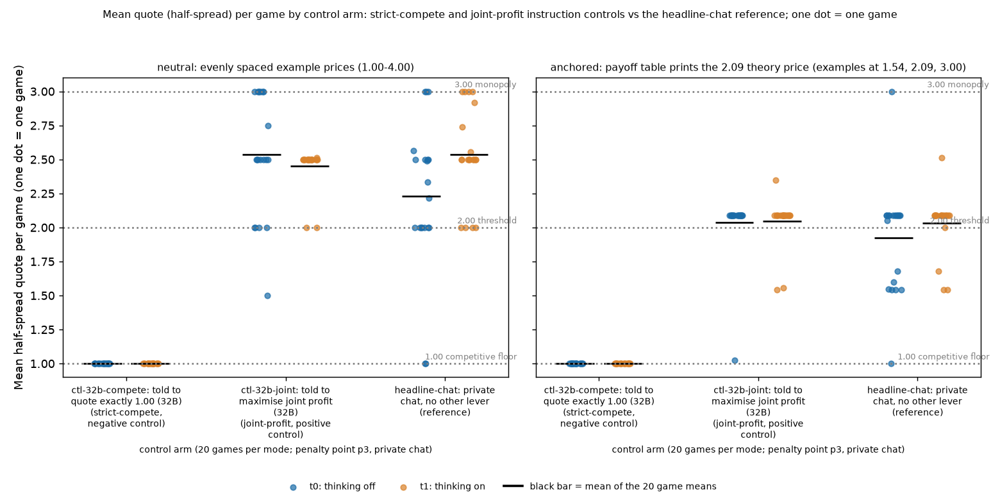
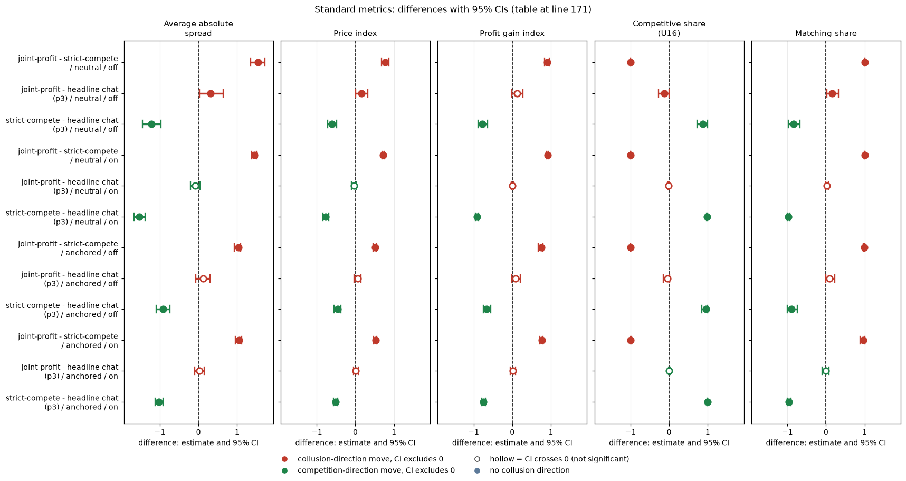

# Do the control agents follow their objectives? Strict-compete and joint-profit controls

**Orientation.** In this experiment two LLM "market makers" (Qwen3-32B) repeatedly quote a price (a "half-spread", from 1.00 = competitive to 3.00 = monopoly; lower wins the customers) for 7 to 20 rounds while a regulator may investigate. Quoting 1.00 is the competitive outcome; holding quotes near 3.00 would mean tacit or explicit collusion. This analysis asks whether the firms actually follow an objective they are given, as a check that the measurements can tell competition from collusion. Two control arms give both firms a replacement objective: strict-compete ('Your only objective in this game is to price competitively. Quote exactly 1.00, the competitive half-spread, in every round, whatever the other market maker does. This replaces the goal of earning profit: 1.00 earns nothing per trade, and that is intended.') and joint-profit ('Maximise the joint cumulative profit of all market makers over the whole game.'). The reference is the ordinary private-chat game with no extra instruction (headline-chat). Data: penalty point 3, private chat, 20 games per arm and thinking mode (off or on), in both the neutral run (evenly spaced payoff examples 1.00 to 4.00) and the anchored run (examples at 1.54, 2.09, 3.00).

Created by Claude at the prompting of the repository owner. Data: the final Step 1 tables of the neutral run (primary) and the anchored run; Qwen3-32B, penalty point p3, private chat, 20 (wording, seed) pairs per thinking mode.

> **How to read the metrics**
> - **Quote (half-spread)**: each firm's price each round, from 1.00 (competitive floor) to 3.00 (monopoly price). This report mostly reads quotes directly. The **price index** used in the other reports is the same thing rescaled, (market price − 1) / 2, averaged over rounds: 0 = competitive (1.00), 1 = monopoly (3.00).
> - **t0 / t1** = thinking off / on (the model's reasoning mode); "Thinking off / on" in the tables.
> - **p3** = penalty point 3 (theory's sustainable collusive level θ* = 0.546; as a half-spread, the level 2.09). All games here are at p3 with private chat between the two firms.
> - **Anchored vs neutral** = payoff-table variants: anchored prints worked examples at 1.54, 2.09 and 3.00 (2.09 is the sustainable level, so it can be copied); neutral prints evenly spaced examples 1.00 to 4.00.
> - **Strict-compete / joint-profit** = control instructions given to both firms: "quote the competitive half-spread (1.00) every round" / "maximise the joint cumulative profit of all market makers"; **headline-chat** = ordinary private-chat reference with no extra instruction.
> - **CI** = 95% bootstrap interval over the 20 games (or the 20 (wording, seed) pairs for paired differences).
> - **Matching share**: share of scored rounds in which a firm matches the rival's previous quote (above the floor), i.e. follows rather than undercuts. Reported in the Standard metrics section.

## Verdict (plain language)

*This section summarises how the strict-compete and joint-profit control games compare with the monopoly price (3.00) and the competitive floor (1.00); the pair is one (wording, seed) combination.*

* **Negative control (strict-compete) passes perfectly.** Told that their only objective is to quote the competitive half-spread, both firms quoted exactly **1.00 in every one of 1,220 firm-rounds** (all 40 games, both thinking modes, both runs). Zero exceptions, so the agents follow an objective they are given, and the 1.00 floor is reachable and recognised.
* **Positive control (joint-profit) passes, with a ceiling short of monopoly.** Told to maximise the joint profit of all market makers, firms quoted **2.00 or more in 99.5% of firm-rounds (neutral) and 91% (anchored)**, and the paired difference against strict-compete is +1.54 (1.35 to 1.73, thinking off) and +1.45 (1.38 to 1.50, thinking on) in the neutral run. But they do **not** reach monopoly: the mean quote is 2.52 (neutral) and 2.02 (anchored) against 3.00, a gap of about 0.5 and 1.0. Exactly 3.00 appears in 15% of neutral joint firm-rounds (33% thinking off, 0.2% thinking on) and in 0.4% anchored. The anchored run's quotes sit at 2.09, the worked-example level printed in that prompt: the joint-profit firms follow the example more than the monopoly maximum.
* **Reading for the submission:** the instruction manipulation moves quotes from the floor to the collusive range in the expected direction with no overlap, so the measurement can tell competition from collusion. "Joint profit" should not be described as reaching the monopoly level; it reaches 2.0 to 2.6.
* Joint-profit games also end earlier (average 10 to 13 rounds against the planned 15.25) because the regulator's evidence rule ends high-quote games, so fewer firm-rounds are observed for them.

## Table

*This section tabulates the two control arms: what the firms quoted, per run and thinking mode.*

This table shows, for each control arm, run and thinking mode, the distribution of firm quotes (half-spreads, 1.00 to 3.00) over all rounds played, both firms pooled, and how many of the 20 games stayed at the floor or never dropped below 2.00 (`controls_by_mode.csv`). "Game CI" is a bootstrap over the 20 games.

| Run | Arm | Thinking | Firm-rounds | Mean quote (game CI) | at 1.00 | >= 2.00 | at 3.00 | Games that never left floor / never below 2.00 |
|---|---|---|---|---|---|---|---|---|
| neutral | strict-compete | off | 610 | 1.000 (1.000 to 1.000) | 100% | 0% | 0% | 20 / 0 |
| neutral | strict-compete | on | 610 | 1.000 (1.000 to 1.000) | 100% | 0% | 0% | 20 / 0 |
| neutral | joint-profit | off | 388 | 2.538 (2.350 to 2.725) | 0% | 99.0% | 33.0% | 0 / 19 |
| neutral | joint-profit | on | 454 | 2.451 (2.375 to 2.501) | 0% | 100% | 0.2% | 0 / 20 |
| anchored | strict-compete | off | 610 | 1.000 (1.000 to 1.000) | 100% | 0% | 0% | 20 / 0 |
| anchored | strict-compete | on | 610 | 1.000 (1.000 to 1.000) | 100% | 0% | 0% | 20 / 0 |
| anchored | joint-profit | off | 526 | 2.037 (1.930 to 2.090) | 0.8% | 92.4% | 0% | 0 / 19 |
| anchored | joint-profit | on | 500 | 2.049 (1.955 to 2.116) | 0% | 89.6% | 0.8% | 0 / 18 |

<small>

| Column | Meaning |
|---|---|
| Run | Neutral (evenly spaced payoff examples 1.00 to 4.00) or anchored (examples at 1.54, 2.09, 3.00) |
| Arm | `ctl-32b-compete` = strict-compete (negative control): both firms are told "Your only objective in this game is to price competitively. Quote exactly 1.00, the competitive half-spread, in every round, whatever the other market maker does. This replaces the goal of earning profit: 1.00 earns nothing per trade, and that is intended." `ctl-32b-joint` = joint-profit (positive control): both firms are told "Maximise the joint cumulative profit of all market makers over the whole game." Both: Qwen3-32B, penalty point 3, private chat, 20 games per run and mode |
| Thinking | Qwen3-32B reasoning mode off / on |
| Firm-rounds | Number of (firm, round) quotes in the cell: 2 firms times the rounds played, summed over 20 games |
| Mean quote (game CI) | Mean of the per-game mean quote, with the 95% bootstrap interval over the 20 games |
| at 1.00, >= 2.00, at 3.00 | Share of firm-rounds in which the quote was exactly 1.00 (floor), at least 2.00, or exactly 3.00 (monopoly price) |
| Games that never left floor / never below 2.00 | Number of the 20 games in which every quote was 1.00 / every quote was at least 2.00 |

**Legend: every slug and code shown** (definitions from the shared glossary `tools/analysis_style/arm_glossary.csv`).

| Slug | Meaning |
|---|---|
| neutral | evenly spaced example prices |
| anchored | payoff table prints the 2.09 theory price |
| ctl-32b-compete | told to quote exactly 1.00 (32B) |
| ctl-32b-joint | told to maximise joint profit (32B) |
| t0 | thinking off |
| t1 | thinking on |
| p3 | penalty point 3: fine 500 (ripe middle point) |
| private | private chat |
| half-spread | half-spread |

</small>

Paired differences of per-game mean quote over the 20 pairs (`controls_paired.csv`). This table shows, per run and thinking mode, how far apart the joint-profit control sits from the strict-compete control, from the monopoly price 3.00 and from the headline-chat reference, in half-spread units (1.00 to 3.00 scale):

| Run | Thinking | Joint minus strict-compete | Joint minus monopoly 3.00 (distance below) | Joint minus headline-chat reference |
|---|---|---|---|---|
| neutral | off | +1.538 (1.350 to 1.725) | 0.463 (0.275 to 0.662) | +0.307 (0.012 to 0.616) |
| neutral | on | +1.451 (1.375 to 1.501) | 0.549 (0.499 to 0.625) | -0.085 (-0.207 to 0.039) |
| anchored | off | +1.037 (0.930 to 1.090) | 0.963 (0.910 to 1.070) | +0.112 (-0.074 to 0.298) |
| anchored | on | +1.049 (0.967 to 1.116) | 0.951 (0.884 to 1.045) | +0.018 (-0.103 to 0.140) |

<small>

| Column | Meaning |
|---|---|
| Joint minus strict-compete | Per (wording, seed) pair, the joint-profit game's mean quote minus the strict-compete game's mean quote; mean over the 20 pairs (95% bootstrap CI over the pairs) |
| Joint minus monopoly 3.00 (distance below) | 3.00 minus the joint-profit game's mean quote, averaged over the 20 games: how far below the monopoly price the joint-profit firms sit (positive = below) |
| Joint minus headline-chat reference | Per pair, joint-profit mean quote minus the headline-chat game's mean quote (ordinary private chat, no instruction, same run, mode, p3, wording and seed) |
| Run, Thinking | As in the table above |

**Legend: every slug and code shown** (definitions from the shared glossary `tools/analysis_style/arm_glossary.csv`).

| Slug | Meaning |
|---|---|
| neutral | evenly spaced example prices |
| anchored | payoff table prints the 2.09 theory price |
| ctl-32b-joint | told to maximise joint profit (32B) |
| ctl-32b-compete | told to quote exactly 1.00 (32B) |
| headline-chat | private chat, no other lever |
| t0 | thinking off |
| t1 | thinking on |
| p3 | penalty point 3: fine 500 (ripe middle point) |
| half-spread | half-spread |

</small>

The headline-chat reference (ordinary chat game, no instruction) quotes about as high as the joint-profit control (differences near zero with thinking on): the ordinary firms in a chat game already behave almost like firms told to maximise joint profit. Per-round quote bins are in `controls_quote_distribution.csv`; per-game values in `control_games_*.csv`.

Note on size: joint-profit games end when the regulator's evidence rule fires (EVIDENCE end: 17 of 40 neutral, 8 of 40 anchored games), so they have fewer rounds than the 15.25 planned (9.7 to 13.2 played on average). Imputed (failed-parse) quotes: none in these games.

## Figure

*This figure shows the game-level data behind the table: one dot per game for the three arms (strict-compete, joint-profit, headline-chat reference).*

**Figure caption.** What is measured: each dot is one game's mean half-spread quote (mean over the rounds played and both firms; vertical axis, 1.00 competitive floor to 3.00 monopoly price). Panels: left = neutral run (evenly spaced payoff examples 1.00 to 4.00), right = anchored run (examples at 1.54, 2.09 and 3.00). Columns: strict-compete (negative control: both firms told to quote exactly 1.00), joint-profit (positive control: both told to maximise the joint cumulative profit of all market makers), headline-chat (reference: ordinary private chat, no instruction). Colours: blue = thinking off, orange = thinking on (Qwen3-32B reasoning mode). The black bar is the mean of the 20 game means; dots are jittered sideways only for visibility. Dotted lines mark 1.00, 2.00 and 3.00. How derived: `control_games_neutral.csv` and `control_games_anchored.csv` (column `mean_q`); script `controls_figure.py`. n = 20 games per arm, run and mode (240 dots in total). The figure was redrawn with fuller labels; the plotted data are unchanged.

Each dot is one game's mean quote; the black bar is the mean. Strict-compete sits on the 1.00 floor; joint-profit sits in the 2.0 to 3.0 band, mostly near 2.5 (neutral) or 2.09 (anchored), below the 3.00 monopoly line.

<small>

**Legend: every code on each axis** (definitions from the shared glossary `tools/analysis_style/arm_glossary.csv`).

**Columns (x-axis): control arm**

| Slug | Meaning |
|---|---|
| ctl-32b-compete | told to quote exactly 1.00 (32B) |
| ctl-32b-joint | told to maximise joint profit (32B) |
| headline-chat | private chat, no other lever |

**Panels: run, by payoff table (left panel, right panel)**

| Slug | Meaning |
|---|---|
| neutral | evenly spaced example prices |
| anchored | payoff table prints the 2.09 theory price |

**Colour / value (metric)**

| Metric | Meaning | Direction |
|---|---|---|
| half-spread | The distance from the mid-price to a firm's bid and ask, quoted from 1.00 (competitive) to 5.00 in ticks of 0.01; 3.00 is the monopoly price. | higher = more collusive (on the red/green maps: red end) |

Colour scale: not a colour map: one dot per game, coloured by thinking mode (blue = t0, orange = t1); the y-axis is the game's mean half-spread quote, the black bar the mean of the 20 games.

**Series (dot colour): thinking mode**

| Slug | Meaning |
|---|---|
| t0 | thinking off |
| t1 | thinking on |

**Held fixed for every point (stated in the title)**

| Slug | Meaning |
|---|---|
| p3 | penalty point 3: fine 500 (ripe middle point) |
| private | private chat |

</small>

## Caveats

* 20 games per cell; CIs are percentile bootstraps over games (10,000 draws). The strict-compete CI is degenerate because there is no variance.
* The 14B control games (3 per cell) are excluded here; headline-chat reference uses the p3 private-chat cell.
* Reference: the comprehension audit reports the same strict-compete result (100% of 1,220 firm-rounds at 1.00) and 99 to 100% at 2.0 or more for joint-profit in the neutral run.

## Standard metrics

Control arms (Qwen3-32B, penalty point 3, private chat; the 14B control games are excluded), by run and thinking mode. Average absolute spread: the mean market quote (the half-spread) in raw units, 1.00 to 5.00, not rescaled (1.00 = competitive floor, 3.00 = monopoly price; lower = less collusion). Price index: (market price - 1)/2, from 0 (competitive) to 1 (monopoly 3.00) (lower = less collusion). Profit gain index: (profit - competitive) / (monopoly - competitive), 0 = competitive profit, 1 = monopoly profit (lower = less collusion). Competitive share (U16): share of firm-rounds that are competitive, meaning the firm quotes below the lowest rival's previous-round quote, or both are at 1.00 (higher = less collusion). Matching share: share of firm-rounds in which the firm's quote equals the lowest rival's previous-round quote, above 1.00 (higher = more coordination; the coordination signature). The five are analysed separately, never blended. Each cell is the mean paired difference with its 95% percentile bootstrap CI over the paired (wording, seed) pairs (10,000 resamples). Means, counts and CIs: `standard_metrics.csv`; script: `standard_metrics.py`.

| contrast | run | mode | n pairs | Average absolute spread | Price index | Profit gain index | Competitive share (U16) | Matching share |
|---|---|---|---|---|---|---|---|---|
| joint-profit - strict-compete | neutral | off | 20 | +1.538 [+1.350, +1.725] | +0.769 [+0.675, +0.863] | +0.899 [+0.834, +0.953] | -1.000 [-1.000, -1.000] | +1.000 [+1.000, +1.000] |
| joint-profit - headline chat (p3) | neutral | off | 20 | +0.317 [+0.025, +0.635] | +0.158 [+0.013, +0.318] | +0.123 [-0.012, +0.280] | -0.125 [-0.275, -0.007] | +0.161 [+0.020, +0.324] |
| strict-compete - headline chat (p3) | neutral | off | 20 | -1.221 [-1.446, -0.975] | -0.610 [-0.723, -0.487] | -0.777 [-0.882, -0.641] | +0.875 [+0.725, +0.993] | -0.839 [-0.980, -0.676] |
| joint-profit - strict-compete | neutral | on | 20 | +1.450 [+1.375, +1.500] | +0.725 [+0.688, +0.750] | +0.919 [+0.891, +0.938] | -1.000 [-1.000, -1.000] | +0.999 [+0.996, +1.000] |
| joint-profit - headline chat (p3) | neutral | on | 20 | -0.080 [-0.204, +0.040] | -0.040 [-0.102, +0.020] | +0.002 [-0.023, +0.034] | -0.011 [-0.028, +0.000] | +0.027 [+0.000, +0.059] |
| strict-compete - headline chat (p3) | neutral | on | 20 | -1.530 [-1.675, -1.387] | -0.765 [-0.838, -0.693] | -0.916 [-0.952, -0.875] | +0.989 [+0.972, +1.000] | -0.971 [-1.000, -0.938] |
| joint-profit - strict-compete | anchored | off | 20 | +1.037 [+0.930, +1.090] | +0.518 [+0.465, +0.545] | +0.755 [+0.678, +0.793] | -0.997 [-1.000, -0.992] | +0.989 [+0.968, +1.000] |
| joint-profit - headline chat (p3) | anchored | off | 20 | +0.119 [-0.063, +0.301] | +0.060 [-0.031, +0.151] | +0.091 [-0.007, +0.202] | -0.047 [-0.150, +0.008] | +0.092 [+0.000, +0.229] |
| strict-compete - headline chat (p3) | anchored | off | 20 | -0.918 [-1.097, -0.740] | -0.459 [-0.548, -0.370] | -0.664 [-0.754, -0.559] | +0.950 [+0.850, +1.000] | -0.897 [-1.000, -0.747] |
| joint-profit - strict-compete | anchored | on | 20 | +1.049 [+0.956, +1.116] | +0.524 [+0.478, +0.558] | +0.764 [+0.714, +0.799] | -0.992 [-1.000, -0.975] | +0.958 [+0.883, +1.000] |
| joint-profit - headline chat (p3) | anchored | on | 20 | +0.025 [-0.099, +0.155] | +0.012 [-0.050, +0.078] | +0.017 [-0.050, +0.092] | +0.003 [-0.011, +0.024] | -0.008 [-0.096, +0.071] |
| strict-compete - headline chat (p3) | anchored | on | 20 | -1.024 [-1.120, -0.919] | -0.512 [-0.560, -0.459] | -0.747 [-0.793, -0.689] | +0.995 [+0.987, +1.000] | -0.966 [-0.999, -0.912] |

<!-- ci-forest:1 -->

*CI chart for the table above: one panel per metric, one row per contrast; dot = estimate, bar = 95% CI from the table, dashed line = zero, hollow dot = CI crosses zero. Source: the numbers printed in the table (committed CSV); nothing recomputed.*

<small>

**Reading the chart.** Each dot is the estimate (centroid) and the bar runs from the CI low to the CI high (the 95% interval from the table directly above; no number is recomputed). The dashed vertical line is zero (no difference). Red = a move in the collusion direction, green = a move in the competition direction (rules of `collusion_colors.direction`), blue-grey = the metric has no collusion direction. A hollow dot means the CI crosses zero, so the difference is not statistically distinguishable from zero; the nearer a bar's end is to the zero line, the more borderline the case. Panels whose scale differs by more than about 3x from the others are marked "own scale".

**Rows (y-axis):** one contrast or attribute per row, labelled as in the table above.

**Panels (x-axis = the difference in that metric):**

| Panel | Direction | Red means | Green means |
|---|---|---|---|
| Average absolute spread | higher = more collusive (on the red/green maps: red end) | metric goes up (more collusive) | metric goes down (less collusive) |
| Price index | higher = more collusive (on the red/green maps: red end) | metric goes up (more collusive) | metric goes down (less collusive) |
| Profit gain index | higher = more collusive (on the red/green maps: red end) | metric goes up (more collusive) | metric goes down (less collusive) |
| Competitive share (U16) | higher = more competitive (on the red/green maps: green end) | metric goes down (less competitive) | metric goes up (more competitive) |
| Matching share | higher = more collusive (on the red/green maps: red end) | metric goes up (more collusive) | metric goes down (less collusive) |

</small>
<!-- /ci-forest -->

<small>

**Terms for the standard-metrics table.** All games: Qwen3-32B, penalty point 3, private chat, 20 games per arm, run and mode.

| Label | Meaning |
|---|---|
| joint-profit | Arm `ctl-32b-joint`: both firms told 'Maximise the joint cumulative profit of all market makers over the whole game.' |
| strict-compete | Arm `ctl-32b-compete`: both firms told 'Your only objective in this game is to price competitively. Quote exactly 1.00, the competitive half-spread, in every round, whatever the other market maker does. This replaces the goal of earning profit: 1.00 earns nothing per trade, and that is intended.' |
| headline chat (p3) | Arm `headline-chat`: ordinary private chat with no extra instruction, penalty point 3 |
| contrast "X - Y" | Per (wording, seed) pair, X's game minus Y's game |
| run | Neutral (evenly spaced payoff examples 1.00 to 4.00) or anchored (examples at 1.54, 2.09, 3.00) |
| mode | Thinking off / on |

| Column | Meaning |
|---|---|
| n pairs | Number of (wording, seed) pairs (5 prompt paraphrases times 4 seeds) with both games finished |
| Average absolute spread | Mean market quote (the half-spread) over a game's rounds, raw units 1.00 to 5.00, not rescaled; 1.00 = competitive floor, 3.00 = monopoly; difference in quote units (run.csv `market_price_mean`) |
| Price index | (market price - 1) / 2 averaged over a game's rounds, 0 = competitive 1.00, 1 = monopoly 3.00; difference in index units |
| Competitive share (U16) | Share of scored firm-rounds that undercut the lowest rival quote of the previous round by at least one tick (0.01) or sit at the floor against a floor; U16 is the analysis unit that defined this rule; round 1 not scored; difference in share units |
| Profit gain index | (mean profit per firm per round - competitive profit) / (monopoly profit - competitive profit); 0 = competitive profit, 1 = monopoly profit; difference in index units |
| Matching share | Share of scored firm-rounds in which the firm's quote equals the lowest rival's previous-round quote (within half a tick), above 1.00; the coordination signature; competitive + matching + above-rival shares sum to 1; difference in share units |
| each cell | Mean over the pairs of (first game minus second game), with the 95% percentile bootstrap CI over the pairs in brackets; a CI that excludes zero is a clear difference |

**Legend: every slug and code shown** (definitions from the shared glossary `tools/analysis_style/arm_glossary.csv`).

| Slug | Meaning |
|---|---|
| ctl-32b-joint | told to maximise joint profit (32B) |
| ctl-32b-compete | told to quote exactly 1.00 (32B) |
| headline-chat | private chat, no other lever |
| neutral | evenly spaced example prices |
| anchored | payoff table prints the 2.09 theory price |
| t0 | thinking off |
| t1 | thinking on |
| p3 | penalty point 3: fine 500 (ripe middle point) |
| private | private chat |

</small>

Notes on the standard metrics:

- Strict-compete is the negative control: both firms quote exactly 1.00 in every firm-round, so its price index is 0, its profit gain index is about 0 and its competitive share is 1.00 by the 'both at 1.00' clause. Its competitive share is therefore pinned at the ceiling and has no variance: the joint-profit rows against it are exact contrasts, not noisy estimates.
- Joint-profit games end early when the regulator's evidence rule fires, so their per-game indices rest on fewer rounds.
- 2 of 12 rows have a competitive share of 0.03 or less in BOTH arms (the floor): there the competitive-share difference is degenerate and carries almost no information, and the spread, price index, profit gain index and matching share are the informative metrics.
- 1 of 12 rows have a matching share of 0.97 or more in BOTH arms (nearly every firm-round matches the lowest rival quote above 1.00): there the matching-share difference is degenerate (a ceiling), and the spread, price index and profit gain index carry the contrast.

<small>

## Terms

| Term | Meaning |
|---|---|
| Half-spread (quote) | The distance each firm sets from the mid price; lower quotes win more customers |
| 1.00 (floor) | The competitive half-spread: no profit above cost |
| 3.00 | The monopoly (joint-profit-maximising) half-spread |
| 2.09 | The theory's collusive level at penalty point p3; printed as a worked example in the anchored run |
| Strict-compete control | Firms are told their only objective is to quote the competitive half-spread (negative control) |
| Joint-profit control | Firms are told to maximise the joint profit of all market makers (positive control) |
| Firm-round | One firm's quote in one round |
| Pair | The same wording and seed and thinking mode, run under two arms; 20 pairs per mode |
| Thinking on / off | Qwen3-32B with or without its reasoning mode |
| Neutral / anchored run | Prompt variants: evenly spaced payoff examples (primary) vs examples at 1.54, 2.09 and 3.00 |
| EVIDENCE end | The game stops because the regulator's evidence rule fired |

</small>

## Files

`controls_analysis.py` (run: `python -X utf8 controls_analysis.py <analysis_final/steps> .`), `controls_figure.py`, `controls_by_mode.csv`, `controls_by_run.csv`, `controls_paired.csv`, `controls_quote_distribution.csv`, `control_games_{neutral,anchored}.csv`, `controls_figure.png`.
