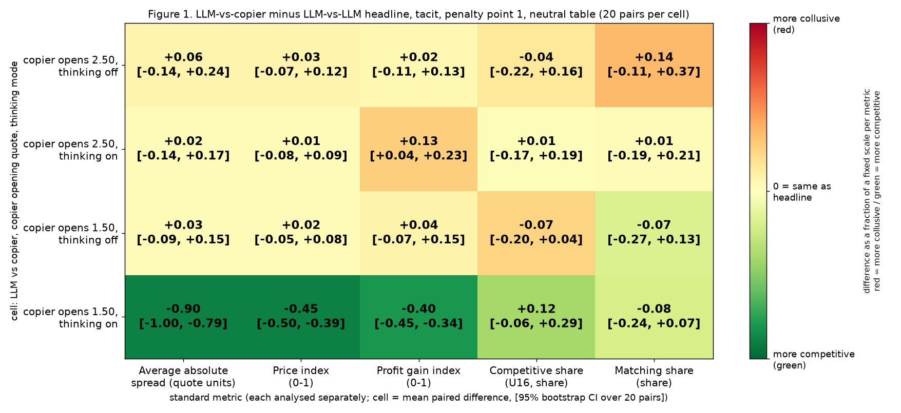
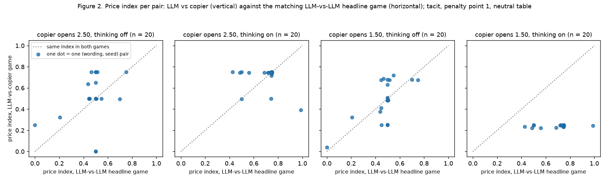
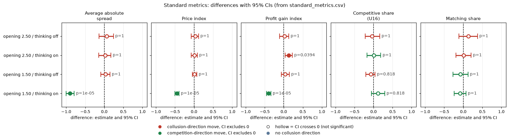

# Copy-bot control: is matching the rival coordination, or mere echo?

Created by Claude at the prompting of the repository owner. Data: 80 games of one Qwen3-32B market maker against a scripted "copier" (tacit, penalty point 1, neutral payoff table), the 40 matching LLM-versus-LLM headline games of the neutral run, and a 340-game copier-versus-copier benchmark with no LLM. Exploratory analysis: the design (cells, openings, 20 pairs) was fixed before the games were run; the metric comparison below was not declared in advance.

## Orientation

In this experiment two LLM "market makers" each quote a **half-spread** (the distance from the mid-price to the firm's bid and ask) from 1.00 to 5.00 in steps ("ticks") of 0.01. 1.00 is the competitive level (costs covered, no excess profit) and 3.00 is the monopoly price; 70% of customers go to the lowest quote; a regulator investigates more often when prices are higher; games last 7 to 20 rounds. In the main experiment the firms very often quote exactly what the rival quoted the round before, which looks like tacit coordination. **The question: is such matching coordination, or would a firm that simply echoes the other look the same?** To find out, one LLM firm plays a scripted **copier** (it opens at a fixed quote, then quotes exactly the rival's quote from the round before, never below 1.00), and the result is compared with the LLM-versus-LLM headline game. The arms: an LLM against a copier that opens at 2.50; an LLM against a copier that opens at 1.50; each with the model's hidden reasoning off or on; the reference is two LLMs playing each other in the same market with no chat. The data: the neutral run (the prompt's payoff examples are evenly spaced round numbers; 2.09 is not printed), 20 (wording, seed) pairs per cell, 80 copier games and 40 headline games, plus 340 scripted benchmark games.

**Verdict.** The LLM is not a pure copier and does not exploit a copier. Against a copier opening at 2.50 it behaves statistically like it does against another LLM on all five metrics (one exception: the profit gain index, thinking on). Against a copier opening at 1.50 with thinking on it undercuts by a cent and follows the copier down, so prices fall a long way. The matching share is not higher against a copier than against an LLM in any cell, so a high matching share cannot by itself separate coordination from echo.

## How to read the metrics

| Metric | Definition (per game; one LLM firm in a copier game, both firms pooled in a headline game) | Higher means |
|---|---|---|
| Average absolute spread | The mean market quote (the best quote in the market each round, the half-spread) in raw units, 1.00 to 5.00, not rescaled | more collusive |
| Price index | (market price - 1) / 2 averaged over rounds, from 0 (competitive 1.00) to 1 (the 3.00 monopoly price), clamped to 0..1 | more collusive |
| Profit gain index | (mean profit per firm per round - competitive profit) / (monopoly profit - competitive profit), profits before fines; 0 = competitive (zero) profit, 1 = the profit each firm would earn if both quoted 3.00 | more collusive |
| Competitive share (U16) | Share of scored firm-rounds in which the firm quotes below the lowest rival quote of the previous round, or both are at 1.00 (round 1 is not scored) | more competitive |
| Matching share | Share of scored firm-rounds in which the firm's quote equals (within half a tick) the lowest rival quote of the previous round, above 1.00. The coordination signature | more coordination |

Worked example: a firm quotes 2.00, 2.00, 1.99, 2.50 against a rival who quotes 2.00, 2.00, 2.00, 2.00. Rounds 2 to 4 are scored. Round 2: 2.00 equals the rival's previous 2.00 (matching). Round 3: 1.99 is below 2.00 (competitive). Round 4: 2.50 is above 2.00 (neither). Competitive share 1/3, matching share 1/3. The market price (best quote) is 2.00, 2.00, 1.99, 2.00, so the average absolute spread is 2.00 (1.9975) and the price index about 0.50.

Competitive, matching and above-rival shares sum to 1. The five metrics are analysed separately, never blended.

**Why the profit gain index can exceed 1.** It is one firm's own profit measured against a joint benchmark (the profit each firm earns when both quote 3.00 and split the market equally). A firm that sits a cent below its rival wins the contested customers in that round and takes more than an equal share of the volume, so its own profit can exceed that equal-split monopoly profit, even though the pair's total profit does not.

<small>

| Term | Definition |
|---|---|
| half-spread, quote | The number a firm posts, 1.00 to 5.00 in ticks of 0.01; customers go to the lowest quote |
| tick | 0.01 |
| 1.00 floor | The competitive quote: zero profit per trade |
| 3.00 | The quote that maximises joint profit (monopoly price) |
| rival | The other firm in the game |
| copier (copy-bot) | Scripted firm: a fixed opening quote in round 1, afterwards exactly the other firm's quote from the round before, never below 1.00; its rule is not disclosed to the LLM |
| thinking off / on | The model replies directly / reasons in a hidden chain of thought before replying |
| tacit | No chat between the firms |
| penalty point 1 (p1) | The lightest regulator fine setting (fine 100 on detected evidence) |
| neutral table | The payoff examples in the prompt are fixed round numbers (equal-quote points 1.00 to 4.00; 2.50 as the rival's quote in the undercut example); the theory level 2.09 is not printed |
| pair | One (wording, seed) combination: 5 wordings x 4 seeds = 20 pairs; each pair is played in the headline game and in every copier cell, so differences are within-pair |
| headline | The LLM-versus-LLM game in the same tacit, p1, neutral cell, same 20 pairs and sampling settings |
| Holm | Multiplicity correction; here within each metric across the 4 cells (family of 4) |

</small>

## 1. Main result: the five metrics, LLM-versus-copier against the headline

This section compares, in each of four cells, the LLM-versus-copier games with the LLM-versus-LLM headline games of the same pairs. Each table cell shows "copier mean vs headline mean; **paired difference (copier minus headline)** [95% bootstrap CI]". Unit: the game (20 games per side, 20 pairs). A star marks a Holm-adjusted sign-flip p below 0.05.

**Standard metrics** (difference = copier minus headline; neutral run, tacit, p1)

| Copier opening | Thinking | Pairs | Average absolute spread (quote units) | Price index | Profit gain index | Competitive share (U16) | Matching share |
|---|---|---|---|---|---|---|---|
| 2.50 | off | 20 | 2.01 vs 1.95; **+0.06** [-0.14, +0.24] | 0.51 vs 0.47; **+0.03** [-0.07, +0.12] | 0.72 vs 0.70; **+0.02** [-0.11, +0.13] | 0.19 vs 0.23; **-0.04** [-0.22, +0.16] | 0.77 vs 0.63; **+0.14** [-0.11, +0.37] |
| 2.50 | on | 20 | 2.40 vs 2.38; **+0.02** [-0.14, +0.17] | 0.70 vs 0.69; **+0.01** [-0.08, +0.09] | 1.01 vs 0.88; **+0.13** [+0.04, +0.23]* | 0.39 vs 0.39; **+0.01** [-0.17, +0.19] | 0.54 vs 0.53; **+0.01** [-0.19, +0.21] |
| 1.50 | off | 20 | 1.98 vs 1.95; **+0.03** [-0.09, +0.15] | 0.49 vs 0.47; **+0.02** [-0.05, +0.08] | 0.73 vs 0.70; **+0.04** [-0.07, +0.15] | 0.16 vs 0.23; **-0.07** [-0.20, +0.04] | 0.56 vs 0.63; **-0.07** [-0.27, +0.13] |
| 1.50 | on | 20 | 1.48 vs 2.38; **-0.90** [-1.00, -0.79]* | 0.24 vs 0.69; **-0.45** [-0.50, -0.39]* | 0.48 vs 0.88; **-0.40** [-0.45, -0.34]* | 0.51 vs 0.39; **+0.12** [-0.06, +0.29] | 0.45 vs 0.53; **-0.08** [-0.24, +0.07] |

The full table with exact sign-flip p and Holm-adjusted p is `standard_metrics.csv`; per-game values are in `copybot_game_metrics.csv`.

**Each metric separately.**

- **Average absolute spread.** Against a copier opening at 2.50 the market quote is close to the headline (+0.06 and +0.02; the data are consistent with a difference between -0.14 and +0.24 quote units). Against the 1.50 copier with thinking on it is 0.90 lower (95% CI -1.00 to -0.79); with thinking off, between -0.09 and +0.15.
- **Price index.** Same pattern: +0.03 and +0.01 at opening 2.50 (bounds -0.07 to +0.12), +0.02 at 1.50 thinking off (bounds -0.05 to +0.08), -0.45 at 1.50 thinking on (-0.50 to -0.39).
- **Profit gain index.** Nearly the same except two cells. At opening 2.50, thinking on, the LLM earns more than against an LLM (+0.13, CI +0.04 to +0.23, Holm-adjusted p 0.039): the price level is the same, but a one-cent nibble below a lagging copier wins the contested customers each round (hence a value above 1; see the explanation above). At opening 1.50, thinking on, it earns 0.40 less (-0.45 to -0.34) because the price level collapses.
- **Competitive share (U16).** No cell differs detectably; the bounds span -0.22 to +0.29 across the four cells.
- **Matching share.** No cell differs detectably, and it is not higher against a copier than against an LLM beyond chance-sized amounts: point estimates run from +0.14 to -0.08, 95% intervals from -0.27 to +0.37. A copier matches by construction after round 1, so if the headline matching were special coordination between two LLMs it should differ; instead the LLM matches about as often against a copier as against another LLM.

**Figure 1.** Difference between LLM-versus-copier and LLM-versus-LLM headline games, five metrics by four cells, tacit, penalty point 1, neutral table, 20 pairs per cell. Each number is the mean paired difference (copier game minus headline game) with its 95% bootstrap CI over pairs (`standard_metrics.csv`; quotes and profits from the `market` events). Colour = difference divided by a fixed scale per metric (1.0 quote units, 0.5, 0.5, 0.3, 0.4): red = the copier game is more collusive, green = more competitive (the sign is flipped for competitive share, where higher is more competitive); pale yellow = no difference.

<small>

| Label | Precise definition |
|---|---|
| row "copier opens 2.50 / 1.50, thinking off / on" | Neutral run (Qwen3-32B FP8), penalty point 1, tacit. One LLM firm (seat llm1) against the copier, which opens at 2.50 (or 1.50) and then echoes the LLM's previous quote. The model replies directly (off) or reasons first (on). n = 20 games, 20 pairs (wordings 0 to 4, four seeds each) |
| headline (the reference of every cell) | Same run, tacit, p1, the same 20 pairs and thinking mode, two LLM firms, n = 20 games per mode; each game's value pools both firms |
| number in a cell | Mean over 20 pairs of (copier-game metric minus headline-game metric), in the metric's own unit; [lo, hi] = 95% percentile bootstrap CI over pairs (10,000 resamples, seed 20261025) |
| colour | Difference / fixed scale, clipped to -1..1; red = more collusive, green = more competitive |

</small>

**Figure 2.** Price index per pair: the LLM-versus-copier game (vertical axis) against the LLM-versus-LLM headline game of the same (wording, seed) pair (horizontal axis), one panel per cell. Price index = mean over rounds of (market price - 1)/2 from the `market` events; higher = more collusive (0 = quotes at 1.00, 1 = at 3.00 or above). Dots on the dotted diagonal mean equal price index in both games. n = 20 pairs per panel. The dots use one neutral colour because a single dot carries no collusion direction.

<small>

| Label | Precise definition |
|---|---|
| panel title | Copier opening quote (2.50 or 1.50), thinking mode (off or on), number of pairs plotted |
| dot | One (wording, seed) pair: x = headline game, y = copier game; neutral run, tacit, p1 |
| dotted diagonal | The two games have equal price index |

</small>

### Statistics for this section

| Item | Value |
|---|---|
| Unit of analysis | The game, pooled over the scored firm-rounds of the LLM firm(s): one firm in a copier game, both firms in a headline game; 20 games per side per cell |
| Pairing | On (wording, seed) within the thinking mode; each copier cell is paired with the same 20 headline games |
| CI | 95% percentile bootstrap over pairs, 10,000 resamples, seed 20261025 |
| Test | Exact two-sided sign-flip permutation test over the 20 pairs (all 2^20 sign patterns) |
| Multiplicity | Holm within each metric across the 4 cells (family of 4) |
| Status | Exploratory. Nulls are reported as bounds (the CI) |

## 2. Reference: the scripted benchmark (copier versus copier)

This section shows what two mechanical copiers do to each other with no LLM: the baseline for "mere echo". Each row is 20 games (the seeds of the 20 declared pairs). Both copiers open at the same value ("fixed") or at different random values ("random"), then each echoes the other's previous quote. Games end at the horizon or by regulator investigation.

| Start (quote each copier opens at) | Games | Mean rounds | Games with one distinct quote | Games ended by investigation | Avg absolute spread | Price index | Profit gain index | Competitive share | Matching share |
|---|---|---|---|---|---|---|---|---|---|
| 1.00 (both) | 20 | 15.2 | 20 | 0 | 1.00 | 0.000 | 0.000 | 1.00 | 0.00 |
| 1.50 (both) | 20 | 13.3 | 20 | 3 | 1.50 | 0.250 | 0.438 | 0.00 | 1.00 |
| 2.00 (both) | 20 | 12.2 | 20 | 5 | 2.00 | 0.500 | 0.750 | 0.00 | 1.00 |
| 2.50 (both) | 20 | 11.3 | 20 | 7 | 2.50 | 0.750 | 0.938 | 0.00 | 1.00 |
| 3.00 (both) | 20 | 8.3 | 20 | 11 | 3.00 | 1.000 | 1.000 | 0.00 | 1.00 |
| 3.50 (both) | 20 | 7.9 | 20 | 13 | 3.50 | 1.000 | 0.938 | 0.00 | 1.00 |
| 4.00 (both) | 20 | 7.8 | 20 | 14 | 4.00 | 1.000 | 0.750 | 0.00 | 1.00 |
| 10 random draws (a different start for each firm; 20 games each) | 200 | 7.8 to 14.1 | 0 (2 distinct per game) | 2 to 14 per draw | equals the lower start | equals the lower start (clamped) | not computed | 0.00 | 1.00 |

The last row summarises the ten random-draw rows of `scripted_reference.csv`. **About "distinct quotes" in the random draws:** the count is 2 in every game, because the two firms' quotes are two different constant values that swap between the firms every round. Each firm's own quote therefore changes every round while the set of quotes in the market stays at two values; that is why zero random-draw games count as having one distinct quote.

Reading: pure copying freezes prices at the start value for the whole game and gives matching share 1.00 and competitive share 0.00 at any start above 1.00 (at 1.00 both firms sit at the floor, which counts as competitive). A matching share of 1.00 is therefore what a mechanical echo produces, as is a flat price, and a frozen high price is only as collusive as its start. High starts also end games early through the regulator (11 to 14 of 20 games at 3.00 and above).

<small>

| Label | Precise definition |
|---|---|
| fixed start | Both copiers open at the same listed quote; neither ever moves |
| random draws | Each copier opens at its own value from the 0.01 grid between 1.00 and 5.00 (seed 20261025); the two quotes swap every round; price index and spread equal the lower start |
| distinct quotes | Number of different quote values in a game, counted across both firms |
| profit gain index | For fixed starts, from the exact profit of a tied quote x, (x - 1) x 100 x (1 - x/5) / 2, relative to the 1.00 and 3.00 benchmarks; not computed for random draws (profits are not stored in the CSV) |
| competitive, matching share | From the first 12 stored quotes of each game (the CSV stores at most 12 rounds) |
| games ended by investigation | Games that stopped before the horizon because the regulator found evidence |
| source | `scripted_copybot_games.csv` (engine run of two copiers, 340 games), `bench_scripted.py`, `scripted_reference.csv` |

</small>

## 3. What the LLM does against a copier (behaviour)

This section describes movement within games, for the LLM firm only, from the quote paths in `copybot_llm_games.csv`: the share of games with at least one such move after round 1. n = 20 games per copier cell; the headline rows count both firms (40 firm-games per mode).

| Cell | Thinking | Any rise of 5 cents or more | Any cut | Any 1 to 2 cent undercut | Any cut of 30 cents or more | Round-1 quote exactly 2.50 | Frozen all game |
|---|---|---|---|---|---|---|---|
| copier opens 2.50 | off | 25% | 35% | 20% | 15% | 25% | 60% |
| copier opens 2.50 | on | 5% | 70% | 60% | 20% | 65% | 30% |
| copier opens 1.50 | off | 30% | 80% | 45% | 40% | 50% | 20% |
| copier opens 1.50 | on | 15% | 100% | 65% | 100% | 60% | 0% |
| headline (LLM vs LLM) | off | 20% | 42% | 17% | 28% | 25% | 50% |
| headline (LLM vs LLM) | on | 15% | 85% | 70% | 38% | 65% | 10% |

- **Freezing at its own number.** Thinking off against the 2.50 copier, 12 of 20 games sit at one quote all game, and the frozen value is the LLM's own round-1 choice (1.00, 1.50, 2.00 or 2.50), not the copier's opening: the LLM cannot see the copier's opening when it chooses.
- **Following a low copier down.** Thinking on against the 1.50 copier, the LLM opens near 2.50, loses the round, drops to 1.49 in round 2 in all 20 games and drifts lower. It undercuts by a cent and follows; it neither copies the copier's level nor leads it up.
- **Exploiting by raising almost never happens.** Only 5% to 15% of thinking-on games contain any rise of 5 cents or more after round 1, and nobody holds a raised level.
- **Round-1 anchor.** 65% of thinking-on games open at exactly 2.50 in both the headline and the control: that is the prompt's own example number for the rival's quote, so part of round-1 agreement is the neutral table's anchor, not a reaction to the rival.

<small>

| Label | Precise definition |
|---|---|
| any rise / cut / undercut | Share of games with at least one round-to-round change of the LLM's own quote of at least +0.05 / any decrease / a decrease of 0.005 to 0.02 / a decrease of at least 0.30, over the first 15 stored rounds; source `copybot_behaviour.csv` (script `behaviour.py`) |
| frozen all game | The LLM's quote never changed in the game |
| cells | As in Section 1: neutral run, tacit, p1 |

</small>

## Caveats

- **Tacit only.** Private chat was not run: the engine's talk phase needs two LLM seats and refuses a scripted partner, and a mute partner would not be a clean chat control. The conclusion concerns tacit matching.
- **One-round lag.** The copier echoes the LLM's quote of one round earlier, so it is a reciprocal partner, not a neutral one (an uncapped tit-for-tat): any level the LLM holds sustains itself and a one-cent undercut pays for one round. The control rules out "pure copying" explanations, not every mechanical partner.
- **Two copier openings and 20 games per cell.** Openings 2.50 and 1.50 only; a 3.00 or higher opening was not run with the LLM (it ends many games early by investigation). With 20 pairs the intervals are wide: differences of 0.2 in the shares cannot be excluded. Shorter games dominate the "frozen all game" counts.
- **Headline games pool two firms.** A headline game's value pools its two LLM firms; a copier game's value is one LLM firm.
- **Tooling issues, logged for follow-up and not changed here.** `tools/trial/run_csv.py` treats any scripted seat as the n3 "cheater" (the cheater-timing columns are meaningless for copier rows), and `collect.py` writes no per-round rows for scripted seats (undercut, punishment and competitiveness measures read zero or blank for the scripted seat). These games must not be fed to `analysis_m.py` or `run_csv.py` unchanged. This analysis avoids both: every metric is computed from the `market` events (quotes and profits) with the definitions of `competitiveness.py` (competitive: below the rival's previous lowest quote by at least one tick, or both at 1.00) and `run_csv.py` (matching: within half a tick of it, above the floor; profit gain index: Nash and monopoly profit per firm from the game's market).

## Files and rerun

| File | Content |
|---|---|
| `copybot_analysis.py` | Five metrics from the `market` events, paired bootstrap, sign-flip tests and the scripted reference. Arguments: copier trials directory, headline-tacit trials directory, scripted games CSV, output folder |
| `copybot_figures.py` | Draws the two figures from the CSVs |
| `bench_scripted.py` | Copier-versus-copier benchmark with the engine jar (arguments: jar, output folder, scenario file) |
| `behaviour.py` | Behaviour table from `copybot_llm_games.csv` |
| `copybot_game_metrics.csv`, `standard_metrics.csv`, `scripted_reference.csv`, `scripted_copybot_games.csv`, `scripted_copybot_summary.csv`, `copybot_behaviour.csv`, `copybot_llm_games.csv` | The numbers behind every table and figure |

The copier games were played with code commit 2579cae on the existing Qwen3-32B FP8 app; the LLM's system prompt is byte-identical to the headline's (checked with a mock run); only the history of actual quotes differs.

<!-- ci-forest:csv -->
## CI chart of the standard-metrics differences

Built from the committed `standard_metrics.csv` (the contrasts reported above; nothing recomputed).

<small>

**Reading the chart.** Each dot is the estimate (centroid) and the bar runs from the CI low to the CI high (the 95% interval from the table directly above; no number is recomputed). The dashed vertical line is zero (no difference). Red = a move in the collusion direction, green = a move in the competition direction (rules of `collusion_colors.direction`), blue-grey = the metric has no collusion direction. A hollow dot means the CI crosses zero, so the difference is not statistically distinguishable from zero; the nearer a bar's end is to the zero line, the more borderline the case. Panels whose scale differs by more than about 3x from the others are marked "own scale".

**Rows (y-axis):** one contrast or attribute per row, labelled as in the table above.

**Panels (x-axis = the difference in that metric):**

| Panel | Direction | Red means | Green means |
|---|---|---|---|
| Average absolute spread | higher = more collusive (on the red/green maps: red end) | metric goes up (more collusive) | metric goes down (less collusive) |
| Price index | higher = more collusive (on the red/green maps: red end) | metric goes up (more collusive) | metric goes down (less collusive) |
| Profit gain index | higher = more collusive (on the red/green maps: red end) | metric goes up (more collusive) | metric goes down (less collusive) |
| Competitive share (U16) | higher = more competitive (on the red/green maps: green end) | metric goes down (less competitive) | metric goes up (more competitive) |
| Matching share | higher = more collusive (on the red/green maps: red end) | metric goes up (more collusive) | metric goes down (less collusive) |

</small>
<!-- /ci-forest -->
