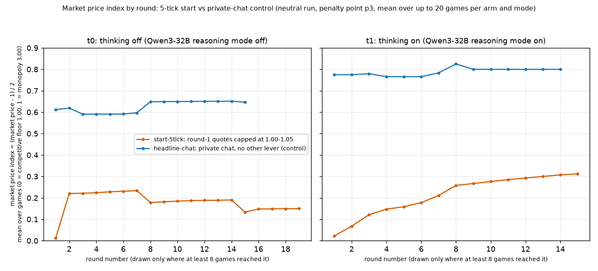
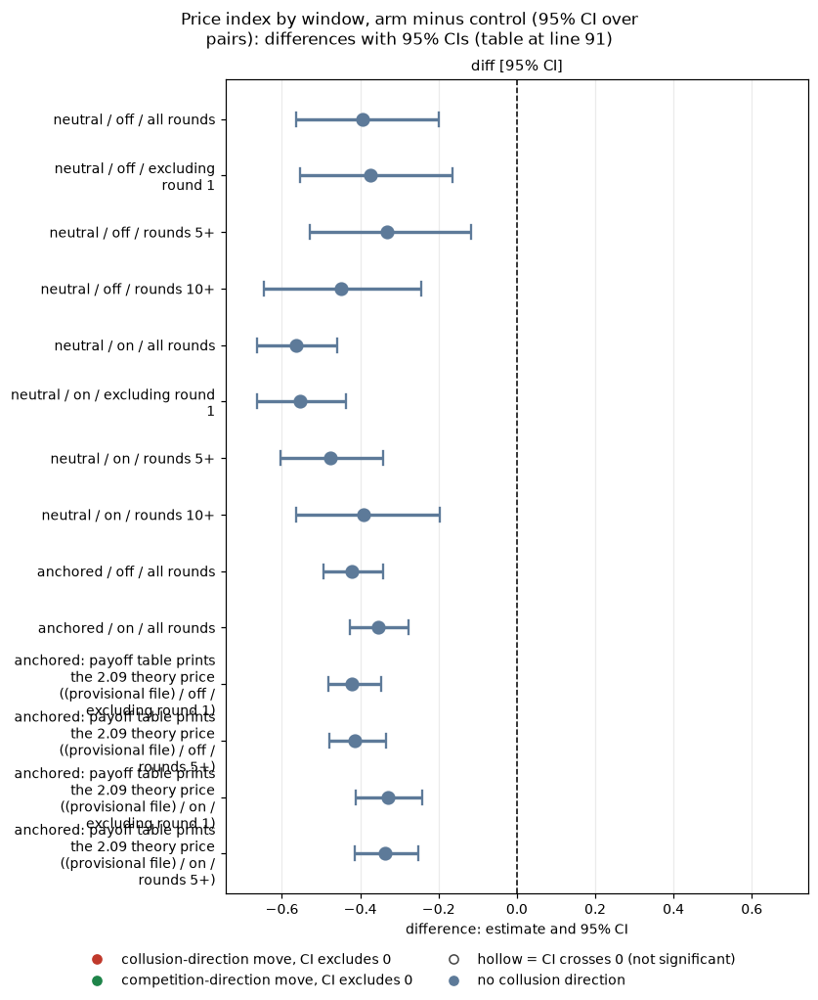
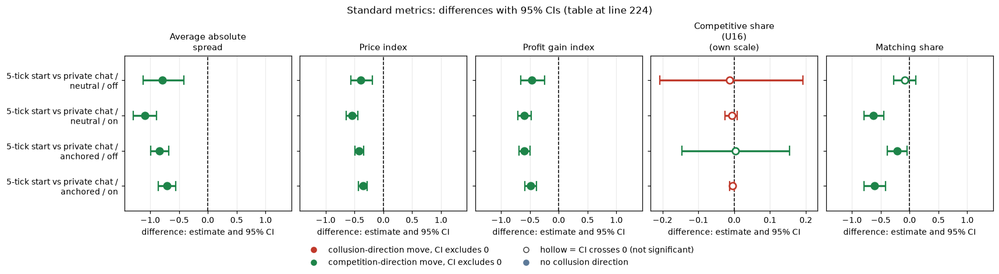

# 5-tick start vs private chat: a one-round cap that does not wash out

**Orientation.** In this experiment two LLM "market makers" (Qwen3-32B) repeatedly quote a price (a "half-spread", from 1.00 = competitive to 3.00 = monopoly; lower wins the customers) for 7 to 20 rounds while a regulator may investigate. Quoting 1.00 is the competitive outcome; holding quotes near 3.00 would mean tacit or explicit collusion. This analysis asks whether forcing both firms to start near the competitive price in round 1 has a lasting effect on prices. In the 5-tick-start arm the prompt states, and the engine enforces, 'In round 1 only, every market maker's quote must be between 1.00 and 1.05. From round 2 on, any quote in the usual range is allowed.' (1.05 is five ticks of 0.01 above the floor). It is compared with the ordinary private-chat game (headline-chat), where the firms can message each other and there is no cap. Data: penalty point 3 (the regulator's fine rule), neutral run (evenly spaced payoff examples 1.00 to 4.00) as the main data and the anchored run (examples at 1.54, 2.09, 3.00) as a check, thinking off and on (the model's reasoning mode), up to 20 games per arm and mode, one for each (wording, seed) pair (5 prompt paraphrases times 4 seeds).

Created by Claude at the prompting of the repository owner. Code: `analyze.py`, `make_md.py`, `common.py`. Data: neutral run `steps/neutral/step1` (rounds table for paths and windows), anchored run (game-level check plus the provisional extras file, copied here as `fivetick_provisional.csv`; source `analysis_final/out_provisional/extras/fivetick.csv`). Numbers: `five_tick_windows.csv`, `paths_by_round.csv`, `climb_back.csv`. Contrast: `start-5tick` vs `headline-chat`, both penalty point 3, paired on (wording, seed) within thinking mode.

> **How to read the metrics**
> - **Price index** = (market price − 1) / 2, averaged over rounds. 0 = competitive (price 1.00), 1 = monopoly (price 3.00).
> - **Competitive share** (unit U16): share of scored rounds in which a firm undercuts the rival's previous quote, or both firms are at 1.00. Higher = more competitive. (Exact rule used in the data: the firm quotes at least one tick, 0.01, below the lowest rival quote of the previous round, or quotes the floor against a floor target; round 1 is not scored.)
> - **Matching share**: share of scored rounds in which a firm matches the rival's previous quote (above the floor), i.e. follows rather than undercuts. Reported in the Standard metrics section.
> - **Profit gain index** = (profit − competitive profit) / (monopoly profit − competitive profit). 0 = competitive profit, 1 = monopoly (joint-profit) level.
> - **t0 / t1** = thinking off / on (the model's reasoning mode); "off / on" in the tables.
> - **p3** = penalty point 3 (theory's sustainable collusive level θ* = 0.546; as a half-spread, 2.09). All games here are at p3 with private chat between the two firms.
> - **Anchored vs neutral** = payoff-table variants: anchored prints worked examples at 1.54, 2.09 and 3.00 (2.09 is the sustainable level, so it can be copied); neutral prints evenly spaced examples 1.00 to 4.00.
> - **CI** = 95% paired bootstrap interval over the 20 (wording, seed) pairs (fewer in later-round windows, see the n pairs column).

## Verdict

*This section summarises the comparison of the 5-tick-start arm with the private-chat control; a "pair" is one (wording, seed) combination and the price index is defined in the box above.*

The 5-tick start (round-1 quotes capped to 1.00-1.05, i.e. within 5 ticks of the floor) **lowers prices by a large and lasting amount, and the effect is not a round-1 artefact.** Price index, neutral run: -0.40 [-0.57, -0.20] (thinking off) and -0.56 [-0.66, -0.46] (on) over all rounds. **Excluding round 1** it is -0.37 [-0.55, -0.16] (off) and -0.55 [-0.66, -0.44] (on): essentially unchanged. **In rounds 5+** it is -0.33 [-0.53, -0.12] (off, 18 pairs) and -0.48 [-0.60, -0.34] (on, 15 pairs); in rounds 10+ it is still -0.45 [-0.65, -0.24] (off, 12 pairs) and -0.39 [-0.56, -0.20] (on, 9 pairs). The anchored run gives the same (-0.42 and -0.35 all rounds; -0.41 and -0.34 in rounds 5+). Even the least favourable bound (CI upper end) is a drop of 0.12 in rounds 5+, so the effect is far above the minimum detectable effect of 0.15-0.25 at its point estimate.

**Do firms climb back up? Only partly and slowly.** Round 2 is already 0.22 (off) and 0.07 (on) against controls of 0.62 and 0.78: the cap is carried forward, not forgotten. With thinking off the price index drifts only from about 0.22 (rounds 2-5) to 0.24 (rounds 6+) and the game-average path is 0.13-0.19 in rounds 8-15 (a shrinking set of games, so not a fall in any one game); 7 of 20 games (35%) ever reach a market price of 2.00 (index 0.5) after round 1, against 18 of 20 (90%) in private chat, and only 1 of 20 reaches 0.8. With thinking on there is a steady climb, from 0.07 in round 2 to 0.16 in round 5, 0.28 by round 10 and 0.31 by round 15 (the later rounds have fewer games, 7-13), but 5 of 19 games (26%) ever reach 0.5 against all 20 controls, and none reaches 0.8. So a first-round anchor near the floor is partly eroded by the chat (thinking on) but nowhere near closed within 20 rounds. These later-round paths are based on 10-13 games, so the shape is indicative.

**Figure caption.** What is measured: the market price index, (market price - 1) / 2, in each round of the game (horizontal axis), averaged over the games still playing; 0 = competitive floor 1.00, 1 = monopoly 3.00. Higher = prices closer to monopoly (more collusion). How derived: `paths_by_round.csv` (columns arm, thinking, round, price_index, n_games), from the neutral run's rounds table; a round is drawn only if at least 8 games reached it. Lines: orange = 5-tick start arm (round-1 quotes capped at 1.00-1.05), blue = private-chat control (headline-chat); left panel thinking off, right panel thinking on. n: 20 games per arm at round 1 for thinking off (19 for the 5-tick start with thinking on), falling in later rounds as games end early (the n for selected rounds is in the table "Market price index at selected rounds" below). The figure was redrawn with fuller labels; the plotted numbers are unchanged. The step changes in later rounds come from games dropping out of the average, not from prices changing in any one game.

<small>

**Definitions of every label in the figure and tables.** Common to all: Qwen3-32B firms, penalty point 3 (p3), private chat, up to 20 games per arm, run and thinking mode (5 prompt wordings, numbered 0 to 4, times 4 seeds; a seed fixes the number of rounds and the regulator's investigation draws). Games end early when the regulator's evidence rule fires, so later rounds have fewer games.

| Label | Exact definition |
|---|---|
| 5-tick start (arm `start-5tick`) | The briefing states, true and engine-enforced: "In round 1 only, every market maker's quote must be between 1.00 and 1.05. From round 2 on, any quote in the usual range is allowed." A round-1 quote outside the range is repaired once, then replaced by the starting quote s0 (the engine logs it). The 1.05 bound is five ticks of 0.01 above the floor. |
| private chat / control (arm `headline-chat`) | The ordinary private-chat game: no round-1 cap, no extra text, same p3, wording, seed and thinking mode. Used as the matched control. |
| thinking off / on (t0 / t1) | Qwen3-32B reasoning mode off / on; run and analysed separately. |
| neutral / anchored (run) | Neutral: payoff table prints evenly spaced examples 1.00 to 4.00 (primary run, used for the figure). Anchored: examples at 1.54, 2.09 and 3.00. |
| market price index | (market price - 1) / 2, so 0 = competitive floor 1.00 and 1 = monopoly 3.00; averaged over the games still playing in that round. |
| round | Round number within the game, counted from 1. |
| diff (arm minus control) | Per (wording, seed) pair, the 5-tick-start game's value minus the matched private-chat game's value, averaged over the n pairs. |

**Legend: every code on each axis** (definitions from the shared glossary `tools/analysis_style/arm_glossary.csv`).

**Columns (x-axis): round number within the game (1 to 19; drawn only where at least 8 games reached it)**

| Slug | Meaning |
|---|---|
| round | one quoting period of the game (numbered from 1) |

**Panels: thinking mode (left panel, right panel)**

| Slug | Meaning |
|---|---|
| t0 | thinking off |
| t1 | thinking on |

**Colour / value (metric)**

| Metric | Meaning | Direction |
|---|---|---|
| price_index | (market price - 1) / 2: 0 at the competitive 1.00, 1 at the 3.00 monopoly price. Higher = more collusive. | higher = more collusive (on the red/green maps: red end) |

Colour scale: not a colour map: line colour = arm (orange = start-5tick, blue = headline-chat); the y-axis is the market price index averaged over the games still playing.

**Series (line colour): arm**

| Slug | Meaning |
|---|---|
| start-5tick | round-1 quotes capped at 1.00-1.05 |
| headline-chat | private chat, no other lever |

**Held fixed for every point (stated in the title)**

| Slug | Meaning |
|---|---|
| neutral | evenly spaced example prices |
| p3 | penalty point 3: fine 500 (ripe middle point) |
| private | private chat |

</small>

## Tables

*These tables compare the 5-tick-start arm with the private-chat control over different round windows, at selected rounds and in how often prices climb back up.*

### Price index by window, arm minus control (95% CI over pairs)

This table shows the mean price index of the private-chat control and of the 5-tick start, and their paired difference, over different round windows (price index on its 0-to-1 scale).

| run | mode | window | n_pairs | private chat | 5-tick | diff [95% CI] |
|---|---|---|---|---|---|---|
| neutral | off | all rounds | 20 | 0.610 | 0.216 | -0.395 [-0.565, -0.199] |
| neutral | off | excluding round 1 | 20 | 0.611 | 0.238 | -0.373 [-0.553, -0.164] |
| neutral | off | rounds 5+ | 18 | 0.595 | 0.263 | -0.332 [-0.529, -0.118] |
| neutral | off | rounds 10+ | 12 | 0.655 | 0.208 | -0.448 [-0.645, -0.244] |
| neutral | on | all rounds | 19 | 0.753 | 0.189 | -0.564 [-0.664, -0.458] |
| neutral | on | excluding round 1 | 19 | 0.756 | 0.202 | -0.554 [-0.663, -0.437] |
| neutral | on | rounds 5+ | 15 | 0.739 | 0.262 | -0.477 [-0.604, -0.341] |
| neutral | on | rounds 10+ | 9 | 0.780 | 0.390 | -0.391 [-0.563, -0.196] |
| anchored | off | all rounds | 20 | 0.459 | 0.037 | -0.422 [-0.494, -0.341] |
| anchored | on | all rounds | 20 | 0.512 | 0.158 | -0.354 [-0.427, -0.278] |
| anchored (provisional file) | off | excluding round 1 | 20 | 0.472 | 0.051 | -0.422 [-0.482, -0.346] |
| anchored (provisional file) | off | rounds 5+ | 18 | 0.439 | 0.026 | -0.414 [-0.480, -0.333] |
| anchored (provisional file) | on | excluding round 1 | 20 | 0.511 | 0.182 | -0.329 [-0.412, -0.241] |
| anchored (provisional file) | on | rounds 5+ | 18 | 0.519 | 0.183 | -0.336 [-0.413, -0.251] |

<!-- ci-forest:1 -->

*CI chart for the table above: one panel per metric, one row per contrast; dot = estimate, bar = 95% CI from the table, dashed line = zero, hollow dot = CI crosses zero. Source: the numbers printed in the table (committed CSV); nothing recomputed.*

<small>

**Reading the chart.** Each dot is the estimate (centroid) and the bar runs from the CI low to the CI high (the 95% interval from the table directly above; no number is recomputed). The dashed vertical line is zero (no difference). Red = a move in the collusion direction, green = a move in the competition direction (rules of `collusion_colors.direction`), blue-grey = the metric has no collusion direction. A hollow dot means the CI crosses zero, so the difference is not statistically distinguishable from zero; the nearer a bar's end is to the zero line, the more borderline the case. Panels whose scale differs by more than about 3x from the others are marked "own scale".

**Rows (y-axis):** one contrast or attribute per row, labelled as in the table above (a glossary slug is expanded to "slug: short label").

| Slug | Meaning |
|---|---|
| anchored | payoff table prints the 2.09 theory price |

**Panels (x-axis = the difference in that metric):**

| Panel | Direction | Red means | Green means |
|---|---|---|---|
| diff [95% CI] | no collusion direction (neutral hue) | none (blue-grey: no collusion direction) | none (blue-grey: no collusion direction) |

</small>
<!-- /ci-forest -->

<small>

| Column | Meaning |
|---|---|
| run, mode | Neutral or anchored run; thinking off / on |
| window | Rounds averaged: all rounds; excluding round 1 (rounds 2 on); rounds 5+ (5 on); rounds 10+ (10 on). A pair enters only if both games reached the window |
| n_pairs | Number of (wording, seed) pairs in the window (at most 20) |
| private chat, 5-tick | Mean price index of the control (`headline-chat`) and of the 5-tick start (`start-5tick`) over those pairs |
| diff [95% CI] | Mean paired difference (5-tick minus private chat), with the 95% bootstrap CI over the pairs |
| anchored (provisional file) | Rows copied from the provisional extras file (imputed rounds dropped), see the note below |

**Legend: every slug and code shown** (definitions from the shared glossary `tools/analysis_style/arm_glossary.csv`).

| Slug | Meaning |
|---|---|
| neutral | evenly spaced example prices |
| anchored | payoff table prints the 2.09 theory price |
| start-5tick | round-1 quotes capped at 1.00-1.05 |
| headline-chat | private chat, no other lever |
| t0 | thinking off |
| t1 | thinking on |
| price_index | price index |

</small>

The neutral all-rounds figures here come from the rounds table and differ in the third decimal from the provisional extras file (which drops imputed rounds). `anchored (provisional file)` rows are copied from that file; the anchored data set has no rounds table, so only its all-rounds row is recomputed.

### Market price index at selected rounds (cell = mean, n games)

This table shows the mean market price index (0-to-1 scale) in selected rounds for each arm and thinking mode, with the number of games still playing in brackets.

| thinking | round | start-5tick | headline-chat |
|---|---|---|---|
| off | 1 | 0.01 (n=20) | 0.61 (n=20) |
| off | 2 | 0.22 (n=20) | 0.62 (n=20) |
| off | 3 | 0.22 (n=20) | 0.59 (n=18) |
| off | 5 | 0.23 (n=20) | 0.59 (n=18) |
| off | 8 | 0.18 (n=15) | 0.65 (n=12) |
| off | 10 | 0.18 (n=15) | 0.65 (n=12) |
| off | 15 | 0.13 (n=13) | 0.65 (n=9) |
| on | 1 | 0.02 (n=19) | 0.78 (n=20) |
| on | 2 | 0.07 (n=19) | 0.78 (n=20) |
| on | 3 | 0.12 (n=18) | 0.78 (n=17) |
| on | 5 | 0.16 (n=18) | 0.77 (n=16) |
| on | 8 | 0.26 (n=13) | 0.82 (n=10) |
| on | 10 | 0.28 (n=13) | 0.80 (n=10) |
| on | 15 | 0.31 (n=11) | 0.82 (n=7) |

<small>

| Column | Meaning |
|---|---|
| thinking | Thinking off / on |
| round | Round number (1 = first round) |
| start-5tick, headline-chat | Mean market price index over the games still playing that round, (n = number of those games), for the 5-tick start and the private-chat control |

**Legend: every slug and code shown** (definitions from the shared glossary `tools/analysis_style/arm_glossary.csv`).

| Slug | Meaning |
|---|---|
| start-5tick | round-1 quotes capped at 1.00-1.05 |
| headline-chat | private chat, no other lever |
| t0 | thinking off |
| t1 | thinking on |
| round | one quoting period of the game (numbered from 1) |
| neutral | evenly spaced example prices |
| price_index | price index |

</small>

### Climbing back up (neutral; round 2 on)

This table shows, per arm and thinking mode, whether and how fast prices rise after round 1: shares of games that ever reach a market price index of 0.5 (price 2.00) or 0.8 (price 2.60), and the average index in rounds 2-5 and rounds 6 and later.

| mode | arm | games with rounds | round1 price index | share games market ever ge 0 5 | share games market ever ge 0 8 | share games any firm quote ge 0 5 after r1 | share firm rounds ge 0 5 after r1 | median first round ge 0 5 | rounds2to5 mean index | rounds6plus mean index | mean of game max after r1 |
|---|---|---|---|---|---|---|---|---|---|---|---|
| off | start-5tick | 20 | 0.012 | 0.350 | 0.050 | 0.350 | 0.281 | 2.000 | 0.224 | 0.242 | 0.246 |
| off | headline-chat | 20 | 0.612 | 0.900 | 0.250 | 0.900 | 0.891 | 1.000 | 0.610 | 0.595 | 0.635 |
| on | start-5tick | 19 | 0.022 | 0.263 | 0.000 | 0.316 | 0.211 | 3.000 | 0.120 | 0.247 | 0.287 |
| on | headline-chat | 20 | 0.775 | 1.000 | 0.300 | 1.000 | 1.000 | 1.000 | 0.775 | 0.754 | 0.775 |

<small>

| Column | Meaning |
|---|---|
| mode, arm | Thinking off / on; `start-5tick` or `headline-chat` |
| games with rounds | Games with rounds data in the cell |
| round1 price index | Mean market price index in round 1 |
| share games market ever ge 0 5 / 0 8 | Share of games whose market price index reaches at least 0.5 (price 2.00) / 0.8 (price 2.60) in some round after round 1 ("0 5" = 0.5, "0 8" = 0.8) |
| share games any firm quote ge 0 5 after r1 | Share of games in which any firm's quote, converted to the same index, reaches 0.5 or more after round 1 |
| share firm rounds ge 0 5 after r1 | Share of firm-rounds after round 1 with quote index at least 0.5 |
| median first round ge 0 5 | Median round of first reaching 0.5, among games that ever do |
| rounds2to5 mean index, rounds6plus mean index | Mean market price index over rounds 2-5 / over rounds 6 on |
| mean of game max after r1 | Mean over games of each game's highest market price index after round 1 |

**Legend: every slug and code shown** (definitions from the shared glossary `tools/analysis_style/arm_glossary.csv`).

| Slug | Meaning |
|---|---|
| start-5tick | round-1 quotes capped at 1.00-1.05 |
| headline-chat | private chat, no other lever |
| t0 | thinking off |
| t1 | thinking on |
| neutral | evenly spaced example prices |
| price_index | price index |

</small>

`median first round ge 0 5` is among games that ever reach 0.5. Game counts are the games with rounds data.

## Standard metrics

*This section repeats the 5-tick-start versus private-chat comparison with the five standard metrics (average absolute spread, price index, profit gain index, competitive share, matching share); "U16" is the analysis unit that defined the competitive-share rule.*

The five standard metrics for every main contrast (arm minus matched control, penalty point 3; 95% bootstrap CI over the paired (wording, seed) pairs). Average absolute spread: the mean market quote (the half-spread) in raw units, 1.00 to 5.00, not rescaled (1.00 = competitive floor, 3.00 = monopoly price; lower = less collusion). Price index: (market price - 1)/2, from 0 (competitive) to 1 (monopoly 3.00) (lower = less collusion). Profit gain index: (profit - competitive) / (monopoly - competitive), 0 = competitive profit, 1 = monopoly profit (lower = less collusion). Competitive share (U16): share of firm-rounds that are competitive, meaning the firm quotes below the lowest rival's previous-round quote, or both are at 1.00 (higher = less collusion). Matching share: share of firm-rounds in which the firm's quote equals the lowest rival's previous-round quote, above 1.00 (higher = more coordination; the coordination signature). The five are analysed separately, never blended. Each cell is the mean paired difference with its 95% percentile bootstrap CI over the paired (wording, seed) pairs (10,000 resamples). Means, counts and CIs: `standard_metrics.csv`; script: `standard_metrics.py`.

| contrast | run | mode | n pairs | Average absolute spread | Price index | Profit gain index | Competitive share (U16) | Matching share |
|---|---|---|---|---|---|---|---|---|
| 5-tick start vs private chat | neutral | off | 20 | -0.789 [-1.127, -0.412] | -0.395 [-0.567, -0.192] | -0.467 [-0.659, -0.247] | -0.013 [-0.208, +0.192] | -0.082 [-0.273, +0.109] |
| 5-tick start vs private chat | neutral | on | 20 | -1.093 [-1.293, -0.891] | -0.546 [-0.646, -0.443] | -0.599 [-0.709, -0.480] | -0.006 [-0.025, +0.009] | -0.624 [-0.792, -0.447] |
| 5-tick start vs private chat | anchored | off | 20 | -0.844 [-0.986, -0.681] | -0.422 [-0.494, -0.340] | -0.598 [-0.685, -0.493] | +0.004 [-0.146, +0.154] | -0.218 [-0.387, -0.045] |
| 5-tick start vs private chat | anchored | on | 20 | -0.708 [-0.857, -0.559] | -0.354 [-0.428, -0.277] | -0.490 [-0.583, -0.390] | -0.005 [-0.013, +0.000] | -0.612 [-0.791, -0.422] |

<!-- ci-forest:2 -->

*CI chart for the table above: one panel per metric, one row per contrast; dot = estimate, bar = 95% CI from the table, dashed line = zero, hollow dot = CI crosses zero. Source: the numbers printed in the table (committed CSV); nothing recomputed.*

<small>

**Reading the chart.** Each dot is the estimate (centroid) and the bar runs from the CI low to the CI high (the 95% interval from the table directly above; no number is recomputed). The dashed vertical line is zero (no difference). Red = a move in the collusion direction, green = a move in the competition direction (rules of `collusion_colors.direction`), blue-grey = the metric has no collusion direction. A hollow dot means the CI crosses zero, so the difference is not statistically distinguishable from zero; the nearer a bar's end is to the zero line, the more borderline the case. Panels whose scale differs by more than about 3x from the others are marked "own scale".

**Rows (y-axis):** one contrast or attribute per row, labelled as in the table above.

**Panels (x-axis = the difference in that metric):**

| Panel | Direction | Red means | Green means |
|---|---|---|---|
| Average absolute spread | higher = more collusive (on the red/green maps: red end) | metric goes up (more collusive) | metric goes down (less collusive) |
| Price index | higher = more collusive (on the red/green maps: red end) | metric goes up (more collusive) | metric goes down (less collusive) |
| Profit gain index | higher = more collusive (on the red/green maps: red end) | metric goes up (more collusive) | metric goes down (less collusive) |
| Competitive share (U16) | higher = more competitive (on the red/green maps: green end) | metric goes down (less competitive) | metric goes up (more competitive) |
| Matching share | higher = more collusive (on the red/green maps: red end) | metric goes up (more collusive) | metric goes down (less collusive) |

</small>
<!-- /ci-forest -->

<small>

**Terms**

| Term | Meaning |
|---|---|
| Half-spread, tick, floor | Each round each firm quotes a half-spread in ticks of 0.01 between 1.00 and 3.00; the lower quote wins the business. 1.00 is the competitive floor (Nash level); 2.09 is the level theory says collusion can sustain at penalty point 3. |
| Average absolute spread | Mean market quote (the half-spread) over a game's rounds, raw units 1.00 to 5.00, not rescaled; 1.00 = competitive floor, 3.00 = monopoly; difference in quote units (run.csv `market_price_mean`) |
| Price index | (market price - 1) / (3 - 1), averaged over the game's rounds. 0 = always the floor, 1 = always the top. Lower = less collusion. |
| Competitive share | Share of LLM firm-rounds (round 2 on) in which the firm undercuts the rival's last quote or both sit at 1.00. Higher = less collusion. |
| Matching share | Share of scored firm-rounds in which the firm's quote equals the lowest rival's previous-round quote (within half a tick), above 1.00; the coordination signature; competitive + matching + above-rival shares sum to 1; difference in share units |
| Rival / control | A rival is another firm in the game. A matched control is the arm that differs only in the lever, paired on (wording, seed) within the thinking mode, at penalty point 3. |
| Profit gain index, n pairs | Profit gain index = (profit - competitive profit) / (monopoly profit - competitive profit), computed per game from mean profit per firm per round (competitive = Nash profit); n pairs = number of (wording, seed) pairs entering the difference |
| Pair, CI | 20 pairs per cell (5 wordings x 4 seeds). Effect = mean pair difference; 95% CI = percentile bootstrap of the pairs, 10,000 resamples. |
| Minimum detectable effect | About 0.15-0.25 in price-index units; a CI that spans zero is a bound on the effect, not evidence of none. |
| Thinking off / on | Whether the Qwen3 model's reasoning mode was switched on (run separately). |
| Neutral / anchored | Two prompt versions; neutral is primary, anchored (payoff examples anchored to the collusive level) is a check. |
| 5-tick start | Engine-enforced cap on the round-1 quote: 1.00-1.05, five ticks above the floor. Later rounds are unrestricted. |
| Excluding round 1 / rounds 5+ | Price index averaged over rounds 2 on / 5 on; a pair needs a round in the window in both games, so n pairs falls in later windows as games end early. |

**Legend: every slug and code shown** (definitions from the shared glossary `tools/analysis_style/arm_glossary.csv`).

| Slug | Meaning |
|---|---|
| start-5tick | round-1 quotes capped at 1.00-1.05 |
| headline-chat | private chat, no other lever |
| neutral | evenly spaced example prices |
| anchored | payoff table prints the 2.09 theory price |
| t0 | thinking off |
| t1 | thinking on |
| p3 | penalty point 3: fine 500 (ripe middle point) |

</small>

Notes on the standard metrics:

- 2 of 4 rows have a competitive share of 0.03 or less in BOTH arms (the floor): there the competitive-share difference is degenerate and carries almost no information, and the spread, price index, profit gain index and matching share are the informative metrics.

