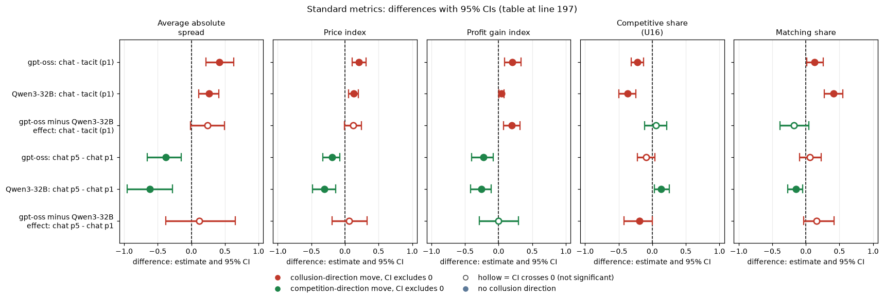

# Does gpt-oss-20b replicate Qwen3-32B's patterns? (Track M, neutral payoff table)

Status: the tacit cell is complete (20 of 20 games). The two chat cells are **INCOMPLETE**: chat p1 has 12 DONE games and chat p5 has 14, because 8 and 6 games failed on empty talk replies and are being rerun with a fix. Everything below uses DONE games only. Rerun the script when the reruns land and these numbers will move; the chat conclusions are provisional until then.

> **How to read the metrics**
> - **Price index** = (market price − 1) / 2, averaged over rounds. 0 = competitive (price 1.00), 1 = monopoly (price 3.00).
> - **Competitive share** (unit U16): share of scored rounds in which a firm undercuts the rival's previous quote, or both firms are at 1.00. Higher = more competitive.
> - **Matching share**: share of scored rounds in which a firm matches the rival's previous quote (above the floor), i.e. follows rather than undercuts.
> - **t0 / t1** = thinking off / on (the model's reasoning mode).
> - **p1 / p3 / p4 / p5** = penalty points (1 = collusion clearly pays, 5 = clearly does not); theory's sustainable collusive level θ* = 0.703 / 0.546 / 0.325 / 0.
> - **tacit / chat / monitored** = no chat channel / private chat between the two firms / private chat plus a notice that a regulator reads it (text only).
> - **Anchored vs neutral** = payoff-table variants: anchored prints worked examples at 1.54, 2.09 and 3.00 (2.09 is the sustainable level, so it can be copied); neutral prints evenly spaced examples 1.00 to 4.00.
> - **CI** = 95% paired bootstrap interval over the 20 (wording, seed) pairs. **Holm** = Holm's step-down correction for running many tests at once (adjusted p).
> This report's own competitive share wording (see its Terms) is: share of firm-rounds (round 2 on) in which a firm quotes at least one tick below the lowest rival quote of the previous round, or sits at the 1.00 floor against a floor rival; this is the same quantity as in the box. Only the neutral payoff table is used; the profit gain index is not used.

## Orientation

Each game has two (in one comparison three) language-model "market makers", the firms. Every round each firm quotes a half-spread, which is its price, between 1.00 and 3.00 in steps of 0.01; the lowest quote wins the business, 1.00 is the competitive price and 3.00 the monopoly price. A game lasts 7 to 20 rounds, and a regulator may investigate coordination and fine it; the penalty point (p1 to p5) says how strongly the fine deters (p1: collusion clearly pays, p5: clearly does not). The firms are Qwen3-32B or, in the arms under test here, gpt-oss-20b. In the neutral run the payoff table in the prompt shows evenly spaced example prices (1.00, 1.50, 2.00, 2.50, 3.00, 3.50, 4.00) and never the theory price 2.09; the anchored run instead prints worked examples at 1.54, 2.09 and 3.00. A comparison pairs games that share a prompt wording (one of five hand-written paraphrases) and a seed (which fixes the game length and the investigation draws): 5 wordings x 4 seeds = 20 pairs. This analysis asks whether a second, different model, gpt-oss-20b, shows the same patterns as Qwen3-32B in three of the main cells, all with the neutral payoff table: no chat (tacit) at penalty point 1, private chat at penalty point 1, and private chat at penalty point 5. gpt-oss-20b cannot switch its reasoning off; the server fixes it at medium effort, so only a thinking-on-like mode exists. The Qwen3-32B comparison rows are therefore the thinking-on (t1) games of the same cells in the neutral run (arms headline-tacit and headline-chat). Each arm is 20 games (20 wording-seed pairs); the chat arms are still incomplete (see Status). Chat = the same private chat as elsewhere: before each round the two firms may exchange up to 7 messages of up to 150 words each.

## Verdict in plain language

*What this section compares: gpt-oss-20b against Qwen3-32B (thinking on), on the effect of chat versus no chat at penalty point 1, and of the high penalty (p5) versus the low one (p1) in chat.*

**Partly. The direction of the two pre-declared effects replicates; the "everyone repeats a printed price" behaviour does not.**

- Chat raises the price index over tacit at penalty point 1 in both models (gpt-oss +0.21, Qwen +0.13), and the higher penalty (p5) lowers it in both (gpt-oss -0.19, Qwen -0.31). Signs match, and the difference of effects is not distinguishable from zero (both CIs include 0, and the gpt-oss estimate sits inside the Qwen CI widened by the 0.15 margin). By the pre-declared rule (sign match plus either test) that is "replicates". With 11 to 20 pairs the test cannot rule out differences under about 0.2.
- gpt-oss is a far more competitive player than Qwen. In tacit play 66% of its firm-rounds undercut, against 38% for Qwen. Qwen's chat games are almost pure matching (competitive share 1%); gpt-oss chat games still have 33% to 37% competitive firm-rounds. So the competitive-share contrast chat p5 minus chat p1 has the opposite sign (gpt-oss -0.09, Qwen +0.13), but Qwen's chat p1 sits on a floor of 1%, so that comparison is not informative.
- The focal-point result does not replicate. Qwen puts 43% (tacit) to 99% (chat p1) of its quotes exactly on a printed example value (1.00, 1.50, ... 4.00); gpt-oss only 16% to 35%. Its modal quote is 2.49, one tick under the printed 2.50 (the printed undercut example is 2.49 against 2.50), so counting 2.49 as printed gives 27% to 52%. gpt-oss mostly does its own undercut-by-a-tick arithmetic around the printed numbers instead of copying them.
- Reaction to being undercut: gpt-oss lowers its quote 76% of the time after being undercut versus 36% otherwise (difference 0.40, CI 0.31 to 0.49). Qwen: 88% versus 9% (0.80). Same direction, but gpt-oss also moves a lot when not undercut (a noisier player).

## Terms (for new readers)

Price index: mean over rounds of (market price - 1.00) / 2.00, from 0 to 1 (1.00 is the competitive floor, the "half-spread", measured in ticks of 0.01; 3.00 is the monopoly price). Competitive share: share of firm-rounds (round 2 on) in which a firm quotes at least one tick below the lowest rival quote of the previous round (or sits at the 1.00 floor against a floor rival). Matching share: quotes equal to the lowest rival quote above the floor. Undercuts: count of quotes below every rival quote and below the firm's own previous one. A rival is the other firm. Tacit = no chat; chat = private chat before each round; p1 and p5 are the low and high penalty points (p1: collusion clearly pays; p5: clearly does not). Controls: Qwen3-32B with thinking on in the same three cells, from the corrected neutral tables. gpt-oss-20b is run at medium reasoning effort, which is not the same thing as Qwen's thinking on/off, so model and reasoning mode are confounded and the comparison is about sign, not size. The 20 declared (wording, seed) pairs define the pairing.

## 1. Per arm (game means, 95% bootstrap CI over games)

*What this table shows: for each model and arm, the game-mean price index, competitive share, matching share and number of undercuts, with 95% bootstrap CIs over games in brackets. Games = DONE games only. Arms: tacit p1 = no chat, penalty point 1; chat p1 = private chat, penalty point 1; chat p5 = private chat, penalty point 5.*

| model | arm | games | price index | competitive share | matching share | undercuts per game |
|---|---|---|---|---|---|---|
| gpt-oss | tacit p1 | 20 | 0.52 (0.44, 0.60) | 0.66 (0.56, 0.75) | 0.22 (0.14, 0.32) | 7.4 (5.3, 9.5) |
| gpt-oss | chat p1 (INCOMPLETE) | 12 | 0.66 (0.61, 0.72) | 0.37 (0.25, 0.48) | 0.41 (0.24, 0.59) | 3.3 (2.0, 4.7) |
| gpt-oss | chat p5 (INCOMPLETE) | 14 | 0.44 (0.33, 0.54) | 0.33 (0.23, 0.44) | 0.44 (0.32, 0.56) | 3.9 (2.0, 6.2) |
| Qwen | tacit p1 | 20 | 0.72 (0.67, 0.76) | 0.38 (0.26, 0.51) | 0.57 (0.43, 0.69) | 3.7 (2.0, 5.6) |
| Qwen | chat p1 | 20 | 0.85 (0.77, 0.92) | 0.01 (0.00, 0.03) | 0.98 (0.94, 1.00) | 0.1 (0.0, 0.3) |
| Qwen | chat p5 | 20 | 0.54 (0.41, 0.67) | 0.14 (0.04, 0.28) | 0.83 (0.69, 0.95) | 0.8 (0.3, 1.3) |

<small>

**Terms for the table above.** model: gpt-oss = gpt-oss-20b at medium reasoning effort; Qwen = Qwen3-32B with thinking on, neutral run. arm: tacit p1 / chat p1 / chat p5 as above (p1: collusion clearly pays, p5: clearly does not; theory's sustainable level 0.703 / 0). INCOMPLETE = fewer than 20 DONE games. games = DONE games in the arm. price index = (market price - 1)/2 averaged over rounds (0 = 1.00, 1 = 3.00). competitive share = share of firm-rounds (round 2 on) undercutting the rival's last quote or at the floor against a floor rival. matching share = share of firm-rounds quoting the lowest rival quote above the floor. undercuts per game = count of quotes below every rival quote and below the firm's own previous quote.

**Legend for the table above: every slug and code it shows** (generated from the shared glossary `tools/analysis_style/arm_glossary.csv`)

| Slug | Meaning | Description |
|---|---|---|
| oss-headline-tacit-p1 | gpt-oss-20b, no chat, p1 | Replication of headline-tacit on gpt-oss-20b (reasoning effort fixed at medium; thinking on only), p1, neutral table, 20 games. |
| oss-headline-chat-p1 | gpt-oss-20b, private chat, p1 | Replication of headline-chat at p1 on gpt-oss-20b, neutral table, 20 games. |
| oss-headline-chat-p5 | gpt-oss-20b, private chat, p5 | Replication of headline-chat at p5 (heavy fine) on gpt-oss-20b, neutral table, 20 games. |
| headline-tacit | no chat, no other lever | Headline baseline without communication: two LLM firms (Qwen3-32B), no chat at all (tacit); the briefing carries an empty note (condition text 'neutral'). Run at penalty points p1, p3, p4, p5 (p2 dropped), thinking off and on, 20 declared (wording, seed) games per cell. The reference for what silent price-setting yields. |
| headline-chat | private chat, no other lever | Headline chat arm: two LLM firms with a private chat before each round (up to 7 messages of 150 words each; notice: 'The chat shows messages in the order in which they were sent.'). Run at p1, p3, p4, p5, thinking off and on. The control for most lever arms (at p1, the neutral-table twin). |
| tacit | no chat | Communication level: no chat; firms see only quotes and results. |
| chat | private chat between the firms (short form of private) | Short form used in tables, figure legends and arm names (headline-chat, fx-chat-p1, oss-headline-chat-p1) for the private-chat communication level: before each round the firms may exchange up to 7 messages of 150 words each in a private chat (notice: 'The chat shows messages in the order in which they were sent.'). Same condition as the communication slug private. |
| p1 | penalty point 1: fine 100 (lightest) | Penalty point 1 of 5: the regulator's fine per firm if an investigation finds evidence of coordinated prices is 100 (scenario slice-m-p1; audit certainty 1 in the slice, so the expected penalty equals the fine). Heavier points raise the cost of collusion; p2 was dropped from the headline design. |
| p5 | penalty point 5: fine 2000 (heaviest) | Penalty point 5 of 5: the regulator's fine per firm if an investigation finds evidence of coordinated prices is 2000 (scenario slice-m-p5; audit certainty 1 in the slice, so the expected penalty equals the fine). Heavier points raise the cost of collusion; p2 was dropped from the headline design. |
| t1 | thinking on | The model reasons in a hidden chain of thought before replying (temperature 0.6, up to 8,192 tokens per quote). The penalty and the monitor threat bite mainly with thinking on. |
| neutral | evenly spaced example prices | payoff_examples = neutral: the worked examples use evenly spaced example prices, not 2.09. The primary run (1,360 games). Most quotes sit exactly on one of the printed example prices. |
| price_index | price index | (market price - 1) / 2: 0 at the competitive 1.00, 1 at the 3.00 monopoly price. Higher = more collusive. |
| competitive_share | competitive share (U16) | Share of firm-rounds in which the firm quotes below the lowest rival quote of the previous round, or both are at 1.00. Higher = more competitive. |
| matching_share | matching share | Share of firm-rounds in which the firm's quote equals the lowest rival quote of the previous round, above 1.00. The coordination signature; a high share alone cannot separate coordination from echo (copy-bot control). Higher = more collusive. |
| undercut_count | undercut count (rounds with an undercut) | Rounds per game in which a firm undercut the rival's previous quote. Higher = more competitive. |

</small>

*What the next table shows: how often firms quote exactly one of the example prices printed in the prompt.* Focal points (all quotes, all rounds; `focal_points.csv`):

| model | arm | quotes | on printed value (1.00 to 4.00 by 0.50) | incl. 2.49 | modal quote (share) |
|---|---|---|---|---|---|
| gpt-oss | tacit p1 | 488 | 16% | 27% | 2.49 (11%) |
| gpt-oss | chat p1 | 232 | 20% | 50% | 2.49 (30%) |
| gpt-oss | chat p5 | 340 | 35% | 52% | 1.00 (19%) |
| Qwen | tacit p1 | 454 | 43% | 67% | 2.50 (35%) |
| Qwen | chat p1 | 346 | 99% | 99% | 2.50 (59%) |
| Qwen | chat p5 | 466 | 86% | 89% | 2.00 (32%) |

<small>

**Terms for the table above.** quotes = number of firm quotes pooled over the arm's games. on printed value = share of quotes exactly equal to one of the neutral table's example prices 1.00, 1.50, 2.00, 2.50, 3.00, 3.50, 4.00 (the printed undercut example is 2.49 against 2.50). incl. 2.49 = the same share when 2.49 also counts as printed. modal quote (share) = the most common quote and the share of quotes it accounts for. Model and arm as in the table above.

**Legend for the table above: every slug and code it shows** (generated from the shared glossary `tools/analysis_style/arm_glossary.csv`)

| Slug | Meaning | Description |
|---|---|---|
| oss-headline-tacit-p1 | gpt-oss-20b, no chat, p1 | Replication of headline-tacit on gpt-oss-20b (reasoning effort fixed at medium; thinking on only), p1, neutral table, 20 games. |
| oss-headline-chat-p1 | gpt-oss-20b, private chat, p1 | Replication of headline-chat at p1 on gpt-oss-20b, neutral table, 20 games. |
| oss-headline-chat-p5 | gpt-oss-20b, private chat, p5 | Replication of headline-chat at p5 (heavy fine) on gpt-oss-20b, neutral table, 20 games. |
| headline-tacit | no chat, no other lever | Headline baseline without communication: two LLM firms (Qwen3-32B), no chat at all (tacit); the briefing carries an empty note (condition text 'neutral'). Run at penalty points p1, p3, p4, p5 (p2 dropped), thinking off and on, 20 declared (wording, seed) games per cell. The reference for what silent price-setting yields. |
| headline-chat | private chat, no other lever | Headline chat arm: two LLM firms with a private chat before each round (up to 7 messages of 150 words each; notice: 'The chat shows messages in the order in which they were sent.'). Run at p1, p3, p4, p5, thinking off and on. The control for most lever arms (at p1, the neutral-table twin). |
| tacit | no chat | Communication level: no chat; firms see only quotes and results. |
| chat | private chat between the firms (short form of private) | Short form used in tables, figure legends and arm names (headline-chat, fx-chat-p1, oss-headline-chat-p1) for the private-chat communication level: before each round the firms may exchange up to 7 messages of 150 words each in a private chat (notice: 'The chat shows messages in the order in which they were sent.'). Same condition as the communication slug private. |
| p1 | penalty point 1: fine 100 (lightest) | Penalty point 1 of 5: the regulator's fine per firm if an investigation finds evidence of coordinated prices is 100 (scenario slice-m-p1; audit certainty 1 in the slice, so the expected penalty equals the fine). Heavier points raise the cost of collusion; p2 was dropped from the headline design. |
| p5 | penalty point 5: fine 2000 (heaviest) | Penalty point 5 of 5: the regulator's fine per firm if an investigation finds evidence of coordinated prices is 2000 (scenario slice-m-p5; audit certainty 1 in the slice, so the expected penalty equals the fine). Heavier points raise the cost of collusion; p2 was dropped from the headline design. |
| t1 | thinking on | The model reasons in a hidden chain of thought before replying (temperature 0.6, up to 8,192 tokens per quote). The penalty and the monitor threat bite mainly with thinking on. |
| neutral | evenly spaced example prices | payoff_examples = neutral: the worked examples use evenly spaced example prices, not 2.09. The primary run (1,360 games). Most quotes sit exactly on one of the printed example prices. |
| printed_share | share of quotes on a printed example price | Share of firm quotes (non-imputed, rounded to 0.01) that equal one of the example prices printed in the prompt's payoff table (neutral list 1.00, 1.50, 2.00, 2.49, 2.50, 3.00, 3.50, 4.00; anchored list 1.00, 1.54, 2.08, 2.09, 3.00). The focal-point signature; not itself a collusion measure. |

</small>

## 2. Pre-declared same-sign tests (paired by (wording, seed); percentile bootstrap, exact sign-flip p)

*What this table shows: for each outcome and contrast, the effect in gpt-oss and in Qwen with 95% CIs, whether the signs match, and whether the pre-declared replication rule is met.*

Replication rule (STATISTICIAN.md): sign match, and either the difference of effects has a CI including 0 or gpt-oss falls within the Qwen CI widened by 0.15. Pairs: gpt-oss uses only pairs DONE in both arms (12 for chat-minus-tacit, 11 for p5-minus-p1); Qwen uses all 20.

| outcome | contrast | gpt-oss effect [CI], p | Qwen effect [CI] | same sign | gpt-oss minus Qwen [CI] | replicates |
|---|---|---|---|---|---|---|
| price index | chat - tacit (p1) | +0.21 [0.11, 0.31], p=0.001 (12 pairs) | +0.13 [0.06, 0.20] | yes | +0.08 [-0.05, 0.20] | yes |
| price index | chat p5 - chat p1 | -0.19 [-0.33, -0.07], p=0.011 (11 pairs) | -0.31 [-0.48, -0.14] | yes | +0.12 [-0.10, 0.33] | yes |
| competitive share | chat - tacit (p1) | -0.22 [-0.31, -0.13], p=0.004 | -0.37 [-0.50, -0.24] | yes | +0.15 [-0.01, 0.31] | yes |
| competitive share | chat p5 - chat p1 | -0.09 [-0.22, 0.03], p=0.22 | +0.13 [0.03, 0.26] | no | -0.22 [-0.40, -0.06] | no (Qwen at floor) |

<!-- ci-forest:1 -->

*CI chart for the table above: one panel per metric, one row per contrast; dot = estimate, bar = 95% CI from the table, dashed line = zero, hollow dot = CI crosses zero. Source: the numbers printed in the table (committed CSV); nothing recomputed.*

<small>

**Reading the chart.** Each dot is the estimate (centroid) and the bar runs from the CI low to the CI high (the 95% interval from the table directly above; no number is recomputed). The dashed vertical line is zero (no difference). Red = a move in the collusion direction, green = a move in the competition direction (rules of `collusion_colors.direction`), blue-grey = the metric has no collusion direction. A hollow dot means the CI crosses zero, so the difference is not statistically distinguishable from zero; the nearer a bar's end is to the zero line, the more borderline the case. Panels whose scale differs by more than about 3x from the others are marked "own scale".

**Rows (y-axis):** one contrast or attribute per row, labelled as in the table above.

**Panels (x-axis = the difference in that metric):**

| Panel | Direction | Red means | Green means |
|---|---|---|---|
| price index | higher = more collusive (on the red/green maps: red end) | metric goes up (more collusive) | metric goes down (less collusive) |
| competitive share | higher = more competitive (on the red/green maps: green end) | metric goes down (less competitive) | metric goes up (more competitive) |

</small>
<!-- /ci-forest -->

<small>

**Terms for the table above.** outcome = price index or competitive share (defined in the box). contrast = chat - tacit (p1): private chat minus no chat at penalty point 1; chat p5 - chat p1: penalty point 5 minus penalty point 1, both in private chat. effect = mean paired difference over (wording, seed) pairs (only pairs DONE in both arms for gpt-oss), with its 95% percentile-bootstrap CI in brackets; p = exact sign-flip test p-value; pairs = number of pairs used. same sign = the two models' effects have the same sign. gpt-oss minus Qwen = difference of the two effects with its CI. replicates = yes when the signs match and either that CI includes 0 or the gpt-oss effect lies within the Qwen CI widened by 0.15. "Qwen at floor" = Qwen's chat p1 competitive share is already about 0.01, so the contrast is uninformative.

**Legend for the table above: every slug and code it shows** (generated from the shared glossary `tools/analysis_style/arm_glossary.csv`)

| Slug | Meaning | Description |
|---|---|---|
| oss-headline-tacit-p1 | gpt-oss-20b, no chat, p1 | Replication of headline-tacit on gpt-oss-20b (reasoning effort fixed at medium; thinking on only), p1, neutral table, 20 games. |
| oss-headline-chat-p1 | gpt-oss-20b, private chat, p1 | Replication of headline-chat at p1 on gpt-oss-20b, neutral table, 20 games. |
| oss-headline-chat-p5 | gpt-oss-20b, private chat, p5 | Replication of headline-chat at p5 (heavy fine) on gpt-oss-20b, neutral table, 20 games. |
| headline-tacit | no chat, no other lever | Headline baseline without communication: two LLM firms (Qwen3-32B), no chat at all (tacit); the briefing carries an empty note (condition text 'neutral'). Run at penalty points p1, p3, p4, p5 (p2 dropped), thinking off and on, 20 declared (wording, seed) games per cell. The reference for what silent price-setting yields. |
| headline-chat | private chat, no other lever | Headline chat arm: two LLM firms with a private chat before each round (up to 7 messages of 150 words each; notice: 'The chat shows messages in the order in which they were sent.'). Run at p1, p3, p4, p5, thinking off and on. The control for most lever arms (at p1, the neutral-table twin). |
| chat | private chat between the firms (short form of private) | Short form used in tables, figure legends and arm names (headline-chat, fx-chat-p1, oss-headline-chat-p1) for the private-chat communication level: before each round the firms may exchange up to 7 messages of 150 words each in a private chat (notice: 'The chat shows messages in the order in which they were sent.'). Same condition as the communication slug private. |
| tacit | no chat | Communication level: no chat; firms see only quotes and results. |
| p1 | penalty point 1: fine 100 (lightest) | Penalty point 1 of 5: the regulator's fine per firm if an investigation finds evidence of coordinated prices is 100 (scenario slice-m-p1; audit certainty 1 in the slice, so the expected penalty equals the fine). Heavier points raise the cost of collusion; p2 was dropped from the headline design. |
| p5 | penalty point 5: fine 2000 (heaviest) | Penalty point 5 of 5: the regulator's fine per firm if an investigation finds evidence of coordinated prices is 2000 (scenario slice-m-p5; audit certainty 1 in the slice, so the expected penalty equals the fine). Heavier points raise the cost of collusion; p2 was dropped from the headline design. |
| t1 | thinking on | The model reasons in a hidden chain of thought before replying (temperature 0.6, up to 8,192 tokens per quote). The penalty and the monitor threat bite mainly with thinking on. |
| neutral | evenly spaced example prices | payoff_examples = neutral: the worked examples use evenly spaced example prices, not 2.09. The primary run (1,360 games). Most quotes sit exactly on one of the printed example prices. |
| pair | one (wording, seed) combination | One (wording, seed) combination run under two arms or runs, so contrasts are within-pair. |
| price_index | price index | (market price - 1) / 2: 0 at the competitive 1.00, 1 at the 3.00 monopoly price. Higher = more collusive. |
| competitive_share | competitive share (U16) | Share of firm-rounds in which the firm quotes below the lowest rival quote of the previous round, or both are at 1.00. Higher = more competitive. |

</small>

The price index is the primary outcome; competitive share is secondary. As fractions of the control level: the chat-minus-tacit price index is +46% (gpt-oss) vs +18% (Qwen); the p5 effect is -29% vs -36%. Effects are of a similar order, but a 12-pair estimate is wide. Selection caution: games that failed on empty talk are excluded and may differ systematically (for example longer or more talkative games), so the chat cells may be biased until the reruns land.

## 3. Behaviour: reaction to being undercut

*What this section compares: how often a firm lowers its quote after the rival undercut it, versus otherwise, in gpt-oss and in Qwen.*

Firm-rounds from round 2. "Undercut" means the rival's last quote was below the firm's own and above 1.00. Game-cluster bootstrap CI for the difference.

| model | arm | undercut firm-rounds | P(lower given undercut) | P(lower otherwise) | difference [CI] |
|---|---|---|---|---|---|
| gpt-oss | tacit p1 | 128 | 0.80 | 0.53 | 0.27 [0.16, 0.39] |
| gpt-oss | chat p1 (incomplete) | 38 | 0.71 | 0.21 | 0.51 [0.36, 0.68] |
| gpt-oss | chat p5 (incomplete) | 42 | 0.69 | 0.24 | 0.45 [0.29, 0.60] |
| gpt-oss | all | 208 | 0.76 | 0.36 | 0.40 [0.31, 0.49] |
| Qwen | tacit p1 | 66 | 0.92 | 0.21 | 0.71 [0.55, 0.88] |
| Qwen | chat p1 | 2 | 0.50 | 0.01 | too few undercuts |
| Qwen | chat p5 | 9 | 0.67 | 0.04 | 0.63 [0.22, 0.98] |
| Qwen | all | 77 | 0.88 | 0.09 | 0.80 [0.69, 0.90] |

<small>

**Terms for the table above.** undercut firm-rounds = firm-rounds (round 2 on) in which the rival's last quote was below the firm's own and above 1.00. P(lower given undercut) = share of those in which the firm lowered its quote; P(lower otherwise) = the same over all other firm-rounds; difference = the first minus the second, with a 95% CI from a bootstrap that resamples whole games. "all" = the three arms pooled. "too few undercuts" = no CI is given because only 2 undercut events occurred (the exact cut-off is not stated in source). Arms as in the first table.

**Legend for the table above: every slug and code it shows** (generated from the shared glossary `tools/analysis_style/arm_glossary.csv`)

| Slug | Meaning | Description |
|---|---|---|
| oss-headline-tacit-p1 | gpt-oss-20b, no chat, p1 | Replication of headline-tacit on gpt-oss-20b (reasoning effort fixed at medium; thinking on only), p1, neutral table, 20 games. |
| oss-headline-chat-p1 | gpt-oss-20b, private chat, p1 | Replication of headline-chat at p1 on gpt-oss-20b, neutral table, 20 games. |
| oss-headline-chat-p5 | gpt-oss-20b, private chat, p5 | Replication of headline-chat at p5 (heavy fine) on gpt-oss-20b, neutral table, 20 games. |
| headline-tacit | no chat, no other lever | Headline baseline without communication: two LLM firms (Qwen3-32B), no chat at all (tacit); the briefing carries an empty note (condition text 'neutral'). Run at penalty points p1, p3, p4, p5 (p2 dropped), thinking off and on, 20 declared (wording, seed) games per cell. The reference for what silent price-setting yields. |
| headline-chat | private chat, no other lever | Headline chat arm: two LLM firms with a private chat before each round (up to 7 messages of 150 words each; notice: 'The chat shows messages in the order in which they were sent.'). Run at p1, p3, p4, p5, thinking off and on. The control for most lever arms (at p1, the neutral-table twin). |
| tacit | no chat | Communication level: no chat; firms see only quotes and results. |
| chat | private chat between the firms (short form of private) | Short form used in tables, figure legends and arm names (headline-chat, fx-chat-p1, oss-headline-chat-p1) for the private-chat communication level: before each round the firms may exchange up to 7 messages of 150 words each in a private chat (notice: 'The chat shows messages in the order in which they were sent.'). Same condition as the communication slug private. |
| p1 | penalty point 1: fine 100 (lightest) | Penalty point 1 of 5: the regulator's fine per firm if an investigation finds evidence of coordinated prices is 100 (scenario slice-m-p1; audit certainty 1 in the slice, so the expected penalty equals the fine). Heavier points raise the cost of collusion; p2 was dropped from the headline design. |
| p5 | penalty point 5: fine 2000 (heaviest) | Penalty point 5 of 5: the regulator's fine per firm if an investigation finds evidence of coordinated prices is 2000 (scenario slice-m-p5; audit certainty 1 in the slice, so the expected penalty equals the fine). Heavier points raise the cost of collusion; p2 was dropped from the headline design. |
| t1 | thinking on | The model reasons in a hidden chain of thought before replying (temperature 0.6, up to 8,192 tokens per quote). The penalty and the monitor threat bite mainly with thinking on. |
| neutral | evenly spaced example prices | payoff_examples = neutral: the worked examples use evenly spaced example prices, not 2.09. The primary run (1,360 games). Most quotes sit exactly on one of the printed example prices. |

</small>

Both models respond to an undercut; gpt-oss reacts less selectively because it lowers its quote often even when not undercut (53% in tacit). Qwen's chat arms have almost no undercuts, so their rates rest on 2 and 9 events.

## 4. Quote-call latency and tokens (gpt-oss, DONE games; `latency_tokens.csv`)

*What this section reports: how long and how many tokens gpt-oss's calls took (latency = seconds per model call; tokens = output tokens; p90 = 90th percentile; a quote call produces the firm's price, a talk call one chat message).* Quote calls: median latency 16.4 s in tacit (p90 35 s, max 95 s) and about 9.5 s in chat (p90 26 to 30 s, max about 119 s); median output 1,700 tokens in tacit and about 1,150 in chat (p90 about 3,000 to 3,300). Talk calls: median 3.7 s and about 450 output tokens. At least one call per arm reached the 8,192-token output cap and one call per group was a non-OK parse, so truncation is rare but not zero.

## Standard metrics

The two pre-declared contrasts (chat minus tacit at penalty point 1; chat at penalty point 5 minus point 1) for gpt-oss-20b and Qwen3-32B (thinking on), and the difference of the two effects, paired on (wording, seed), using exactly the DONE games listed in `game_level.csv`. gpt-oss values are recomputed from the raw trials with the same code as run_csv.py; Qwen values are from the neutral run.csv. Average absolute spread: the mean market quote (the half-spread) in raw units, 1.00 to 5.00, not rescaled (1.00 = competitive floor, 3.00 = monopoly price; lower = less collusion). Price index: (market price - 1)/2, from 0 (competitive) to 1 (monopoly 3.00) (lower = less collusion). Profit gain index: (profit - competitive) / (monopoly - competitive), 0 = competitive profit, 1 = monopoly profit (lower = less collusion). Competitive share (U16): share of firm-rounds that are competitive, meaning the firm quotes below the lowest rival's previous-round quote, or both are at 1.00 (higher = less collusion). Matching share: share of firm-rounds in which the firm's quote equals the lowest rival's previous-round quote, above 1.00 (higher = more coordination; the coordination signature). The five are analysed separately, never blended. Each cell is the mean paired difference with its 95% percentile bootstrap CI over the paired (wording, seed) pairs (10,000 resamples). Means, counts and CIs: `standard_metrics.csv`; script: `standard_metrics.py`.

| contrast | n pairs | Average absolute spread | Price index | Profit gain index | Competitive share (U16) | Matching share |
|---|---|---|---|---|---|---|
| gpt-oss: chat - tacit (p1) | 12 | +0.418 [+0.218, +0.629] | +0.209 [+0.109, +0.314] | +0.205 [+0.088, +0.333] | -0.218 [-0.309, -0.128] | +0.131 [+0.011, +0.260] |
| Qwen3-32B: chat - tacit (p1) | 20 | +0.261 [+0.113, +0.406] | +0.130 [+0.056, +0.203] | +0.041 [+0.004, +0.078] | -0.366 [-0.499, -0.244] | +0.411 [+0.278, +0.551] |
| gpt-oss minus Qwen3-32B effect: chat - tacit (p1) | 12 | +0.241 [-0.013, +0.493] | +0.120 [-0.006, +0.247] | +0.193 [+0.075, +0.318] | +0.054 [-0.114, +0.218] | -0.179 [-0.387, +0.048] |
| gpt-oss: chat p5 - chat p1 | 11 | -0.381 [-0.659, -0.147] | -0.190 [-0.330, -0.073] | -0.226 [-0.404, -0.080] | -0.090 [-0.219, +0.036] | +0.063 [-0.091, +0.225] |
| Qwen3-32B: chat p5 - chat p1 | 20 | -0.616 [-0.957, -0.282] | -0.308 [-0.479, -0.141] | -0.259 [-0.416, -0.112] | +0.131 [+0.034, +0.258] | -0.146 [-0.270, -0.046] |
| gpt-oss minus Qwen3-32B effect: chat p5 - chat p1 | 11 | +0.119 [-0.381, +0.653] | +0.059 [-0.190, +0.326] | -0.005 [-0.283, +0.292] | -0.187 [-0.421, -0.002] | +0.161 [-0.032, +0.417] |

<!-- ci-forest:2 -->

*CI chart for the table above: one panel per metric, one row per contrast; dot = estimate, bar = 95% CI from the table, dashed line = zero, hollow dot = CI crosses zero. Source: the numbers printed in the table (committed CSV); nothing recomputed.*

<small>

**Reading the chart.** Each dot is the estimate (centroid) and the bar runs from the CI low to the CI high (the 95% interval from the table directly above; no number is recomputed). The dashed vertical line is zero (no difference). Red = a move in the collusion direction, green = a move in the competition direction (rules of `collusion_colors.direction`), blue-grey = the metric has no collusion direction. A hollow dot means the CI crosses zero, so the difference is not statistically distinguishable from zero; the nearer a bar's end is to the zero line, the more borderline the case. Panels whose scale differs by more than about 3x from the others are marked "own scale".

**Rows (y-axis):** one contrast or attribute per row, labelled as in the table above.

**Panels (x-axis = the difference in that metric):**

| Panel | Direction | Red means | Green means |
|---|---|---|---|
| Average absolute spread | higher = more collusive (on the red/green maps: red end) | metric goes up (more collusive) | metric goes down (less collusive) |
| Price index | higher = more collusive (on the red/green maps: red end) | metric goes up (more collusive) | metric goes down (less collusive) |
| Profit gain index | higher = more collusive (on the red/green maps: red end) | metric goes up (more collusive) | metric goes down (less collusive) |
| Competitive share (U16) | higher = more competitive (on the red/green maps: green end) | metric goes down (less competitive) | metric goes up (more competitive) |
| Matching share | higher = more collusive (on the red/green maps: red end) | metric goes up (more collusive) | metric goes down (less collusive) |

</small>
<!-- /ci-forest -->

<small>

**Terms for the table above.** contrast = the effect named (chat - tacit at p1: private chat minus no chat at penalty point 1; chat p5 - chat p1: penalty point 5 minus 1, both in private chat), for gpt-oss = gpt-oss-20b, for Qwen3-32B = Qwen3-32B with thinking on (neutral run), and gpt-oss minus Qwen3-32B = the difference of the two effects. Price index = (market price - 1)/2 averaged over rounds (0 = competitive 1.00, 1 = monopoly 3.00). Competitive share (U16) = share of firm-rounds (round 2 on) in which a firm undercuts the rival's previous quote or both are at 1.00. Profit gain index = (profit - competitive profit)/(monopoly profit - competitive profit); 0 = competitive profit, 1 = monopoly profit. Each cell = mean paired difference with its 95% bootstrap CI over the (wording, seed) pairs in brackets; n pairs = number of such pairs. Chat = private chat before each round; tacit = no chat; p1 / p5 = penalty points 1 and 5. Average absolute spread = the mean market quote (the half-spread) in raw units, 1.00 to 5.00, not rescaled (1.00 = competitive floor, 3.00 = monopoly price); difference in quote units. Matching share = share of firm-rounds (round 2 on) in which the firm's quote equals the lowest rival's previous-round quote, above 1.00 (the coordination signature); difference in share units.

**Legend for the table above: every slug and code it shows** (generated from the shared glossary `tools/analysis_style/arm_glossary.csv`)

| Slug | Meaning | Description |
|---|---|---|
| oss-headline-tacit-p1 | gpt-oss-20b, no chat, p1 | Replication of headline-tacit on gpt-oss-20b (reasoning effort fixed at medium; thinking on only), p1, neutral table, 20 games. |
| oss-headline-chat-p1 | gpt-oss-20b, private chat, p1 | Replication of headline-chat at p1 on gpt-oss-20b, neutral table, 20 games. |
| oss-headline-chat-p5 | gpt-oss-20b, private chat, p5 | Replication of headline-chat at p5 (heavy fine) on gpt-oss-20b, neutral table, 20 games. |
| headline-tacit | no chat, no other lever | Headline baseline without communication: two LLM firms (Qwen3-32B), no chat at all (tacit); the briefing carries an empty note (condition text 'neutral'). Run at penalty points p1, p3, p4, p5 (p2 dropped), thinking off and on, 20 declared (wording, seed) games per cell. The reference for what silent price-setting yields. |
| headline-chat | private chat, no other lever | Headline chat arm: two LLM firms with a private chat before each round (up to 7 messages of 150 words each; notice: 'The chat shows messages in the order in which they were sent.'). Run at p1, p3, p4, p5, thinking off and on. The control for most lever arms (at p1, the neutral-table twin). |
| chat | private chat between the firms (short form of private) | Short form used in tables, figure legends and arm names (headline-chat, fx-chat-p1, oss-headline-chat-p1) for the private-chat communication level: before each round the firms may exchange up to 7 messages of 150 words each in a private chat (notice: 'The chat shows messages in the order in which they were sent.'). Same condition as the communication slug private. |
| tacit | no chat | Communication level: no chat; firms see only quotes and results. |
| p1 | penalty point 1: fine 100 (lightest) | Penalty point 1 of 5: the regulator's fine per firm if an investigation finds evidence of coordinated prices is 100 (scenario slice-m-p1; audit certainty 1 in the slice, so the expected penalty equals the fine). Heavier points raise the cost of collusion; p2 was dropped from the headline design. |
| p5 | penalty point 5: fine 2000 (heaviest) | Penalty point 5 of 5: the regulator's fine per firm if an investigation finds evidence of coordinated prices is 2000 (scenario slice-m-p5; audit certainty 1 in the slice, so the expected penalty equals the fine). Heavier points raise the cost of collusion; p2 was dropped from the headline design. |
| t1 | thinking on | The model reasons in a hidden chain of thought before replying (temperature 0.6, up to 8,192 tokens per quote). The penalty and the monitor threat bite mainly with thinking on. |
| neutral | evenly spaced example prices | payoff_examples = neutral: the worked examples use evenly spaced example prices, not 2.09. The primary run (1,360 games). Most quotes sit exactly on one of the printed example prices. |
| pair | one (wording, seed) combination | One (wording, seed) combination run under two arms or runs, so contrasts are within-pair. |
| abs_spread | average absolute spread | Mean market quote (half-spread) in raw units, 1.00 to 5.00; not rescaled. Higher = more collusive. |
| price_index | price index | (market price - 1) / 2: 0 at the competitive 1.00, 1 at the 3.00 monopoly price. Higher = more collusive. |
| profit_gain_index | profit gain index | (profit - competitive profit) / (monopoly profit - competitive profit); the metric inherited from the earlier study. Higher = more collusive. |
| competitive_share | competitive share (U16) | Share of firm-rounds in which the firm quotes below the lowest rival quote of the previous round, or both are at 1.00. Higher = more competitive. |
| matching_share | matching share | Share of firm-rounds in which the firm's quote equals the lowest rival quote of the previous round, above 1.00. The coordination signature; a high share alone cannot separate coordination from echo (copy-bot control). Higher = more collusive. |

</small>

Notes on the standard metrics:

- The gpt-oss chat cells were INCOMPLETE when this analysis was written (12 and 14 DONE games), so their pair counts are 11 or 12 and the rows are provisional like the rest of this document.
- Qwen's chat p1 cell sits at a competitive share of about 0.01, so the competitive-share row for Qwen and the difference-of-effects row are dominated by that floor.

## Files and rerun

`analyze_oss_replication.py` collects with `tools/trial/collect.py` into a scratch folder (no raw run data is committed), keeps DONE games only (dropping any `__failed_empty_talk` directories), and rewrites the CSVs here: `arm_summary.csv`, `focal_points.csv`, `same_sign_tests.csv`, `undercut_reaction.csv`, `latency_tokens.csv`, `game_level.csv`, `excluded_games.csv`. Arguments: `--oss-run`, `--qwen-tables`, `--scratch` (add `--skip-collect` to reuse an earlier collection). Chat cells are labelled INCOMPLETE automatically while they have fewer than 20 DONE games.
