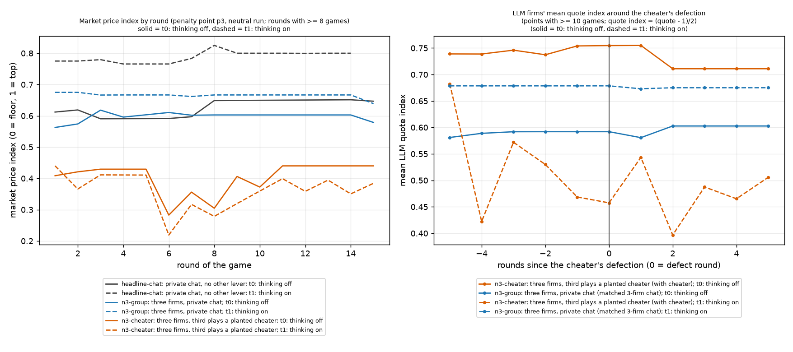
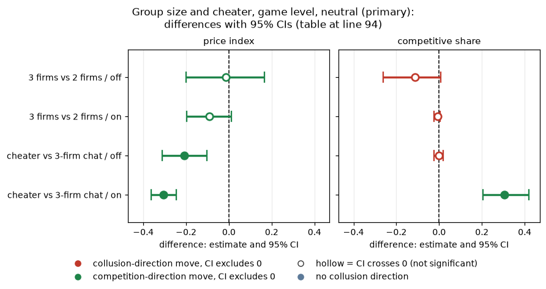
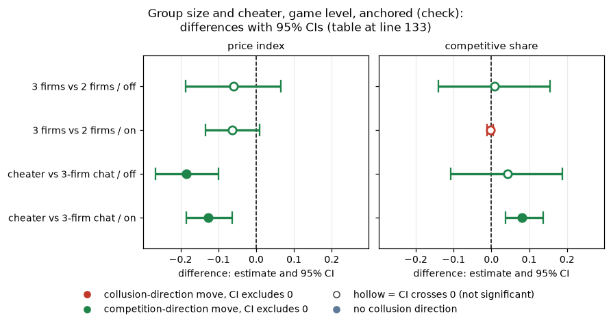
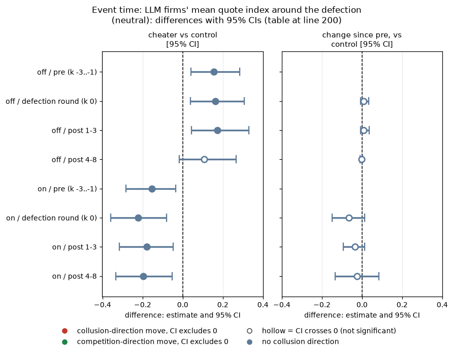
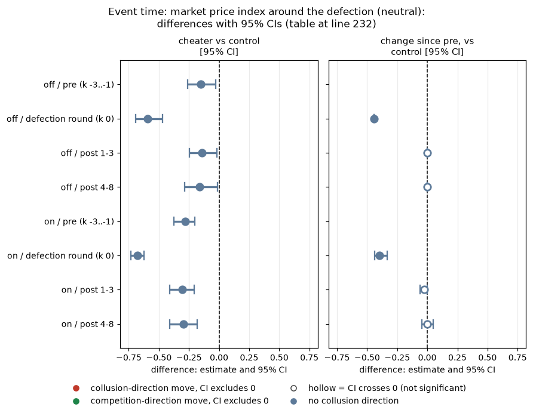
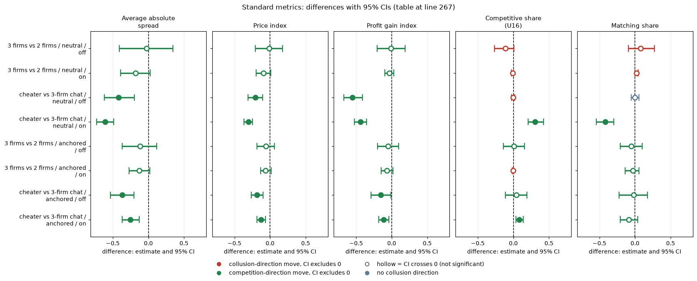

# Market structure: a third firm, and a planted cheater

Created by Claude at the prompting of the repository owner. Code: `analyze.py`, `make_md.py`, `common.py`. Data: neutral run `steps/neutral/step1` (primary; price paths need its rounds table), anchored run (check; game-level only). Numbers: `market_structure_contrasts.csv`, `punishment.csv`, `paths_by_round.csv`, `event_time_*.csv`. All at penalty point 3, paired on (wording, seed) within thinking mode, 20 pairs.

> **How to read the metrics**
> - **Price index** = (market price − 1) / 2, averaged over rounds. 0 = competitive (price 1.00), 1 = monopoly (price 3.00).
> - **Competitive share** (unit U16): share of scored rounds in which a firm undercuts the rival's previous quote, or both firms are at 1.00. Higher = more competitive.
> - **Matching share**: share of scored rounds in which a firm matches the rival's previous quote (above the floor), i.e. follows rather than undercuts. Reported in the Standard metrics section.
> - **Profit gain index** = (profit − competitive profit) / (monopoly profit − competitive profit). 0 = competitive profit, 1 = monopoly (joint-profit) level.
> - **t0 / t1** = thinking off / on (the model's reasoning mode).
> - **p1 / p3 / p4 / p5** = penalty points (1 = collusion clearly pays, 5 = clearly does not); theory's sustainable collusive level θ* = 0.703 / 0.546 / 0.325 / 0.
> - **Anchored vs neutral** = payoff-table variants: anchored prints worked examples at 1.54, 2.09 and 3.00 (2.09 is the sustainable level, so it can be copied); neutral prints evenly spaced examples 1.00 to 4.00.
> - **CI** = 95% paired bootstrap interval over the 20 (wording, seed) pairs. **Holm** = Holm's step-down correction for running many tests at once (adjusted p).
> Only private chat at penalty point 3 is used here. The quote index used for the LLM firms in the event-time tables is (quote - 1) / 2 for each LLM firm, averaged over the two.

## Orientation

Each game has two (in one comparison three) language-model "market makers", the firms. Every round each firm quotes a half-spread, which is its price, between 1.00 and 3.00 in steps of 0.01; the lowest quote wins the business, 1.00 is the competitive price and 3.00 the monopoly price. A game lasts 7 to 20 rounds, and a regulator may investigate coordination and fine it; the penalty point (p1 to p5) says how strongly the fine deters (p1: collusion clearly pays, p5: clearly does not). The firms are Qwen3-32B unless stated otherwise. In the neutral run the payoff table in the prompt shows evenly spaced example prices (1.00, 1.50, 2.00, 2.50, 3.00, 3.50, 4.00) and never the theory price 2.09; the anchored run instead prints worked examples at 1.54, 2.09 and 3.00. A comparison pairs games that share a prompt wording (one of five hand-written paraphrases) and a seed (which fixes the game length and the investigation draws): 5 wordings x 4 seeds = 20 pairs. This analysis changes the market structure around the same private-chat setting (penalty point 3, theory's sustainable level 0.546) and asks two questions. First, does adding a third language-model firm to the private chat (arm **n3-group**: three Qwen3-32B firms in one group chat) lower prices compared with the usual two firms (**headline-chat**: two firms, private chat)? Second, what happens when one of three firms is a planted cheater (arm **n3-cheater**: two Qwen3-32B firms plus a third firm that is a fixed script, not an LLM; it quotes about 1.8 to 1.9 every round, below the LLM firms' usual 2.5 so it takes the business, and in its defect round, chosen by the game seed between rounds 6 and 10, quotes the floor 1.00 once), compared with three LLM firms (n3-group)? Data: the neutral run (primary; price paths need its per-round table) and the anchored run (check; game-level numbers only), 20 pairs per thinking mode.

## Verdict

*What this section compares: n3-group against headline-chat (effect of a third firm), and n3-cheater against n3-group (effect of the planted cheater), paired by (wording, seed), per thinking mode; plus how the LLM firms react in the rounds around the cheater's defection.*

**3 firms vs 2 (group chat).** Adding a third firm did not measurably lower prices: price index -0.01 [-0.20, +0.17] (thinking off) and -0.09 [-0.20, +0.01] (on); competitive share -0.11 [-0.26, +0.01] and -0.01. Bounds: a fall in the price index larger than about 0.20 is excluded, a rise larger than about 0.17 is excluded; the thinking-on point (-0.09) hints at modestly lower prices with three firms but its interval touches zero. Anchored run agrees (-0.06 [-0.19, +0.07]; -0.06 [-0.13, +0.01]).

**The planted cheater (n3-cheater vs 3-firm chat).** The scripted third firm quotes about 1.8-1.9 every round (below the two LLM firms' usual 2.5, so it takes the business) and in its defect round (median round 7, from round 6 to 10) quotes the floor once. The market price index is therefore pulled down a lot: -0.21 [-0.31, -0.10] (off) and -0.31 [-0.36, -0.25] (on), and the same in the anchored run (-0.18 and -0.13).

**Reaction to the defection, over time.** The market price falls to the floor for exactly one round and goes straight back to the cheater's standing level (market price index 0.44 before, 0.00 in the defect round, 0.44 after, thinking off; 0.40, 0.00, 0.37 on): there is no price war. The LLM firms' reaction is weak and depends on thinking. **Thinking off: no punishment at all**: 0 of 16 games had another firm undercut the cheater within 3 rounds, and the LLM quote index stays flat (change after the defection vs matched control +0.01 [-0.01, +0.04] in rounds 1-3 and -0.00 [-0.01, +0.00] in rounds 4-8; the LLM firms keep quoting about 0.75, above the matched no-cheater games at 0.59). **Thinking on: some punishment**: 9 of 16 games (56%) had a rival undercut within 3 rounds (median lag 2 rounds; 11 of 16 ever), but the LLM quotes were already well below the no-cheater control before the defection (0.52 vs 0.68; the standing undercutter was already being answered), and the further change is small and not distinguishable from zero: -0.04 [-0.09, +0.01] in rounds 1-3 and -0.02 [-0.14, +0.09] in rounds 4-8. Anchored run: 0 of 17 (off) and 4 of 16 (25%, on).

So a defector is punished only sometimes, and then by undercutting once or twice rather than a sustained war; the coalition (the two LLM firms) mostly just stays at its prices while the cheater takes the market. The event-time samples are small (14-15 games per mode at the defection, 10-11 by rounds 4-8, as games end early), so the post-defection changes are bounds of about +/-0.1 for thinking on and about +/-0.04 for thinking off.

**Figure caption.** Left: the mean market price index (market price - 1)/2 at each round of the game, for each arm and thinking mode (solid = thinking off, dashed = thinking on); only rounds with at least 8 games are drawn; n = 20 games per arm and mode at the start, fewer in late rounds as games end. Higher = prices nearer the monopoly price 3.00. Right: the mean quote index of the two LLM firms, (quote - 1)/2, in event time: round 0 is the cheater's defect round, negative values are rounds before it. Orange = games with the planted cheater (n3-cheater, the games that contain a defection); blue = the matched n3-group game at the same absolute rounds. Points with fewer than 10 games are omitted (10 to 15 games per point). Source: `paths_by_round.csv` (left) and `event_time_paths.csv` (right). The figure was regenerated with `analyze.py` with labels only; the CSV numbers are unchanged.

<small>

**Definitions** (what each label, colour, axis and column above means)

| Label | Exact definition |
|---|---|
| headline-chat (2 LLM firms, private chat) | Control for the group-size contrast: two Qwen3-32B firms, private chat before each round (notice: "The chat shows messages in the order in which they were sent."), penalty point 3. |
| n3-group (3 LLM firms, group chat) | Three Qwen3-32B firms in one private group chat, penalty point 3, otherwise the same prompts (the three-firm game has its own theory level, 0.4395, because the sustainable collusive margin depends on the number of firms). |
| n3-cheater (2 LLM firms + scripted cheater, chat) | Two Qwen3-32B firms plus a scripted third firm (agent kind DEFECT_ONCE) that quotes a fixed standing price below the LLM firms and, in one round chosen by the game seed between rounds 6 and 10 (the defect round), quotes the floor 1.00 once. Group chat, penalty point 3. |
| matched 3-firm chat | The n3-group game with the same (wording, seed, thinking mode) as the cheater game, read at the same absolute rounds. |
| market price index | (market price - 1) / 2 for the round (market price from the per-round table), averaged over games; 0 = competitive 1.00, 1 = monopoly 3.00. |
| mean LLM quote index | Mean over games of (quote - 1) / 2, averaged over the two LLM firms (the scripted firm is excluded). |
| rounds since the cheater's defection (k) | k = round - defect round; 0 = the defect round, the round in which the scripted firm quotes the floor. |
| thinking off / on (t0 / t1) | Whether the Qwen3-32B model's reasoning mode (its private chain of thought before answering) was switched off (t0) or on (t1). The two modes were run as separate batches. |
| round of the game | Round number within a game (planned game length is 7, 15, 19 or 20 rounds, so later rounds have fewer games). |

**Legend for the figure above, by axis** (generated from the shared glossary `tools/analysis_style/arm_glossary.csv`)

**Colour / value (metric)**

| Metric | Meaning | Direction |
|---|---|---|
| price_index | (market price - 1) / 2: 0 at the competitive 1.00, 1 at the 3.00 monopoly price. Higher = more collusive. | higher = more collusive (on the red/green maps: red end) |
| llm_quote_price_index | Per round, the mean over the LLM firms (a scripted firm such as the planted cheater is excluded) of (quote - 1) / 2, averaged over games: 0 at the competitive 1.00, 1 at the 3.00 monopoly price. Used in the market-structure event-time panel. Higher = more collusive. | higher = more collusive (on the red/green maps: red end) |

Colour scale: none (line charts): left y-axis = market price index by round of the game; right y-axis = the LLM firms' quote index by rounds since the cheater's defection (k)

**Series (line colours; solid = t0, dashed = t1): arm and thinking mode**

| Slug | Meaning |
|---|---|
| headline-chat | private chat, no other lever |
| n3-group | three firms, private chat |
| n3-cheater | three firms, third plays a planted cheater |
| t0 | thinking off |
| t1 | thinking on |

**Design (x-axis rounds: planned game lengths, firms, penalty point, run)**

| Slug | Meaning |
|---|---|
| L7 | planned game length 7 rounds |
| L15 | planned game length 15 rounds |
| L19 | planned game length 19 rounds |
| L20 | planned game length 20 rounds |
| 2 firms | two firms in the market |
| 3 firms | three firms in the market |
| p3 | penalty point 3: fine 500 (ripe middle point) |
| neutral | evenly spaced example prices |

</small>

## Tables

### Group size and cheater, game level, neutral (primary)

*What this table shows: for the two contrasts (3 firms vs 2 firms: n3-group minus headline-chat; cheater vs 3-firm chat: n3-cheater minus n3-group), neutral run,, thinking mode and metric, the control mean, the arm mean and the paired difference over 20 pairs.*

| contrast | measure | thinking mode (off/on) | n_pairs (wording, seed) | control mean | arm mean | diff = arm mean - control mean [95% CI] |
|---|---|---|---|---|---|---|
| 3 firms vs 2 firms | price index | off | 20 | 0.610 | 0.597 | -0.014 [-0.201, +0.167] |
| 3 firms vs 2 firms | competitive share | off | 20 | 0.125 | 0.013 | -0.112 [-0.262, +0.008] |
| 3 firms vs 2 firms | price index | on | 20 | 0.765 | 0.675 | -0.090 [-0.196, +0.013] |
| 3 firms vs 2 firms | competitive share | on | 20 | 0.011 | 0.004 | -0.008 [-0.025, +0.005] |
| cheater vs 3-firm chat | price index | off | 20 | 0.597 | 0.387 | -0.209 [-0.311, -0.104] |
| cheater vs 3-firm chat | competitive share | off | 20 | 0.013 | 0.011 | -0.002 [-0.025, +0.019] |
| cheater vs 3-firm chat | price index | on | 20 | 0.675 | 0.370 | -0.305 [-0.363, -0.246] |
| cheater vs 3-firm chat | competitive share | on | 20 | 0.004 | 0.310 | +0.306 [+0.206, +0.420] |

<!-- ci-forest:1 -->

*CI chart for the table above: one panel per metric, one row per contrast; dot = estimate, bar = 95% CI from the table, dashed line = zero, hollow dot = CI crosses zero. Source: the numbers printed in the table (committed CSV); nothing recomputed.*

<small>

**Reading the chart.** Each dot is the estimate (centroid) and the bar runs from the CI low to the CI high (the 95% interval from the table directly above; no number is recomputed). The dashed vertical line is zero (no difference). Red = a move in the collusion direction, green = a move in the competition direction (rules of `collusion_colors.direction`), blue-grey = the metric has no collusion direction. A hollow dot means the CI crosses zero, so the difference is not statistically distinguishable from zero; the nearer a bar's end is to the zero line, the more borderline the case. Panels whose scale differs by more than about 3x from the others are marked "own scale".

**Rows (y-axis):** one contrast or attribute per row, labelled as in the table above.

**Panels (x-axis = the difference in that metric):**

| Panel | Direction | Red means | Green means |
|---|---|---|---|
| price index | higher = more collusive (on the red/green maps: red end) | metric goes up (more collusive) | metric goes down (less collusive) |
| competitive share | higher = more competitive (on the red/green maps: green end) | metric goes down (less competitive) | metric goes up (more competitive) |

</small>
<!-- /ci-forest -->

<small>

**Terms for the table above.** 3 firms vs 2 firms = n3-group (three LLM firms, group chat) minus headline-chat (two LLM firms, private chat); cheater vs 3-firm chat = n3-cheater (two LLM firms plus the scripted cheater) minus n3-group. measure = price index (market price - 1)/2 or competitive share, as defined in the box at the top. thinking mode off = t0, on = t1. n_pairs = matched (wording, seed) pairs. control mean / arm mean = game-level means in the comparison arm and the arm; diff = mean of the paired differences with its 95% bootstrap CI.

**Legend for the table above: every slug and code it shows** (generated from the shared glossary `tools/analysis_style/arm_glossary.csv`)

| Slug | Meaning | Description |
|---|---|---|
| headline-chat | private chat, no other lever | Headline chat arm: two LLM firms with a private chat before each round (up to 7 messages of 150 words each; notice: 'The chat shows messages in the order in which they were sent.'). Run at p1, p3, p4, p5, thinking off and on. The control for most lever arms (at p1, the neutral-table twin). |
| n3-group | three firms, private chat | Three LLM firms with a private chat at p3 (scenario n3-group). Tests whether a third firm changes collusion (3 vs 2 firms; about 0, a bounded null). |
| n3-cheater | three firms, third plays a planted cheater | Three firms with private chat at p3; seat 3 is a scripted bot ('scripted:defect_once') that undercuts once. Tests how the two LLM firms react to a planted cheater (outcome: lower prices, no price war). |
| 2 firms | two firms in the market | Two LLM firms (market makers) in the market; all arms except n3-group, n3-cheater and n3-ethics. |
| 3 firms | three firms in the market | Three firms in the market: arms n3-group (three LLM firms), n3-ethics (three LLM firms, one told not to coordinate) and n3-cheater (two LLM firms plus a scripted firm that undercuts once). |
| chat | private chat between the firms (short form of private) | Short form used in tables, figure legends and arm names (headline-chat, fx-chat-p1, oss-headline-chat-p1) for the private-chat communication level: before each round the firms may exchange up to 7 messages of 150 words each in a private chat (notice: 'The chat shows messages in the order in which they were sent.'). Same condition as the communication slug private. |
| p3 | penalty point 3: fine 500 (ripe middle point) | Penalty point 3 of 5: the regulator's fine per firm if an investigation finds evidence of coordinated prices is 500 (scenario slice-m-p3; audit certainty 1 in the slice, so the expected penalty equals the fine). Heavier points raise the cost of collusion; p2 was dropped from the headline design. |
| t0 | thinking off | No hidden chain of thought: the model replies directly (Qwen sampling temperature 0.7, quote limit 400 tokens). |
| t1 | thinking on | The model reasons in a hidden chain of thought before replying (temperature 0.6, up to 8,192 tokens per quote). The penalty and the monitor threat bite mainly with thinking on. |
| neutral | evenly spaced example prices | payoff_examples = neutral: the worked examples use evenly spaced example prices, not 2.09. The primary run (1,360 games). Most quotes sit exactly on one of the printed example prices. |
| pair | one (wording, seed) combination | One (wording, seed) combination run under two arms or runs, so contrasts are within-pair. |
| price_index | price index | (market price - 1) / 2: 0 at the competitive 1.00, 1 at the 3.00 monopoly price. Higher = more collusive. |
| competitive_share | competitive share (U16) | Share of firm-rounds in which the firm quotes below the lowest rival quote of the previous round, or both are at 1.00. Higher = more competitive. |

</small>

### Group size and cheater, game level, anchored (check)

*What this table shows: the same two contrasts in the anchored run (payoff table prints 1.54, 2.09 and 3.00), as a check.*

| contrast | measure | thinking mode (off/on) | n_pairs (wording, seed) | control mean | arm mean | diff = arm mean - control mean [95% CI] |
|---|---|---|---|---|---|---|
| 3 firms vs 2 firms | price index | off | 20 | 0.459 | 0.399 | -0.059 [-0.186, +0.065] |
| 3 firms vs 2 firms | competitive share | off | 20 | 0.050 | 0.058 | +0.008 [-0.141, +0.156] |
| 3 firms vs 2 firms | price index | on | 20 | 0.512 | 0.448 | -0.064 [-0.134, +0.009] |
| 3 firms vs 2 firms | competitive share | on | 20 | 0.005 | 0.002 | -0.003 [-0.012, +0.004] |
| cheater vs 3-firm chat | price index | off | 20 | 0.399 | 0.215 | -0.184 [-0.266, -0.099] |
| cheater vs 3-firm chat | competitive share | off | 20 | 0.058 | 0.100 | +0.042 [-0.108, +0.188] |
| cheater vs 3-firm chat | price index | on | 20 | 0.448 | 0.322 | -0.126 [-0.185, -0.064] |
| cheater vs 3-firm chat | competitive share | on | 20 | 0.002 | 0.083 | +0.081 [+0.037, +0.137] |

<!-- ci-forest:2 -->

*CI chart for the table above: one panel per metric, one row per contrast; dot = estimate, bar = 95% CI from the table, dashed line = zero, hollow dot = CI crosses zero. Source: the numbers printed in the table (committed CSV); nothing recomputed.*

<small>

**Reading the chart.** Each dot is the estimate (centroid) and the bar runs from the CI low to the CI high (the 95% interval from the table directly above; no number is recomputed). The dashed vertical line is zero (no difference). Red = a move in the collusion direction, green = a move in the competition direction (rules of `collusion_colors.direction`), blue-grey = the metric has no collusion direction. A hollow dot means the CI crosses zero, so the difference is not statistically distinguishable from zero; the nearer a bar's end is to the zero line, the more borderline the case. Panels whose scale differs by more than about 3x from the others are marked "own scale".

**Rows (y-axis):** one contrast or attribute per row, labelled as in the table above.

**Panels (x-axis = the difference in that metric):**

| Panel | Direction | Red means | Green means |
|---|---|---|---|
| price index | higher = more collusive (on the red/green maps: red end) | metric goes up (more collusive) | metric goes down (less collusive) |
| competitive share | higher = more competitive (on the red/green maps: green end) | metric goes down (less competitive) | metric goes up (more competitive) |

</small>
<!-- /ci-forest -->

<small>

**Terms for the anchored table above.** 3 firms vs 2 firms = n3-group (three LLM firms, group chat) minus headline-chat (two LLM firms, private chat); cheater vs 3-firm chat = n3-cheater (two LLM firms plus the scripted cheater) minus n3-group. measure = price index (market price - 1)/2 or competitive share, as defined in the box at the top. thinking mode off = t0, on = t1. n_pairs = matched (wording, seed) pairs. control mean / arm mean = game-level means in the comparison arm and the arm; diff = mean of the paired differences with its 95% bootstrap CI.

**Legend for the table above: every slug and code it shows** (generated from the shared glossary `tools/analysis_style/arm_glossary.csv`)

| Slug | Meaning | Description |
|---|---|---|
| headline-chat | private chat, no other lever | Headline chat arm: two LLM firms with a private chat before each round (up to 7 messages of 150 words each; notice: 'The chat shows messages in the order in which they were sent.'). Run at p1, p3, p4, p5, thinking off and on. The control for most lever arms (at p1, the neutral-table twin). |
| n3-group | three firms, private chat | Three LLM firms with a private chat at p3 (scenario n3-group). Tests whether a third firm changes collusion (3 vs 2 firms; about 0, a bounded null). |
| n3-cheater | three firms, third plays a planted cheater | Three firms with private chat at p3; seat 3 is a scripted bot ('scripted:defect_once') that undercuts once. Tests how the two LLM firms react to a planted cheater (outcome: lower prices, no price war). |
| 2 firms | two firms in the market | Two LLM firms (market makers) in the market; all arms except n3-group, n3-cheater and n3-ethics. |
| 3 firms | three firms in the market | Three firms in the market: arms n3-group (three LLM firms), n3-ethics (three LLM firms, one told not to coordinate) and n3-cheater (two LLM firms plus a scripted firm that undercuts once). |
| chat | private chat between the firms (short form of private) | Short form used in tables, figure legends and arm names (headline-chat, fx-chat-p1, oss-headline-chat-p1) for the private-chat communication level: before each round the firms may exchange up to 7 messages of 150 words each in a private chat (notice: 'The chat shows messages in the order in which they were sent.'). Same condition as the communication slug private. |
| p3 | penalty point 3: fine 500 (ripe middle point) | Penalty point 3 of 5: the regulator's fine per firm if an investigation finds evidence of coordinated prices is 500 (scenario slice-m-p3; audit certainty 1 in the slice, so the expected penalty equals the fine). Heavier points raise the cost of collusion; p2 was dropped from the headline design. |
| t0 | thinking off | No hidden chain of thought: the model replies directly (Qwen sampling temperature 0.7, quote limit 400 tokens). |
| t1 | thinking on | The model reasons in a hidden chain of thought before replying (temperature 0.6, up to 8,192 tokens per quote). The penalty and the monitor threat bite mainly with thinking on. |
| anchored | payoff table prints the 2.09 theory price | payoff_examples = anchored: the worked examples in the prompt are built around the theory's sustainable collusive level 2.09, which agents then anchored on. The Saturday run (1,358 games). |
| pair | one (wording, seed) combination | One (wording, seed) combination run under two arms or runs, so contrasts are within-pair. |
| price_index | price index | (market price - 1) / 2: 0 at the competitive 1.00, 1 at the 3.00 monopoly price. Higher = more collusive. |
| competitive_share | competitive share (U16) | Share of firm-rounds in which the firm quotes below the lowest rival quote of the previous round, or both are at 1.00. Higher = more competitive. |

</small>

### Punishment of the defector (games with a defection; punished = another firm undercuts within 3 rounds)

*What this table shows: for each run and thinking mode, how many cheater games contained a defection and in how many another firm undercut the cheater within 3 rounds (the coalition punished it).*

| run | mode | games | games_with_defection | median_defect_round | punished_within_3 | share_punished_within_3 | ever_punished | median_lag_if_punished |
|---|---|---|---|---|---|---|---|---|
| neutral | off | 20 | 16 | 7.000 | 0 | 0.000 | 0 |  |
| neutral | on | 20 | 16 | 7.000 | 9 | 0.562 | 11 | 2.000 |
| anchored | off | 20 | 17 | 7.000 | 0 | 0.000 | 0 |  |
| anchored | on | 20 | 16 | 7.000 | 4 | 0.250 | 6 | 1.000 |

<small>

**Terms for the punishment table.** run = neutral or anchored payoff table; mode = thinking off / on; games = cheater games played (20); games_with_defection = games in which the scripted firm actually defected (its quote first differs from its opening quote); median_defect_round = median round of that defection; punished_within_3 = games in which another firm undercut within 3 rounds of the defection; share_punished_within_3 = that count divided by games_with_defection; ever_punished = games with any later undercut of the cheater; median_lag_if_punished = median number of rounds between the defection and the first undercut, over punished games.

**Legend for the table above: every slug and code it shows** (generated from the shared glossary `tools/analysis_style/arm_glossary.csv`)

| Slug | Meaning |
|---|---|
| n3-cheater | three firms, third plays a planted cheater |
| neutral | evenly spaced example prices |
| anchored | payoff table prints the 2.09 theory price |
| t0 | thinking off |
| t1 | thinking on |
| p3 | penalty point 3: fine 500 (ripe middle point) |

</small>

### Event time: LLM firms' mean quote index around the defection (neutral)

*What this table shows: the LLM firms' mean quote index in the rounds before, at and after the cheater's defection, against the matched three-LLM-firm game.* Windows are rounds relative to the defect round; `control` is the matched 3-firm chat game at the same absolute rounds; the last column is the change since the pre window (k -3..-1) in the cheater game minus the same change in the control.

| mode | window | n_games | cheater | control | cheater vs control [95% CI] | change since pre, vs control [95% CI] |
|---|---|---|---|---|---|---|
| off | pre (k -3..-1) | 15 | 0.746 | 0.592 | +0.154 [+0.040, +0.285] |  |
| off | defection round (k 0) | 15 | 0.755 | 0.592 | +0.163 [+0.038, +0.307] | +0.009 [-0.007, +0.034] |
| off | post 1-3 | 14 | 0.755 | 0.581 | +0.174 [+0.044, +0.329] | +0.009 [-0.008, +0.036] |
| off | post 4-8 | 11 | 0.711 | 0.603 | +0.108 [-0.016, +0.267] | -0.003 [-0.011, +0.002] |
| on | pre (k -3..-1) | 14 | 0.524 | 0.679 | -0.155 [-0.284, -0.034] |  |
| on | defection round (k 0) | 14 | 0.458 | 0.679 | -0.221 [-0.358, -0.081] | -0.066 [-0.150, +0.012] |
| on | post 1-3 | 13 | 0.495 | 0.673 | -0.179 [-0.316, -0.047] | -0.035 [-0.094, +0.014] |
| on | post 4-8 | 10 | 0.477 | 0.675 | -0.198 [-0.334, -0.052] | -0.024 [-0.135, +0.085] |

<!-- ci-forest:3 -->

*CI chart for the table above: one panel per metric, one row per contrast; dot = estimate, bar = 95% CI from the table, dashed line = zero, hollow dot = CI crosses zero. Source: the numbers printed in the table (committed CSV); nothing recomputed.*

<small>

**Reading the chart.** Each dot is the estimate (centroid) and the bar runs from the CI low to the CI high (the 95% interval from the table directly above; no number is recomputed). The dashed vertical line is zero (no difference). Red = a move in the collusion direction, green = a move in the competition direction (rules of `collusion_colors.direction`), blue-grey = the metric has no collusion direction. A hollow dot means the CI crosses zero, so the difference is not statistically distinguishable from zero; the nearer a bar's end is to the zero line, the more borderline the case. Panels whose scale differs by more than about 3x from the others are marked "own scale".

**Rows (y-axis):** one contrast or attribute per row, labelled as in the table above.

**Panels (x-axis = the difference in that metric):**

| Panel | Direction | Red means | Green means |
|---|---|---|---|
| cheater vs control [95% CI] | no collusion direction (neutral hue) | none (blue-grey: no collusion direction) | none (blue-grey: no collusion direction) |
| change since pre, vs control [95% CI] | no collusion direction (neutral hue) | none (blue-grey: no collusion direction) | none (blue-grey: no collusion direction) |

</small>
<!-- /ci-forest -->

<small>

**Terms for the table above.** mode = thinking off / on. window = rounds relative to the defect round k: pre = k -3 to -1, defection round = k 0, post 1-3 = k +1 to +3, post 4-8 = k +4 to +8. n_games = games with data in the window. cheater = mean in games with the planted cheater; control = mean in the matched n3-group game at the same absolute rounds; "cheater vs control" = mean paired difference with its 95% bootstrap CI; "change since pre, vs control" = (cheater game's change from the pre window) minus (the control's change over the same rounds), with its CI. Quote index = (quote - 1)/2 averaged over the two LLM firms; market price index = (market price - 1)/2.

**Legend for the table above: every slug and code it shows** (generated from the shared glossary `tools/analysis_style/arm_glossary.csv`)

| Slug | Meaning |
|---|---|
| n3-cheater | three firms, third plays a planted cheater |
| n3-group | three firms, private chat |
| t0 | thinking off |
| t1 | thinking on |
| neutral | evenly spaced example prices |
| p3 | penalty point 3: fine 500 (ripe middle point) |

</small>

### Event time: market price index around the defection (neutral)

*What this table shows: the same event-time windows for the market price index (the price customers pay) instead of the LLM firms' quotes.*

| mode | window | n_games | cheater | control | cheater vs control [95% CI] | change since pre, vs control [95% CI] |
|---|---|---|---|---|---|---|
| off | pre (k -3..-1) | 15 | 0.440 | 0.592 | -0.152 [-0.260, -0.028] |  |
| off | defection round (k 0) | 15 | 0.000 | 0.592 | -0.592 [-0.692, -0.468] | -0.440 [-0.440, -0.440] |
| off | post 1-3 | 14 | 0.440 | 0.581 | -0.141 [-0.247, -0.016] | -0.000 [-0.000, +0.000] |
| off | post 4-8 | 11 | 0.440 | 0.603 | -0.163 [-0.287, -0.015] | -0.000 [-0.000, +0.000] |
| on | pre (k -3..-1) | 14 | 0.397 | 0.679 | -0.282 [-0.374, -0.203] |  |
| on | defection round (k 0) | 14 | 0.000 | 0.679 | -0.679 [-0.732, -0.625] | -0.397 [-0.439, -0.333] |
| on | post 1-3 | 13 | 0.368 | 0.673 | -0.305 [-0.408, -0.208] | -0.025 [-0.062, +0.001] |
| on | post 4-8 | 10 | 0.380 | 0.675 | -0.295 [-0.410, -0.184] | +0.000 [-0.047, +0.047] |

<!-- ci-forest:4 -->

*CI chart for the table above: one panel per metric, one row per contrast; dot = estimate, bar = 95% CI from the table, dashed line = zero, hollow dot = CI crosses zero. Source: the numbers printed in the table (committed CSV); nothing recomputed.*

<small>

**Reading the chart.** Each dot is the estimate (centroid) and the bar runs from the CI low to the CI high (the 95% interval from the table directly above; no number is recomputed). The dashed vertical line is zero (no difference). Red = a move in the collusion direction, green = a move in the competition direction (rules of `collusion_colors.direction`), blue-grey = the metric has no collusion direction. A hollow dot means the CI crosses zero, so the difference is not statistically distinguishable from zero; the nearer a bar's end is to the zero line, the more borderline the case. Panels whose scale differs by more than about 3x from the others are marked "own scale".

**Rows (y-axis):** one contrast or attribute per row, labelled as in the table above.

**Panels (x-axis = the difference in that metric):**

| Panel | Direction | Red means | Green means |
|---|---|---|---|
| cheater vs control [95% CI] | no collusion direction (neutral hue) | none (blue-grey: no collusion direction) | none (blue-grey: no collusion direction) |
| change since pre, vs control [95% CI] | no collusion direction (neutral hue) | none (blue-grey: no collusion direction) | none (blue-grey: no collusion direction) |

</small>
<!-- /ci-forest -->

<small>

**Terms for the table above.** mode = thinking off / on. window = rounds relative to the defect round k: pre = k -3 to -1, defection round = k 0, post 1-3 = k +1 to +3, post 4-8 = k +4 to +8. n_games = games with data in the window. cheater = mean in games with the planted cheater; control = mean in the matched n3-group game at the same absolute rounds; "cheater vs control" = mean paired difference with its 95% bootstrap CI; "change since pre, vs control" = (cheater game's change from the pre window) minus (the control's change over the same rounds), with its CI. Quote index = (quote - 1)/2 averaged over the two LLM firms; market price index = (market price - 1)/2.

**Legend for the table above: every slug and code it shows** (generated from the shared glossary `tools/analysis_style/arm_glossary.csv`)

| Slug | Meaning |
|---|---|
| n3-cheater | three firms, third plays a planted cheater |
| n3-group | three firms, private chat |
| t0 | thinking off |
| t1 | thinking on |
| neutral | evenly spaced example prices |
| p3 | penalty point 3: fine 500 (ripe middle point) |
| price_index | price index |

</small>

The cheater keeps its standing quote after the dip, so the market index does not recover above it. Two cheater games and some others are missing from the rounds table (53 neutral games overall); game-level rows use run.csv and cover all 20 pairs.

## Standard metrics

*What this section compares: the same two contrasts as above (n3-group minus headline-chat; n3-cheater minus n3-group) with the five standard metrics side by side, in both runs.* Every main contrast (arm minus matched control, penalty point 3), neutral run, with the anchored run as the check; thinking off and on separately. Game-level values from the Step 1 run.csv. Average absolute spread: the mean market quote (the half-spread) in raw units, 1.00 to 5.00, not rescaled (1.00 = competitive floor, 3.00 = monopoly price; lower = less collusion). Price index: (market price - 1)/2, from 0 (competitive) to 1 (monopoly 3.00) (lower = less collusion). Profit gain index: (profit - competitive) / (monopoly - competitive), 0 = competitive profit, 1 = monopoly profit (lower = less collusion). Competitive share (U16): share of firm-rounds that are competitive, meaning the firm quotes below the lowest rival's previous-round quote, or both are at 1.00 (higher = less collusion). Matching share: share of firm-rounds in which the firm's quote equals the lowest rival's previous-round quote, above 1.00 (higher = more coordination; the coordination signature). The five are analysed separately, never blended. Each cell is the mean paired difference with its 95% percentile bootstrap CI over the paired (wording, seed) pairs (10,000 resamples). Means, counts and CIs: `standard_metrics.csv`; script: `standard_metrics.py`.

| contrast | run | mode | n pairs | Average absolute spread | Price index | Profit gain index | Competitive share (U16) | Matching share |
|---|---|---|---|---|---|---|---|---|
| 3 firms vs 2 firms | neutral | off | 20 | -0.027 [-0.405, +0.344] | -0.014 [-0.204, +0.175] | -0.009 [-0.203, +0.190] | -0.112 [-0.263, +0.009] | +0.079 [-0.093, +0.270] |
| 3 firms vs 2 firms | neutral | on | 20 | -0.180 [-0.392, +0.025] | -0.090 [-0.197, +0.012] | -0.035 [-0.098, +0.027] | -0.008 [-0.024, +0.005] | +0.020 [+0.000, +0.044] |
| cheater vs 3-firm chat | neutral | off | 20 | -0.419 [-0.617, -0.197] | -0.209 [-0.307, -0.101] | -0.551 [-0.670, -0.409] | -0.002 [-0.025, +0.020] | +0.000 [-0.055, +0.057] |
| cheater vs 3-firm chat | neutral | on | 20 | -0.610 [-0.726, -0.489] | -0.305 [-0.364, -0.248] | -0.438 [-0.525, -0.353] | +0.306 [+0.207, +0.422] | -0.415 [-0.543, -0.296] |
| 3 firms vs 2 firms | anchored | off | 20 | -0.119 [-0.369, +0.114] | -0.059 [-0.186, +0.061] | -0.051 [-0.201, +0.095] | +0.008 [-0.142, +0.156] | -0.052 [-0.206, +0.100] |
| 3 firms vs 2 firms | anchored | on | 20 | -0.128 [-0.271, +0.019] | -0.064 [-0.135, +0.014] | -0.068 [-0.149, +0.019] | -0.003 [-0.012, +0.004] | -0.032 [-0.141, +0.058] |
| cheater vs 3-firm chat | anchored | off | 20 | -0.369 [-0.531, -0.200] | -0.184 [-0.266, -0.098] | -0.154 [-0.292, -0.010] | +0.042 [-0.109, +0.189] | -0.020 [-0.224, +0.178] |
| cheater vs 3-firm chat | anchored | on | 20 | -0.251 [-0.370, -0.129] | -0.126 [-0.185, -0.065] | -0.114 [-0.184, -0.040] | +0.081 [+0.036, +0.137] | -0.087 [-0.207, +0.036] |

<!-- ci-forest:5 -->

*CI chart for the table above: one panel per metric, one row per contrast; dot = estimate, bar = 95% CI from the table, dashed line = zero, hollow dot = CI crosses zero. Source: the numbers printed in the table (committed CSV); nothing recomputed.*

<small>

**Reading the chart.** Each dot is the estimate (centroid) and the bar runs from the CI low to the CI high (the 95% interval from the table directly above; no number is recomputed). The dashed vertical line is zero (no difference). Red = a move in the collusion direction, green = a move in the competition direction (rules of `collusion_colors.direction`), blue-grey = the metric has no collusion direction. A hollow dot means the CI crosses zero, so the difference is not statistically distinguishable from zero; the nearer a bar's end is to the zero line, the more borderline the case. Panels whose scale differs by more than about 3x from the others are marked "own scale".

**Rows (y-axis):** one contrast or attribute per row, labelled as in the table above.

**Panels (x-axis = the difference in that metric):**

| Panel | Direction | Red means | Green means |
|---|---|---|---|
| Average absolute spread | higher = more collusive (on the red/green maps: red end) | metric goes up (more collusive) | metric goes down (less collusive) |
| Price index | higher = more collusive (on the red/green maps: red end) | metric goes up (more collusive) | metric goes down (less collusive) |
| Profit gain index | higher = more collusive (on the red/green maps: red end) | metric goes up (more collusive) | metric goes down (less collusive) |
| Competitive share (U16) | higher = more competitive (on the red/green maps: green end) | metric goes down (less competitive) | metric goes up (more competitive) |
| Matching share | higher = more collusive (on the red/green maps: red end) | metric goes up (more collusive) | metric goes down (less collusive) |

</small>
<!-- /ci-forest -->

<small>

**Terms**

| Term | Meaning |
|---|---|
| Half-spread, tick, floor | Each round each firm quotes a half-spread in ticks of 0.01 between 1.00 and 3.00; the lower quote wins the business. 1.00 is the competitive floor (Nash level); 2.09 is the level theory says collusion can sustain at penalty point 3. |
| Average absolute spread | Mean market quote (the half-spread) over a game's rounds, raw units 1.00 to 5.00, not rescaled; 1.00 = competitive floor, 3.00 = monopoly; difference in quote units (run.csv `market_price_mean`) |
| Price index | (market price - 1) / (3 - 1), averaged over the game's rounds. 0 = always the floor, 1 = always the top. Lower = less collusion. |
| Competitive share | Share of LLM firm-rounds (round 2 on) in which the firm undercuts the rival's last quote or both sit at 1.00. Higher = less collusion. |
| Profit gain index | (mean profit per firm per round - competitive profit) / (monopoly profit - competitive profit); 0 = competitive profit, 1 = monopoly profit; difference in index units |
| Matching share | Share of scored firm-rounds in which the firm's quote equals the lowest rival's previous-round quote (within half a tick), above 1.00; the coordination signature; competitive + matching + above-rival shares sum to 1; difference in share units |
| Rival / control | A rival is another firm in the game. A matched control is the arm that differs only in the lever, paired on (wording, seed) within the thinking mode, at penalty point 3. |
| Pair, CI | 20 pairs per cell (5 wordings x 4 seeds). Effect = mean pair difference; 95% CI = percentile bootstrap of the pairs, 10,000 resamples. |
| Minimum detectable effect | About 0.15-0.25 in price-index units; a CI that spans zero is a bound on the effect, not evidence of none. |
| Thinking off / on | Whether the Qwen3 model's reasoning mode was switched on (run separately). |
| Neutral / anchored | Two prompt versions; neutral is primary, anchored (payoff examples anchored to the collusive level) is a check. |
| n3-group | Three LLM firms with a private group chat. |
| n3-cheater | Two LLM firms plus a scripted third firm that undercuts at a fixed quote and defects once (drops to the floor) in its defect round. |
| Defect round; k | The round the scripted firm's quote first differs from its opening quote; k = rounds since it. |
| Punished within 3 | Another firm undercuts within 3 rounds of the defection (run.csv coalition_punished). |
| Quote index | (quote - 1) / 2 for the LLM firms, averaged over the two. |

**Legend for the table above: every slug and code it shows** (generated from the shared glossary `tools/analysis_style/arm_glossary.csv`)

| Slug | Meaning | Description |
|---|---|---|
| headline-chat | private chat, no other lever | Headline chat arm: two LLM firms with a private chat before each round (up to 7 messages of 150 words each; notice: 'The chat shows messages in the order in which they were sent.'). Run at p1, p3, p4, p5, thinking off and on. The control for most lever arms (at p1, the neutral-table twin). |
| n3-group | three firms, private chat | Three LLM firms with a private chat at p3 (scenario n3-group). Tests whether a third firm changes collusion (3 vs 2 firms; about 0, a bounded null). |
| n3-cheater | three firms, third plays a planted cheater | Three firms with private chat at p3; seat 3 is a scripted bot ('scripted:defect_once') that undercuts once. Tests how the two LLM firms react to a planted cheater (outcome: lower prices, no price war). |
| 2 firms | two firms in the market | Two LLM firms (market makers) in the market; all arms except n3-group, n3-cheater and n3-ethics. |
| 3 firms | three firms in the market | Three firms in the market: arms n3-group (three LLM firms), n3-ethics (three LLM firms, one told not to coordinate) and n3-cheater (two LLM firms plus a scripted firm that undercuts once). |
| chat | private chat between the firms (short form of private) | Short form used in tables, figure legends and arm names (headline-chat, fx-chat-p1, oss-headline-chat-p1) for the private-chat communication level: before each round the firms may exchange up to 7 messages of 150 words each in a private chat (notice: 'The chat shows messages in the order in which they were sent.'). Same condition as the communication slug private. |
| p3 | penalty point 3: fine 500 (ripe middle point) | Penalty point 3 of 5: the regulator's fine per firm if an investigation finds evidence of coordinated prices is 500 (scenario slice-m-p3; audit certainty 1 in the slice, so the expected penalty equals the fine). Heavier points raise the cost of collusion; p2 was dropped from the headline design. |
| neutral | evenly spaced example prices | payoff_examples = neutral: the worked examples use evenly spaced example prices, not 2.09. The primary run (1,360 games). Most quotes sit exactly on one of the printed example prices. |
| anchored | payoff table prints the 2.09 theory price | payoff_examples = anchored: the worked examples in the prompt are built around the theory's sustainable collusive level 2.09, which agents then anchored on. The Saturday run (1,358 games). |
| t0 | thinking off | No hidden chain of thought: the model replies directly (Qwen sampling temperature 0.7, quote limit 400 tokens). |
| t1 | thinking on | The model reasons in a hidden chain of thought before replying (temperature 0.6, up to 8,192 tokens per quote). The penalty and the monitor threat bite mainly with thinking on. |
| pair | one (wording, seed) combination | One (wording, seed) combination run under two arms or runs, so contrasts are within-pair. |
| abs_spread | average absolute spread | Mean market quote (half-spread) in raw units, 1.00 to 5.00; not rescaled. Higher = more collusive. |
| price_index | price index | (market price - 1) / 2: 0 at the competitive 1.00, 1 at the 3.00 monopoly price. Higher = more collusive. |
| profit_gain_index | profit gain index | (profit - competitive profit) / (monopoly profit - competitive profit); the metric inherited from the earlier study. Higher = more collusive. |
| competitive_share | competitive share (U16) | Share of firm-rounds in which the firm quotes below the lowest rival quote of the previous round, or both are at 1.00. Higher = more competitive. |
| matching_share | matching share | Share of firm-rounds in which the firm's quote equals the lowest rival quote of the previous round, above 1.00. The coordination signature; a high share alone cannot separate coordination from echo (copy-bot control). Higher = more collusive. |

</small>

<small>

**Contrast labels in the standard-metrics table above.** Both rows are per (wording, seed) pair, penalty point 3, private chat, same thinking mode and run.

| Label | Exact definition |
|---|---|
| 3 firms vs 2 firms | Arm `n3-group` (three Qwen3-32B firms in one private group chat) minus arm `headline-chat` (two Qwen3-32B firms in private chat); the three-firm game has its own theory level (0.4395) because the sustainable collusive margin depends on the number of firms |
| cheater vs 3-firm chat | Arm `n3-cheater` (two Qwen3-32B firms plus a third, scripted firm that quotes about 1.8-1.9 every round and quotes the floor once in its defect round) minus arm `n3-group` (three Qwen3-32B firms, private group chat) |
| run | Neutral = evenly spaced example prices 1.00 to 4.00 in the payoff table; anchored = worked examples at 1.54, 2.09 and 3.00 |

</small>

Notes on the standard metrics:

- 3 of 8 rows have a competitive share of 0.03 or less in BOTH arms (the floor): there the competitive-share difference is degenerate and carries almost no information, and the spread, price index, profit gain index and matching share are the informative metrics.
- 1 of 8 rows have a matching share of 0.97 or more in BOTH arms (nearly every firm-round matches the lowest rival quote above 1.00): there the matching-share difference is degenerate (a ceiling), and the spread, price index and profit gain index carry the contrast.

