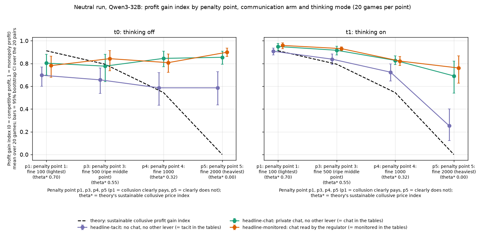
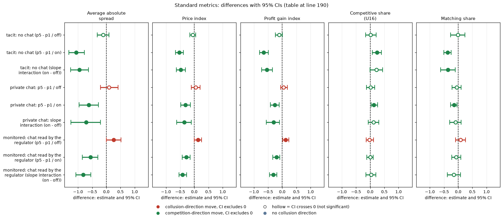

# Penalty: does a heavier expected fine lower prices, and does thinking matter?

## Orientation (what this report is about)

Two LLM "market makers" (Qwen3-32B, an open-weight language model) play a repeated pricing game. Each round, each firm quotes a **half-spread**, a price between 1.00 and 5.00 in steps ("ticks") of 0.01; the lower quote wins most of the customers. A quote of 1.00 is the competitive floor (costs covered, no excess profit) and 3.00 is the monopoly price. The game has an undisclosed cap of 40 rounds and about a 95% chance of continuing after each round. A regulator may investigate and fine collusion; the **penalty point** (1 to 5) sets how heavy the expected fine is: point 1 = fine 100 (collusion clearly pays; theory says a collusive price of 2.41 can be sustained), point 3 = fine 500 (2.09), point 4 = fine 1000 (1.65), point 5 = fine 2000 (theory says no collusion above the 1.00 floor is sustainable). This report asks: **does a heavier expected fine lower prices, and does it matter whether the model reasons ("thinks") before each answer?** It compares three communication arms, each at four penalty points and in both thinking modes: **tacit** (no chat channel; firms see only each other's quotes), **chat** (a private chat between the two firms, with the notice "The chat shows messages in the order in which they were sent."), and **monitored** (the same chat plus the notice "A regulator reads all messages in this chat, as they are sent."; this is text only, the investigation probability is unchanged). Data: the neutral run (the payoff table shows evenly spaced example prices 1.00 to 4.00 and never the theory price 2.09), 3 arms x 4 penalty points x 2 thinking modes x 20 games = 480 games. A general primer is in [RESEARCH_OVERVIEW](../../../RESEARCH_OVERVIEW.md).

> **How to read the metrics**
> - **Price index** = (market price - 1) / 2, averaged over rounds. 0 = competitive (price 1.00), 1 = monopoly (price 3.00).
> - **Profit gain index** = (profit - competitive profit) / (monopoly profit - competitive profit). 0 = competitive profit, 1 = monopoly (joint-profit) level.
> - **t0 / t1** = thinking off / on (the model's reasoning mode).
> - **p1 / p3 / p4 / p5** = penalty points (1 = collusion clearly pays, 5 = clearly does not); theory's sustainable collusive level theta* = 0.703 / 0.546 / 0.325 / 0.
> - **tacit / chat / monitored** = no chat channel / private chat between the two firms / private chat plus a notice that a regulator reads it (text only).
> - **Neutral vs anchored**: this report uses the neutral payoff table (evenly spaced examples 1.00 to 4.00). The anchored variant would print worked examples at 1.54, 2.09 and 3.00 (2.09 is the sustainable level, so it can be copied).
> - **CI** = 95% paired bootstrap interval over the 20 (wording, seed) pairs. **Holm** = Holm's step-down correction for running many tests at once (adjusted p).
> - **Competitive share** appears only in the Standard metrics table at the end (defined in its Terms table); matching share is not used.

A **(wording, seed) pair** is one of 5 hand-written paraphrases of every prompt text ("wording" 0 to 4) combined with one of 4 random seeds: 20 pairs, so each cell is 20 games, one per pair.

## Verdict in plain language

- **Only thinking-on models respond to the penalty, and only partly.** Moving from penalty point 1 (collusion clearly pays) to point 5 (clearly does not) lowers the profit gain index by 0.26 with private chat, 0.20 with monitored chat and 0.66 with silence (tacit) when thinking is on. With thinking off there is no drop: the change is +0.05 (chat), +0.12 (monitored, CI 0.02 to 0.24) and -0.11 (tacit, CI -0.25 to 0.01).
- **Thinking changes the slope.** The thinking-on minus thinking-off difference in the p5 - p1 slope for private chat is **-0.31 [-0.57, -0.10], Holm p = 0.016**. This reproduces the final number (-0.31 [-0.56, -0.10], Holm 0.016; the CI differs in the third decimal only because of the bootstrap seed). Tacit (-0.54) and monitored (-0.32) have the same sign and are stronger (Holm p < 0.001).
- **Even the responders fall far short of theory.** The theory curve falls from 0.91 to 0 on the gain index (sustainable price 0.70 to 0 on the price index), a slope of -0.91. The observed chat slopes (-0.26 thinking on, +0.05 off) are far shallower. At point 5, where theory says no collusion is sustainable, chat games still earn 0.69 (on) and 0.85 (off) of the gain; only thinking-on silence comes close to theory (0.25).
- **Thinking-off models are insensitive to the penalty altogether,** as if the fine were not part of their decision. Thinking-on models are sensitive but not enough to reach the competitive outcome.
- **Caveats.** 20 pairs per cell; the comparison is across penalty points 1 and 5 only (points 3 and 4 are in the figure); the thinking x penalty interaction is exploratory in the declared design, with Holm applied over the four interaction tests of the final family. Neutral run only.

## Design and data

This section states exactly which games and which formulas lie behind every number below.

- Neutral run, `run.csv` rows with status done, arms headline-tacit, headline-chat, headline-monitored, penalty points 1, 3, 4, 5, both thinking modes; 20 games per cell, one per (wording, seed) pair.
- Slope = penalty point 5 minus penalty point 1, computed within each (wording, seed) pair, then averaged. The interaction = slope(thinking on) minus slope(thinking off) within the pair. Bootstrap 95% CI over 20 pairs (10,000 resamples); exact sign-flip permutation p (all 2^20 flips); Holm over the four interaction tests (tacit, chat, monitored, monitoring x thinking), as in the final numbers.
- Theory curve: sustainable price index theta* = 0.703, 0.546, 0.325, 0 at points 1, 3, 4, 5 (0.440 is the ripe-point variant for other arms); on the gain index 0.912, 0.794, 0.544, 0 (from `FINAL_NUMBERS.md`). Theory slopes: -0.912 (gain) and -0.703 (price).
- Scripts: `penalty.py` and `common.py` (set `STEP1_DIR` to the Step 1 folder). Raw data is not checked in. Tables: `slopes.csv`, `interactions.csv`, `cells_by_penalty_point.csv`.

## Table 1. Slope p5 - p1 (profit gain index), mean over pairs [95% CI], sign-flip p

This table compares, for each communication arm, how much the profit gain index changes when the penalty goes from point 1 (light fine, collusion pays) to point 5 (heavy fine), separately for thinking off and on, and the difference between the two modes. Each slope is computed within each of the 20 (wording, seed) pairs (game at point 5 minus game at point 1) and then averaged; negative = prices fall as the fine rises. "Theory slope" is the fall theory predicts, 0 - 0.912.

| Communication | Thinking off | Thinking on | Interaction (on - off) [CI], Holm p | Theory slope |
|---|---|---|---|---|
| tacit | -0.11 [-0.25, 0.01], p 0.12 | -0.66 [-0.80, -0.49], p < 0.001 | -0.54 [-0.73, -0.35], <0.001 | -0.91 |
| private chat | +0.05 [-0.06, 0.18], p 0.48 | -0.26 [-0.43, -0.12], p 0.001 | -0.31 [-0.57, -0.10], 0.016 | -0.91 |
| monitored | +0.12 [0.02, 0.24], p 0.04 | -0.20 [-0.34, -0.08], p 0.001 | -0.32 [-0.45, -0.19], <0.001 | -0.91 |

<!-- ci-forest:1 -->
![CI forest chart for the table above (Table 1. Slope p5 - p1 (profit gain index), mean over pairs [95% CI], sign-flip p): estimates with 95% CI bars, red = collusion-direction move, green = competition-direction move, hollow = CI crosses zero](forest/ANALYSIS_ci01.png)

*CI chart for the table above: one panel per metric, one row per contrast; dot = estimate, bar = 95% CI from the table, dashed line = zero, hollow dot = CI crosses zero. Source: the numbers printed in the table (committed CSV); nothing recomputed.*

<small>

**Reading the chart.** Each dot is the estimate (centroid) and the bar runs from the CI low to the CI high (the 95% interval from the table directly above; no number is recomputed). The dashed vertical line is zero (no difference). Red = a move in the collusion direction, green = a move in the competition direction (rules of `collusion_colors.direction`), blue-grey = the metric has no collusion direction. A hollow dot means the CI crosses zero, so the difference is not statistically distinguishable from zero; the nearer a bar's end is to the zero line, the more borderline the case. Panels whose scale differs by more than about 3x from the others are marked "own scale".

**Rows (y-axis):** one contrast or attribute per row, labelled as in the table above (a glossary slug is expanded to "slug: short label").

| Slug | Meaning |
|---|---|
| tacit | no chat |
| monitored | chat read by the regulator |

**Panels (x-axis = the difference in that metric):**

| Panel | Direction | Red means | Green means |
|---|---|---|---|
| Thinking off | no collusion direction (neutral hue) | none (blue-grey: no collusion direction) | none (blue-grey: no collusion direction) |
| Thinking on | no collusion direction (neutral hue) | none (blue-grey: no collusion direction) | none (blue-grey: no collusion direction) |
| Interaction (on - off) [CI], Holm p | no collusion direction (neutral hue) | none (blue-grey: no collusion direction) | none (blue-grey: no collusion direction) |

</small>
<!-- /ci-forest -->

<small>

| Term | Meaning |
|---|---|
| Communication | tacit = no chat; private chat = chat between the two firms; monitored = private chat plus the text notice that a regulator reads it. |
| Thinking off / on | t0 / t1: Qwen3-32B answers directly / reasons before every call. |
| Slope p5 - p1 | Mean over the 20 pairs of (profit gain index at penalty point 5) minus (index at point 1), in index units (the index runs 0 to 1). |
| [95% CI] | 95% bootstrap interval over the 20 pairs (10,000 resamples). |
| p | Exact two-sided sign-flip permutation p-value (all 2^20 sign patterns) of the mean difference being zero. |
| Interaction (on - off) | Slope with thinking on minus slope with thinking off, within each pair. Holm p = that p adjusted for four tests. |
| Theory slope | Theory's sustainable profit gain index at point 5 (0) minus at point 1 (0.912). |

**Legend for the table above: every slug and code it shows** (generated from the shared glossary `tools/analysis_style/arm_glossary.csv`)

| Slug | Meaning | Description |
|---|---|---|
| headline-tacit | no chat, no other lever | Headline baseline without communication: two LLM firms (Qwen3-32B), no chat at all (tacit); the briefing carries an empty note (condition text 'neutral'). Run at penalty points p1, p3, p4, p5 (p2 dropped), thinking off and on, 20 declared (wording, seed) games per cell. The reference for what silent price-setting yields. |
| headline-chat | private chat, no other lever | Headline chat arm: two LLM firms with a private chat before each round (up to 7 messages of 150 words each; notice: 'The chat shows messages in the order in which they were sent.'). Run at p1, p3, p4, p5, thinking off and on. The control for most lever arms (at p1, the neutral-table twin). |
| headline-monitored | chat read by the regulator | Headline monitored-chat arm: as headline-chat, but the chat notice says 'A regulator reads all messages in this chat, as they are sent.' Tests whether being watched suppresses collusion. Run at p1, p3, p4, p5, both thinking modes. |
| tacit | no chat | Communication level: no chat; firms see only quotes and results. |
| private | private chat | Communication level: a chat before each round (up to 7 messages of 150 words, turn-taking, ends when all say done), notice only about message order. |
| monitored | chat read by the regulator | Communication level: chat notice 'A regulator reads all messages in this chat, as they are sent.' |
| t0 | thinking off | No hidden chain of thought: the model replies directly (Qwen sampling temperature 0.7, quote limit 400 tokens). |
| t1 | thinking on | The model reasons in a hidden chain of thought before replying (temperature 0.6, up to 8,192 tokens per quote). The penalty and the monitor threat bite mainly with thinking on. |
| p1 | penalty point 1: fine 100 (lightest) | Penalty point 1 of 5: the regulator's fine per firm if an investigation finds evidence of coordinated prices is 100 (scenario slice-m-p1; audit certainty 1 in the slice, so the expected penalty equals the fine). Heavier points raise the cost of collusion; p2 was dropped from the headline design. |
| p5 | penalty point 5: fine 2000 (heaviest) | Penalty point 5 of 5: the regulator's fine per firm if an investigation finds evidence of coordinated prices is 2000 (scenario slice-m-p5; audit certainty 1 in the slice, so the expected penalty equals the fine). Heavier points raise the cost of collusion; p2 was dropped from the headline design. |
| neutral | evenly spaced example prices | payoff_examples = neutral: the worked examples use evenly spaced example prices, not 2.09. The primary run (1,360 games). Most quotes sit exactly on one of the printed example prices. |
| profit_gain_index | profit gain index | (profit - competitive profit) / (monopoly profit - competitive profit); the metric inherited from the earlier study. Higher = more collusive. |
| pair | one (wording, seed) combination | One (wording, seed) combination run under two arms or runs, so contrasts are within-pair. |

</small>

Price-index version (exploratory): chat slopes +0.05 (off), -0.31 (on), interaction -0.36 [-0.64, -0.10]; tacit -0.06 and -0.53; monitored +0.13 and -0.28. Theory slope -0.70.

## Table 2. Gain index by penalty point (thinking on / off) against theory

This table gives the mean profit gain index (0 = competitive profit, 1 = monopoly profit; mean over 20 games) in every cell, thinking off / thinking on, next to the profit gain index that theory says is sustainable at each penalty point. These are the points plotted in the figure below.

| Point | Theory (theta*) | Theory gain | Tacit off / on | Chat off / on | Monitored off / on |
|---|---|---|---|---|---|
| 1 | 0.703 | 0.91 | 0.70 / 0.91 | 0.80 / 0.95 | 0.78 / 0.96 |
| 3 | 0.546 | 0.79 | 0.66 / 0.84 | 0.78 / 0.92 | 0.84 / 0.93 |
| 4 | 0.325 | 0.54 | 0.59 / 0.72 | 0.84 / 0.83 | 0.81 / 0.82 |
| 5 | 0 | 0.00 | 0.59 / 0.25 | 0.85 / 0.69 | 0.90 / 0.76 |

<small>

| Term | Meaning |
|---|---|
| Point | Penalty point 1 to 5 (fine 100 / not run / 500 / 1000 / 2000; point 2 was not run). |
| Theory (theta*) | Theory's sustainable collusive price index, (price - 1) / 2: 0.703 at point 1 (half-spread 2.41), 0.546 at point 3 (2.09), 0.325 at point 4 (1.65), 0 at point 5. |
| Theory gain | The same theory curve expressed on the profit gain index (from FINAL_NUMBERS.md). |
| Tacit / Chat / Monitored, off / on | Mean profit gain index of the 20 games of that communication arm, thinking off / thinking on. |

**Legend for the table above: every slug and code it shows** (generated from the shared glossary `tools/analysis_style/arm_glossary.csv`)

| Slug | Meaning | Description |
|---|---|---|
| headline-tacit | no chat, no other lever | Headline baseline without communication: two LLM firms (Qwen3-32B), no chat at all (tacit); the briefing carries an empty note (condition text 'neutral'). Run at penalty points p1, p3, p4, p5 (p2 dropped), thinking off and on, 20 declared (wording, seed) games per cell. The reference for what silent price-setting yields. |
| headline-chat | private chat, no other lever | Headline chat arm: two LLM firms with a private chat before each round (up to 7 messages of 150 words each; notice: 'The chat shows messages in the order in which they were sent.'). Run at p1, p3, p4, p5, thinking off and on. The control for most lever arms (at p1, the neutral-table twin). |
| headline-monitored | chat read by the regulator | Headline monitored-chat arm: as headline-chat, but the chat notice says 'A regulator reads all messages in this chat, as they are sent.' Tests whether being watched suppresses collusion. Run at p1, p3, p4, p5, both thinking modes. |
| tacit | no chat | Communication level: no chat; firms see only quotes and results. |
| chat | private chat between the firms (short form of private) | Short form used in tables, figure legends and arm names (headline-chat, fx-chat-p1, oss-headline-chat-p1) for the private-chat communication level: before each round the firms may exchange up to 7 messages of 150 words each in a private chat (notice: 'The chat shows messages in the order in which they were sent.'). Same condition as the communication slug private. |
| monitored | chat read by the regulator | Communication level: chat notice 'A regulator reads all messages in this chat, as they are sent.' |
| p1 | penalty point 1: fine 100 (lightest) | Penalty point 1 of 5: the regulator's fine per firm if an investigation finds evidence of coordinated prices is 100 (scenario slice-m-p1; audit certainty 1 in the slice, so the expected penalty equals the fine). Heavier points raise the cost of collusion; p2 was dropped from the headline design. |
| p3 | penalty point 3: fine 500 (ripe middle point) | Penalty point 3 of 5: the regulator's fine per firm if an investigation finds evidence of coordinated prices is 500 (scenario slice-m-p3; audit certainty 1 in the slice, so the expected penalty equals the fine). Heavier points raise the cost of collusion; p2 was dropped from the headline design. |
| p4 | penalty point 4: fine 1000 | Penalty point 4 of 5: the regulator's fine per firm if an investigation finds evidence of coordinated prices is 1000 (scenario slice-m-p4; audit certainty 1 in the slice, so the expected penalty equals the fine). Heavier points raise the cost of collusion; p2 was dropped from the headline design. |
| p5 | penalty point 5: fine 2000 (heaviest) | Penalty point 5 of 5: the regulator's fine per firm if an investigation finds evidence of coordinated prices is 2000 (scenario slice-m-p5; audit certainty 1 in the slice, so the expected penalty equals the fine). Heavier points raise the cost of collusion; p2 was dropped from the headline design. |
| t0 | thinking off | No hidden chain of thought: the model replies directly (Qwen sampling temperature 0.7, quote limit 400 tokens). |
| t1 | thinking on | The model reasons in a hidden chain of thought before replying (temperature 0.6, up to 8,192 tokens per quote). The penalty and the monitor threat bite mainly with thinking on. |
| neutral | evenly spaced example prices | payoff_examples = neutral: the worked examples use evenly spaced example prices, not 2.09. The primary run (1,360 games). Most quotes sit exactly on one of the printed example prices. |
| profit_gain_index | profit gain index | (profit - competitive profit) / (monopoly profit - competitive profit); the metric inherited from the earlier study. Higher = more collusive. |

</small>

## Figure

Figure caption. **What is measured:** the mean profit gain index, (profit - competitive profit) / (monopoly profit - competitive profit), of the two firms, at each penalty point (x-axis: point 1, 3, 4, 5, labelled with the theory's sustainable collusive price index theta*). **How derived:** for each cell, the game-level profit gain index (`profit_gain_index` in `run.csv`) is averaged over the cell's 20 games, one per (wording, seed) pair; bars are the 95% bootstrap CI over those 20 pairs (`cells_by_penalty_point.csv`). The dashed black line is the theory curve (0.912, 0.794, 0.544, 0). Left panel = thinking off (t0), right panel = thinking on (t1). Within a penalty point the three arms are shifted slightly sideways so the bars do not overlap. **Reading:** higher = more profit above the competitive level (closer to monopoly); a line that follows the dashed curve downwards would mean firms obey theory. n = 20 games per dot, 480 games in all.

<small>

| Label in the figure | Exact definition |
|---|---|
| tacit (purple) | Arm headline-tacit: no chat channel; the firms see only each other's quotes. 20 games per penalty point and thinking mode. |
| chat (green) | Arm headline-chat: private chat between the two firms with the notice "The chat shows messages in the order in which they were sent." |
| monitored (orange) | Arm headline-monitored: the same private chat plus the notice "A regulator reads all messages in this chat, as they are sent." (text only; the investigation probability is unchanged). |
| theory (dashed) | Theory's sustainable collusive profit gain index at each penalty point: 0.912, 0.794, 0.544, 0. |
| point 1 / 3 / 4 / 5 | Penalty point: fine 100 / 500 / 1000 / 2000. 1 = collusion clearly pays, 5 = clearly does not. |
| theta* 0.70 / 0.55 / 0.32 / 0.00 | Theory's sustainable collusive price index (price - 1) / 2: half-spreads 2.41 / 2.09 / 1.65 / none. |
| Thinking off (t0) / on (t1) | Whether the model reasons before each call. |
| Run | Neutral: payoff table shows evenly spaced example prices 1.00 to 4.00 and never 2.09. |

**Legend for the figure above, by axis** (generated from the shared glossary `tools/analysis_style/arm_glossary.csv`)

**Columns (x-axis): penalty point (theta* under each tick = theory's sustainable collusive price index)**

| Slug | Meaning |
|---|---|
| p1 | penalty point 1: fine 100 (lightest) |
| p3 | penalty point 3: fine 500 (ripe middle point) |
| p4 | penalty point 4: fine 1000 |
| p5 | penalty point 5: fine 2000 (heaviest) |

**Panels: thinking mode**

| Slug | Meaning |
|---|---|
| t0 | thinking off |
| t1 | thinking on |

**Colour / value (metric)**

| Metric | Meaning | Direction |
|---|---|---|
| profit_gain_index | (profit - competitive profit) / (monopoly profit - competitive profit); the metric inherited from the earlier study. Higher = more collusive. | higher = more collusive (on the red/green maps: red end) |

Colour scale: none (a line chart): the y-axis is the profit gain index; the dashed black line is theory's sustainable level

**Series (line colours): communication arm**

| Slug | Meaning |
|---|---|
| headline-tacit | no chat, no other lever |
| headline-chat | private chat, no other lever |
| headline-monitored | chat read by the regulator |
| tacit | no chat |
| chat | private chat between the firms (short form of private) |
| monitored | chat read by the regulator |

**Other codes (run, pairing)**

| Slug | Meaning |
|---|---|
| neutral | evenly spaced example prices |
| pair | one (wording, seed) combination |

</small>

## Standard metrics

Slope = penalty point 5 minus point 1 within each (wording, seed) pair, by thinking mode, and the interaction (slope with thinking on minus slope with thinking off). Neutral run, headline arms. Average absolute spread: the mean market quote (the half-spread) in raw units, 1.00 to 5.00, not rescaled (1.00 = competitive floor, 3.00 = monopoly price; lower = less collusion). Price index: (market price - 1)/2, from 0 (competitive) to 1 (monopoly 3.00) (lower = less collusion). Profit gain index: (profit - competitive) / (monopoly - competitive), 0 = competitive profit, 1 = monopoly profit (lower = less collusion). Competitive share (U16): share of firm-rounds that are competitive, meaning the firm quotes below the lowest rival's previous-round quote, or both are at 1.00 (higher = less collusion). Matching share: share of firm-rounds in which the firm's quote equals the lowest rival's previous-round quote, above 1.00 (higher = more coordination; the coordination signature). The five are analysed separately, never blended. Each cell is the mean paired difference with its 95% percentile bootstrap CI over the paired (wording, seed) pairs (10,000 resamples). Means, counts and CIs: `standard_metrics.csv`; script: `standard_metrics.py`.

| contrast | mode | n pairs | Average absolute spread | Price index | Profit gain index | Competitive share (U16) | Matching share |
|---|---|---|---|---|---|---|---|
| tacit: p5 - p1 | off | 20 | -0.109 [-0.321, +0.094] | -0.055 [-0.161, +0.047] | -0.111 [-0.244, +0.008] | +0.015 [-0.166, +0.215] | -0.012 [-0.268, +0.235] |
| tacit: p5 - p1 | on | 20 | -1.065 [-1.320, -0.778] | -0.533 [-0.660, -0.389] | -0.655 [-0.802, -0.489] | +0.238 [+0.078, +0.399] | -0.376 [-0.510, -0.243] |
| tacit: slope interaction (on - off) | - | 20 | -0.956 [-1.267, -0.627] | -0.478 [-0.633, -0.313] | -0.544 [-0.730, -0.344] | +0.223 [-0.008, +0.442] | -0.364 [-0.621, -0.105] |
| private chat: p5 - p1 | off | 20 | +0.098 [-0.202, +0.411] | +0.049 [-0.101, +0.206] | +0.051 [-0.058, +0.182] | +0.018 [-0.135, +0.161] | -0.055 [-0.214, +0.108] |
| private chat: p5 - p1 | on | 20 | -0.616 [-0.957, -0.282] | -0.308 [-0.479, -0.141] | -0.259 [-0.416, -0.112] | +0.131 [+0.034, +0.258] | -0.146 [-0.270, -0.046] |
| private chat: slope interaction (on - off) | - | 20 | -0.714 [-1.247, -0.202] | -0.357 [-0.623, -0.101] | -0.310 [-0.559, -0.097] | +0.113 [-0.069, +0.303] | -0.091 [-0.300, +0.105] |
| monitored: p5 - p1 | off | 20 | +0.260 [+0.002, +0.514] | +0.130 [+0.001, +0.257] | +0.117 [+0.017, +0.233] | -0.028 [-0.142, +0.112] | +0.081 [-0.092, +0.259] |
| monitored: p5 - p1 | on | 20 | -0.561 [-0.848, -0.302] | -0.281 [-0.424, -0.151] | -0.198 [-0.340, -0.083] | +0.007 [-0.126, +0.109] | -0.070 [-0.224, +0.089] |
| monitored: slope interaction (on - off) | - | 20 | -0.821 [-1.079, -0.551] | -0.411 [-0.539, -0.275] | -0.316 [-0.448, -0.194] | +0.035 [-0.153, +0.196] | -0.150 [-0.382, +0.085] |

<!-- ci-forest:2 -->

*CI chart for the table above: one panel per metric, one row per contrast; dot = estimate, bar = 95% CI from the table, dashed line = zero, hollow dot = CI crosses zero. Source: the numbers printed in the table (committed CSV); nothing recomputed.*

<small>

**Reading the chart.** Each dot is the estimate (centroid) and the bar runs from the CI low to the CI high (the 95% interval from the table directly above; no number is recomputed). The dashed vertical line is zero (no difference). Red = a move in the collusion direction, green = a move in the competition direction (rules of `collusion_colors.direction`), blue-grey = the metric has no collusion direction. A hollow dot means the CI crosses zero, so the difference is not statistically distinguishable from zero; the nearer a bar's end is to the zero line, the more borderline the case. Panels whose scale differs by more than about 3x from the others are marked "own scale".

**Rows (y-axis):** one contrast or attribute per row, labelled as in the table above (a glossary slug is expanded to "slug: short label").

| Slug | Meaning |
|---|---|
| tacit | no chat |
| monitored | chat read by the regulator |

**Panels (x-axis = the difference in that metric):**

| Panel | Direction | Red means | Green means |
|---|---|---|---|
| Average absolute spread | higher = more collusive (on the red/green maps: red end) | metric goes up (more collusive) | metric goes down (less collusive) |
| Price index | higher = more collusive (on the red/green maps: red end) | metric goes up (more collusive) | metric goes down (less collusive) |
| Profit gain index | higher = more collusive (on the red/green maps: red end) | metric goes up (more collusive) | metric goes down (less collusive) |
| Competitive share (U16) | higher = more competitive (on the red/green maps: green end) | metric goes down (less competitive) | metric goes up (more competitive) |
| Matching share | higher = more collusive (on the red/green maps: red end) | metric goes up (more collusive) | metric goes down (less collusive) |

</small>
<!-- /ci-forest -->

<small>

**Terms for the standard-metrics table.** Each row is one contrast, analysed on the five standard metrics separately.

| Label | Meaning |
|---|---|
| contrast "X - Y" | The value is arm X's game minus arm Y's game in the same (wording, seed) pair; X and Y are defined where the contrast is introduced above |
| run / mode | Neutral or anchored run; thinking off / on (Qwen3-32B reasoning mode), analysed separately, where a column is shown |
| n pairs | Number of (wording, seed) pairs (5 prompt paraphrases times 4 seeds) with both games finished |
| each cell | Mean over the pairs of (first game minus second game), with the 95% percentile bootstrap CI over the pairs in brackets; a CI that excludes zero is a clear difference |

| Column | Meaning |
|---|---|
| Average absolute spread | Mean market quote (the half-spread) over a game's rounds, raw units 1.00 to 5.00, not rescaled; 1.00 = competitive floor, 3.00 = monopoly; difference in quote units (run.csv `market_price_mean`) |
| Price index | (market price - 1) / 2 averaged over a game's rounds, 0 = competitive 1.00, 1 = monopoly 3.00; difference in index units |
| Profit gain index | (mean profit per firm per round - competitive profit) / (monopoly profit - competitive profit); 0 = competitive profit, 1 = monopoly profit; difference in index units |
| Competitive share (U16) | Share of scored firm-rounds in which the firm quotes below the lowest rival's quote of the previous round, or both are at 1.00; round 1 is not scored; difference in share units |
| Matching share | Share of scored firm-rounds in which the firm's quote equals the lowest rival's previous-round quote (within half a tick), above 1.00; the coordination signature; competitive + matching + above-rival shares sum to 1; difference in share units |

**Legend for the table above: every slug and code it shows** (generated from the shared glossary `tools/analysis_style/arm_glossary.csv`)

| Slug | Meaning | Description |
|---|---|---|
| headline-tacit | no chat, no other lever | Headline baseline without communication: two LLM firms (Qwen3-32B), no chat at all (tacit); the briefing carries an empty note (condition text 'neutral'). Run at penalty points p1, p3, p4, p5 (p2 dropped), thinking off and on, 20 declared (wording, seed) games per cell. The reference for what silent price-setting yields. |
| headline-chat | private chat, no other lever | Headline chat arm: two LLM firms with a private chat before each round (up to 7 messages of 150 words each; notice: 'The chat shows messages in the order in which they were sent.'). Run at p1, p3, p4, p5, thinking off and on. The control for most lever arms (at p1, the neutral-table twin). |
| headline-monitored | chat read by the regulator | Headline monitored-chat arm: as headline-chat, but the chat notice says 'A regulator reads all messages in this chat, as they are sent.' Tests whether being watched suppresses collusion. Run at p1, p3, p4, p5, both thinking modes. |
| tacit | no chat | Communication level: no chat; firms see only quotes and results. |
| private | private chat | Communication level: a chat before each round (up to 7 messages of 150 words, turn-taking, ends when all say done), notice only about message order. |
| monitored | chat read by the regulator | Communication level: chat notice 'A regulator reads all messages in this chat, as they are sent.' |
| p1 | penalty point 1: fine 100 (lightest) | Penalty point 1 of 5: the regulator's fine per firm if an investigation finds evidence of coordinated prices is 100 (scenario slice-m-p1; audit certainty 1 in the slice, so the expected penalty equals the fine). Heavier points raise the cost of collusion; p2 was dropped from the headline design. |
| p5 | penalty point 5: fine 2000 (heaviest) | Penalty point 5 of 5: the regulator's fine per firm if an investigation finds evidence of coordinated prices is 2000 (scenario slice-m-p5; audit certainty 1 in the slice, so the expected penalty equals the fine). Heavier points raise the cost of collusion; p2 was dropped from the headline design. |
| t0 | thinking off | No hidden chain of thought: the model replies directly (Qwen sampling temperature 0.7, quote limit 400 tokens). |
| t1 | thinking on | The model reasons in a hidden chain of thought before replying (temperature 0.6, up to 8,192 tokens per quote). The penalty and the monitor threat bite mainly with thinking on. |
| neutral | evenly spaced example prices | payoff_examples = neutral: the worked examples use evenly spaced example prices, not 2.09. The primary run (1,360 games). Most quotes sit exactly on one of the printed example prices. |
| pair | one (wording, seed) combination | One (wording, seed) combination run under two arms or runs, so contrasts are within-pair. |
| abs_spread | average absolute spread | Mean market quote (half-spread) in raw units, 1.00 to 5.00; not rescaled. Higher = more collusive. |
| price_index | price index | (market price - 1) / 2: 0 at the competitive 1.00, 1 at the 3.00 monopoly price. Higher = more collusive. |
| profit_gain_index | profit gain index | (profit - competitive profit) / (monopoly profit - competitive profit); the metric inherited from the earlier study. Higher = more collusive. |
| competitive_share | competitive share (U16) | Share of firm-rounds in which the firm quotes below the lowest rival quote of the previous round, or both are at 1.00. Higher = more competitive. |
| matching_share | matching share | Share of firm-rounds in which the firm's quote equals the lowest rival quote of the previous round, above 1.00. The coordination signature; a high share alone cannot separate coordination from echo (copy-bot control). Higher = more collusive. |

</small>

Notes on the standard metrics:

- Reading: the slope rows show how far each metric moves between the lightest and the heaviest penalty point; the interaction rows are slope(on) minus slope(off).

<small>

| Term | Meaning |
|---|---|
| Penalty point | 1 to 5: how strongly the expected fine deters collusion (1 = collusion clearly pays, 5 = clearly does not). |
| theta* | Theory's sustainable collusive level, as a fraction of the distance from the 1.00 floor to the 3.00 monopoly price; 0 means collusion does not pay. |
| Profit gain index | (mean profit per firm-round - Nash profit) / (monopoly profit - Nash profit); 0 is the competitive outcome, 1 the monopoly profit. |
| Price index | Mean of (market price - 1.00) / 2.00 over rounds; the price is a half-spread in ticks of 0.01. |
| Slope | Value at penalty point 5 minus value at point 1, within a (wording, seed) pair. |
| Interaction | Thinking-on slope minus thinking-off slope. |
| Tacit, chat, monitored | No chat; private chat; chat with a notice that a regulator reads it. |
| Holm p | Exact sign-flip p adjusted over four tests. |
| Competitive share (U16) | Competitive firm-rounds / scored firm-rounds; competitive = the firm undercuts the rival's previous quote by at least one tick (0.01), or both are at the 1.00 floor (rounds 2 onward). Higher = more competitive. |
| [95% CI] and n pairs | 95% bootstrap interval over the (wording, seed) pairs; n pairs = number of pairs (each pair contributes one game per arm and mode). |
| contrast / mode | Which arm (tacit, private chat, monitored) and thinking mode (off / on) the row is for; "p5 - p1" = outcome at penalty point 5 minus outcome at point 1; "slope interaction (on - off)" = thinking-on slope minus thinking-off slope. |

</small>
