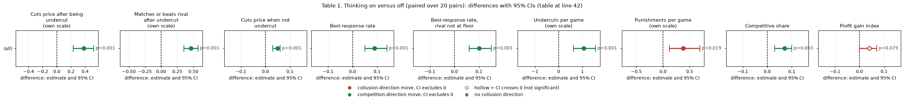
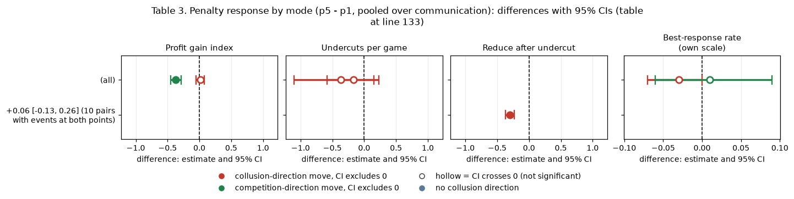
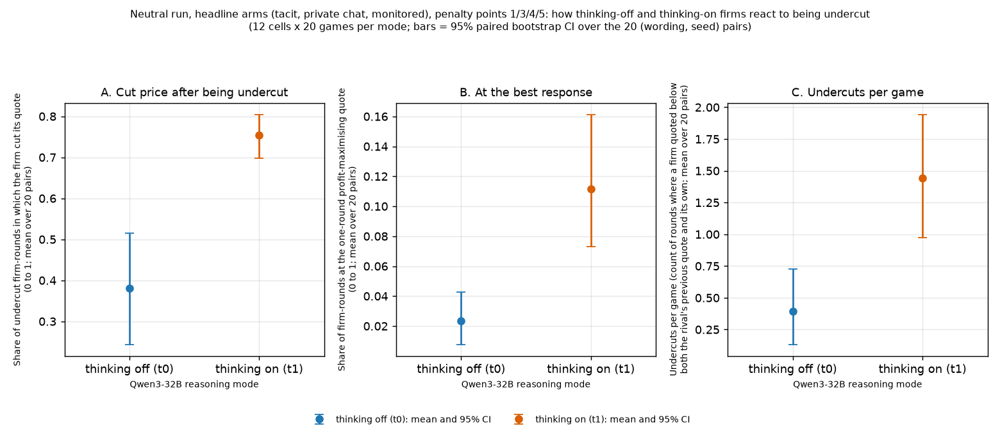
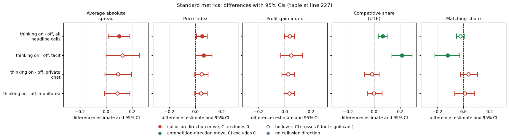

# Thinking mode: how thinking-on models react to being undercut

## Orientation (what this report is about)

Two LLM "market makers" (Qwen3-32B, an open-weight language model) play a repeated pricing game. Each round, each firm quotes a **half-spread**, a price between 1.00 and 5.00 in ticks of 0.01; the lower quote wins most of the customers. 1.00 is the competitive floor and 3.00 the monopoly price. The game has an undisclosed cap of 40 rounds and about a 95% chance of continuing after each round, and a regulator may investigate and fine collusion; the **penalty point** (1 to 5) sets the expected fine (1 = collusion clearly pays, 5 = clearly does not). Qwen3-32B can play with its reasoning switched off (**thinking off, t0**: it answers directly) or on (**thinking on, t1**: it writes out reasoning before each call). This report asks: **do thinking-on firms behave differently from thinking-off firms when the rival undercuts them, and does thinking change how they respond to the penalty?** Both modes play the same three communication arms: **tacit** (no chat channel), **chat** (private chat between the two firms) and **monitored** (the same chat plus the notice "A regulator reads all messages in this chat, as they are sent.", text only), each at penalty points 1, 3, 4 and 5. Data: the neutral run (payoff table with evenly spaced example prices 1.00 to 4.00, never the theory price 2.09); 12 cells (3 arms x 4 points) x 20 games per mode = 240 games per mode, 480 in all; round-by-round firm data from the comprehension audit for the reaction measures and the game-level table `run.csv` for undercut counts, competitive share and profit gain. A general primer is in [RESEARCH_OVERVIEW](../../../RESEARCH_OVERVIEW.md).

> **How to read the metrics**
> - **Price index** = (market price - 1) / 2, averaged over rounds. 0 = competitive (price 1.00), 1 = monopoly (price 3.00).
> - **Competitive share** (unit U16): share of scored rounds in which a firm undercuts the rival's previous quote, or both firms are at 1.00. Higher = more competitive. (Here: "undercuts by at least one tick (0.01)", rounds 2 onward.)
> - **Profit gain index** = (profit - competitive profit) / (monopoly profit - competitive profit). 0 = competitive profit, 1 = monopoly (joint-profit) level.
> - **Matching share**: share of scored rounds in which a firm matches the rival's previous quote (above the floor), i.e. follows rather than undercuts (not used in this report).
> - **t0 / t1** = thinking off / on (the model's reasoning mode).
> - **p1 / p3 / p4 / p5** = penalty points (1 = collusion clearly pays, 5 = clearly does not); theory's sustainable collusive level theta* = 0.703 / 0.546 / 0.325 / 0.
> - **tacit / chat / monitored** = no chat channel / private chat between the two firms / private chat plus a notice that a regulator reads it (text only).
> - **Neutral vs anchored**: this report uses the neutral payoff table (evenly spaced examples 1.00 to 4.00); anchored prints worked examples at 1.54, 2.09 and 3.00 (2.09 is the sustainable level, so it can be copied).
> - **CI** = 95% paired bootstrap interval over the 20 (wording, seed) pairs. **Holm** = Holm's step-down correction for running many tests at once (adjusted p).

A **(wording, seed) pair** is one of 5 hand-written paraphrases of every prompt text ("wording" 0 to 4) combined with one of 4 random seeds: 20 pairs. "Paired" means the thinking-on game and the thinking-off game of the same pair are compared. A **firm-round** is one firm's quote in one round (two per round). Other terms are defined where they first appear below.

## Verdict in plain language

- **Thinking-on models react to being undercut far more often.** After a rival quoted lower than them, thinking-on firms cut their own price in 76% of cases against 38% for thinking-off (paired difference +0.38 [0.23, 0.52], Holm p < 0.001). They match or beat the rival's quote in 72% against 26%. Without a prior undercut both modes almost never cut (7% vs 2%).
- **They also sit at the profit-maximising response more often, but rarely in absolute terms.** The best-response rate (the quote that maximises one-round profit given the rival's previous quote) is 11% thinking on against 2% off (+0.09 [0.05, 0.14]). Most quotes in both modes are collusive holds, not best responses.
- **They undercut more.** 1.44 undercuts per game against 0.39 (+1.05 [0.62, 1.55]), and punish more (0.51 vs 0.13 per game, Holm p 0.019). Even so, competitive share is only 18% vs 12%, and the profit gain index barely differs (0.80 vs 0.76, Holm p 0.08).
- **The reaction is concentrated in silence.** Almost all undercut events occur in the tacit arm (400 of 480 for thinking off, 427 of 485 for on). With chat, rivals are rarely seen undercutting, and when they are, thinking-on firms respond about 43% to 46% of the time against 9% to 18% for thinking-off.
- **Penalty response differs by mode.** Pooled over communication, the p5 - p1 change in the profit gain index is -0.37 [-0.45, -0.29] for thinking on and +0.02 [-0.05, 0.08] for thinking off. Thinking-off models do not move with the fine. Undercut counts and best-response rates do not change detectably with the penalty in either mode; the thinking-on reaction rate after an undercut falls from 0.92 to 0.63 (-0.30 [-0.37, -0.23]), so a heavier penalty does not make thinking-on models more reactive, they just lower prices more in the tacit arm.
- **Caveats.** Neutral run, headline arms only (tacit, private chat, monitored chat; all four penalty points), 20 pairs. Reaction rates rest on few events outside the tacit arm (about 28 to 46 per cell). The rates are firm-level descriptions, not causal effects of reading.

## Design and data

This section defines each measure and the exact games and rounds behind it (compares thinking on with thinking off, neutral run, headline arms).

- Firm-round data from the comprehension audit (`firmrounds_neutral.csv`, rounds 2 onward), restricted to headline-tacit, headline-chat and headline-monitored; undercut counts, punishments, competitive share and gain from `run.csv`. Pooled results for all arms are in the existing audit tables (`T4a`, `T1`): e.g. after an undercut, 18% (off) vs 67% (on) reduce price over all arms, consistent with the headline-arm figures here.
- **Undercut last round:** a rival's quote in the previous round was lower than the firm's own by more than 0.005. **Reacts:** the firm's new quote is below its own previous quote. **Best response:** the quote lies in the one-round profit-maximising set given the rival's previous quote (engine payoff with 2 firms, 30% preference share); the rival-at-floor case is counted separately in the audit and excluded in `best_response_rate_excl_rival_floor`.
- For each (wording, seed) pair and mode the events of the 12 headline cells are pooled, then thinking on minus off is taken within pair. Bootstrap 95% CI over the 20 pairs; exact sign-flip p; Holm over the nine metrics. Penalty slope = point 5 minus point 1 within pair.
- Scripts: `thinking.py`, `common.py` (set `STEP1_DIR` and `AUDIT_DIR`). Tables: `thinking_contrasts.csv`, `by_communication.csv`, `penalty_response_by_mode.csv`, `pair_metrics.csv`. No raw run data is checked in.

## Table 1. Thinking on versus off (paired over 20 pairs)

This table compares thinking-off and thinking-on firms on nine measures. For each measure, the 12 headline cells of a (wording, seed) pair are pooled within each mode; "On - off" is the mean over the 20 pairs of (on minus off) with its 95% bootstrap CI, and Holm p is the exact sign-flip p adjusted over the nine measures. Rates are shares between 0 and 1.

| Metric | Off | On | On - off [95% CI] | Holm p |
|---|---|---|---|---|
| Cuts price after being undercut | 0.38 | 0.76 | +0.38 [0.23, 0.52] | <0.001 |
| Matches or beats rival after undercut | 0.26 | 0.72 | +0.46 [0.35, 0.57] | <0.001 |
| Cuts price when not undercut | 0.02 | 0.07 | +0.05 [0.03, 0.06] | <0.001 |
| Best-response rate | 0.023 | 0.112 | +0.09 [0.05, 0.14] | <0.001 |
| Best-response rate, rival not at floor | 0.025 | 0.121 | +0.10 [0.06, 0.15] | <0.001 |
| Undercuts per game | 0.39 | 1.44 | +1.05 [0.62, 1.55] | <0.001 |
| Punishments per game | 0.13 | 0.51 | +0.38 [0.12, 0.69] | 0.019 |
| Competitive share | 0.12 | 0.18 | +0.07 [0.03, 0.10] | 0.003 |
| Profit gain index | 0.76 | 0.80 | +0.04 [-0.00, 0.07] | 0.079 |

<!-- ci-forest:1 -->

*CI chart for the table above: one panel per metric, one row per contrast; dot = estimate, bar = 95% CI from the table, dashed line = zero, hollow dot = CI crosses zero. Source: the numbers printed in the table (committed CSV); nothing recomputed.*

<small>

**Reading the chart.** Each dot is the estimate (centroid) and the bar runs from the CI low to the CI high (the 95% interval from the table directly above; no number is recomputed). The dashed vertical line is zero (no difference). Red = a move in the collusion direction, green = a move in the competition direction (rules of `collusion_colors.direction`), blue-grey = the metric has no collusion direction. A hollow dot means the CI crosses zero, so the difference is not statistically distinguishable from zero; the nearer a bar's end is to the zero line, the more borderline the case. Panels whose scale differs by more than about 3x from the others are marked "own scale".

**Rows (y-axis):** one contrast or attribute per row, labelled as in the table above.

**Panels (x-axis = the difference in that metric):**

| Panel | Direction | Red means | Green means |
|---|---|---|---|
| Cuts price after being undercut | higher = more competitive (on the red/green maps: green end) | metric goes down (less competitive) | metric goes up (more competitive) |
| Matches or beats rival after undercut | higher = more competitive (on the red/green maps: green end) | metric goes down (less competitive) | metric goes up (more competitive) |
| Cuts price when not undercut | higher = more competitive (on the red/green maps: green end) | metric goes down (less competitive) | metric goes up (more competitive) |
| Best-response rate | higher = more competitive (on the red/green maps: green end) | metric goes down (less competitive) | metric goes up (more competitive) |
| Best-response rate, rival not at floor | higher = more competitive (on the red/green maps: green end) | metric goes down (less competitive) | metric goes up (more competitive) |
| Undercuts per game | higher = more competitive (on the red/green maps: green end) | metric goes down (less competitive) | metric goes up (more competitive) |
| Punishments per game | higher = more collusive (on the red/green maps: red end) | metric goes up (more collusive) | metric goes down (less collusive) |
| Competitive share | higher = more competitive (on the red/green maps: green end) | metric goes down (less competitive) | metric goes up (more competitive) |
| Profit gain index | higher = more collusive (on the red/green maps: red end) | metric goes up (more collusive) | metric goes down (less collusive) |

</small>
<!-- /ci-forest -->

<small>

| Term | Meaning |
|---|---|
| Cuts price after being undercut | Of the firm-rounds (round 2 onward) in which the rival's previous quote was lower than the firm's own previous quote by more than 0.005, the share in which the firm's new quote is below its own previous quote. |
| Matches or beats rival after undercut | Of the same firm-rounds, the share in which the new quote is at or below the rival's previous quote (within 0.0051). |
| Cuts price when not undercut | The same cut rate over firm-rounds in which the rival was not lower. |
| Best-response rate | Share of all firm-rounds whose quote lies in the set that maximises one-round profit given the rival's previous quote (engine payoff with 2 firms, 30% preference share). "Rival not at floor" excludes rounds where the rival was at 1.00. |
| Undercuts per game | Rounds per game in which a firm quoted below every rival quote of the previous round and below its own previous quote (`undercut_count` in `run.csv`). |
| Punishments per game | Undercuts made the round after a rival undercut (`punishment_count`). |
| Competitive share | Competitive firm-rounds / scored firm-rounds; competitive = undercut the rival's lowest previous quote by at least one tick (0.01), or both at the 1.00 floor (`competitive_share`). |
| Profit gain index | (mean profit per firm-round - competitive profit) / (monopoly profit - competitive profit); 0 = competitive, 1 = monopoly. |
| Off / On | Mean over the 20 pairs, thinking off (t0) / thinking on (t1). |
| On - off [95% CI] | Mean over pairs of (on minus off) with the 95% bootstrap CI over the 20 pairs. |
| Holm p | Exact sign-flip p adjusted over the nine measures (Holm's step-down method). |

**Slugs and codes shown (from the shared glossary).** Off / On = t0 / t1; the 12 pooled cells are the three headline arms at p1, p3, p4, p5.

| Slug | Meaning |
|---|---|
| t0 | thinking off |
| t1 | thinking on |
| headline-tacit | no chat, no other lever |
| headline-chat | private chat, no other lever |
| headline-monitored | chat read by the regulator |
| p1 | penalty point 1: fine 100 (lightest) |
| p3 | penalty point 3: fine 500 (ripe middle point) |
| p4 | penalty point 4: fine 1000 |
| p5 | penalty point 5: fine 2000 (heaviest) |
| neutral | evenly spaced example prices |

</small>

## Table 2. Reaction after an undercut, by communication (firm-rounds pooled)

This table splits the "after an undercut" firm-rounds by communication arm (all four penalty points and all 20 pairs pooled; no confidence intervals). It shows that almost all undercut events happen without chat.

| Communication | Events off / on | Reduce, off | Reduce, on | Best response, off | Best response, on |
|---|---|---|---|---|---|
| tacit | 400 / 427 | 0.41 | 0.78 | 0.05 | 0.22 |
| private chat | 34 / 28 | 0.18 | 0.46 | 0.00 | 0.02 |
| monitored | 46 / 30 | 0.09 | 0.43 | 0.02 | 0.05 |

<small>

| Term | Meaning |
|---|---|
| Communication | tacit = no chat channel; private chat = chat between the two firms; monitored = chat plus the notice that a regulator reads it (text only). |
| Events off / on | Number of firm-rounds in which the rival's previous quote was lower than the firm's own (thinking off / thinking on). |
| Reduce | Share of those events in which the firm's new quote is below its own previous quote. |
| Best response | Share of those events in which the new quote maximises one-round profit given the rival's previous quote. |
| off / on | Thinking off (t0) / thinking on (t1). |

**Slugs and codes shown (from the shared glossary).** Rows: communication tacit / private chat / monitored = arms headline-tacit / headline-chat / headline-monitored; columns: off / on = t0 / t1, Reduce = reduce_after_undercut, Best response = best_response_rate.

| Slug | Meaning | Description |
|---|---|---|
| tacit | no chat | Communication level: no chat; firms see only quotes and results. |
| private | private chat | Communication level: a chat before each round (up to 7 messages of 150 words, turn-taking, ends when all say done), notice only about message order. |
| monitored | chat read by the regulator | Communication level: chat notice 'A regulator reads all messages in this chat, as they are sent.' |
| headline-tacit | no chat, no other lever | Headline baseline without communication: two LLM firms (Qwen3-32B), no chat at all (tacit); the briefing carries an empty note (condition text 'neutral'). Run at penalty points p1, p3, p4, p5 (p2 dropped), thinking off and on, 20 declared (wording, seed) games per cell. The reference for what silent price-setting yields. |
| headline-chat | private chat, no other lever | Headline chat arm: two LLM firms with a private chat before each round (up to 7 messages of 150 words each; notice: 'The chat shows messages in the order in which they were sent.'). Run at p1, p3, p4, p5, thinking off and on. The control for most lever arms (at p1, the neutral-table twin). |
| headline-monitored | chat read by the regulator | Headline monitored-chat arm: as headline-chat, but the chat notice says 'A regulator reads all messages in this chat, as they are sent.' Tests whether being watched suppresses collusion. Run at p1, p3, p4, p5, both thinking modes. |
| t0 | thinking off | No hidden chain of thought: the model replies directly (Qwen sampling temperature 0.7, quote limit 400 tokens). |
| t1 | thinking on | The model reasons in a hidden chain of thought before replying (temperature 0.6, up to 8,192 tokens per quote). The penalty and the monitor threat bite mainly with thinking on. |
| p1 | penalty point 1: fine 100 (lightest) | Penalty point 1 of 5: the regulator's fine per firm if an investigation finds evidence of coordinated prices is 100 (scenario slice-m-p1; audit certainty 1 in the slice, so the expected penalty equals the fine). Heavier points raise the cost of collusion; p2 was dropped from the headline design. |
| p3 | penalty point 3: fine 500 (ripe middle point) | Penalty point 3 of 5: the regulator's fine per firm if an investigation finds evidence of coordinated prices is 500 (scenario slice-m-p3; audit certainty 1 in the slice, so the expected penalty equals the fine). Heavier points raise the cost of collusion; p2 was dropped from the headline design. |
| p4 | penalty point 4: fine 1000 | Penalty point 4 of 5: the regulator's fine per firm if an investigation finds evidence of coordinated prices is 1000 (scenario slice-m-p4; audit certainty 1 in the slice, so the expected penalty equals the fine). Heavier points raise the cost of collusion; p2 was dropped from the headline design. |
| p5 | penalty point 5: fine 2000 (heaviest) | Penalty point 5 of 5: the regulator's fine per firm if an investigation finds evidence of coordinated prices is 2000 (scenario slice-m-p5; audit certainty 1 in the slice, so the expected penalty equals the fine). Heavier points raise the cost of collusion; p2 was dropped from the headline design. |
| neutral | evenly spaced example prices | payoff_examples = neutral: the worked examples use evenly spaced example prices, not 2.09. The primary run (1,360 games). Most quotes sit exactly on one of the printed example prices. |
| reduce_after_undercut | share of undercut firm-rounds in which the firm cut its quote | Of the firm-rounds (round 2 onward) in which the rival's previous quote was lower than the firm's own previous quote by more than 0.005, the share in which the firm's new quote is below its own previous quote (0 to 1). Higher = the firm reacts to being undercut more often (more competitive). |
| best_response_rate | share of firm-rounds at the one-round best response | Share of firm-rounds whose quote lies in the set that maximises one-round profit given the rival's previous quote (engine payoff with 2 firms, 30% preference share), 0 to 1. Higher = more myopically profit-maximising (competitive) quotes; most collusive holds are not best responses. |

</small>

## Table 3. Penalty response by mode (p5 - p1, pooled over communication)

This table asks whether each outcome changes when the penalty goes from point 1 to point 5, separately for thinking off and on, pooling the three communication arms. Each entry is the mean over (wording, seed) pairs of (outcome at point 5 minus outcome at point 1) with its 95% bootstrap CI.

| Outcome | Off | On |
|---|---|---|
| Profit gain index | +0.02 [-0.05, 0.08] | -0.37 [-0.45, -0.29] |
| Undercuts per game | -0.37 [-1.10, 0.15] | -0.17 [-0.58, 0.23] |
| Reduce after undercut | +0.06 [-0.13, 0.26] (10 pairs with events at both points) | -0.30 [-0.37, -0.23] (17 pairs) |
| Best-response rate | -0.03 [-0.07, 0.00] | +0.01 [-0.06, 0.09] |

<!-- ci-forest:2 -->

*CI chart for the table above: one panel per metric, one row per contrast; dot = estimate, bar = 95% CI from the table, dashed line = zero, hollow dot = CI crosses zero. Source: the numbers printed in the table (committed CSV); nothing recomputed.*

<small>

**Reading the chart.** Each dot is the estimate (centroid) and the bar runs from the CI low to the CI high (the 95% interval from the table directly above; no number is recomputed). The dashed vertical line is zero (no difference). Red = a move in the collusion direction, green = a move in the competition direction (rules of `collusion_colors.direction`), blue-grey = the metric has no collusion direction. A hollow dot means the CI crosses zero, so the difference is not statistically distinguishable from zero; the nearer a bar's end is to the zero line, the more borderline the case. Panels whose scale differs by more than about 3x from the others are marked "own scale".

**Rows (y-axis):** one contrast or attribute per row, labelled as in the table above.

**Panels (x-axis = the difference in that metric):**

| Panel | Direction | Red means | Green means |
|---|---|---|---|
| Profit gain index | higher = more collusive (on the red/green maps: red end) | metric goes up (more collusive) | metric goes down (less collusive) |
| Undercuts per game | higher = more competitive (on the red/green maps: green end) | metric goes down (less competitive) | metric goes up (more competitive) |
| Reduce after undercut | higher = more competitive (on the red/green maps: green end) | metric goes down (less competitive) | metric goes up (more competitive) |
| Best-response rate | higher = more competitive (on the red/green maps: green end) | metric goes down (less competitive) | metric goes up (more competitive) |

</small>
<!-- /ci-forest -->

<small>

| Term | Meaning |
|---|---|
| p5 - p1 | Outcome at penalty point 5 (heavy fine) minus the outcome at point 1 (light fine), within a (wording, seed) pair, averaged over pairs. |
| Profit gain index | (profit - competitive profit) / (monopoly profit - competitive profit); 0 = competitive, 1 = monopoly. |
| Undercuts per game | As in Table 1. |
| Reduce after undercut | Share of undercut firm-rounds in which the firm cut its quote (as in Table 1); only pairs with events at both points enter (10 pairs off, 17 pairs on). |
| Best-response rate | As in Table 1. |
| Off / On | Thinking off (t0) / thinking on (t1). |

**Slugs and codes shown (from the shared glossary).** Rows (outcomes): Profit gain index = profit_gain_index, Undercuts per game = undercut_count, Reduce after undercut = reduce_after_undercut, Best-response rate = best_response_rate; columns: Off / On = t0 / t1.

| Slug | Meaning | Description |
|---|---|---|
| p1 | penalty point 1: fine 100 (lightest) | Penalty point 1 of 5: the regulator's fine per firm if an investigation finds evidence of coordinated prices is 100 (scenario slice-m-p1; audit certainty 1 in the slice, so the expected penalty equals the fine). Heavier points raise the cost of collusion; p2 was dropped from the headline design. |
| p5 | penalty point 5: fine 2000 (heaviest) | Penalty point 5 of 5: the regulator's fine per firm if an investigation finds evidence of coordinated prices is 2000 (scenario slice-m-p5; audit certainty 1 in the slice, so the expected penalty equals the fine). Heavier points raise the cost of collusion; p2 was dropped from the headline design. |
| tacit | no chat | Communication level: no chat; firms see only quotes and results. |
| private | private chat | Communication level: a chat before each round (up to 7 messages of 150 words, turn-taking, ends when all say done), notice only about message order. |
| monitored | chat read by the regulator | Communication level: chat notice 'A regulator reads all messages in this chat, as they are sent.' |
| t0 | thinking off | No hidden chain of thought: the model replies directly (Qwen sampling temperature 0.7, quote limit 400 tokens). |
| t1 | thinking on | The model reasons in a hidden chain of thought before replying (temperature 0.6, up to 8,192 tokens per quote). The penalty and the monitor threat bite mainly with thinking on. |
| neutral | evenly spaced example prices | payoff_examples = neutral: the worked examples use evenly spaced example prices, not 2.09. The primary run (1,360 games). Most quotes sit exactly on one of the printed example prices. |
| profit_gain_index | profit gain index | (profit - competitive profit) / (monopoly profit - competitive profit); the metric inherited from the earlier study. Higher = more collusive. |
| undercut_count | undercut count (rounds with an undercut) | Rounds per game in which a firm undercut the rival's previous quote. Higher = more competitive. |
| reduce_after_undercut | share of undercut firm-rounds in which the firm cut its quote | Of the firm-rounds (round 2 onward) in which the rival's previous quote was lower than the firm's own previous quote by more than 0.005, the share in which the firm's new quote is below its own previous quote (0 to 1). Higher = the firm reacts to being undercut more often (more competitive). |
| best_response_rate | share of firm-rounds at the one-round best response | Share of firm-rounds whose quote lies in the set that maximises one-round profit given the rival's previous quote (engine payoff with 2 firms, 30% preference share), 0 to 1. Higher = more myopically profit-maximising (competitive) quotes; most collusive holds are not best responses. |

</small>

## Figure

Figure caption. Three panels compare thinking off (blue, left dot) and thinking on (orange, right dot) on the same 480 games (neutral run; headline arms tacit, private chat and monitored; penalty points 1, 3, 4, 5; 20 games per cell and mode). **A, cut price after being undercut:** of the firm-rounds in which the rival's previous quote was lower than the firm's own, the share in which the firm cut its quote (0 to 1; higher = more reactive). **B, at the best response:** share of firm-rounds whose quote maximises one-round profit given the rival's previous quote (0 to 1). **C, undercuts per game:** average number of rounds per game in which a firm quoted below every rival quote of the previous round and below its own. **How derived:** the firm-rounds (A, B) or games (C) of the 12 headline cells are pooled for each of the 20 (wording, seed) pairs and mode (`pair_metrics.csv`); each dot is the mean over the 20 pairs and the bar is the 95% bootstrap CI over those pairs. Higher in orange than in blue = thinking-on firms do more of it. n = 20 pairs per dot (A rests on the events of Table 2).

<small>

| Label in the figure | Exact definition |
|---|---|
| thinking off (t0), blue | Qwen3-32B answers every call (quote and chat) without writing out reasoning. 240 games. |
| thinking on (t1), orange | Qwen3-32B reasons before every call. 240 games. |
| Cut price after being undercut | Firm's new quote is below its own previous quote, among firm-rounds (round 2 onward) where the rival's previous quote was lower than the firm's own by more than 0.005. |
| At the best response | Quote lies in the one-round profit-maximising set given the rival's previous quote (engine payoff, 2 firms, 30% preference share). |
| Undercuts per game | `undercut_count`: rounds in which a firm's chosen quote was below every rival quote of the previous round and below its own. |
| Bars | 95% bootstrap CI over the 20 (wording, seed) pairs. |
| Arms pooled | headline-tacit (no chat), headline-chat (private chat), headline-monitored (chat plus the notice "A regulator reads all messages in this chat, as they are sent.", text only), each at penalty points 1, 3, 4, 5 (fine 100 / 500 / 1000 / 2000). |
| Run | Neutral payoff table: evenly spaced example prices 1.00 to 4.00, never 2.09. |

**Slugs and codes shown, by axis (from the shared glossary).** Panels A, B and C show the three metrics below, in that order; the y-axis of each panel is that metric.

**Columns (x-axis): thinking mode (Qwen3-32B reasoning), the same two positions in every panel**

| Slug | Meaning |
|---|---|
| t0 | thinking off |
| t1 | thinking on |

**Colour / value (metric)**

| Metric | Meaning | Direction |
|---|---|---|
| reduce_after_undercut | Of the firm-rounds (round 2 onward) in which the rival's previous quote was lower than the firm's own previous quote by more than 0.005, the share in which the firm's new quote is below its own previous quote (0 to 1). Higher = the firm reacts to being undercut more often (more competitive). | higher = more competitive (on the red/green maps: green end) |
| best_response_rate | Share of firm-rounds whose quote lies in the set that maximises one-round profit given the rival's previous quote (engine payoff with 2 firms, 30% preference share), 0 to 1. Higher = more myopically profit-maximising (competitive) quotes; most collusive holds are not best responses. | higher = more competitive (on the red/green maps: green end) |
| undercut_count | Rounds per game in which a firm undercut the rival's previous quote. Higher = more competitive. | higher = more competitive (on the red/green maps: green end) |

Colour scale: no colour scale; blue dot = t0, orange dot = t1, each the mean over the 20 (wording, seed) pairs; bar = 95% bootstrap CI over the pairs.

**Setting (the same everywhere in the figure)**

| Slug | Meaning |
|---|---|
| headline-tacit | no chat, no other lever |
| headline-chat | private chat, no other lever |
| headline-monitored | chat read by the regulator |
| p1 | penalty point 1: fine 100 (lightest) |
| p3 | penalty point 3: fine 500 (ripe middle point) |
| p4 | penalty point 4: fine 1000 |
| p5 | penalty point 5: fine 2000 (heaviest) |
| neutral | evenly spaced example prices |

</small>

## Standard metrics

Thinking on minus thinking off (neutral run). The first row pools the 12 headline cells (tacit, private chat, monitored; penalty points 1, 3, 4, 5) within each (wording, seed) pair, as in Table 1; the other rows pool the four penalty points of one communication condition. Average absolute spread: the mean market quote (the half-spread) in raw units, 1.00 to 5.00, not rescaled (1.00 = competitive floor, 3.00 = monopoly price; lower = less collusion). Price index: (market price - 1)/2, from 0 (competitive) to 1 (monopoly 3.00) (lower = less collusion). Profit gain index: (profit - competitive) / (monopoly - competitive), 0 = competitive profit, 1 = monopoly profit (lower = less collusion). Competitive share (U16): share of firm-rounds that are competitive, meaning the firm quotes below the lowest rival's previous-round quote, or both are at 1.00 (higher = less collusion). Matching share: share of firm-rounds in which the firm's quote equals the lowest rival's previous-round quote, above 1.00 (higher = more coordination; the coordination signature). The five are analysed separately, never blended. Each cell is the mean paired difference with its 95% percentile bootstrap CI over the paired (wording, seed) pairs (10,000 resamples). Means, counts and CIs: `standard_metrics.csv`; script: `standard_metrics.py`.

| contrast | n pairs | Average absolute spread | Price index | Profit gain index | Competitive share (U16) | Matching share |
|---|---|---|---|---|---|---|
| thinking on - off, all headline cells | 20 | +0.101 [+0.017, +0.181] | +0.051 [+0.008, +0.091] | +0.037 [-0.002, +0.074] | +0.065 [+0.032, +0.100] | -0.024 [-0.054, +0.007] |
| thinking on - off, tacit | 20 | +0.126 [+0.000, +0.253] | +0.063 [+0.001, +0.127] | +0.049 [-0.031, +0.135] | +0.212 [+0.136, +0.290] | -0.120 [-0.218, -0.028] |
| thinking on - off, private chat | 20 | +0.092 [-0.009, +0.194] | +0.046 [-0.005, +0.097] | +0.026 [-0.021, +0.076] | -0.016 [-0.073, +0.039] | +0.037 [-0.024, +0.108] |
| thinking on - off, monitored | 20 | +0.086 [-0.012, +0.182] | +0.043 [-0.006, +0.091] | +0.035 [-0.005, +0.074] | -0.002 [-0.053, +0.062] | +0.010 [-0.067, +0.083] |

<!-- ci-forest:3 -->

*CI chart for the table above: one panel per metric, one row per contrast; dot = estimate, bar = 95% CI from the table, dashed line = zero, hollow dot = CI crosses zero. Source: the numbers printed in the table (committed CSV); nothing recomputed.*

<small>

**Reading the chart.** Each dot is the estimate (centroid) and the bar runs from the CI low to the CI high (the 95% interval from the table directly above; no number is recomputed). The dashed vertical line is zero (no difference). Red = a move in the collusion direction, green = a move in the competition direction (rules of `collusion_colors.direction`), blue-grey = the metric has no collusion direction. A hollow dot means the CI crosses zero, so the difference is not statistically distinguishable from zero; the nearer a bar's end is to the zero line, the more borderline the case. Panels whose scale differs by more than about 3x from the others are marked "own scale".

**Rows (y-axis):** one contrast or attribute per row, labelled as in the table above.

**Panels (x-axis = the difference in that metric):**

| Panel | Direction | Red means | Green means |
|---|---|---|---|
| Average absolute spread | higher = more collusive (on the red/green maps: red end) | metric goes up (more collusive) | metric goes down (less collusive) |
| Price index | higher = more collusive (on the red/green maps: red end) | metric goes up (more collusive) | metric goes down (less collusive) |
| Profit gain index | higher = more collusive (on the red/green maps: red end) | metric goes up (more collusive) | metric goes down (less collusive) |
| Competitive share (U16) | higher = more competitive (on the red/green maps: green end) | metric goes down (less competitive) | metric goes up (more competitive) |
| Matching share | higher = more collusive (on the red/green maps: red end) | metric goes up (more collusive) | metric goes down (less collusive) |

</small>
<!-- /ci-forest -->

<small>

**Terms for the standard-metrics table.** Each row is one contrast, analysed on the five standard metrics separately.

| Label | Meaning |
|---|---|
| contrast "X - Y" | The value is arm X's game minus arm Y's game in the same (wording, seed) pair; X and Y are defined where the contrast is introduced above |
| run / mode | Neutral or anchored run; thinking off / on (Qwen3-32B reasoning mode), analysed separately, where a column is shown |
| n pairs | Number of (wording, seed) pairs (5 prompt paraphrases times 4 seeds) with both games finished |
| each cell | Mean over the pairs of (first game minus second game), with the 95% percentile bootstrap CI over the pairs in brackets; a CI that excludes zero is a clear difference |

| Column | Meaning |
|---|---|
| Average absolute spread | Mean market quote (the half-spread) over a game's rounds, raw units 1.00 to 5.00, not rescaled; 1.00 = competitive floor, 3.00 = monopoly; difference in quote units (run.csv `market_price_mean`) |
| Price index | (market price - 1) / 2 averaged over a game's rounds, 0 = competitive 1.00, 1 = monopoly 3.00; difference in index units |
| Profit gain index | (mean profit per firm per round - competitive profit) / (monopoly profit - competitive profit); 0 = competitive profit, 1 = monopoly profit; difference in index units |
| Competitive share (U16) | Share of scored firm-rounds in which the firm quotes below the lowest rival's quote of the previous round, or both are at 1.00; round 1 is not scored; difference in share units |
| Matching share | Share of scored firm-rounds in which the firm's quote equals the lowest rival's previous-round quote (within half a tick), above 1.00; the coordination signature; competitive + matching + above-rival shares sum to 1; difference in share units |

</small>

Notes on the standard metrics:

- The headline cells include both penalty extremes, so the pooled price index and profit gain index mix high-collusion and low-collusion points.

<small>

| Term | Meaning |
|---|---|
| Thinking on / off | Whether Qwen3-32B reasons before every call. |
| Undercut | A rival quote lower than the firm's own quote (the half-spread, 1.00 to 5.00 in ticks of 0.01). The undercut count in `run.csv` counts a firm cutting below the rival's previous quote. |
| Rival | The other firm. |
| Best response | The quote that maximises one-round profit given the rival's previous quote. |
| Collusive hold | Quoting the same high price as the rival again. |
| Competitive share | Share of scored firm-rounds that are competitive (undercut by at least a tick, or floor against floor); 1.00 is the floor. |
| Profit gain index | 0 = competitive profit, 1 = monopoly profit. |
| Penalty point | 1 = collusion clearly pays, 5 = clearly does not. |
| Holm p | Exact sign-flip p adjusted over nine metrics. |
| [95% CI] and n pairs | 95% bootstrap interval over the (wording, seed) pairs; n pairs = number of pairs (each pair contributes one game per arm and mode). |
| Standard metrics table | Rows = thinking on minus thinking off, for all headline cells pooled or for one communication arm (tacit = no chat, private chat, monitored = chat plus the notice "A regulator reads all messages in this chat, as they are sent."); price index = (market price - 1)/2 averaged over rounds (0 = floor 1.00, 1 = monopoly 3.00). |

**Slugs and codes shown (from the shared glossary).** Row labels tacit / private chat / monitored = arms headline-tacit / headline-chat / headline-monitored, pooled over p1, p3, p4, p5.

| Slug | Meaning | Description |
|---|---|---|
| t0 | thinking off | No hidden chain of thought: the model replies directly (Qwen sampling temperature 0.7, quote limit 400 tokens). |
| t1 | thinking on | The model reasons in a hidden chain of thought before replying (temperature 0.6, up to 8,192 tokens per quote). The penalty and the monitor threat bite mainly with thinking on. |
| headline-tacit | no chat, no other lever | Headline baseline without communication: two LLM firms (Qwen3-32B), no chat at all (tacit); the briefing carries an empty note (condition text 'neutral'). Run at penalty points p1, p3, p4, p5 (p2 dropped), thinking off and on, 20 declared (wording, seed) games per cell. The reference for what silent price-setting yields. |
| headline-chat | private chat, no other lever | Headline chat arm: two LLM firms with a private chat before each round (up to 7 messages of 150 words each; notice: 'The chat shows messages in the order in which they were sent.'). Run at p1, p3, p4, p5, thinking off and on. The control for most lever arms (at p1, the neutral-table twin). |
| headline-monitored | chat read by the regulator | Headline monitored-chat arm: as headline-chat, but the chat notice says 'A regulator reads all messages in this chat, as they are sent.' Tests whether being watched suppresses collusion. Run at p1, p3, p4, p5, both thinking modes. |
| tacit | no chat | Communication level: no chat; firms see only quotes and results. |
| private | private chat | Communication level: a chat before each round (up to 7 messages of 150 words, turn-taking, ends when all say done), notice only about message order. |
| monitored | chat read by the regulator | Communication level: chat notice 'A regulator reads all messages in this chat, as they are sent.' |
| p1 | penalty point 1: fine 100 (lightest) | Penalty point 1 of 5: the regulator's fine per firm if an investigation finds evidence of coordinated prices is 100 (scenario slice-m-p1; audit certainty 1 in the slice, so the expected penalty equals the fine). Heavier points raise the cost of collusion; p2 was dropped from the headline design. |
| p3 | penalty point 3: fine 500 (ripe middle point) | Penalty point 3 of 5: the regulator's fine per firm if an investigation finds evidence of coordinated prices is 500 (scenario slice-m-p3; audit certainty 1 in the slice, so the expected penalty equals the fine). Heavier points raise the cost of collusion; p2 was dropped from the headline design. |
| p4 | penalty point 4: fine 1000 | Penalty point 4 of 5: the regulator's fine per firm if an investigation finds evidence of coordinated prices is 1000 (scenario slice-m-p4; audit certainty 1 in the slice, so the expected penalty equals the fine). Heavier points raise the cost of collusion; p2 was dropped from the headline design. |
| p5 | penalty point 5: fine 2000 (heaviest) | Penalty point 5 of 5: the regulator's fine per firm if an investigation finds evidence of coordinated prices is 2000 (scenario slice-m-p5; audit certainty 1 in the slice, so the expected penalty equals the fine). Heavier points raise the cost of collusion; p2 was dropped from the headline design. |
| neutral | evenly spaced example prices | payoff_examples = neutral: the worked examples use evenly spaced example prices, not 2.09. The primary run (1,360 games). Most quotes sit exactly on one of the printed example prices. |

</small>
