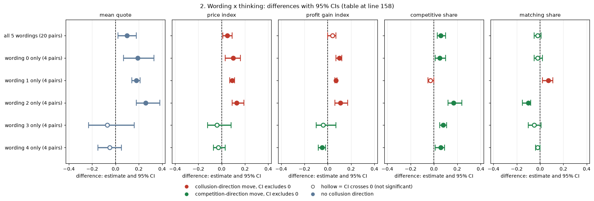
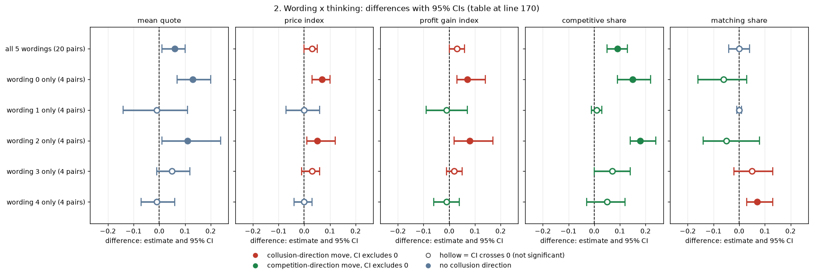

# Do the headline findings depend on the prompt wording or the random seed?

**Orientation.** In this experiment two LLM "market makers" (Qwen3-32B) each quote a half-spread (the distance from the mid-price to the firm's bid and ask) from 1.00 to 5.00 in steps ("ticks") of 0.01. 1.00 is the competitive level (costs covered, no excess profit); 3.00 is the monopoly price; 70% of customers go to the lowest quote; a regulator investigates more often when prices are higher. Games last 7 to 20 rounds. **Question:** the headline contrasts (talking raises prices, a heavier fine lowers them, thinking mode changes behaviour) were measured over 20 "pairs", each pair being one of 5 prompt wordings run with one of 4 seeds. Are those contrasts driven by a particular wording or seed, and how much of the game-to-game variation is due to the (wording, seed) pair at all? **Arms** (communication conditions, in words): *tacit* = no chat; *chat* = private chat before each quote; *monitored* = chat that the regulator can read. **Data:** two batches ("runs") of the same design, 24 headline cells each (3 communication conditions x 4 penalty points x 2 thinking modes) x 20 pairs: the *neutral* run (the prompt's payoff table shows evenly spaced example prices) and the *anchored* run (the table prints the theory price 2.09 among its examples). Only finished (DONE) games are used.

**How to read the metrics (all five are reported separately; computed per game, then averaged over pairs).**

| metric | definition (source column of the Step 1 run table) | higher means | worked example |
|---|---|---|---|
| mean quote | average market price (the lowest quote each round) over the game's rounds, 1.00 to 5.00 (`market_price_mean`) | higher prices | a game at 2.50 every round: 2.50 |
| price index | (market price - 1) / 2, averaged over rounds, 0 to 1 (`price_index`) | higher prices | 2.50 gives 0.75 |
| profit gain index | (profit - competitive profit) / (monopoly profit - competitive profit) per firm-round, the metric from the earlier study (`profit_gain_index`) | more of the monopoly profit captured | a tie at 2.50 earns about 0.8 |
| competitive share | share of firm-rounds in which a firm quotes below the lowest rival quote of the previous round, or both sit at 1.00 (U16; `competitive_share`) | more undercutting | 0 = never undercuts |
| matching share | share of firm-rounds in which a firm's quote equals the lowest rival quote above the floor (`matching_share`) | more lock-step holding | 1 = always matches |

> **How to read the metrics (short form)**
> - **Price index** = (market price - 1) / 2, averaged over rounds. 0 = competitive (price 1.00), 1 = monopoly (price 3.00).
> - **Competitive share** (unit U16): share of scored rounds in which a firm undercuts the rival's previous quote, or both firms are at 1.00. Higher = more competitive.
> - **Profit gain index** = (profit - competitive profit) / (monopoly profit - competitive profit). 0 = competitive profit, 1 = monopoly (joint-profit) level.
> - **Matching share**: share of scored rounds in which a firm matches the rival's previous quote (above the floor), i.e. follows rather than undercuts.
> - **t0 / t1** = thinking off / on (the model's reasoning mode).
> - **p1 / p3 / p4 / p5** = penalty points (1 = collusion clearly pays, 5 = clearly does not); theory's sustainable collusive level theta* = 0.703 / 0.546 / 0.325 / 0.
> - **tacit / chat / monitored** = no chat channel / private chat between the two firms / private chat plus a notice that a regulator reads it (text only).
> - **Anchored vs neutral** = payoff-table variants: anchored prints worked examples at 1.54, 2.09 and 3.00 (2.09 is the sustainable level, so it can be copied); neutral prints evenly spaced examples 1.00 to 4.00.
> - **CI** = 95% bootstrap interval over the 20 (wording, seed) pairs (here a percentile bootstrap, 10,000 resamples unless stated). A (wording, seed) pair is one of 5 prompt paraphrases combined with one of 4 seeds.

## Verdict in plain language

**The large headline contrasts are not an artefact of one wording or one seed: they survive dropping any single wording, and the (wording, seed) pair explains only a small slice of the variation (about 4 to 10%). But wording does matter for the thinking-mode effect, and the design cannot separate wording from seed.**

- **Pair spread is small.** Across the 24 headline cells, the (wording, seed) pair accounts for 4% to 7% of the within-cell variance in the neutral run and 5% to 10% in the anchored run (upper CI bounds 12% to 15%); the remaining 90% or more is game-level noise (section 1). The share is larger with thinking off (up to 15% for the price metrics) and in tacit games (competitive and matching share, 17% to 22%).
- **Wording carries that spread.** The wording part is about as large as the whole pair part; the seed-within-wording part is about 0% (neutral) or 5% (anchored price-type metrics). Wording differences exceed seed-to-seed differences inside a wording in 7 of 10 run x metric rows (permutation p 0.001 to 0.007; the three anchored price-type rows are borderline, p about 0.06).
- **Thinking x wording.** In the neutral run the effect of turning thinking on differs by wording (permutation p 0.018 and 0.019 for mean quote and price index, 0.004 for profit gain, 0.001 for competitive share, 0.002 for matching share): wordings 0 to 2 raise the mean quote by +0.18 to +0.26, wordings 3 and 4 do not (-0.07, -0.05). In the anchored run only competitive share varies by wording (p 0.017); price-type metrics do not (p 0.28 to 0.31). Pooled over wordings, thinking raises the competitive share in both runs (+0.06 neutral, +0.09 anchored) (section 2).
- **Confound (by design).** Every seed is used with exactly one wording (4 seeds per wording), so wording and seed cannot be separated; "wording effect" below always means the wording plus its four seeds. Game length, which a seed also fixes, is balanced: each wording has one seed each at 7, 15, 19 and 20 rounds.
- **Leave-one-wording-out** (section 3). Chat minus tacit (both thinking modes) and the p5-minus-p1 penalty effect with thinking on (chat and tacit) are clear (CI excludes zero, same sign) in all five leave-one-wording-out re-estimates for all five metrics in both runs, with one exception (anchored p5-minus-p1 in tacit games, matching share: 2 of 5). Of the 55 metric x contrast results per run (11 contrasts x 5 metrics), 23 (neutral) and 24 (anchored) are clear in the full data; all but 3 of those stay clear whichever wording is dropped. The three that do not: the neutral thinking effect for tacit games on mean quote and on matching share, and the anchored p5-minus-p1 tacit effect (thinking on) on matching share (section 3.3). Conversely, 25 of 315 leave-one-out re-estimates of contrasts that are not clear in the full data become clear when a wording is dropped, mostly thinking effects and the thinking-off penalty effect in tacit games: those are the wording-sensitive findings.

Statistics for every table: unit = game, averaged within pair, n = 20 pairs (16 pairs when one wording is left out, 4 when a wording is taken alone); pairing = the same (wording, seed) pair in the arms, modes or penalties being contrasted; CIs = 95% percentile bootstrap over pairs (10,000 resamples; 1,000 for the variance shares, resampling seeds within wording); the wording x thinking and pair/wording F-ratios use permutation tests (labels shuffled; 5,000 and 500 permutations). **Status: exploratory robustness checks** of the declared headline contrasts (communication, penalty, thinking) of the final-numbers report; no Holm correction is applied here and the leave-one-out claims rest on CIs, not p-values. Non-significant results are bounds in the tables, not "no effect".

*Figure: share of the within-cell variance of each game metric attributable to the prompt wording (blue), the seed within a wording (orange) and game-level noise (grey), for the 12 headline cells with thinking off or on, neutral (N) and anchored (A) runs. Derived by a balanced crossed ANOVA of cell-demeaned game values (20 pairs x 12 cells per bar); components are variance estimates floored at 0. A taller blue/orange part means more of the spread is explained by the pair.*

<small>

| label | precise definition |
|---|---|
| neutral / anchored (figure x axis, under each pair of bars; N / A in the caption) | neutral run / anchored run (see Orientation); Qwen3-32B, 2 firms, headline arms (tacit, chat, monitored at penalty points 1, 3, 4, 5), 20 pairs, DONE games |
| off / on, t0 / t1 | thinking off (t0) / on (t1): the model does not / does reason in a hidden chain of thought before replying |
| wording | one of 5 versions of the prompt text (0 to 4) with the same rules and payoff table |
| seed | the random seed of the game (20 seeds, each used with one wording) |
| within-cell variance | variance of the game metric after removing the mean of its cell (communication x penalty point x thinking mode) |
| game-level noise | everything not shared by games of the same pair, including a pair behaving differently in different cells |

**Slugs and codes shown, by axis (from the shared glossary).** Bars are labelled with the thinking-mode slug, with the run under each pair of bars; panels left to right are the five game metrics whose variance is split (Metric names map to slugs: mean quote = abs_spread, price index = price_index, profit gain index = profit_gain_index, competitive share = competitive_share, matching share = matching_share.)

**Columns (x-axis): thinking mode (each bar) and run (under each pair of bars); left to right neutral t0, neutral t1, anchored t0, anchored t1**

| Slug | Meaning |
|---|---|
| t0 | thinking off |
| t1 | thinking on |
| neutral | evenly spaced example prices |
| anchored | payoff table prints the 2.09 theory price |

**Panels: game metric whose within-cell variance is split (left to right)**

| Slug | Meaning |
|---|---|
| abs_spread | average absolute spread |
| price_index | price index |
| profit_gain_index | profit gain index |
| competitive_share | competitive share (U16) |
| matching_share | matching share |

**Colour / value (metric)**

| Metric | Meaning | Direction |
|---|---|---|
| variance_share | From a balanced crossed ANOVA of cell-demeaned game values (20 (wording, seed) pairs x 12 headline cells, communication x penalty point, per thinking mode and run): the share of the within-cell variance of a game metric attributable to the prompt wording (with its 4 seeds), to the seed within a wording, and to game-level noise (everything not shared by a pair); the three shares sum to 1 and components are floored at 0. | no collusion direction (neutral hue) |

Colour scale: not a red/green collusion scale; the y-axis is the share of within-cell variance (0 to 1, each bar sums to 1); blue = prompt wording (with its 4 seeds), orange = seed within wording, grey = game-level noise.

**Sources of variance (bar segments)**

| Slug | Meaning |
|---|---|
| wording | one of 5 paraphrases of the briefing (w0-w4) |
| seed | random seed (investigation draws, game length) |
| pair | one (wording, seed) combination |

**Setting (the same in every bar)**

| Slug | Meaning |
|---|---|
| headline-tacit | no chat, no other lever |
| headline-chat | private chat, no other lever |
| headline-monitored | chat read by the regulator |
| p1 | penalty point 1: fine 100 (lightest) |
| p3 | penalty point 3: fine 500 (ripe middle point) |
| p4 | penalty point 4: fine 1000 |
| p5 | penalty point 5: fine 2000 (heaviest) |
| cell | one communication x penalty-point combination |

</small>

## 1. How much of the variation is the (wording, seed) pair?

Compared: the 20 pairs inside each of the 24 headline cells (arms tacit, chat, monitored; penalty points p1, p3, p4, p5, the expected fine rising from p1 (collusion pays) to p5 (it does not); thinking off and on), for each of the five metrics. Because each seed belongs to one wording, the pair splits into *wording* and *seed within wording*. Variance components come from a balanced ANOVA (floored at zero); "pair share" is (wording + seed) / (wording + seed + game-level noise). The first p-value tests that pairs differ (pair labels shuffled within cell, 500 permutations); the second tests wording against seed-within-wording (wording labels shuffled among the 20 pairs).

| run | metric | pair share of variance [95% CI] | of which wording | of which seed within wording | p: pair effect | p: wording vs seed | pair share, thinking off | pair share, thinking on |
|---|---|---|---|---|---|---|---|---|
| neutral | mean quote | 4% [2%, 8%] | 4% | 0% | 0.084 | 0.003 | 11% | 0% |
| neutral | price index | 4% [2%, 8%] | 4% | 0% | 0.111 | 0.005 | 11% | 0% |
| neutral | profit gain index | 5% [2%, 11%] | 5% | 0% | 0.020 | 0.003 | 12% | 1% |
| neutral | competitive share | 6% [4%, 12%] | 6% | 0% | 0.001 | 0.001 | 3% | 15% |
| neutral | matching share | 7% [5%, 12%] | 7% | 0% | 0.001 | 0.001 | 3% | 18% |
| anchored | mean quote | 10% [6%, 15%] | 5% | 5% | 0.001 | 0.058 | 15% | 4% |
| anchored | price index | 10% [5%, 15%] | 5% | 5% | 0.001 | 0.059 | 15% | 4% |
| anchored | profit gain index | 9% [5%, 14%] | 4% | 5% | 0.001 | 0.065 | 15% | 2% |
| anchored | competitive share | 5% [2%, 10%] | 5% | 0% | 0.024 | 0.007 | 1% | 11% |
| anchored | matching share | 9% [6%, 15%] | 9% | 0% | 0.001 | 0.001 | 7% | 13% |

<small>

| label | precise definition |
|---|---|
| pair share of variance | share of within-cell variance of the game metric due to the (wording, seed) pair, 24 cells, 20 pairs, both thinking modes; 95% bootstrap CI over pairs (seeds resampled within wording) |
| of which wording / seed within wording | the split of the pair share (they sum to it) |
| p: pair effect | permutation p that pairs differ more than chance |
| p: wording vs seed | permutation p that wording means differ more than seeds within a wording would produce (F-ratio, 4 and 15 degrees of freedom) |
| pair share, thinking off / on | the same share using only the 12 thinking-off (on) cells |

**Slugs and codes shown (from the shared glossary).** Metric names map to slugs: mean quote = abs_spread, price index = price_index, profit gain index = profit_gain_index, competitive share = competitive_share, matching share = matching_share.

| Slug | Meaning | Description |
|---|---|---|
| neutral | evenly spaced example prices | payoff_examples = neutral: the worked examples use evenly spaced example prices, not 2.09. The primary run (1,360 games). Most quotes sit exactly on one of the printed example prices. |
| anchored | payoff table prints the 2.09 theory price | payoff_examples = anchored: the worked examples in the prompt are built around the theory's sustainable collusive level 2.09, which agents then anchored on. The Saturday run (1,358 games). |
| t0 | thinking off | No hidden chain of thought: the model replies directly (Qwen sampling temperature 0.7, quote limit 400 tokens). |
| t1 | thinking on | The model reasons in a hidden chain of thought before replying (temperature 0.6, up to 8,192 tokens per quote). The penalty and the monitor threat bite mainly with thinking on. |
| wording | one of 5 paraphrases of the briefing (w0-w4) | Wording w0-w4 is one of five paraphrases of the same briefing text; each wording gets its own seed of each game length, so the 20 (wording, seed) pairs per cell test robustness to phrasing. |
| seed | random seed (investigation draws, game length) | The integer seed fixes the regulator's investigation draws; the declared 20 seeds cover game lengths 7, 15, 19 and 20 rounds. A pair is one (wording, seed) combination run in two arms. |
| pair | one (wording, seed) combination | One (wording, seed) combination run under two arms or runs, so contrasts are within-pair. |
| cell | one communication x penalty-point combination | One combination of communication condition and penalty point (with thinking mode where relevant). |
| abs_spread | average absolute spread | Mean market quote (half-spread) in raw units, 1.00 to 5.00; not rescaled. Higher = more collusive. |
| price_index | price index | (market price - 1) / 2: 0 at the competitive 1.00, 1 at the 3.00 monopoly price. Higher = more collusive. |
| profit_gain_index | profit gain index | (profit - competitive profit) / (monopoly profit - competitive profit); the metric inherited from the earlier study. Higher = more collusive. |
| competitive_share | competitive share (U16) | Share of firm-rounds in which the firm quotes below the lowest rival quote of the previous round, or both are at 1.00. Higher = more competitive. |
| matching_share | matching share | Share of firm-rounds in which the firm's quote equals the lowest rival quote of the previous round, above 1.00. The coordination signature; a high share alone cannot separate coordination from echo (copy-bot control). Higher = more collusive. |

</small>

## 2. Wording x thinking

Compared: for each wording, the effect of turning thinking on (thinking on minus off), averaged over the three communication arms and four penalty points, per pair; 95% bootstrap CI over the pairs of that wording (4 pairs, so wide). The last row tests whether the thinking effect differs across wordings (variance of the five wording-level effects against 5,000 permutations of the wording labels). Thinking off and on use the same pair, so the difference is within-pair.

**Neutral run** (thinking on minus off)

| subset | mean quote | price index | profit gain index | competitive share | matching share |
|---|---|---|---|---|---|
| all 5 wordings (20 pairs) | +0.10 [+0.02, +0.18] | +0.05 [+0.01, +0.09] | +0.04 [-0.00, +0.07] | +0.06 [+0.03, +0.10] | -0.02 [-0.05, +0.01] |
| wording 0 only (4 pairs) | +0.19 [+0.07, +0.33] | +0.10 [+0.03, +0.16] | +0.10 [+0.07, +0.12] | +0.05 [+0.01, +0.10] | -0.02 [-0.05, +0.02] |
| wording 1 only (4 pairs) | +0.18 [+0.14, +0.21] | +0.09 [+0.07, +0.11] | +0.07 [+0.06, +0.08] | -0.03 [-0.05, +0.00] | +0.07 [+0.02, +0.11] |
| wording 2 only (4 pairs) | +0.26 [+0.18, +0.38] | +0.13 [+0.09, +0.19] | +0.11 [+0.06, +0.17] | +0.17 [+0.12, +0.24] | -0.10 [-0.15, -0.08] |
| wording 3 only (4 pairs) | -0.07 [-0.23, +0.16] | -0.04 [-0.12, +0.08] | -0.04 [-0.10, +0.07] | +0.08 [+0.05, +0.11] | -0.05 [-0.10, +0.01] |
| wording 4 only (4 pairs) | -0.05 [-0.15, +0.05] | -0.03 [-0.07, +0.03] | -0.05 [-0.08, -0.02] | +0.06 [+0.01, +0.09] | -0.02 [-0.04, -0.00] |
| wording x thinking, permutation p | 0.018 | 0.019 | 0.004 | 0.001 | 0.002 |

<!-- ci-forest:1 -->

*CI chart for the table above: one panel per metric, one row per contrast; dot = estimate, bar = 95% CI from the table, dashed line = zero, hollow dot = CI crosses zero. Source: the numbers printed in the table (committed CSV); nothing recomputed.*

<small>

**Reading the chart.** Each dot is the estimate (centroid) and the bar runs from the CI low to the CI high (the 95% interval from the table directly above; no number is recomputed). The dashed vertical line is zero (no difference). Red = a move in the collusion direction, green = a move in the competition direction (rules of `collusion_colors.direction`), blue-grey = the metric has no collusion direction. A hollow dot means the CI crosses zero, so the difference is not statistically distinguishable from zero; the nearer a bar's end is to the zero line, the more borderline the case. Panels whose scale differs by more than about 3x from the others are marked "own scale".

**Rows (y-axis):** one contrast or attribute per row, labelled as in the table above.

**Panels (x-axis = the difference in that metric):**

| Panel | Direction | Red means | Green means |
|---|---|---|---|
| mean quote | no collusion direction (neutral hue) | none (blue-grey: no collusion direction) | none (blue-grey: no collusion direction) |
| price index | higher = more collusive (on the red/green maps: red end) | metric goes up (more collusive) | metric goes down (less collusive) |
| profit gain index | higher = more collusive (on the red/green maps: red end) | metric goes up (more collusive) | metric goes down (less collusive) |
| competitive share | higher = more competitive (on the red/green maps: green end) | metric goes down (less competitive) | metric goes up (more competitive) |
| matching share | higher = more collusive (on the red/green maps: red end) | metric goes up (more collusive) | metric goes down (less collusive) |

</small>
<!-- /ci-forest -->

**Anchored run** (thinking on minus off)

| subset | mean quote | price index | profit gain index | competitive share | matching share |
|---|---|---|---|---|---|
| all 5 wordings (20 pairs) | +0.06 [+0.01, +0.10] | +0.03 [+0.00, +0.05] | +0.03 [-0.00, +0.06] | +0.09 [+0.05, +0.13] | +0.00 [-0.04, +0.04] |
| wording 0 only (4 pairs) | +0.13 [+0.07, +0.20] | +0.07 [+0.03, +0.10] | +0.07 [+0.03, +0.14] | +0.15 [+0.09, +0.22] | -0.06 [-0.16, +0.03] |
| wording 1 only (4 pairs) | -0.01 [-0.14, +0.11] | -0.00 [-0.07, +0.06] | -0.01 [-0.09, +0.07] | +0.01 [-0.01, +0.03] | -0.00 [-0.01, +0.01] |
| wording 2 only (4 pairs) | +0.11 [+0.01, +0.24] | +0.05 [+0.01, +0.12] | +0.08 [+0.02, +0.17] | +0.18 [+0.14, +0.24] | -0.05 [-0.14, +0.08] |
| wording 3 only (4 pairs) | +0.05 [-0.01, +0.12] | +0.03 [-0.01, +0.06] | +0.02 [-0.01, +0.05] | +0.07 [+0.00, +0.14] | +0.05 [-0.02, +0.13] |
| wording 4 only (4 pairs) | -0.01 [-0.07, +0.06] | -0.00 [-0.04, +0.03] | -0.01 [-0.06, +0.04] | +0.05 [-0.03, +0.12] | +0.07 [+0.03, +0.13] |
| wording x thinking, permutation p | 0.285 | 0.305 | 0.279 | 0.017 | 0.247 |

<!-- ci-forest:2 -->

*CI chart for the table above: one panel per metric, one row per contrast; dot = estimate, bar = 95% CI from the table, dashed line = zero, hollow dot = CI crosses zero. Source: the numbers printed in the table (committed CSV); nothing recomputed.*

<small>

**Reading the chart.** Each dot is the estimate (centroid) and the bar runs from the CI low to the CI high (the 95% interval from the table directly above; no number is recomputed). The dashed vertical line is zero (no difference). Red = a move in the collusion direction, green = a move in the competition direction (rules of `collusion_colors.direction`), blue-grey = the metric has no collusion direction. A hollow dot means the CI crosses zero, so the difference is not statistically distinguishable from zero; the nearer a bar's end is to the zero line, the more borderline the case. Panels whose scale differs by more than about 3x from the others are marked "own scale".

**Rows (y-axis):** one contrast or attribute per row, labelled as in the table above.

**Panels (x-axis = the difference in that metric):**

| Panel | Direction | Red means | Green means |
|---|---|---|---|
| mean quote | no collusion direction (neutral hue) | none (blue-grey: no collusion direction) | none (blue-grey: no collusion direction) |
| price index | higher = more collusive (on the red/green maps: red end) | metric goes up (more collusive) | metric goes down (less collusive) |
| profit gain index | higher = more collusive (on the red/green maps: red end) | metric goes up (more collusive) | metric goes down (less collusive) |
| competitive share | higher = more competitive (on the red/green maps: green end) | metric goes down (less competitive) | metric goes up (more competitive) |
| matching share | higher = more collusive (on the red/green maps: red end) | metric goes up (more collusive) | metric goes down (less collusive) |

</small>
<!-- /ci-forest -->

<small>

| label | precise definition |
|---|---|
| wording w only (4 pairs) | the 4 pairs (seeds) that use prompt wording w; effect = mean over those pairs of [metric in thinking-on games minus thinking-off games, averaged over the 12 headline arm x penalty cells]; 95% bootstrap CI over the 4 pairs |
| all 5 wordings | the same over all 20 pairs |
| wording x thinking, permutation p | permutation test that the thinking effect is equal across wordings |
| metrics | as in "How to read the metrics"; differences are in each metric's own units |

**Slugs and codes shown (from the shared glossary).** Wording k (0 to 4) = slug wk; off / on = t0 / t1. Metric names map to slugs: mean quote = abs_spread, price index = price_index, profit gain index = profit_gain_index, competitive share = competitive_share, matching share = matching_share.

| Slug | Meaning | Description |
|---|---|---|
| w0 | paraphrase 1 of 5 | Wording w0: one of five hand-written paraphrases of every prompt text, with the same meaning. Each wording is paired with four seeds (one per planned game length), so the 20 declared (wording, seed) pairs cover all five wordings. |
| w1 | paraphrase 2 of 5 | Wording w1: one of five hand-written paraphrases of every prompt text, with the same meaning. Each wording is paired with four seeds (one per planned game length), so the 20 declared (wording, seed) pairs cover all five wordings. |
| w2 | paraphrase 3 of 5 | Wording w2: one of five hand-written paraphrases of every prompt text, with the same meaning. Each wording is paired with four seeds (one per planned game length), so the 20 declared (wording, seed) pairs cover all five wordings. |
| w3 | paraphrase 4 of 5 | Wording w3: one of five hand-written paraphrases of every prompt text, with the same meaning. Each wording is paired with four seeds (one per planned game length), so the 20 declared (wording, seed) pairs cover all five wordings. |
| w4 | paraphrase 5 of 5 | Wording w4: one of five hand-written paraphrases of every prompt text, with the same meaning. Each wording is paired with four seeds (one per planned game length), so the 20 declared (wording, seed) pairs cover all five wordings. |
| t0 | thinking off | No hidden chain of thought: the model replies directly (Qwen sampling temperature 0.7, quote limit 400 tokens). |
| t1 | thinking on | The model reasons in a hidden chain of thought before replying (temperature 0.6, up to 8,192 tokens per quote). The penalty and the monitor threat bite mainly with thinking on. |
| neutral | evenly spaced example prices | payoff_examples = neutral: the worked examples use evenly spaced example prices, not 2.09. The primary run (1,360 games). Most quotes sit exactly on one of the printed example prices. |
| anchored | payoff table prints the 2.09 theory price | payoff_examples = anchored: the worked examples in the prompt are built around the theory's sustainable collusive level 2.09, which agents then anchored on. The Saturday run (1,358 games). |
| headline-tacit | no chat, no other lever | Headline baseline without communication: two LLM firms (Qwen3-32B), no chat at all (tacit); the briefing carries an empty note (condition text 'neutral'). Run at penalty points p1, p3, p4, p5 (p2 dropped), thinking off and on, 20 declared (wording, seed) games per cell. The reference for what silent price-setting yields. |
| headline-chat | private chat, no other lever | Headline chat arm: two LLM firms with a private chat before each round (up to 7 messages of 150 words each; notice: 'The chat shows messages in the order in which they were sent.'). Run at p1, p3, p4, p5, thinking off and on. The control for most lever arms (at p1, the neutral-table twin). |
| headline-monitored | chat read by the regulator | Headline monitored-chat arm: as headline-chat, but the chat notice says 'A regulator reads all messages in this chat, as they are sent.' Tests whether being watched suppresses collusion. Run at p1, p3, p4, p5, both thinking modes. |
| p1 | penalty point 1: fine 100 (lightest) | Penalty point 1 of 5: the regulator's fine per firm if an investigation finds evidence of coordinated prices is 100 (scenario slice-m-p1; audit certainty 1 in the slice, so the expected penalty equals the fine). Heavier points raise the cost of collusion; p2 was dropped from the headline design. |
| p3 | penalty point 3: fine 500 (ripe middle point) | Penalty point 3 of 5: the regulator's fine per firm if an investigation finds evidence of coordinated prices is 500 (scenario slice-m-p3; audit certainty 1 in the slice, so the expected penalty equals the fine). Heavier points raise the cost of collusion; p2 was dropped from the headline design. |
| p4 | penalty point 4: fine 1000 | Penalty point 4 of 5: the regulator's fine per firm if an investigation finds evidence of coordinated prices is 1000 (scenario slice-m-p4; audit certainty 1 in the slice, so the expected penalty equals the fine). Heavier points raise the cost of collusion; p2 was dropped from the headline design. |
| p5 | penalty point 5: fine 2000 (heaviest) | Penalty point 5 of 5: the regulator's fine per firm if an investigation finds evidence of coordinated prices is 2000 (scenario slice-m-p5; audit certainty 1 in the slice, so the expected penalty equals the fine). Heavier points raise the cost of collusion; p2 was dropped from the headline design. |
| abs_spread | average absolute spread | Mean market quote (half-spread) in raw units, 1.00 to 5.00; not rescaled. Higher = more collusive. |
| price_index | price index | (market price - 1) / 2: 0 at the competitive 1.00, 1 at the 3.00 monopoly price. Higher = more collusive. |
| profit_gain_index | profit gain index | (profit - competitive profit) / (monopoly profit - competitive profit); the metric inherited from the earlier study. Higher = more collusive. |
| competitive_share | competitive share (U16) | Share of firm-rounds in which the firm quotes below the lowest rival quote of the previous round, or both are at 1.00. Higher = more competitive. |
| matching_share | matching share | Share of firm-rounds in which the firm's quote equals the lowest rival quote of the previous round, above 1.00. The coordination signature; a high share alone cannot separate coordination from echo (copy-bot control). Higher = more collusive. |

</small>

## 3. Do the headline contrasts hold in every wording? (leave one wording out)

Compared: each headline contrast is re-estimated on all 20 pairs and again with each wording removed in turn (16 pairs), and with each wording alone (4 pairs). "Clear" means the 95% bootstrap CI over the remaining pairs excludes zero with the full-data sign. Each cell shows the full-data difference [95% CI], then "leave-one-out k/5 clear" (in how many of the five leave-one-wording-out re-estimates the contrast is clear with that sign) and the number of wordings that, taken alone, have the full-data sign.

### 3.1 Neutral run

| contrast (paired on pair) | mean quote | price index | profit gain index | competitive share | matching share |
|---|---|---|---|---|---|
| chat - tacit, pooled penalties, t0 | +0.40 [+0.26, +0.54]; leave-one-out 5/5 clear, single wording same sign 4/5 | +0.20 [+0.13, +0.27]; leave-one-out 5/5 clear, single wording same sign 4/5 | +0.19 [+0.11, +0.27]; leave-one-out 5/5 clear, single wording same sign 4/5 | -0.17 [-0.23, -0.10]; leave-one-out 5/5 clear, single wording same sign 5/5 | +0.32 [+0.22, +0.41]; leave-one-out 5/5 clear, single wording same sign 5/5 |
| chat - tacit, pooled penalties, t1 | +0.36 [+0.26, +0.46]; leave-one-out 5/5 clear, single wording same sign 5/5 | +0.18 [+0.13, +0.23]; leave-one-out 5/5 clear, single wording same sign 5/5 | +0.17 [+0.11, +0.21]; leave-one-out 5/5 clear, single wording same sign 5/5 | -0.39 [-0.49, -0.30]; leave-one-out 5/5 clear, single wording same sign 5/5 | +0.47 [+0.37, +0.58]; leave-one-out 5/5 clear, single wording same sign 5/5 |
| monitored - chat, pooled penalties, t0 | +0.02 [-0.06, +0.10]; leave-one-out 0/5 clear, single wording same sign 3/5 | +0.01 [-0.03, +0.05]; leave-one-out 0/5 clear, single wording same sign 3/5 | +0.01 [-0.03, +0.05]; leave-one-out 0/5 clear, single wording same sign 3/5 | -0.01 [-0.06, +0.04]; leave-one-out 0/5 clear, single wording same sign 2/5 | +0.02 [-0.06, +0.10]; leave-one-out 0/5 clear, single wording same sign 3/5 |
| monitored - chat, pooled penalties, t1 | +0.01 [-0.07, +0.10]; leave-one-out 0/5 clear, single wording same sign 3/5 | +0.01 [-0.04, +0.05]; leave-one-out 0/5 clear, single wording same sign 3/5 | +0.02 [-0.03, +0.07]; leave-one-out 1/5 clear, single wording same sign 4/5 | +0.00 [-0.05, +0.07]; leave-one-out 0/5 clear, single wording same sign 3/5 | -0.01 [-0.08, +0.05]; leave-one-out 0/5 clear, single wording same sign 4/5 |
| p5 - p1 chat, t0 | +0.10 [-0.19, +0.42]; leave-one-out 0/5 clear, single wording same sign 4/5 | +0.05 [-0.10, +0.21]; leave-one-out 0/5 clear, single wording same sign 4/5 | +0.05 [-0.06, +0.18]; leave-one-out 0/5 clear, single wording same sign 4/5 | +0.02 [-0.13, +0.16]; leave-one-out 0/5 clear, single wording same sign 2/5 | -0.06 [-0.22, +0.10]; leave-one-out 1/5 clear, single wording same sign 2/5 |
| p5 - p1 chat, t1 | -0.62 [-0.96, -0.28]; leave-one-out 5/5 clear, single wording same sign 5/5 | -0.31 [-0.49, -0.15]; leave-one-out 5/5 clear, single wording same sign 5/5 | -0.26 [-0.42, -0.12]; leave-one-out 5/5 clear, single wording same sign 5/5 | +0.13 [+0.03, +0.26]; leave-one-out 5/5 clear, single wording same sign 5/5 | -0.15 [-0.27, -0.05]; leave-one-out 5/5 clear, single wording same sign 5/5 |
| p5 - p1 tacit, t0 | -0.11 [-0.33, +0.09]; leave-one-out 0/5 clear, single wording same sign 2/5 | -0.05 [-0.16, +0.05]; leave-one-out 0/5 clear, single wording same sign 2/5 | -0.11 [-0.24, +0.01]; leave-one-out 3/5 clear, single wording same sign 2/5 | +0.01 [-0.17, +0.22]; leave-one-out 0/5 clear, single wording same sign 2/5 | -0.01 [-0.26, +0.24]; leave-one-out 0/5 clear, single wording same sign 3/5 |
| p5 - p1 tacit, t1 | -1.07 [-1.32, -0.78]; leave-one-out 5/5 clear, single wording same sign 5/5 | -0.53 [-0.66, -0.39]; leave-one-out 5/5 clear, single wording same sign 5/5 | -0.66 [-0.80, -0.49]; leave-one-out 5/5 clear, single wording same sign 5/5 | +0.24 [+0.08, +0.39]; leave-one-out 5/5 clear, single wording same sign 5/5 | -0.38 [-0.51, -0.24]; leave-one-out 5/5 clear, single wording same sign 5/5 |
| thinking on - off, tacit, pooled penalties | +0.13 [+0.00, +0.25]; leave-one-out 2/5 clear, single wording same sign 4/5 | +0.06 [-0.00, +0.13]; leave-one-out 2/5 clear, single wording same sign 4/5 | +0.05 [-0.03, +0.13]; leave-one-out 1/5 clear, single wording same sign 3/5 | +0.21 [+0.14, +0.29]; leave-one-out 5/5 clear, single wording same sign 5/5 | -0.12 [-0.22, -0.03]; leave-one-out 3/5 clear, single wording same sign 4/5 |
| thinking on - off, chat, pooled penalties | +0.09 [-0.01, +0.20]; leave-one-out 2/5 clear, single wording same sign 3/5 | +0.05 [-0.00, +0.10]; leave-one-out 2/5 clear, single wording same sign 3/5 | +0.03 [-0.02, +0.08]; leave-one-out 0/5 clear, single wording same sign 3/5 | -0.02 [-0.07, +0.04]; leave-one-out 0/5 clear, single wording same sign 2/5 | +0.04 [-0.03, +0.11]; leave-one-out 0/5 clear, single wording same sign 3/5 |
| thinking on - off, monitored, pooled penalties | +0.09 [-0.01, +0.18]; leave-one-out 2/5 clear, single wording same sign 3/5 | +0.04 [-0.01, +0.09]; leave-one-out 2/5 clear, single wording same sign 3/5 | +0.04 [-0.00, +0.07]; leave-one-out 2/5 clear, single wording same sign 3/5 | -0.00 [-0.05, +0.06]; leave-one-out 1/5 clear, single wording same sign 3/5 | +0.01 [-0.07, +0.08]; leave-one-out 0/5 clear, single wording same sign 3/5 |

<small>

**Definitions of the contrast labels in the table above (and in 3.2).** Every contrast is computed per (wording, seed) pair as (first game minus second game) on the same pair, then averaged over pairs; penalty points are pooled (averaged within the pair over p1, p3, p4, p5) where "pooled penalties" is stated.

| Label | Exact definition |
|---|---|
| chat - tacit, pooled penalties, t0 / t1 | Private-chat arm (the two firms exchange messages before each round's quotes) minus the no-chat (tacit) arm, averaged over the four penalty points, thinking off (t0) / on (t1) |
| monitored - chat, pooled penalties, t0 / t1 | Monitored arm (private chat plus the notice "A regulator reads all messages in this chat, as they are sent."; text only) minus plain private chat, averaged over the four penalty points, t0 / t1 |
| p5 - p1 chat / tacit, t0 / t1 | Penalty point 5 (heaviest expected fine; theory says no collusion is sustainable) minus penalty point 1 (lightest; collusion clearly pays), within the chat (or tacit) arm, t0 / t1 |
| thinking on - off, tacit / chat / monitored, pooled penalties | Thinking-on (t1) game minus thinking-off (t0) game of the same pair, same arm, averaged over the four penalty points |
| leave-one-out k/5 clear; single wording same sign | As defined in section 3.3 and under the table: k of the 5 leave-one-wording-out re-estimates whose CI excludes 0 with the full-data sign; number of wordings whose own 4-pair estimate has that sign |

**Slugs and codes shown (from the shared glossary).** Contrast codes: chat = private chat (arm headline-chat), tacit = no chat (arm headline-tacit), monitored = arm headline-monitored; p1 / p5 = penalty points; t0 / t1 = thinking off / on. Columns: Metric names map to slugs: mean quote = abs_spread, price index = price_index, profit gain index = profit_gain_index, competitive share = competitive_share, matching share = matching_share.

| Slug | Meaning | Description |
|---|---|---|
| private | private chat | Communication level: a chat before each round (up to 7 messages of 150 words, turn-taking, ends when all say done), notice only about message order. |
| tacit | no chat | Communication level: no chat; firms see only quotes and results. |
| monitored | chat read by the regulator | Communication level: chat notice 'A regulator reads all messages in this chat, as they are sent.' |
| headline-tacit | no chat, no other lever | Headline baseline without communication: two LLM firms (Qwen3-32B), no chat at all (tacit); the briefing carries an empty note (condition text 'neutral'). Run at penalty points p1, p3, p4, p5 (p2 dropped), thinking off and on, 20 declared (wording, seed) games per cell. The reference for what silent price-setting yields. |
| headline-chat | private chat, no other lever | Headline chat arm: two LLM firms with a private chat before each round (up to 7 messages of 150 words each; notice: 'The chat shows messages in the order in which they were sent.'). Run at p1, p3, p4, p5, thinking off and on. The control for most lever arms (at p1, the neutral-table twin). |
| headline-monitored | chat read by the regulator | Headline monitored-chat arm: as headline-chat, but the chat notice says 'A regulator reads all messages in this chat, as they are sent.' Tests whether being watched suppresses collusion. Run at p1, p3, p4, p5, both thinking modes. |
| p1 | penalty point 1: fine 100 (lightest) | Penalty point 1 of 5: the regulator's fine per firm if an investigation finds evidence of coordinated prices is 100 (scenario slice-m-p1; audit certainty 1 in the slice, so the expected penalty equals the fine). Heavier points raise the cost of collusion; p2 was dropped from the headline design. |
| p3 | penalty point 3: fine 500 (ripe middle point) | Penalty point 3 of 5: the regulator's fine per firm if an investigation finds evidence of coordinated prices is 500 (scenario slice-m-p3; audit certainty 1 in the slice, so the expected penalty equals the fine). Heavier points raise the cost of collusion; p2 was dropped from the headline design. |
| p4 | penalty point 4: fine 1000 | Penalty point 4 of 5: the regulator's fine per firm if an investigation finds evidence of coordinated prices is 1000 (scenario slice-m-p4; audit certainty 1 in the slice, so the expected penalty equals the fine). Heavier points raise the cost of collusion; p2 was dropped from the headline design. |
| p5 | penalty point 5: fine 2000 (heaviest) | Penalty point 5 of 5: the regulator's fine per firm if an investigation finds evidence of coordinated prices is 2000 (scenario slice-m-p5; audit certainty 1 in the slice, so the expected penalty equals the fine). Heavier points raise the cost of collusion; p2 was dropped from the headline design. |
| t0 | thinking off | No hidden chain of thought: the model replies directly (Qwen sampling temperature 0.7, quote limit 400 tokens). |
| t1 | thinking on | The model reasons in a hidden chain of thought before replying (temperature 0.6, up to 8,192 tokens per quote). The penalty and the monitor threat bite mainly with thinking on. |
| neutral | evenly spaced example prices | payoff_examples = neutral: the worked examples use evenly spaced example prices, not 2.09. The primary run (1,360 games). Most quotes sit exactly on one of the printed example prices. |
| wording | one of 5 paraphrases of the briefing (w0-w4) | Wording w0-w4 is one of five paraphrases of the same briefing text; each wording gets its own seed of each game length, so the 20 (wording, seed) pairs per cell test robustness to phrasing. |
| abs_spread | average absolute spread | Mean market quote (half-spread) in raw units, 1.00 to 5.00; not rescaled. Higher = more collusive. |
| price_index | price index | (market price - 1) / 2: 0 at the competitive 1.00, 1 at the 3.00 monopoly price. Higher = more collusive. |
| profit_gain_index | profit gain index | (profit - competitive profit) / (monopoly profit - competitive profit); the metric inherited from the earlier study. Higher = more collusive. |
| competitive_share | competitive share (U16) | Share of firm-rounds in which the firm quotes below the lowest rival quote of the previous round, or both are at 1.00. Higher = more competitive. |
| matching_share | matching share | Share of firm-rounds in which the firm's quote equals the lowest rival quote of the previous round, above 1.00. The coordination signature; a high share alone cannot separate coordination from echo (copy-bot control). Higher = more collusive. |

</small>

### 3.2 Anchored run

| contrast (paired on pair) | mean quote | price index | profit gain index | competitive share | matching share |
|---|---|---|---|---|---|
| chat - tacit, pooled penalties, t0 | +0.38 [+0.28, +0.48]; leave-one-out 5/5 clear, single wording same sign 5/5 | +0.19 [+0.14, +0.24]; leave-one-out 5/5 clear, single wording same sign 5/5 | +0.24 [+0.18, +0.31]; leave-one-out 5/5 clear, single wording same sign 5/5 | -0.19 [-0.25, -0.13]; leave-one-out 5/5 clear, single wording same sign 5/5 | +0.51 [+0.39, +0.63]; leave-one-out 5/5 clear, single wording same sign 5/5 |
| chat - tacit, pooled penalties, t1 | +0.24 [+0.17, +0.30]; leave-one-out 5/5 clear, single wording same sign 5/5 | +0.12 [+0.09, +0.15]; leave-one-out 5/5 clear, single wording same sign 5/5 | +0.15 [+0.11, +0.19]; leave-one-out 5/5 clear, single wording same sign 5/5 | -0.35 [-0.45, -0.24]; leave-one-out 5/5 clear, single wording same sign 5/5 | +0.38 [+0.28, +0.48]; leave-one-out 5/5 clear, single wording same sign 5/5 |
| monitored - chat, pooled penalties, t0 | -0.06 [-0.17, +0.04]; leave-one-out 0/5 clear, single wording same sign 3/5 | -0.03 [-0.09, +0.02]; leave-one-out 0/5 clear, single wording same sign 3/5 | -0.04 [-0.11, +0.03]; leave-one-out 0/5 clear, single wording same sign 3/5 | +0.01 [-0.04, +0.05]; leave-one-out 0/5 clear, single wording same sign 3/5 | -0.02 [-0.07, +0.04]; leave-one-out 0/5 clear, single wording same sign 3/5 |
| monitored - chat, pooled penalties, t1 | -0.06 [-0.13, +0.03]; leave-one-out 0/5 clear, single wording same sign 3/5 | -0.03 [-0.07, +0.01]; leave-one-out 0/5 clear, single wording same sign 3/5 | -0.04 [-0.09, +0.02]; leave-one-out 0/5 clear, single wording same sign 3/5 | -0.02 [-0.09, +0.05]; leave-one-out 0/5 clear, single wording same sign 2/5 | -0.02 [-0.10, +0.06]; leave-one-out 0/5 clear, single wording same sign 2/5 |
| p5 - p1 chat, t0 | +0.06 [-0.10, +0.20]; leave-one-out 0/5 clear, single wording same sign 4/5 | +0.03 [-0.05, +0.10]; leave-one-out 0/5 clear, single wording same sign 4/5 | +0.04 [-0.06, +0.13]; leave-one-out 0/5 clear, single wording same sign 4/5 | +0.01 [-0.06, +0.08]; leave-one-out 0/5 clear, single wording same sign 2/5 | +0.03 [-0.11, +0.17]; leave-one-out 0/5 clear, single wording same sign 2/5 |
| p5 - p1 chat, t1 | -0.47 [-0.69, -0.24]; leave-one-out 5/5 clear, single wording same sign 5/5 | -0.23 [-0.35, -0.12]; leave-one-out 5/5 clear, single wording same sign 5/5 | -0.33 [-0.50, -0.17]; leave-one-out 5/5 clear, single wording same sign 5/5 | +0.34 [+0.15, +0.53]; leave-one-out 5/5 clear, single wording same sign 4/5 | -0.41 [-0.62, -0.20]; leave-one-out 5/5 clear, single wording same sign 5/5 |
| p5 - p1 tacit, t0 | -0.10 [-0.25, +0.03]; leave-one-out 1/5 clear, single wording same sign 3/5 | -0.05 [-0.12, +0.01]; leave-one-out 1/5 clear, single wording same sign 3/5 | -0.07 [-0.18, +0.02]; leave-one-out 1/5 clear, single wording same sign 3/5 | +0.06 [-0.11, +0.23]; leave-one-out 0/5 clear, single wording same sign 3/5 | -0.08 [-0.30, +0.17]; leave-one-out 0/5 clear, single wording same sign 3/5 |
| p5 - p1 tacit, t1 | -0.59 [-0.78, -0.38]; leave-one-out 5/5 clear, single wording same sign 5/5 | -0.29 [-0.39, -0.19]; leave-one-out 5/5 clear, single wording same sign 5/5 | -0.44 [-0.58, -0.29]; leave-one-out 5/5 clear, single wording same sign 5/5 | +0.29 [+0.08, +0.49]; leave-one-out 5/5 clear, single wording same sign 4/5 | -0.23 [-0.43, -0.02]; leave-one-out 2/5 clear, single wording same sign 4/5 |
| thinking on - off, tacit, pooled penalties | +0.15 [+0.06, +0.23]; leave-one-out 5/5 clear, single wording same sign 4/5 | +0.07 [+0.03, +0.12]; leave-one-out 5/5 clear, single wording same sign 4/5 | +0.09 [+0.04, +0.15]; leave-one-out 5/5 clear, single wording same sign 4/5 | +0.21 [+0.12, +0.29]; leave-one-out 5/5 clear, single wording same sign 5/5 | +0.09 [-0.03, +0.21]; leave-one-out 1/5 clear, single wording same sign 3/5 |
| thinking on - off, chat, pooled penalties | +0.01 [-0.07, +0.09]; leave-one-out 0/5 clear, single wording same sign 2/5 | +0.00 [-0.04, +0.05]; leave-one-out 0/5 clear, single wording same sign 2/5 | -0.00 [-0.05, +0.05]; leave-one-out 0/5 clear, single wording same sign 3/5 | +0.05 [-0.02, +0.11]; leave-one-out 1/5 clear, single wording same sign 4/5 | -0.04 [-0.11, +0.03]; leave-one-out 1/5 clear, single wording same sign 4/5 |
| thinking on - off, monitored, pooled penalties | +0.01 [-0.08, +0.11]; leave-one-out 0/5 clear, single wording same sign 3/5 | +0.01 [-0.04, +0.06]; leave-one-out 0/5 clear, single wording same sign 3/5 | -0.00 [-0.06, +0.06]; leave-one-out 0/5 clear, single wording same sign 2/5 | +0.02 [-0.03, +0.07]; leave-one-out 0/5 clear, single wording same sign 3/5 | -0.04 [-0.11, +0.02]; leave-one-out 0/5 clear, single wording same sign 4/5 |

<small>

**Definitions of the contrast labels in the table above (repeated for the anchored run).** Every contrast is computed per (wording, seed) pair as (first game minus second game) on the same pair, then averaged over pairs; penalty points are pooled (averaged within the pair over p1, p3, p4, p5) where "pooled penalties" is stated.

| Label | Exact definition |
|---|---|
| chat - tacit, pooled penalties, t0 / t1 | Private-chat arm (the two firms exchange messages before each round's quotes) minus the no-chat (tacit) arm, averaged over the four penalty points, thinking off (t0) / on (t1) |
| monitored - chat, pooled penalties, t0 / t1 | Monitored arm (private chat plus the notice "A regulator reads all messages in this chat, as they are sent."; text only) minus plain private chat, averaged over the four penalty points, t0 / t1 |
| p5 - p1 chat / tacit, t0 / t1 | Penalty point 5 (heaviest expected fine; theory says no collusion is sustainable) minus penalty point 1 (lightest; collusion clearly pays), within the chat (or tacit) arm, t0 / t1 |
| thinking on - off, tacit / chat / monitored, pooled penalties | Thinking-on (t1) game minus thinking-off (t0) game of the same pair, same arm, averaged over the four penalty points |
| leave-one-out k/5 clear; single wording same sign | As defined in section 3.3 and under the table: k of the 5 leave-one-wording-out re-estimates whose CI excludes 0 with the full-data sign; number of wordings whose own 4-pair estimate has that sign |

**Slugs and codes shown (from the shared glossary).** Contrast codes: chat = private chat (arm headline-chat), tacit = no chat (arm headline-tacit), monitored = arm headline-monitored; p1 / p5 = penalty points; t0 / t1 = thinking off / on. Columns: Metric names map to slugs: mean quote = abs_spread, price index = price_index, profit gain index = profit_gain_index, competitive share = competitive_share, matching share = matching_share.

| Slug | Meaning | Description |
|---|---|---|
| private | private chat | Communication level: a chat before each round (up to 7 messages of 150 words, turn-taking, ends when all say done), notice only about message order. |
| tacit | no chat | Communication level: no chat; firms see only quotes and results. |
| monitored | chat read by the regulator | Communication level: chat notice 'A regulator reads all messages in this chat, as they are sent.' |
| headline-tacit | no chat, no other lever | Headline baseline without communication: two LLM firms (Qwen3-32B), no chat at all (tacit); the briefing carries an empty note (condition text 'neutral'). Run at penalty points p1, p3, p4, p5 (p2 dropped), thinking off and on, 20 declared (wording, seed) games per cell. The reference for what silent price-setting yields. |
| headline-chat | private chat, no other lever | Headline chat arm: two LLM firms with a private chat before each round (up to 7 messages of 150 words each; notice: 'The chat shows messages in the order in which they were sent.'). Run at p1, p3, p4, p5, thinking off and on. The control for most lever arms (at p1, the neutral-table twin). |
| headline-monitored | chat read by the regulator | Headline monitored-chat arm: as headline-chat, but the chat notice says 'A regulator reads all messages in this chat, as they are sent.' Tests whether being watched suppresses collusion. Run at p1, p3, p4, p5, both thinking modes. |
| p1 | penalty point 1: fine 100 (lightest) | Penalty point 1 of 5: the regulator's fine per firm if an investigation finds evidence of coordinated prices is 100 (scenario slice-m-p1; audit certainty 1 in the slice, so the expected penalty equals the fine). Heavier points raise the cost of collusion; p2 was dropped from the headline design. |
| p3 | penalty point 3: fine 500 (ripe middle point) | Penalty point 3 of 5: the regulator's fine per firm if an investigation finds evidence of coordinated prices is 500 (scenario slice-m-p3; audit certainty 1 in the slice, so the expected penalty equals the fine). Heavier points raise the cost of collusion; p2 was dropped from the headline design. |
| p4 | penalty point 4: fine 1000 | Penalty point 4 of 5: the regulator's fine per firm if an investigation finds evidence of coordinated prices is 1000 (scenario slice-m-p4; audit certainty 1 in the slice, so the expected penalty equals the fine). Heavier points raise the cost of collusion; p2 was dropped from the headline design. |
| p5 | penalty point 5: fine 2000 (heaviest) | Penalty point 5 of 5: the regulator's fine per firm if an investigation finds evidence of coordinated prices is 2000 (scenario slice-m-p5; audit certainty 1 in the slice, so the expected penalty equals the fine). Heavier points raise the cost of collusion; p2 was dropped from the headline design. |
| t0 | thinking off | No hidden chain of thought: the model replies directly (Qwen sampling temperature 0.7, quote limit 400 tokens). |
| t1 | thinking on | The model reasons in a hidden chain of thought before replying (temperature 0.6, up to 8,192 tokens per quote). The penalty and the monitor threat bite mainly with thinking on. |
| anchored | payoff table prints the 2.09 theory price | payoff_examples = anchored: the worked examples in the prompt are built around the theory's sustainable collusive level 2.09, which agents then anchored on. The Saturday run (1,358 games). |
| wording | one of 5 paraphrases of the briefing (w0-w4) | Wording w0-w4 is one of five paraphrases of the same briefing text; each wording gets its own seed of each game length, so the 20 (wording, seed) pairs per cell test robustness to phrasing. |
| abs_spread | average absolute spread | Mean market quote (half-spread) in raw units, 1.00 to 5.00; not rescaled. Higher = more collusive. |
| price_index | price index | (market price - 1) / 2: 0 at the competitive 1.00, 1 at the 3.00 monopoly price. Higher = more collusive. |
| profit_gain_index | profit gain index | (profit - competitive profit) / (monopoly profit - competitive profit); the metric inherited from the earlier study. Higher = more collusive. |
| competitive_share | competitive share (U16) | Share of firm-rounds in which the firm quotes below the lowest rival quote of the previous round, or both are at 1.00. Higher = more competitive. |
| matching_share | matching share | Share of firm-rounds in which the firm's quote equals the lowest rival quote of the previous round, above 1.00. The coordination signature; a high share alone cannot separate coordination from echo (copy-bot control). Higher = more collusive. |

</small>

### 3.3 Summary across metrics

| run | metric | contrasts | clear in full data (CI excludes 0) | of those, clear in every leave-one-wording-out | clear in full data but not in every leave-one-out |
|---|---|---|---|---|---|
| neutral | mean quote | 11 | 5 | 4 | thinking on - off, tacit, pooled penalties |
| neutral | price index | 11 | 4 | 4 | none |
| neutral | profit gain index | 11 | 4 | 4 | none |
| neutral | competitive share | 11 | 5 | 5 | none |
| neutral | matching share | 11 | 5 | 4 | thinking on - off, tacit, pooled penalties |
| anchored | mean quote | 11 | 5 | 5 | none |
| anchored | price index | 11 | 5 | 5 | none |
| anchored | profit gain index | 11 | 5 | 5 | none |
| anchored | competitive share | 11 | 5 | 5 | none |
| anchored | matching share | 11 | 4 | 3 | p5 - p1 tacit, t1 |

<small>

| label | precise definition |
|---|---|
| chat - tacit, pooled penalties | per pair: metric in the chat arm minus the tacit arm (no chat), averaged over penalty points p1, p3, p4, p5; t0 = thinking off, t1 = thinking on; positive = higher under chat |
| monitored - chat | per pair: monitored-chat arm minus private-chat arm, same pooling |
| p5 - p1 chat / tacit | per pair: heaviest-fine cell (p5) minus lightest-fine cell (p1) in that arm and mode; negative = lower under the heavier fine |
| thinking on - off | per pair: thinking-on minus thinking-off, averaged over penalty points, in that arm |
| leave-one-out k/5 clear | number of the 5 leave-one-wording-out re-estimates (16 pairs each) whose CI excludes 0 with the full-data sign |
| single wording same sign | number of wordings whose own 4-pair estimate has the full-data sign |
| competitive / matching share | firm-round shares as defined above; a chat effect of -0.17 means 17 percentage points fewer competitive firm-rounds |

**Slugs and codes shown (from the shared glossary).** Metric names map to slugs: mean quote = abs_spread, price index = price_index, profit gain index = profit_gain_index, competitive share = competitive_share, matching share = matching_share. Contrast codes: chat = private chat (arm headline-chat), tacit = no chat (arm headline-tacit), monitored = arm headline-monitored; p1 / p5 = penalty points; t0 / t1 = thinking off / on.

| Slug | Meaning | Description |
|---|---|---|
| neutral | evenly spaced example prices | payoff_examples = neutral: the worked examples use evenly spaced example prices, not 2.09. The primary run (1,360 games). Most quotes sit exactly on one of the printed example prices. |
| anchored | payoff table prints the 2.09 theory price | payoff_examples = anchored: the worked examples in the prompt are built around the theory's sustainable collusive level 2.09, which agents then anchored on. The Saturday run (1,358 games). |
| abs_spread | average absolute spread | Mean market quote (half-spread) in raw units, 1.00 to 5.00; not rescaled. Higher = more collusive. |
| price_index | price index | (market price - 1) / 2: 0 at the competitive 1.00, 1 at the 3.00 monopoly price. Higher = more collusive. |
| profit_gain_index | profit gain index | (profit - competitive profit) / (monopoly profit - competitive profit); the metric inherited from the earlier study. Higher = more collusive. |
| competitive_share | competitive share (U16) | Share of firm-rounds in which the firm quotes below the lowest rival quote of the previous round, or both are at 1.00. Higher = more competitive. |
| matching_share | matching share | Share of firm-rounds in which the firm's quote equals the lowest rival quote of the previous round, above 1.00. The coordination signature; a high share alone cannot separate coordination from echo (copy-bot control). Higher = more collusive. |
| private | private chat | Communication level: a chat before each round (up to 7 messages of 150 words, turn-taking, ends when all say done), notice only about message order. |
| tacit | no chat | Communication level: no chat; firms see only quotes and results. |
| monitored | chat read by the regulator | Communication level: chat notice 'A regulator reads all messages in this chat, as they are sent.' |
| p1 | penalty point 1: fine 100 (lightest) | Penalty point 1 of 5: the regulator's fine per firm if an investigation finds evidence of coordinated prices is 100 (scenario slice-m-p1; audit certainty 1 in the slice, so the expected penalty equals the fine). Heavier points raise the cost of collusion; p2 was dropped from the headline design. |
| p5 | penalty point 5: fine 2000 (heaviest) | Penalty point 5 of 5: the regulator's fine per firm if an investigation finds evidence of coordinated prices is 2000 (scenario slice-m-p5; audit certainty 1 in the slice, so the expected penalty equals the fine). Heavier points raise the cost of collusion; p2 was dropped from the headline design. |
| t0 | thinking off | No hidden chain of thought: the model replies directly (Qwen sampling temperature 0.7, quote limit 400 tokens). |
| t1 | thinking on | The model reasons in a hidden chain of thought before replying (temperature 0.6, up to 8,192 tokens per quote). The penalty and the monitor threat bite mainly with thinking on. |
| wording | one of 5 paraphrases of the briefing (w0-w4) | Wording w0-w4 is one of five paraphrases of the same briefing text; each wording gets its own seed of each game length, so the 20 (wording, seed) pairs per cell test robustness to phrasing. |

</small>

## Limits

- Wording and seed are fully nested (each seed has one wording), so wording effects are wording plus four seeds; with only 5 wordings the wording variance has 4 degrees of freedom and wording-level CIs are wide. A crossed seed-by-wording design would be needed to separate them.
- Pair shares are shares of within-cell variance only; the cell means (the headline effects) are removed first, so shares of the whole variance are smaller.
- The neutral and anchored runs reuse the same 20 pairs, so they are not independent replications of the pair effects.
- The competitive and matching shares are bounded between 0 and 1 and sit near a floor or ceiling in several cells, which can understate wording effects there.
- No multiplicity correction: 5 metrics x 11 contrasts x 2 runs are shown, so isolated borderline CIs should not be over-read.

<small>

## Terms

| term | meaning |
|---|---|
| half-spread / quote | the number each firm posts per round, 1.00 to 5.00; the lowest quote takes most business |
| ticks | steps of 0.01 in the quote |
| 1.00 / 3.00 / 2.09 | competitive floor / monopoly price / theory's sustainable collusive level at penalty point 3 (printed in the anchored run's table) |
| rival | the other firm |
| pair | one (wording, seed) combination, used identically in every arm, mode and penalty it appears in and in both runs |
| tacit / chat / monitored | no talk / private talk before each round / talk the regulator can read |
| p1, p3, p4, p5 | penalty points; the regulator's expected fine rises with the number |
| DONE | a finished game; unfinished or never-started games are excluded |

</small>