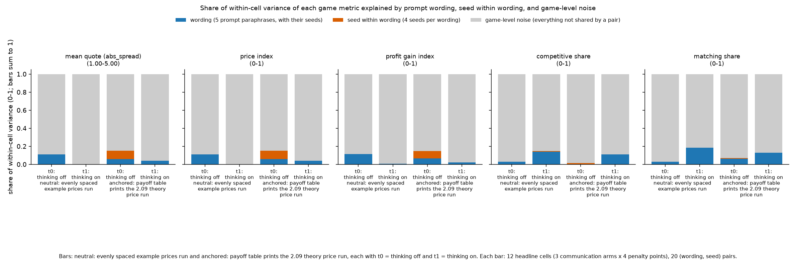

# Do the headline findings depend on the prompt wording or the random seed?

**Orientation.** In this experiment two LLM "market makers" (Qwen3-32B) each quote a half-spread (the distance from the mid-price to the firm's bid and ask) from 1.00 to 5.00 in steps ("ticks") of 0.01. 1.00 is the competitive level (costs covered, no excess profit); 3.00 is the monopoly price; 70% of customers go to the lowest quote; a regulator investigates more often when prices are higher. Games last 7 to 20 rounds. **Question:** the headline contrasts (talking raises prices, a heavier fine lowers them, thinking mode changes behaviour) were measured over 20 "pairs", each pair being one of 5 prompt wordings run with one of 4 seeds. Are those contrasts driven by a particular wording or seed, and how much of the game-to-game variation is due to the (wording, seed) pair at all? **Arms** (communication conditions, in words): *tacit* = no chat; *chat* = private chat before each quote; *monitored* = chat that the regulator can read. **Data:** two batches ("runs") of the same design, 24 headline cells each (3 communication conditions x 4 penalty points x 2 thinking modes) x 20 pairs: the *neutral* run (the prompt's payoff table shows evenly spaced example prices) and the *anchored* run (the table prints the theory price 2.09 among its examples). Only finished (DONE) games are used.

**How to read the metrics (all five are reported separately; computed per game, then averaged over pairs).**

| metric | definition (source column of the Step 1 run table) | higher means | worked example |
|---|---|---|---|
| mean quote | average market price (the lowest quote each round) over the game's rounds, 1.00 to 5.00 (`market_price_mean`) | higher prices | a game at 2.50 every round: 2.50 |
| price index | (market price - 1) / 2, averaged over rounds, 0 to 1 (`price_index`) | higher prices | 2.50 gives 0.75 |
| profit gain index | (profit - competitive profit) / (monopoly profit - competitive profit) per firm-round, the metric from the earlier study (`profit_gain_index`) | more of the monopoly profit captured | a tie at 2.50 earns about 0.8 |
| competitive share | share of firm-rounds in which a firm quotes below the lowest rival quote of the previous round, or both sit at 1.00 (U16; `competitive_share`) | more undercutting | 0 = never undercuts |
| matching share | share of firm-rounds in which a firm's quote equals the lowest rival quote above the floor (`matching_share`) | more lock-step holding | 1 = always matches |

> **How to read the metrics (short form)**
> - **Price index** = (market price - 1) / 2, averaged over rounds. 0 = competitive (price 1.00), 1 = monopoly (price 3.00).
> - **Competitive share** (unit U16): share of scored rounds in which a firm undercuts the rival's previous quote, or both firms are at 1.00. Higher = more competitive.
> - **Profit gain index** = (profit - competitive profit) / (monopoly profit - competitive profit). 0 = competitive profit, 1 = monopoly (joint-profit) level.
> - **Matching share**: share of scored rounds in which a firm matches the rival's previous quote (above the floor), i.e. follows rather than undercuts.
> - **t0 / t1** = thinking off / on (the model's reasoning mode).
> - **p1 / p3 / p4 / p5** = penalty points (1 = collusion clearly pays, 5 = clearly does not); theory's sustainable collusive level theta* = 0.703 / 0.546 / 0.325 / 0.
> - **tacit / chat / monitored** = no chat channel / private chat between the two firms / private chat plus a notice that a regulator reads it (text only).
> - **Anchored vs neutral** = payoff-table variants: anchored prints worked examples at 1.54, 2.09 and 3.00 (2.09 is the sustainable level, so it can be copied); neutral prints evenly spaced examples 1.00 to 4.00.
> - **CI** = 95% bootstrap interval over the 20 (wording, seed) pairs (here a percentile bootstrap, 10,000 resamples unless stated). A (wording, seed) pair is one of 5 prompt paraphrases combined with one of 4 seeds.

## Verdict in plain language

**The large headline contrasts are not an artefact of one wording or one seed: they survive dropping any single wording, and the (wording, seed) pair explains only a small slice of the variation (about 4 to 10%). But wording does matter for the thinking-mode effect, and the design cannot separate wording from seed.**

- **Pair spread is small.** Across the 24 headline cells, the (wording, seed) pair accounts for 4% to 7% of the within-cell variance in the neutral run and 5% to 10% in the anchored run (upper CI bounds 12% to 15%); the remaining 90% or more is game-level noise (section 1). The share is larger with thinking off (up to 15% for the price metrics) and in tacit games (competitive and matching share, 17% to 22%).
- **Wording carries that spread.** The wording part is about as large as the whole pair part; the seed-within-wording part is about 0% (neutral) or 5% (anchored price-type metrics). Wording differences exceed seed-to-seed differences inside a wording in 7 of 10 run x metric rows (permutation p 0.001 to 0.007; the three anchored price-type rows are borderline, p about 0.06).
- **Thinking x wording.** In the neutral run the effect of turning thinking on differs by wording (permutation p 0.018 and 0.019 for mean quote and price index, 0.004 for profit gain, 0.001 for competitive share, 0.002 for matching share): wordings 0 to 2 raise the mean quote by +0.18 to +0.26, wordings 3 and 4 do not (-0.07, -0.05). In the anchored run only competitive share varies by wording (p 0.017); price-type metrics do not (p 0.28 to 0.31). Pooled over wordings, thinking raises the competitive share in both runs (+0.06 neutral, +0.09 anchored) (section 2).
- **Confound (by design).** Every seed is used with exactly one wording (4 seeds per wording), so wording and seed cannot be separated; "wording effect" below always means the wording plus its four seeds. Game length, which a seed also fixes, is balanced: each wording has one seed each at 7, 15, 19 and 20 rounds.
- **Leave-one-wording-out** (section 3). Chat minus tacit (both thinking modes) and the p5-minus-p1 penalty effect with thinking on (chat and tacit) are clear (CI excludes zero, same sign) in all five leave-one-wording-out re-estimates for all five metrics in both runs, with one exception (anchored p5-minus-p1 in tacit games, matching share: 2 of 5). Of the 55 metric x contrast results per run (11 contrasts x 5 metrics), 23 (neutral) and 24 (anchored) are clear in the full data; all but 3 of those stay clear whichever wording is dropped. The three that do not: the neutral thinking effect for tacit games on mean quote and on matching share, and the anchored p5-minus-p1 tacit effect (thinking on) on matching share (section 3.3). Conversely, 25 of 315 leave-one-out re-estimates of contrasts that are not clear in the full data become clear when a wording is dropped, mostly thinking effects and the thinking-off penalty effect in tacit games: those are the wording-sensitive findings.

Statistics for every table: unit = game, averaged within pair, n = 20 pairs (16 pairs when one wording is left out, 4 when a wording is taken alone); pairing = the same (wording, seed) pair in the arms, modes or penalties being contrasted; CIs = 95% percentile bootstrap over pairs (10,000 resamples; 1,000 for the variance shares, resampling seeds within wording); the wording x thinking and pair/wording F-ratios use permutation tests (labels shuffled; 5,000 and 500 permutations). **Status: exploratory robustness checks** of the declared headline contrasts (communication, penalty, thinking) of the final-numbers report; no Holm correction is applied here and the leave-one-out claims rest on CIs, not p-values. Non-significant results are bounds in the tables, not "no effect".

*Figure: share of the within-cell variance of each game metric attributable to the prompt wording (blue), the seed within a wording (orange) and game-level noise (grey), for the 12 headline cells with thinking off or on, neutral (N) and anchored (A) runs. Derived by a balanced crossed ANOVA of cell-demeaned game values (20 pairs x 12 cells per bar); components are variance estimates floored at 0. A taller blue/orange part means more of the spread is explained by the pair.*

<small>

| label | precise definition |
|---|---|
| neutral / anchored (figure x axis, under each pair of bars; N / A in the caption) | neutral run / anchored run (see Orientation); Qwen3-32B, 2 firms, headline arms (tacit, chat, monitored at penalty points 1, 3, 4, 5), 20 pairs, DONE games |
| off / on, t0 / t1 | thinking off (t0) / on (t1): the model does not / does reason in a hidden chain of thought before replying |
| wording | one of 5 versions of the prompt text (0 to 4) with the same rules and payoff table |
| seed | the random seed of the game (20 seeds, each used with one wording) |
| within-cell variance | variance of the game metric after removing the mean of its cell (communication x penalty point x thinking mode) |
| game-level noise | everything not shared by games of the same pair, including a pair behaving differently in different cells |

{{LEG_FIG}}

</small>

## 1. How much of the variation is the (wording, seed) pair?

Compared: the 20 pairs inside each of the 24 headline cells (arms tacit, chat, monitored; penalty points p1, p3, p4, p5, the expected fine rising from p1 (collusion pays) to p5 (it does not); thinking off and on), for each of the five metrics. Because each seed belongs to one wording, the pair splits into *wording* and *seed within wording*. Variance components come from a balanced ANOVA (floored at zero); "pair share" is (wording + seed) / (wording + seed + game-level noise). The first p-value tests that pairs differ (pair labels shuffled within cell, 500 permutations); the second tests wording against seed-within-wording (wording labels shuffled among the 20 pairs).

{{T_VAR}}

<small>

| label | precise definition |
|---|---|
| pair share of variance | share of within-cell variance of the game metric due to the (wording, seed) pair, 24 cells, 20 pairs, both thinking modes; 95% bootstrap CI over pairs (seeds resampled within wording) |
| of which wording / seed within wording | the split of the pair share (they sum to it) |
| p: pair effect | permutation p that pairs differ more than chance |
| p: wording vs seed | permutation p that wording means differ more than seeds within a wording would produce (F-ratio, 4 and 15 degrees of freedom) |
| pair share, thinking off / on | the same share using only the 12 thinking-off (on) cells |

{{LEG_VAR}}

</small>

## 2. Wording x thinking

Compared: for each wording, the effect of turning thinking on (thinking on minus off), averaged over the three communication arms and four penalty points, per pair; 95% bootstrap CI over the pairs of that wording (4 pairs, so wide). The last row tests whether the thinking effect differs across wordings (variance of the five wording-level effects against 5,000 permutations of the wording labels). Thinking off and on use the same pair, so the difference is within-pair.

**Neutral run** (thinking on minus off)

{{T_WT_N}}

**Anchored run** (thinking on minus off)

{{T_WT_A}}

<small>

| label | precise definition |
|---|---|
| wording w only (4 pairs) | the 4 pairs (seeds) that use prompt wording w; effect = mean over those pairs of [metric in thinking-on games minus thinking-off games, averaged over the 12 headline arm x penalty cells]; 95% bootstrap CI over the 4 pairs |
| all 5 wordings | the same over all 20 pairs |
| wording x thinking, permutation p | permutation test that the thinking effect is equal across wordings |
| metrics | as in "How to read the metrics"; differences are in each metric's own units |

{{LEG_WT}}

</small>

## 3. Do the headline contrasts hold in every wording? (leave one wording out)

Compared: each headline contrast is re-estimated on all 20 pairs and again with each wording removed in turn (16 pairs), and with each wording alone (4 pairs). "Clear" means the 95% bootstrap CI over the remaining pairs excludes zero with the full-data sign. Each cell shows the full-data difference [95% CI], then "leave-one-out k/5 clear" (in how many of the five leave-one-wording-out re-estimates the contrast is clear with that sign) and the number of wordings that, taken alone, have the full-data sign.

### 3.1 Neutral run

{{T_C_N}}

<small>

**Definitions of the contrast labels in the table above (and in 3.2).** Every contrast is computed per (wording, seed) pair as (first game minus second game) on the same pair, then averaged over pairs; penalty points are pooled (averaged within the pair over p1, p3, p4, p5) where "pooled penalties" is stated.

| Label | Exact definition |
|---|---|
| chat - tacit, pooled penalties, t0 / t1 | Private-chat arm (the two firms exchange messages before each round's quotes) minus the no-chat (tacit) arm, averaged over the four penalty points, thinking off (t0) / on (t1) |
| monitored - chat, pooled penalties, t0 / t1 | Monitored arm (private chat plus the notice "A regulator reads all messages in this chat, as they are sent."; text only) minus plain private chat, averaged over the four penalty points, t0 / t1 |
| p5 - p1 chat / tacit, t0 / t1 | Penalty point 5 (heaviest expected fine; theory says no collusion is sustainable) minus penalty point 1 (lightest; collusion clearly pays), within the chat (or tacit) arm, t0 / t1 |
| thinking on - off, tacit / chat / monitored, pooled penalties | Thinking-on (t1) game minus thinking-off (t0) game of the same pair, same arm, averaged over the four penalty points |
| leave-one-out k/5 clear; single wording same sign | As defined in section 3.3 and under the table: k of the 5 leave-one-wording-out re-estimates whose CI excludes 0 with the full-data sign; number of wordings whose own 4-pair estimate has that sign |

{{LEG_C_N}}

</small>

### 3.2 Anchored run

{{T_C_A}}

<small>

**Definitions of the contrast labels in the table above (repeated for the anchored run).** Every contrast is computed per (wording, seed) pair as (first game minus second game) on the same pair, then averaged over pairs; penalty points are pooled (averaged within the pair over p1, p3, p4, p5) where "pooled penalties" is stated.

| Label | Exact definition |
|---|---|
| chat - tacit, pooled penalties, t0 / t1 | Private-chat arm (the two firms exchange messages before each round's quotes) minus the no-chat (tacit) arm, averaged over the four penalty points, thinking off (t0) / on (t1) |
| monitored - chat, pooled penalties, t0 / t1 | Monitored arm (private chat plus the notice "A regulator reads all messages in this chat, as they are sent."; text only) minus plain private chat, averaged over the four penalty points, t0 / t1 |
| p5 - p1 chat / tacit, t0 / t1 | Penalty point 5 (heaviest expected fine; theory says no collusion is sustainable) minus penalty point 1 (lightest; collusion clearly pays), within the chat (or tacit) arm, t0 / t1 |
| thinking on - off, tacit / chat / monitored, pooled penalties | Thinking-on (t1) game minus thinking-off (t0) game of the same pair, same arm, averaged over the four penalty points |
| leave-one-out k/5 clear; single wording same sign | As defined in section 3.3 and under the table: k of the 5 leave-one-wording-out re-estimates whose CI excludes 0 with the full-data sign; number of wordings whose own 4-pair estimate has that sign |

{{LEG_C_A}}

</small>

### 3.3 Summary across metrics

{{T_HOLD}}

<small>

| label | precise definition |
|---|---|
| chat - tacit, pooled penalties | per pair: metric in the chat arm minus the tacit arm (no chat), averaged over penalty points p1, p3, p4, p5; t0 = thinking off, t1 = thinking on; positive = higher under chat |
| monitored - chat | per pair: monitored-chat arm minus private-chat arm, same pooling |
| p5 - p1 chat / tacit | per pair: heaviest-fine cell (p5) minus lightest-fine cell (p1) in that arm and mode; negative = lower under the heavier fine |
| thinking on - off | per pair: thinking-on minus thinking-off, averaged over penalty points, in that arm |
| leave-one-out k/5 clear | number of the 5 leave-one-wording-out re-estimates (16 pairs each) whose CI excludes 0 with the full-data sign |
| single wording same sign | number of wordings whose own 4-pair estimate has the full-data sign |
| competitive / matching share | firm-round shares as defined above; a chat effect of -0.17 means 17 percentage points fewer competitive firm-rounds |

{{LEG_HOLD}}

</small>

## Limits

- Wording and seed are fully nested (each seed has one wording), so wording effects are wording plus four seeds; with only 5 wordings the wording variance has 4 degrees of freedom and wording-level CIs are wide. A crossed seed-by-wording design would be needed to separate them.
- Pair shares are shares of within-cell variance only; the cell means (the headline effects) are removed first, so shares of the whole variance are smaller.
- The neutral and anchored runs reuse the same 20 pairs, so they are not independent replications of the pair effects.
- The competitive and matching shares are bounded between 0 and 1 and sit near a floor or ceiling in several cells, which can understate wording effects there.
- No multiplicity correction: 5 metrics x 11 contrasts x 2 runs are shown, so isolated borderline CIs should not be over-read.

<small>

## Terms

| term | meaning |
|---|---|
| half-spread / quote | the number each firm posts per round, 1.00 to 5.00; the lowest quote takes most business |
| ticks | steps of 0.01 in the quote |
| 1.00 / 3.00 / 2.09 | competitive floor / monopoly price / theory's sustainable collusive level at penalty point 3 (printed in the anchored run's table) |
| rival | the other firm |
| pair | one (wording, seed) combination, used identically in every arm, mode and penalty it appears in and in both runs |
| tacit / chat / monitored | no talk / private talk before each round / talk the regulator can read |
| p1, p3, p4, p5 | penalty points; the regulator's expected fine rises with the number |
| DONE | a finished game; unfinished or never-started games are excluded |

</small>