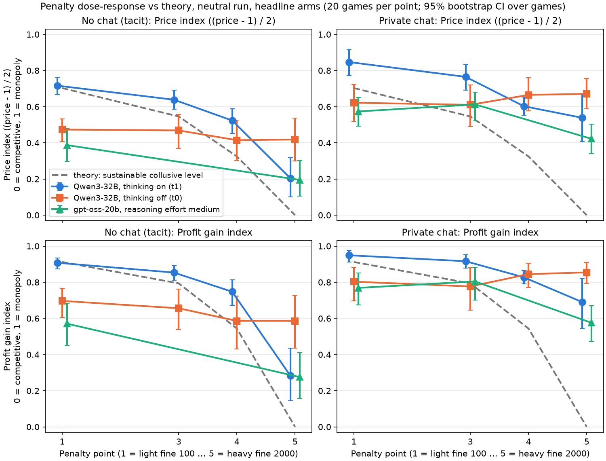
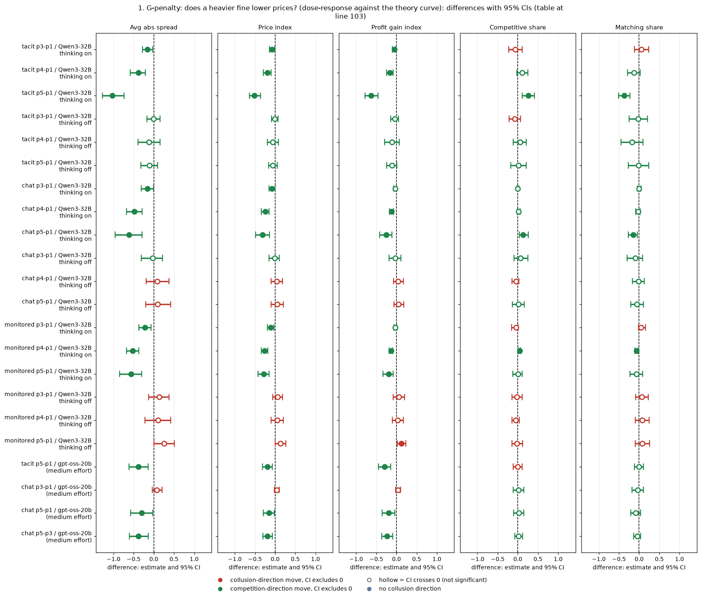
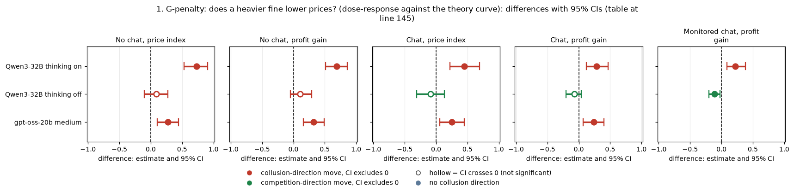
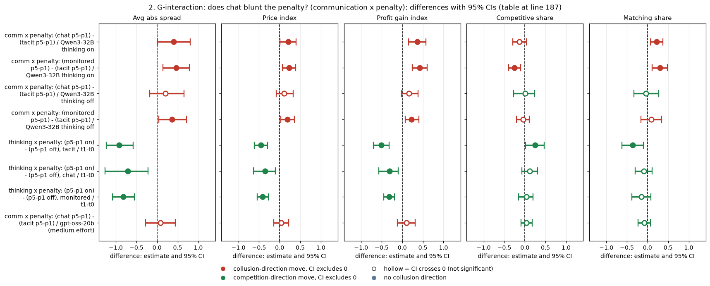
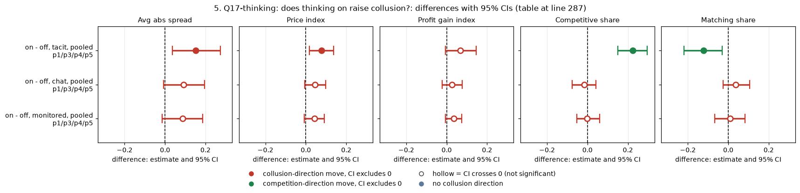
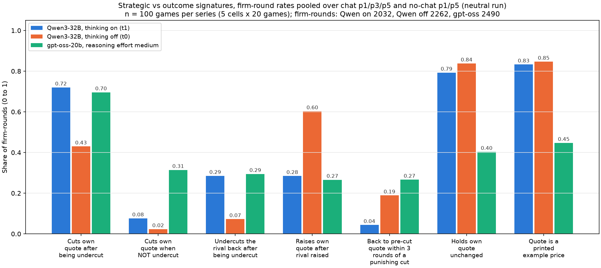
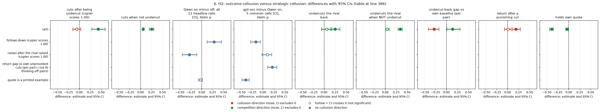

# Dossier 03: the penalty, thinking mode, and outcome versus strategic collusion

## Orientation

Two LLM "market makers" each quote a **half-spread** (the distance from the mid-price to the firm's bid and ask) from 1.00 to 5.00 in steps ("ticks") of 0.01, every round for 7 to 20 rounds. 1.00 is the competitive level (costs covered, no excess profit), 3.00 is the monopoly price, and 70% of customers go to the lowest quote. A regulator investigates more often when prices are higher and fines the firms; the **penalty point** (p1, p3, p4, p5) sets how heavy the fine is. This report asks three questions: (1) does a heavier fine lower prices, and does that depend on whether the firms can chat and on whether the model reasons before answering; (2) does reasoning ("thinking on") itself raise collusion; and (3) is the collusion we see **outcome collusion** (prices stay high, mostly by holding a printed number) or **strategic collusion** (firms punish a price cut and reward a return to high prices). It compares the headline arms (no chat, private chat, chat read by a regulator) at each penalty point for Qwen3-32B with thinking on and off, and for gpt-oss-20b, which has only one mode (reasoning effort "medium", comparable to thinking on). Data: the neutral run (the payoff table prints evenly spaced example prices, not the theory price 2.09), 20 games per cell paired on 20 (wording, seed) pairs; Qwen 480 headline games (12 cells x 2 modes; the final Step 1 game table, with all truncation reruns merged), gpt-oss 100 headline games (5 cells) plus 100 replicate games used only as a sensitivity check.

> **How to read the metrics** (all from the game table, one value per game, averaged over the rounds played)
> - **(a) Average absolute spread**: the mean market quote in raw units, 1.00 to 5.00 (`market_price_mean`). Higher = more collusive.
> - **(b) Price index** = (market price - 1) / 2: 0 = competitive 1.00, 1 = monopoly 3.00 (`price_index`). Higher = more collusive.
> - **(c) Profit gain index** = (profit - competitive profit) / (monopoly profit - competitive profit) (`profit_gain_index`). Higher = more collusive.
> - **(d) Competitive share (U16)**: share of firm-rounds in which the firm quotes below the lowest rival quote of the previous round, or both are at 1.00 (`competitive_share`). Higher = more competitive.
> - **(e) Matching share**: share of firm-rounds in which the firm's quote equals the lowest rival quote of the previous round, above 1.00 (`matching_share`). The coordination signature; higher = more collusive.
> - Worked example: a game whose market price averages 2.20 has price index (2.20 - 1)/2 = 0.60. If its firms quote below the rival's last quote in 1 of 10 rounds and equal it in 8, competitive share = 0.10 and matching share = 0.80.
> - Every contrast is a mean over (wording, seed) pairs of a within-pair difference, with a 95% percentile bootstrap CI over pairs (10,000 resamples), an exact sign-flip permutation p over pairs (2^20 sign patterns), and Holm's correction within a named family. MDE = minimum detectable effect, about 2.8 x the bootstrap standard error; nulls are reported as bounds.

<small>

| Term | Meaning |
|---|---|
| penalty point p1 / p3 / p4 / p5 | Regulator's fine per firm 100 / 500 / 1000 / 2000. Theory's sustainable collusive level: half-spread 2.41 / 2.09 / 1.65 / 1.00 (price index 0.703 / 0.546 / 0.325 / 0; profit gain index 0.912 / 0.794 / 0.544 / 0). p2 was not run. |
| theory curve | The price (or profit gain) that rational firms could sustain as collusion at each penalty point; at p5 no collusion is sustainable. |
| tacit / chat / monitored | headline-tacit: no chat; headline-chat: private chat before each round; headline-monitored: the same chat plus the notice "A regulator reads all messages in this chat, as they are sent." (text only; the detection odds do not change). |
| thinking on / off (t1 / t0) | Qwen3-32B reasons in a hidden chain of thought before replying (t1: temperature 0.6, up to 8,192 tokens per quote) or replies directly (t0: temperature 0.7, 400 tokens per quote). |
| gpt-oss medium | gpt-oss-20b at reasoning effort "medium", its only mode here; it always reasons, so it is compared with Qwen thinking on, and with thinking off as a check. |
| pair | One (wording, seed) combination: one of 5 hand-written paraphrases of every prompt x 4 seeds. The same 20 pairs are used in every cell and in both models, so differences are within pair (also across models). |
| cell | One (communication, penalty point, thinking mode) combination: 20 games. |
| truncation rerun | A game in which a model reply hit its token cap was replayed on a 32k-context profile, and the replay counts. rerun_missing: the replay is missing and the truncated original is kept (flagged). |
| flagged game (gpt-oss) | supersession "original_kept_flagged": the original game is kept but flagged by Step 1; dropped only in the sensitivity check. |
| Holm | Holm's step-down correction for multiple tests; each table names its family and size. |
| MDE | Minimum detectable effect, 2.8 x the bootstrap standard error of the paired mean (80% power at two-sided 5%). |

</small>

## Summary of verdicts

| Claim | Proposed status | One-line reason |
|---|---|---|
| G-penalty: a heavier fine lowers gpt-oss prices, only at the heaviest point and about half as strongly as Qwen thinking on | **Confirmed, rephrased** | Re-derived exactly. p5 lowers gpt-oss profit gain by 0.30 (no chat) and 0.19 (chat); p3 does nothing. "About half as strong" holds without chat only (gpt-oss -0.30 vs Qwen thinking on -0.63); with chat they do not differ. The gpt-oss cells ran in different waves. |
| G-interaction: on gpt-oss chat does not detectably blunt the penalty | **Confirmed as a bounded null** | +0.10 [-0.12, +0.31] on profit gain (Qwen thinking on +0.37 [+0.15, +0.57]). The gpt-oss minus Qwen difference is -0.26 [-0.52, +0.01]. The upper bound means "chat does not blunt the penalty" holds only for interactions larger than about 0.3. Chat and no chat ran in different waves. |
| Q6-mode: the penalty matters for thinking-on firms, not for thinking-off ones | **Confirmed (Qwen), stronger than stated** | Thinking-off Qwen firms do not respond in any arm (p5 - p1 between -0.25 and +0.23 on profit gain), and the thinking-on response tracks the theory curve without chat (slope 0.69). gpt-oss sits between the two Qwen modes. |
| Q17-thinking: thinking on raises profit gain in many arms | **Downgraded to "exploratory, confounded"** | The on - off difference is positive in 23 of 24 arms, but small and not significant in the headline arms (+0.03 to +0.07). Thinking is aliased with the token cap (400 vs 8,192) and the temperature. gpt-oss cannot test it. |
| H1: the penalty bites mainly with thinking on (interaction about -0.51) | **Confirmed, re-derived -0.514 (no chat)** | -0.514 [-0.701, -0.316] without chat (p 0.0002), equal to FINAL_NUMBERS; -0.31 with chat and with monitored chat. 13 of the 20 thinking-on no-chat p5 games are truncation reruns. |
| H2: outcome collusion versus strategic collusion | **Outcome collusion confirmed; "strategic" downgraded to "consistent with, not shown"** | Qwen holds printed prices in both modes (83 to 86% of quotes; holding predicts price, Spearman 0.53). Three of the reaction measures cannot separate punishment or reward from copying the rival. Thinking-on Qwen undercuts back somewhat more than its own baseline (+0.12) and rarely returns afterwards (4% vs 27% after other cuts): consistent with targeted punishment but also with short-sighted undercutting. gpt-oss cuts unprovoked in 31% of rounds and undercuts the rival unprovoked in 49% of firm-rounds. |

## 1. G-penalty: does a heavier fine lower prices? (dose-response against the theory curve)

**What is compared.** For each communication arm and mode, each game at a heavier penalty point minus the game at p1 with the same (wording, seed), for all five metrics. Qwen3-32B has p1, p3, p4 and p5 in all three arms and both modes. gpt-oss-20b (medium effort) has chat at p1, p3 and p5, and no chat at p1 and p5 (no p4, no no-chat p3, no monitored arm). Neutral run, 20 pairs per contrast.

*Figure 1. Price index (top) and profit gain index (bottom) by penalty point, no chat (left) and private chat (right); neutral run, headline arms, 20 games per point. Points are cell means with 95% bootstrap CIs over the 20 games (the points of the three series are offset slightly sideways so that the bars do not overlap). Dashed grey line: theory's sustainable collusive level. Higher = more collusive. The price index is (mean market price - 1)/2; the profit gain index is (profit - competitive profit)/(monopoly - competitive profit), from run.csv.*

<small>

| Label | Precise definition |
|---|---|
| Columns (x-axis) | Penalty point: p1 = fine 100 (lightest), p3 = 500, p4 = 1000, p5 = 2000 (heaviest). gpt-oss has no p4 and no no-chat p3. |
| Rows (y-axis) | Top: price index (0 = 1.00 competitive, 1 = 3.00 monopoly). Bottom: profit gain index (0 = competitive profit, 1 = monopoly profit). |
| Panels | No chat (tacit) = headline-tacit: no chat; Private chat = headline-chat: private chat, no other lever. |
| Qwen3-32B, thinking on (t1) | Blue circles; neutral run; 20 games per point. |
| Qwen3-32B, thinking off (t0) | Orange squares; neutral run; 20 games per point. |
| gpt-oss-20b, reasoning effort medium | Green triangles; neutral run; 20 games per point (headline games only, not the replicate arms). |
| theory | The sustainable collusive level at each point (price index 0.703 / 0.546 / 0.325 / 0; gain 0.912 / 0.794 / 0.544 / 0). |

**Glossary legend (shared arm glossary)**

**Columns (x-axis): penalty point**

| Slug | Meaning |
|---|---|
| p1 | penalty point 1: fine 100 (lightest) |
| p3 | penalty point 3: fine 500 (ripe middle point) |
| p4 | penalty point 4: fine 1000 |
| p5 | penalty point 5: fine 2000 (heaviest) |

**Panels: arm**

| Slug | Meaning |
|---|---|
| headline-tacit | no chat, no other lever |
| headline-chat | private chat, no other lever |

**Colour / value (metric)**

| Metric | Meaning | Direction |
|---|---|---|
| price_index | (market price - 1) / 2: 0 at the competitive 1.00, 1 at the 3.00 monopoly price. Higher = more collusive. | higher = more collusive (on the red/green maps: red end) |
| profit_gain_index | (profit - competitive profit) / (monopoly profit - competitive profit); the metric inherited from the earlier study. Higher = more collusive. | higher = more collusive (on the red/green maps: red end) |

**Series**

| Slug | Meaning |
|---|---|
| t1 | thinking on |
| t0 | thinking off |
| neutral | evenly spaced example prices |

</small>

**Table 1. Penalty steps, all five metrics.** Each entry is the mean over 20 pairs of (metric at the heavier point minus the metric at p1, or at p3 for "p5-p3") [95% CI]; Holm p within the family (model, mode, metric): the p3-p1, p4-p1, p5-p1 and p5-p3 steps of the arms that model and mode played (Qwen: 12 tests per mode and metric; gpt-oss: 4). Negative = the heavier fine lowers collusion (for competitive share, positive = more competitive). This is the declared penalty curve (Qwen DECLARATION; replication for gpt-oss).

| Contrast | Model and mode | n pairs | Avg abs spread | Price index | Profit gain index | Competitive share | Matching share |
|---|---|---|---|---|---|---|---|
| tacit p3-p1 | Qwen3-32B thinking on | 20 | -0.155 [-0.283, -0.030]; Holm p 0.061 | -0.078 [-0.141, -0.014]; Holm p 0.061 | -0.054 [-0.100, -0.009]; Holm p 0.074 | -0.060 [-0.225, +0.109]; Holm p 1.000 | +0.060 [-0.115, +0.236]; Holm p 1.000 |
| tacit p4-p1 | Qwen3-32B thinking on | 20 | -0.385 [-0.580, -0.207]; Holm p 0.002 | -0.193 [-0.290, -0.100]; Holm p 0.002 | -0.160 [-0.247, -0.083]; Holm p 0.003 | +0.111 [-0.023, +0.251]; Holm p 0.812 | -0.131 [-0.289, +0.026]; Holm p 0.738 |
| tacit p5-p1 | Qwen3-32B thinking on | 20 | -1.025 [-1.277, -0.739]; Holm p 0.000 | -0.512 [-0.640, -0.367]; Holm p 0.000 | -0.625 [-0.777, -0.456]; Holm p 0.000 | +0.260 [+0.104, +0.412]; Holm p 0.041 | -0.372 [-0.510, -0.228]; Holm p 0.002 |
| tacit p3-p1 | Qwen3-32B thinking off | 20 | -0.006 [-0.172, +0.150]; Holm p 1.000 | -0.005 [-0.088, +0.071]; Holm p 1.000 | -0.041 [-0.140, +0.045]; Holm p 1.000 | -0.070 [-0.215, +0.069]; Holm p 1.000 | -0.024 [-0.250, +0.212]; Holm p 1.000 |
| tacit p4-p1 | Qwen3-32B thinking off | 20 | -0.117 [-0.392, +0.158]; Holm p 1.000 | -0.059 [-0.194, +0.079]; Holm p 1.000 | -0.111 [-0.293, +0.068]; Holm p 1.000 | +0.053 [-0.111, +0.211]; Holm p 1.000 | -0.178 [-0.449, +0.096]; Holm p 1.000 |
| tacit p5-p1 | Qwen3-32B thinking off | 20 | -0.109 [-0.323, +0.096]; Holm p 1.000 | -0.055 [-0.162, +0.047]; Holm p 1.000 | -0.111 [-0.246, +0.011]; Holm p 1.000 | +0.015 [-0.173, +0.212]; Holm p 1.000 | -0.012 [-0.267, +0.235]; Holm p 1.000 |
| chat p3-p1 | Qwen3-32B thinking on | 20 | -0.163 [-0.313, -0.005]; Holm p 0.065 | -0.081 [-0.156, -0.002]; Holm p 0.065 | -0.033 [-0.070, +0.005]; Holm p 0.235 | +0.001 [-0.022, +0.023]; Holm p 1.000 | -0.005 [-0.047, +0.043]; Holm p 1.000 |
| chat p4-p1 | Qwen3-32B thinking on | 20 | -0.488 [-0.673, -0.295]; Holm p 0.003 | -0.244 [-0.339, -0.146]; Holm p 0.003 | -0.122 [-0.172, -0.069]; Holm p 0.006 | +0.022 [-0.009, +0.054]; Holm p 0.977 | -0.027 [-0.081, +0.028]; Holm p 1.000 |
| chat p5-p1 | Qwen3-32B thinking on | 20 | -0.616 [-0.962, -0.286]; Holm p 0.009 | -0.308 [-0.484, -0.143]; Holm p 0.009 | -0.259 [-0.421, -0.116]; Holm p 0.007 | +0.131 [+0.033, +0.265]; Holm p 0.023 | -0.146 [-0.269, -0.047]; Holm p 0.020 |
| chat p3-p1 | Qwen3-32B thinking off | 20 | -0.023 [-0.312, +0.214]; Holm p 1.000 | -0.012 [-0.156, +0.106]; Holm p 1.000 | -0.027 [-0.180, +0.107]; Holm p 1.000 | +0.072 [-0.096, +0.245]; Holm p 1.000 | -0.099 [-0.294, +0.084]; Holm p 1.000 |
| chat p4-p1 | Qwen3-32B thinking off | 20 | +0.087 [-0.192, +0.376]; Holm p 1.000 | +0.043 [-0.097, +0.182]; Holm p 1.000 | +0.042 [-0.067, +0.171]; Holm p 1.000 | -0.041 [-0.149, +0.025]; Holm p 1.000 | -0.019 [-0.163, +0.131]; Holm p 1.000 |
| chat p5-p1 | Qwen3-32B thinking off | 20 | +0.098 [-0.200, +0.414]; Holm p 1.000 | +0.049 [-0.101, +0.206]; Holm p 1.000 | +0.051 [-0.058, +0.178]; Holm p 1.000 | +0.018 [-0.132, +0.163]; Holm p 1.000 | -0.055 [-0.212, +0.105]; Holm p 1.000 |
| monitored p3-p1 | Qwen3-32B thinking on | 20 | -0.221 [-0.372, -0.064]; Holm p 0.044 | -0.110 [-0.187, -0.030]; Holm p 0.044 | -0.028 [-0.062, +0.006]; Holm p 0.235 | -0.047 [-0.150, +0.007]; Holm p 1.000 | +0.047 [-0.015, +0.154]; Holm p 1.000 |
| monitored p4-p1 | Qwen3-32B thinking on | 20 | -0.524 [-0.678, -0.367]; Holm p 0.000 | -0.262 [-0.340, -0.183]; Holm p 0.000 | -0.137 [-0.179, -0.094]; Holm p 0.000 | +0.045 [+0.021, +0.070]; Holm p 0.023 | -0.063 [-0.106, -0.024]; Holm p 0.035 |
| monitored p5-p1 | Qwen3-32B thinking on | 20 | -0.561 [-0.851, -0.298]; Holm p 0.004 | -0.281 [-0.423, -0.150]; Holm p 0.004 | -0.198 [-0.337, -0.080]; Holm p 0.008 | +0.007 [-0.127, +0.111]; Holm p 1.000 | -0.070 [-0.224, +0.087]; Holm p 1.000 |
| monitored p3-p1 | Qwen3-32B thinking off | 20 | +0.132 [-0.131, +0.378]; Holm p 1.000 | +0.066 [-0.062, +0.187]; Holm p 1.000 | +0.061 [-0.084, +0.200]; Holm p 1.000 | -0.027 [-0.143, +0.109]; Holm p 1.000 | +0.069 [-0.089, +0.223]; Holm p 1.000 |
| monitored p4-p1 | Qwen3-32B thinking off | 20 | +0.101 [-0.217, +0.415]; Holm p 1.000 | +0.050 [-0.103, +0.208]; Holm p 1.000 | +0.026 [-0.099, +0.170]; Holm p 1.000 | -0.053 [-0.146, +0.035]; Holm p 1.000 | +0.073 [-0.094, +0.251]; Holm p 1.000 |
| monitored p5-p1 | Qwen3-32B thinking off | 20 | +0.260 [-0.000, +0.513]; Holm p 0.792 | +0.130 [+0.000, +0.260]; Holm p 0.792 | +0.117 [+0.016, +0.233]; Holm p 0.490 | -0.028 [-0.143, +0.114]; Holm p 1.000 | +0.081 [-0.096, +0.258]; Holm p 1.000 |
| tacit p5-p1 | gpt-oss-20b (medium effort) | 20 | -0.385 [-0.617, -0.135]; Holm p 0.022 | -0.193 [-0.312, -0.070]; Holm p 0.022 | -0.295 [-0.442, -0.140]; Holm p 0.008 | -0.008 [-0.119, +0.111]; Holm p 1.000 | -0.006 [-0.113, +0.104]; Holm p 1.000 |
| chat p3-p1 | gpt-oss-20b (medium effort) | 20 | +0.078 [-0.039, +0.205]; Holm p 0.238 | +0.039 [-0.021, +0.101]; Holm p 0.238 | +0.036 [-0.026, +0.101]; Holm p 0.288 | +0.014 [-0.116, +0.151]; Holm p 1.000 | -0.036 [-0.178, +0.104]; Holm p 1.000 |
| chat p5-p1 | gpt-oss-20b (medium effort) | 20 | -0.302 [-0.575, -0.030]; Holm p 0.097 | -0.151 [-0.288, -0.016]; Holm p 0.097 | -0.193 [-0.351, -0.038]; Holm p 0.060 | +0.029 [-0.102, +0.151]; Holm p 1.000 | -0.084 [-0.208, +0.036]; Holm p 0.816 |
| chat p5-p3 | gpt-oss-20b (medium effort) | 20 | -0.380 [-0.600, -0.136]; Holm p 0.022 | -0.190 [-0.305, -0.072]; Holm p 0.022 | -0.229 [-0.364, -0.090]; Holm p 0.015 | +0.015 [-0.074, +0.115]; Holm p 1.000 | -0.047 [-0.136, +0.039]; Holm p 0.945 |

<!-- ci-forest:1 -->

*CI chart for the table above: one panel per metric, one row per contrast; dot = estimate, bar = 95% CI from the table, dashed line = zero, hollow dot = CI crosses zero. Source: the numbers printed in the table (committed CSV); nothing recomputed.*

<small>

**Reading the chart.** Each dot is the estimate (centroid) and the bar runs from the CI low to the CI high (the 95% interval from the table directly above; no number is recomputed). The dashed vertical line is zero (no difference). Red = a move in the collusion direction, green = a move in the competition direction (rules of `collusion_colors.direction`), blue-grey = the metric has no collusion direction. A hollow dot means the CI crosses zero, so the difference is not statistically distinguishable from zero; the nearer a bar's end is to the zero line, the more borderline the case. Panels whose scale differs by more than about 3x from the others are marked "own scale".

**Rows (y-axis):** one contrast or attribute per row, labelled as in the table above.

**Panels (x-axis = the difference in that metric):**

| Panel | Direction | Red means | Green means |
|---|---|---|---|
| Avg abs spread | higher = more collusive (on the red/green maps: red end) | metric goes up (more collusive) | metric goes down (less collusive) |
| Price index | higher = more collusive (on the red/green maps: red end) | metric goes up (more collusive) | metric goes down (less collusive) |
| Profit gain index | higher = more collusive (on the red/green maps: red end) | metric goes up (more collusive) | metric goes down (less collusive) |
| Competitive share | higher = more competitive (on the red/green maps: green end) | metric goes down (less competitive) | metric goes up (more competitive) |
| Matching share | higher = more collusive (on the red/green maps: red end) | metric goes up (more collusive) | metric goes down (less collusive) |

</small>
<!-- /ci-forest -->

<small>

| Term | Meaning |
|---|---|
| Contrast "arm pK-p1" | Within each (wording, seed) pair: the game at penalty point K minus the game at p1, same arm, same mode, neutral run. "p5-p3" = p5 minus p3. |
| Avg abs spread | Mean market quote (1.00 to 5.00, raw), `market_price_mean`. |
| Holm p | Exact sign-flip p over the 20 pairs, Holm-adjusted within (model, mode, metric). |
| n pairs | (wording, seed) pairs with both games present. |

</small>

**Re-derivation.** This table matches the ledger and the gpt-oss penalty ad hoc analysis to three decimals: gpt-oss no chat p5-p1 profit gain -0.295 (ledger -0.30), chat p5-p1 -0.193, chat p5-p3 -0.229, chat p3-p1 +0.036; Qwen thinking on no chat -0.625 and chat -0.259, both equal to FINAL_NUMBERS. Two differences:
- **The ledger's -0.655** (lever table) for Qwen thinking on, no chat, p5-p1 came from the provisional game table, in which two thinking-on no-chat p5 games were still truncated originals. In the final table they are reruns, and the value is -0.625 [-0.777, -0.456]. 13 of the 20 games in that cell are truncation reruns.
- **Holm p for gpt-oss chat p5-p1** is 0.060 here, in a 4-test family. The ledger's 0.154 comes from the larger Step 2 family. Neither passes 0.05.

**Tracking the theory curve.** For each pair, the slope of the metric on the theory value across the penalty points (1 = moves one-for-one with theory, 0 = ignores the fine), from `tracking_slopes.csv`:

| Model and mode | No chat, price index | No chat, profit gain | Chat, price index | Chat, profit gain | Monitored chat, profit gain |
|---|---|---|---|---|---|
| Qwen3-32B thinking on | 0.73 [0.53, 0.91] | 0.69 [0.51, 0.86] | 0.45 [0.22, 0.69] | 0.28 [0.12, 0.47] | 0.22 [0.09, 0.38] |
| Qwen3-32B thinking off | 0.09 [-0.10, 0.27] | 0.11 [-0.05, 0.29] | -0.09 [-0.31, 0.13] | -0.07 [-0.20, 0.04] | -0.11 [-0.20, -0.02] |
| gpt-oss-20b medium | 0.27 [0.10, 0.44] (p1, p5 only) | 0.32 [0.16, 0.49] | 0.25 [0.06, 0.45] (p1, p3, p5) | 0.24 [0.07, 0.40] | n/a |

<!-- ci-forest:2 -->

*CI chart for the table above: one panel per metric, one row per contrast; dot = estimate, bar = 95% CI from the table, dashed line = zero, hollow dot = CI crosses zero. Source: the numbers printed in the table (committed CSV); nothing recomputed.*

<small>

**Reading the chart.** Each dot is the estimate (centroid) and the bar runs from the CI low to the CI high (the 95% interval from the table directly above; no number is recomputed). The dashed vertical line is zero (no difference). Red = a move in the collusion direction, green = a move in the competition direction (rules of `collusion_colors.direction`), blue-grey = the metric has no collusion direction. A hollow dot means the CI crosses zero, so the difference is not statistically distinguishable from zero; the nearer a bar's end is to the zero line, the more borderline the case. Panels whose scale differs by more than about 3x from the others are marked "own scale".

**Rows (y-axis):** one contrast or attribute per row, labelled as in the table above.

**Panels (x-axis = the difference in that metric):**

| Panel | Direction | Red means | Green means |
|---|---|---|---|
| No chat, price index | higher = more collusive (on the red/green maps: red end) | metric goes up (more collusive) | metric goes down (less collusive) |
| No chat, profit gain | higher = more collusive (on the red/green maps: red end) | metric goes up (more collusive) | metric goes down (less collusive) |
| Chat, price index | higher = more collusive (on the red/green maps: red end) | metric goes up (more collusive) | metric goes down (less collusive) |
| Chat, profit gain | higher = more collusive (on the red/green maps: red end) | metric goes up (more collusive) | metric goes down (less collusive) |
| Monitored chat, profit gain | higher = more collusive (on the red/green maps: red end) | metric goes up (more collusive) | metric goes down (less collusive) |

</small>
<!-- /ci-forest -->

<small>

| Term | Meaning |
|---|---|
| slope | Per pair, the ordinary least-squares slope of the game's metric on the theory value of its penalty point (price index on theory price index; profit gain on theory profit gain), averaged over 20 pairs, 95% bootstrap CI. Qwen uses p1, p3, p4, p5; gpt-oss uses the points it played. |

</small>

**Evidence across models.**
- *Supporting:*
  - gpt-oss responds to p5 in both arms.
  - The response survives dropping the flagged games: no chat -0.34 [-0.55, -0.11] (12 pairs), chat -0.26 [-0.43, -0.09] (15 pairs).
  - Averaging in the replicate games gives no chat -0.40 [-0.55, -0.23] and chat -0.23 [-0.34, -0.12].
  - The same chat p5-p1 drop appears in the gpt-oss formula arms, which print no example prices: -0.26 [-0.42, -0.10], 19 pairs. So on gpt-oss the penalty works without a focal number.
- *Contrary or qualifying:*
  - gpt-oss does not respond at p3, and even the replicate-averaged p3-p1 is -0.02 [-0.09, +0.03]. Chat p3 ran in different waves (107 to 112) from chat p1 and p5 (7 to 12).
  - Its drop is a lower price level with no shift toward undercutting: competitive share changes by -0.01 (no chat) and +0.03 (chat).
  - At p5 gpt-oss chat still earns 0.58 of the monopoly gain, where theory sustains none.
  - Paired across models on the same pairs, gpt-oss falls less than Qwen thinking on without chat (difference +0.33 [+0.17, +0.48], Holm 0.007 in the 5-test family "model compare vs thinking on"; gpt-oss -0.295 vs Qwen -0.625, about half). With chat the two models do not differ (+0.07 [-0.16, +0.30]). So "about half as strong" is right without chat only.

**Cross-wave caveat (gpt-oss).** The gpt-oss cells were run in different waves: chat p1 and p5 in waves 7 to 12, no chat p1 and p5 in waves 13 to 16, chat p3 in waves 107 to 112. Every gpt-oss contrast between chat and no chat (including the interaction) and every contrast involving chat p3 therefore also compares waves. Mitigation: the replicate offsets (replicate game minus original, profit gain at p1) are of the same sign and similar size for chat (+0.06, +0.12) and no chat (+0.15, +0.17). Limit: the replicates ran in the same waves as their originals, so a wave effect itself is untested.

**Strength.** Declared (the Qwen pre-registered penalty curve; the gpt-oss run replicates its matched cells), n = 20 pairs per contrast. Headline effects: gpt-oss no chat p5-p1 profit gain -0.295 [-0.442, -0.140], p 0.002, Holm 0.008; chat p5-p1 -0.193 [-0.351, -0.038], p 0.030, Holm 0.060 (MDE 0.23); chat p3-p1 +0.036, a null bounded to [-0.026, +0.101] (MDE 0.09).

**Main-text sentence.** "A heavier expected fine lowered gpt-oss-20b prices only at the heaviest penalty point, where theory sustains no collusion (profit gain -0.30 without chat, -0.19 with chat). gpt-oss still kept 0.58 of the monopoly gain with chat and did not respond at the middle point."

**Appendix sentence.** "gpt-oss-20b: p5 - p1 profit gain -0.295 [-0.442, -0.140] without chat (Holm 0.008) and -0.193 [-0.351, -0.038] with chat (Holm 0.060); p3 - p1 +0.036 [-0.026, +0.101]. Without chat it falls about half as far as Qwen3-32B thinking on (-0.625), paired across models (+0.33 [+0.17, +0.48]); with chat the two do not differ (+0.07 [-0.16, +0.30]). The p5 drop survives dropping flagged games, adding replicate games, and removing the example prices (formula arms, -0.26 [-0.42, -0.10]). The gpt-oss chat p3 cell and the no-chat cells ran in different waves from chat p1 and p5."

Sub-questions: 1.1 (necessary variables), 1.5 (the cheapest restriction).

## 2. G-interaction: does chat blunt the penalty? (communication x penalty)

**What is compared.** Within each (wording, seed) pair: (chat p5 minus chat p1) minus (no-chat p5 minus no-chat p1). A positive value means that with chat the penalty lowers prices less. Neutral run, 20 pairs, all five metrics. For Qwen the monitored-chat version is also given.

**Table 2. Interactions.** Holm families: "Qwen interactions" = the 7 interaction contrasts of Qwen per metric (4 communication x penalty contrasts and 3 thinking x penalty contrasts, section 4); gpt-oss = 1 test per metric (no correction).

| Contrast | Model and mode | n pairs | Avg abs spread | Price index | Profit gain index | Competitive share | Matching share |
|---|---|---|---|---|---|---|---|
| comm x penalty: (chat p5-p1) - (tacit p5-p1) | Qwen3-32B thinking on | 20 | +0.409 [+0.010, +0.803]; Holm p 0.139 | +0.204 [+0.005, +0.394]; Holm p 0.139 | +0.367 [+0.154, +0.570]; Holm p 0.020 | -0.129 [-0.297, +0.042]; Holm p 0.833 | +0.226 [+0.074, +0.377]; Holm p 0.074 |
| comm x penalty: (monitored p5-p1) - (tacit p5-p1) | Qwen3-32B thinking on | 20 | +0.463 [+0.140, +0.786]; Holm p 0.067 | +0.232 [+0.072, +0.390]; Holm p 0.067 | +0.427 [+0.242, +0.606]; Holm p 0.003 | -0.253 [-0.397, -0.107]; Holm p 0.030 | +0.302 [+0.112, +0.487]; Holm p 0.057 |
| comm x penalty: (chat p5-p1) - (tacit p5-p1) | Qwen3-32B thinking off | 20 | +0.208 [-0.179, +0.656]; Holm p 0.375 | +0.104 [-0.084, +0.330]; Holm p 0.375 | +0.162 [-0.022, +0.387]; Holm p 0.173 | +0.003 [-0.278, +0.241]; Holm p 1.000 | -0.043 [-0.327, +0.277]; Holm p 1.000 |
| comm x penalty: (monitored p5-p1) - (tacit p5-p1) | Qwen3-32B thinking off | 20 | +0.369 [+0.041, +0.717]; Holm p 0.139 | +0.185 [+0.023, +0.360]; Holm p 0.139 | +0.228 [+0.070, +0.402]; Holm p 0.032 | -0.043 [-0.203, +0.104]; Holm p 1.000 | +0.093 [-0.156, +0.342]; Holm p 1.000 |
| thinking x penalty: (p5-p1 on) - (p5-p1 off), tacit | t1-t0 | 20 | -0.915 [-1.228, -0.583]; Holm p 0.001 | -0.458 [-0.613, -0.295]; Holm p 0.001 | -0.514 [-0.701, -0.316]; Holm p 0.001 | +0.246 [+0.015, +0.469]; Holm p 0.350 | -0.360 [-0.622, -0.102]; Holm p 0.082 |
| thinking x penalty: (p5-p1 on) - (p5-p1 off), chat | t1-t0 | 20 | -0.714 [-1.263, -0.220]; Holm p 0.067 | -0.357 [-0.634, -0.105]; Holm p 0.067 | -0.310 [-0.565, -0.097]; Holm p 0.024 | +0.113 [-0.076, +0.307]; Holm p 0.977 | -0.091 [-0.302, +0.109]; Holm p 1.000 |
| thinking x penalty: (p5-p1 on) - (p5-p1 off), monitored | t1-t0 | 20 | -0.821 [-1.081, -0.550]; Holm p 0.000 | -0.411 [-0.542, -0.276]; Holm p 0.000 | -0.316 [-0.447, -0.192]; Holm p 0.000 | +0.035 [-0.150, +0.198]; Holm p 1.000 | -0.150 [-0.379, +0.086]; Holm p 0.944 |
| comm x penalty: (chat p5-p1) - (tacit p5-p1) | gpt-oss-20b (medium effort) | 20 | +0.083 [-0.282, +0.442]; Holm p 0.658 | +0.042 [-0.139, +0.218]; Holm p 0.658 | +0.102 [-0.119, +0.312]; Holm p 0.376 | +0.038 [-0.096, +0.175]; Holm p 0.600 | -0.078 [-0.228, +0.068]; Holm p 0.329 |

<!-- ci-forest:3 -->

*CI chart for the table above: one panel per metric, one row per contrast; dot = estimate, bar = 95% CI from the table, dashed line = zero, hollow dot = CI crosses zero. Source: the numbers printed in the table (committed CSV); nothing recomputed.*

<small>

**Reading the chart.** Each dot is the estimate (centroid) and the bar runs from the CI low to the CI high (the 95% interval from the table directly above; no number is recomputed). The dashed vertical line is zero (no difference). Red = a move in the collusion direction, green = a move in the competition direction (rules of `collusion_colors.direction`), blue-grey = the metric has no collusion direction. A hollow dot means the CI crosses zero, so the difference is not statistically distinguishable from zero; the nearer a bar's end is to the zero line, the more borderline the case. Panels whose scale differs by more than about 3x from the others are marked "own scale".

**Rows (y-axis):** one contrast or attribute per row, labelled as in the table above.

**Panels (x-axis = the difference in that metric):**

| Panel | Direction | Red means | Green means |
|---|---|---|---|
| Avg abs spread | higher = more collusive (on the red/green maps: red end) | metric goes up (more collusive) | metric goes down (less collusive) |
| Price index | higher = more collusive (on the red/green maps: red end) | metric goes up (more collusive) | metric goes down (less collusive) |
| Profit gain index | higher = more collusive (on the red/green maps: red end) | metric goes up (more collusive) | metric goes down (less collusive) |
| Competitive share | higher = more competitive (on the red/green maps: green end) | metric goes down (less competitive) | metric goes up (more competitive) |
| Matching share | higher = more collusive (on the red/green maps: red end) | metric goes up (more collusive) | metric goes down (less collusive) |

</small>
<!-- /ci-forest -->

<small>

| Term | Meaning |
|---|---|
| comm x penalty: (chat p5-p1) - (tacit p5-p1) | Per pair, the chat penalty slope minus the no-chat penalty slope (each the p5 game minus the p1 game, same mode). Positive = chat dampens the penalty effect. |
| thinking x penalty: (p5-p1 on) - (p5-p1 off), arm | Per pair, the thinking-on penalty slope minus the thinking-off penalty slope in that arm (Qwen only). Negative = the penalty bites more with thinking on. |
| t1-t0 | The thinking x penalty contrasts use both Qwen modes. |

</small>

**Re-derivation.**
- Qwen thinking on: +0.367 [+0.154, +0.570] on profit gain, p 0.005, Holm 0.020. The ledger's +0.397 came from the provisional game table, in which two thinking-on no-chat p5 games were truncated originals.
- gpt-oss: +0.102 [-0.119, +0.312] (ledger +0.10 [-0.09, +0.30] from Step 2 and +0.102 [-0.126, +0.311] from the ad hoc analysis). The CIs differ only by bootstrap draws.
- The ledger's Qwen "F 8.5, bootstrap p 0.002" is a regression test over all four points. The paired contrast here gives p 0.005, Holm 0.020.

**Evidence across models.**
- *Supporting* (that the gpt-oss interaction is small): the price-index interaction is +0.04 [-0.14, +0.22], and the matching share runs in the opposite direction to Qwen's (-0.08 vs +0.23).
- *Contrary:*
  - Paired across models, the gpt-oss interaction is smaller than Qwen thinking on's by -0.26 [-0.52, +0.01] on profit gain (Holm 0.29); the CI includes 0.
  - The Qwen interaction partly reflects headroom: Qwen chat p1 sits at 0.95 gain and the no-chat p5 games fall to 0.28.
  - With thinking off, Qwen shows a smaller interaction for monitored chat only (+0.23, Holm 0.032).
  - gpt-oss has no monitored arm.
  - Cross-wave caveat: the gpt-oss chat games (waves 7 to 12) and no-chat games (waves 13 to 16) ran in different waves, so the interaction also contrasts waves. The replicate offsets are similar for chat and no chat (+0.06 and +0.12 vs +0.15 and +0.17 profit gain at p1), but a wave effect itself is untested.

**Strength.** Exploratory (the interaction was not declared), n = 20 pairs. gpt-oss +0.102 [-0.119, +0.312], p 0.376, MDE 0.31. A **bounded null**: it rules out a gpt-oss interaction above about +0.31 gain, but not one the size of a quarter of Qwen's. "Chat does not blunt the penalty on gpt-oss" therefore holds only for interactions larger than about 0.3.

**Main-text sentence.** "Unlike Qwen3-32B with thinking on, where private chat halved the penalty's bite, gpt-oss-20b showed no detectable communication x penalty interaction; the data rule out only an interaction larger than about 0.3 of the profit gain range."

**Appendix sentence.** "Communication x penalty interaction on the profit gain index, (chat p5-p1) - (no chat p5-p1): gpt-oss-20b +0.10 [-0.12, +0.31] (n = 20 pairs, p 0.38, MDE 0.31) against Qwen3-32B thinking on +0.37 [+0.15, +0.57] (Holm 0.020). The paired model difference is -0.26 [-0.52, +0.01]. The gpt-oss chat and no-chat cells ran in different waves."

Sub-questions: 1.1, 3.1 (whether the chat channel is a conduit).

## 3. Q6-mode: the penalty matters for thinking-on firms, not thinking-off firms (Qwen)

**What is compared.** The Qwen3-32B penalty steps of Table 1, thinking on against thinking off, in all three arms, all five metrics (neutral run, 20 pairs).

**Result.**
- *Thinking off:*
  - No penalty step passes Holm, in any arm or metric.
  - The p5-p1 profit gain is -0.111 [-0.246, +0.011] without chat, +0.051 [-0.058, +0.178] with chat and +0.117 [+0.016, +0.233] with monitored chat. The last points the wrong way (Holm 0.49).
  - The tracking slopes are -0.11 to +0.11.
- *Thinking on:*
  - The penalty step is clear in every arm: p5-p1 -0.625 / -0.259 / -0.198 on profit gain, and p4-p1 already -0.16 / -0.12 / -0.14.
  - Without chat, thinking-on play follows the theory curve closely down to p4 (Figure 1, bottom left). Even so, at p5 it keeps 0.28 of the monopoly gain, where theory sustains none.
- *gpt-oss* (one mode) responds less than Qwen thinking on without chat, but more than Qwen thinking off. In profit gain, gpt-oss minus Qwen thinking off is -0.19 [-0.39, +0.02] without chat and -0.24 [-0.46, -0.06] with chat. So the gpt-oss penalty response is intermediate. It cannot test the mode effect itself.

**Re-derivation.** Matches the Qwen ledger (thinking off, chat +0.051 [-0.057, 0.181]; monitored +0.117 [0.016, 0.234]) and the thinking-mode ad hoc analysis: pooled over communication, the thinking-on p5-p1 is -0.37 and thinking off +0.02. Here the per-arm values average to -0.361 and +0.019.

**Strength.** Declared (the Qwen penalty curve in both modes), n = 20 pairs per contrast; Holm family (mode, metric) of 12 tests. Thinking-off null bounds on p5-p1 profit gain, per arm: no chat [-0.25, +0.01], chat [-0.06, +0.18], monitored [+0.02, +0.23] (MDE 0.16 to 0.18).

**Caveat.** Thinking on versus off also changes the token cap (400 vs 8,192 per quote) and the temperature (0.7 vs 0.6). Thinking-on games were the ones truncated and rerun on a 32k profile. "Thinking" is therefore a bundle of settings, not a single switch.

**Main-text sentence.** "Qwen3-32B priced in the fine only when it reasoned: with thinking on, prices tracked the theory curve without chat, while with thinking off no penalty step was detectable in any arm."

**Appendix sentence.** "Qwen3-32B, p5 - p1 profit gain, thinking on: no chat -0.625 [-0.777, -0.456], chat -0.259 [-0.421, -0.116], monitored -0.198 [-0.337, -0.080] (all Holm < 0.01). Thinking off: -0.111 [-0.246, +0.011], +0.051 [-0.058, +0.178], +0.117 [+0.016, +0.233] (all Holm > 0.4). Thinking also changes the token cap and the temperature. gpt-oss-20b (medium effort, one mode) falls between the two Qwen modes."

Sub-question: 1.1.

## 4. H1: the penalty bites mainly with thinking on (thinking x penalty interaction)

**What is compared.** Within each (wording, seed) pair, Qwen3-32B: (p5 minus p1 with thinking on) minus (p5 minus p1 with thinking off), per arm. Negative = the fine bites more with thinking on. See Table 2, rows "thinking x penalty". Holm family: the 7 Qwen interaction contrasts per metric.

**Result.**
- No chat: profit gain -0.514 [-0.701, -0.316], p 0.0002, Holm 0.001; price index -0.458 [-0.613, -0.295]; average spread -0.92 [-1.23, -0.58].
- Chat: -0.310 [-0.565, -0.097], Holm 0.024.
- Monitored: -0.316 [-0.447, -0.192], Holm < 0.001.
- On the shares (no chat), competitive share +0.25 [+0.02, +0.47] and matching share -0.36 [-0.62, -0.10]. Neither passes Holm.

**Re-derivation.**
- FINAL_NUMBERS gives -0.514 [-0.700, -0.315] (no chat), -0.310 (chat) and -0.316 (monitored). All three match.
- Rerun dependence: 13 of the 20 thinking-on no-chat p5 games are truncation reruns on a 32k profile (6 at p3, 6 at p4, 3 at p1).
- Restricting to the 5 pairs with no rerun at p1 or p5, the thinking-on no-chat p5-p1 is -0.29 [-0.70, +0.09]. With thinking on, truncation is concentrated in the high-penalty no-chat games, so that check is selected, not clean. The no-chat interaction is the most rerun-dependent number in this dossier. With chat, which has few reruns, the thinking-on effect barely moves when rerun pairs are dropped (-0.246, 17 pairs).

**gpt-oss.** Not testable: gpt-oss has no thinking-off mode. The thinking-mode confound applies to every gpt-oss comparison in this dossier.

**Strength.** Exploratory (FINAL_NUMBERS lists it under "Interactions (exploratory)"), n = 20 pairs.

**Main-text sentence.** "The fine's effect depended on reasoning: going from the lightest to the heaviest penalty lowered Qwen3-32B profit gain by about 0.51 more with thinking on than off without chat, and by about 0.31 more with chat."

**Appendix sentence.** "Thinking x penalty interaction on the profit gain index, Qwen3-32B, 20 pairs: no chat -0.514 [-0.701, -0.316], private chat -0.310 [-0.565, -0.097], monitored chat -0.316 [-0.447, -0.192] (Holm 0.001, 0.024, < 0.001; 7-test family). 13 of the 20 thinking-on no-chat p5 games are truncation reruns; restricted to the 5 pairs without reruns, the thinking-on no-chat p5 - p1 is -0.29 [-0.70, +0.09], a subset selected by truncation."

Sub-question: 1.1.

## 5. Q17-thinking: does thinking on raise collusion?

**What is compared.** Qwen3-32B, thinking on minus thinking off, within (wording, seed) pair, in two ways: (a) for the three headline arms, pooled over p1, p3, p4 and p5, all five metrics (Holm family "thinking-main", 3 tests per metric); (b) for every arm played in both modes, the profit gain only (24 arms; Holm over the 24, family "thinking-all-arms"; `thinking_all_arms.csv`).

**Table 3. Thinking on minus off, headline arms, pooled over penalty points (Qwen3-32B, 20 pairs).**

| Contrast | Model and mode | n pairs | Avg abs spread | Price index | Profit gain index | Competitive share | Matching share |
|---|---|---|---|---|---|---|---|
| on - off, tacit, pooled p1/p3/p4/p5 |  | 20 | +0.152 [+0.037, +0.274]; Holm p 0.070 | +0.077 [+0.018, +0.137]; Holm p 0.068 | +0.067 [-0.007, +0.147]; Holm p 0.311 | +0.224 [+0.150, +0.296]; Holm p 0.000 | -0.123 [-0.218, -0.029]; Holm p 0.068 |
| on - off, chat, pooled p1/p3/p4/p5 |  | 20 | +0.092 [-0.007, +0.196]; Holm p 0.203 | +0.046 [-0.006, +0.098]; Holm p 0.203 | +0.026 [-0.022, +0.077]; Holm p 0.327 | -0.016 [-0.075, +0.041]; Holm p 1.000 | +0.037 [-0.025, +0.107]; Holm p 0.641 |
| on - off, monitored, pooled p1/p3/p4/p5 |  | 20 | +0.086 [-0.015, +0.185]; Holm p 0.203 | +0.043 [-0.008, +0.092]; Holm p 0.203 | +0.035 [-0.006, +0.074]; Holm p 0.311 | -0.002 [-0.053, +0.061]; Holm p 1.000 | +0.010 [-0.066, +0.083]; Holm p 0.796 |

<!-- ci-forest:4 -->

*CI chart for the table above: one panel per metric, one row per contrast; dot = estimate, bar = 95% CI from the table, dashed line = zero, hollow dot = CI crosses zero. Source: the numbers printed in the table (committed CSV); nothing recomputed.*

<small>

**Reading the chart.** Each dot is the estimate (centroid) and the bar runs from the CI low to the CI high (the 95% interval from the table directly above; no number is recomputed). The dashed vertical line is zero (no difference). Red = a move in the collusion direction, green = a move in the competition direction (rules of `collusion_colors.direction`), blue-grey = the metric has no collusion direction. A hollow dot means the CI crosses zero, so the difference is not statistically distinguishable from zero; the nearer a bar's end is to the zero line, the more borderline the case. Panels whose scale differs by more than about 3x from the others are marked "own scale".

**Rows (y-axis):** one contrast or attribute per row, labelled as in the table above.

**Panels (x-axis = the difference in that metric):**

| Panel | Direction | Red means | Green means |
|---|---|---|---|
| Avg abs spread | higher = more collusive (on the red/green maps: red end) | metric goes up (more collusive) | metric goes down (less collusive) |
| Price index | higher = more collusive (on the red/green maps: red end) | metric goes up (more collusive) | metric goes down (less collusive) |
| Profit gain index | higher = more collusive (on the red/green maps: red end) | metric goes up (more collusive) | metric goes down (less collusive) |
| Competitive share | higher = more competitive (on the red/green maps: green end) | metric goes down (less competitive) | metric goes up (more competitive) |
| Matching share | higher = more collusive (on the red/green maps: red end) | metric goes up (more collusive) | metric goes down (less collusive) |

</small>
<!-- /ci-forest -->

<small>

| Term | Meaning |
|---|---|
| on - off, arm, pooled | Per pair, the mean over the four penalty points of (thinking-on game minus thinking-off game), same arm and point. Positive = higher with thinking on. |

</small>

**Result.**
- *Headline arms:* thinking on raises profit gain by only +0.03 to +0.07 (no chat +0.067 [-0.007, +0.147], chat +0.026, monitored +0.035; all CIs include 0; equal to FINAL_NUMBERS). Without chat it raises competitive share by +0.22 [+0.15, +0.30] (Holm < 0.001): thinking-on firms undercut more.
- *Across all 24 two-mode arms:*
  - the on - off profit gain is positive in 23 (the 24th, the strict-compete control, is 0 in both modes);
  - the CI excludes 0 in 13;
  - 7 pass Holm: d-conflict, d-temptation-b, m-asym, n3-cheater, r2s-confidant, r3f-public and r4-announced (+0.13 to +0.23).
- *The confound:* in every arm thinking on also has a 20x larger quote token cap (8,192 vs 400; 900 in r2s and r3s) and a different temperature.

**gpt-oss.** Not testable (one mode). Its levels lie below Qwen thinking on in the matched headline cells (no chat p1 gain 0.57 vs 0.91; chat p1 0.77 vs 0.95). gpt-oss differs from Qwen in model, size and reasoning style, so this is not a thinking contrast.

**Strength.** Exploratory (the declared thinking-mode contrast is the pooled headline one, which is null: Holm 0.31 to 0.53). The 24-arm pattern is post hoc. Pooled headline bounds on profit gain: no chat [-0.01, +0.15], chat [-0.02, +0.08], monitored [-0.01, +0.07] (MDE 0.06 to 0.11).

**Proposed status.** Downgrade to an exploratory observation: "thinking on is associated with slightly higher profit gain in the side arms (not in the headline arms), aliased with token cap and temperature". This suits the owner's "exploratory, inconclusive but interesting" section.

**Main-text sentence.** (None. Keep it in the appendix or the exploratory section.)

**Appendix sentence.** "With thinking on, Qwen3-32B profit gain was higher than with thinking off in 23 of 24 arms run in both modes (7 pass Holm, +0.13 to +0.23), but not detectably in the headline arms (+0.03 to +0.07; bounds about -0.02 to +0.15). Thinking is aliased with a 20x larger token cap and a different temperature, so this is not a clean effect of reasoning."

Sub-question: 2.3 (what counts as evidence: a model setting that moves the outcome).

## 6. H2: outcome collusion versus strategic collusion

**The distinction.** The paper's draft defines *outcome collusion* as sustained pricing above the competitive level, with firms rarely undercutting although undercutting wins customers, and *strategic collusion* as computed reward and punishment. The earlier evidence for "strategic, partial, mainly with thinking on" in the Qwen work is:
- the thinking-mode ad hoc analysis: after being undercut, thinking-on firms cut their price in 76% of cases vs 38% with thinking off, and they punish more (0.51 vs 0.13 per game);
- the Qwen step 3 say-versus-do result: 73 threat-then-punish rounds with thinking on, 1 with thinking off (keyword rules, unvalidated).

The focal-point side comes from the Qwen payoff-table analyses (about 80% of quotes sit on a printed example). This section rebuilds every counted headline game's round-by-round quotes from the raw game logs (both models, final game tables, so truncation reruns are used where they count). It then measures both kinds of signature with the same definitions, and asks which measures can tell punishment apart from simpler rules.

**Measures** (per firm-round, round 2 on; rounds 3 on for the raise measures). The last column shows what two non-strategic rules would score: a **copier** quotes the rival's previous quote, and a **plain undercutter** always quotes just below the rival's previous quote.

| Measure | Definition | Signature of | Copier / plain undercutter |
|---|---|---|---|
| cuts after being undercut | P(own quote < own previous quote, given the rival's previous quote was below the firm's own previous quote) | reaction | 1.00 / 1.00 |
| cuts when not undercut (baseline) | the same cut rate when the rival was not below | background noise or exploration | 0 / high |
| follows down | P(own quote within half a tick of the rival's previous quote, given being undercut) | matching the cut | 1.00 / 0 |
| raises after the rival raised | P(own quote > own previous quote, given the rival raised its quote the round before) | reward, or following | 1.00 / high |
| undercuts the rival back | P(own quote < the rival's previous quote, given being undercut) | retaliation | 0 / 1.00 |
| undercuts the rival when NOT undercut | P(own quote < the rival's previous quote, given the rival was not below) | baseline for retaliation | 0 / 1.00 |
| return after a punishing cut | among cuts made after being undercut: share back at or above the pre-cut quote within 3 rounds | a punish-then-return path | - |
| return after an unprovoked cut | the same for cuts made when not undercut | baseline for the return path | - |
| holds own quote | own quote within half a tick of its previous quote | a static (focal) hold | - |
| quote is a printed example | quote within half a tick of a printed neutral example (1.00, 1.50, 2.00, 2.49, 2.50, 3.00, 3.50, 4.00) | focal-point coordination | - |

**What can and cannot be read from them.** A copier scores 1.00 on "cuts after being undercut", "follows down" and "raises after the rival raised". These three are therefore **not evidence of punishment or reward**. "Undercuts the rival back" is the only measure a copier scores 0 on, but a plain undercutter scores high on it. It counts as punishment only if it exceeds the firm's own unprovoked undercutting.

*Figure 2. Reaction and focal-point signatures by model and mode, firm-round rates pooled over the five cells both models played (chat p1, p3, p5; no chat p1, p5), neutral run; n = 100 games per series (2,032 Qwen thinking-on, 2,262 Qwen thinking-off and 2,490 gpt-oss firm-rounds). Bars are shares between 0 and 1; numbers are printed on the bars. Source: the raw game logs (market events), rebuilt in `strategic_signatures.py`.*

<small>

| Label | Precise definition |
|---|---|
| Columns (x-axis) | Seven of the measures in the table above (definitions there), pooled over firm-rounds, not pairs. |
| Rows (y-axis) | Share of the conditioning firm-rounds (0 to 1). |
| Qwen3-32B, thinking on (t1) | Blue; headline-tacit (no chat) p1, p5 and headline-chat (private chat) p1, p3, p5; 100 games. Pooled over firm-rounds (repeated measures within games). |
| Qwen3-32B, thinking off (t0) | Orange; same cells, 100 games. |
| gpt-oss-20b, reasoning effort medium | Green; same cells, 100 games (headline only, not the replicate arms). |
| Event counts | Being undercut: 207 (on) / 221 (off) / 645 (gpt-oss) firm-rounds; rival raised: 123 / 214 / 425; punishing cuts: 138 / 90 / 413. |

**Glossary legend (shared arm glossary)**

**Panels: cells pooled**

| Slug | Meaning |
|---|---|
| headline-tacit | no chat, no other lever |
| headline-chat | private chat, no other lever |
| p1 | penalty point 1: fine 100 (lightest) |
| p3 | penalty point 3: fine 500 (ripe middle point) |
| p5 | penalty point 5: fine 2000 (heaviest) |

**Series**

| Slug | Meaning |
|---|---|
| t1 | thinking on |
| t0 | thinking off |
| neutral | evenly spaced example prices |

</small>

**Table 4. Paired contrasts of the signatures** (per pair, rates over that pair's firm-rounds; `strategic_contrasts.csv`, `strategic_baseline_contrasts.csv`). Holm within each named family (11 measures per family; the "gap vs own baseline" rows form a separate 6-test family).

| Measure | Qwen on minus off, all 12 headline cells [CI], Holm p | gpt-oss minus Qwen on, 5 common cells [CI], Holm p | Level: Qwen on / Qwen off / gpt-oss (5 common cells, pooled) |
|---|---|---|---|
| cuts after being undercut (copier scores 1.00) | +0.43 [+0.28, +0.59], < 0.001 | -0.06 [-0.15, +0.03], 0.55 | 0.72 / 0.43 / 0.70 |
| cuts when not undercut | +0.06 [+0.04, +0.08], < 0.001 | +0.25 [+0.20, +0.30], < 0.001 | 0.08 / 0.02 / 0.31 |
| follows down (copier scores 1.00) | +0.28 [+0.12, +0.45], 0.017 | -0.16 [-0.28, -0.06], 0.044 | 0.39 / 0.22 / 0.33 |
| raises after the rival raised (copier scores 1.00) | -0.28 [-0.44, -0.11], 0.036 (16 pairs) | +0.10 [-0.02, +0.20], 0.44 (17 pairs) | 0.28 / 0.60 / 0.27 |
| undercuts the rival back | +0.25 [+0.15, +0.36], < 0.001 | +0.06 [-0.06, +0.17], 0.67 | 0.29 / 0.07 / 0.29 |
| undercuts the rival when NOT undercut | +0.04 [-0.00, +0.09], 0.21 | +0.34 [+0.29, +0.39], < 0.001 | 0.16 / 0.10 / 0.49 |
| undercut-back gap vs own baseline (per pair) | +0.14 [+0.01, +0.31], 0.21 (18 pairs) | -0.28 [-0.41, -0.17], 0.001 | Qwen on +0.07 [-0.02, +0.18]; Qwen off -0.06 [-0.14, +0.02]; gpt-oss -0.20 [-0.26, -0.15] |
| return after a punishing cut | +0.01 [-0.07, +0.08], 0.78 | +0.19 [+0.11, +0.29], 0.001 | 0.04 / 0.19 / 0.27 |
| return gap vs own unprovoked cuts (per pair) | n/a (6 thinking-off pairs) | +0.21 [+0.11, +0.32], 0.015 | Qwen on -0.28 [-0.39, -0.17] (Holm 0.002); gpt-oss -0.08 [-0.14, -0.02] |
| holds own quote | -0.04 [-0.07, -0.01], 0.14 | -0.39 [-0.44, -0.35], < 0.001 | 0.79 / 0.84 / 0.40 |
| quote is a printed example | -0.03 [-0.07, +0.02], 0.42 | -0.39 [-0.47, -0.31], < 0.001 | 0.83 / 0.85 / 0.45 |

<!-- ci-forest:5 -->

*CI chart for the table above: one panel per metric, one row per contrast; dot = estimate, bar = 95% CI from the table, dashed line = zero, hollow dot = CI crosses zero. Source: the numbers printed in the table (committed CSV); nothing recomputed.*

<small>

**Reading the chart.** Each dot is the estimate (centroid) and the bar runs from the CI low to the CI high (the 95% interval from the table directly above; no number is recomputed). The dashed vertical line is zero (no difference). Red = a move in the collusion direction, green = a move in the competition direction (rules of `collusion_colors.direction`), blue-grey = the metric has no collusion direction. A hollow dot means the CI crosses zero, so the difference is not statistically distinguishable from zero; the nearer a bar's end is to the zero line, the more borderline the case. Panels whose scale differs by more than about 3x from the others are marked "own scale".

**Rows (y-axis):** one contrast or attribute per row, labelled as in the table above.

**Panels (x-axis = the difference in that metric):**

| Panel | Direction | Red means | Green means |
|---|---|---|---|
| cuts after being undercut (copier scores 1.00) | higher = more competitive (on the red/green maps: green end) | metric goes down (less competitive) | metric goes up (more competitive) |
| cuts when not undercut | higher = more competitive (on the red/green maps: green end) | metric goes down (less competitive) | metric goes up (more competitive) |
| Qwen on minus off, all 12 headline cells [CI], Holm p | no collusion direction (neutral hue) | none (blue-grey: no collusion direction) | none (blue-grey: no collusion direction) |
| gpt-oss minus Qwen on, 5 common cells [CI], Holm p | no collusion direction (neutral hue) | none (blue-grey: no collusion direction) | none (blue-grey: no collusion direction) |
| undercuts the rival back | higher = more competitive (on the red/green maps: green end) | metric goes down (less competitive) | metric goes up (more competitive) |
| undercuts the rival when NOT undercut | higher = more competitive (on the red/green maps: green end) | metric goes down (less competitive) | metric goes up (more competitive) |
| undercut-back gap vs own baseline (per pair) | higher = more competitive (on the red/green maps: green end) | metric goes down (less competitive) | metric goes up (more competitive) |
| return after a punishing cut | higher = more collusive (on the red/green maps: red end) | metric goes up (more collusive) | metric goes down (less collusive) |
| holds own quote | higher = more collusive (on the red/green maps: red end) | metric goes up (more collusive) | metric goes down (less collusive) |

</small>
<!-- /ci-forest -->

<small>

| Term | Meaning |
|---|---|
| Qwen on minus off, all 12 headline cells | Qwen3-32B: per (wording, seed) pair, the rate over all that pair's firm-rounds in the 12 headline cells (3 arms x 4 points), thinking on minus off; mean over pairs with events in both modes (20 unless noted), 95% bootstrap CI; exact sign-flip p, Holm over the measures in the family. Gap rows use the 5 common cells. |
| gpt-oss minus Qwen on, 5 common cells | Per pair, the gpt-oss rate minus the Qwen thinking-on rate over the 5 cells both models played (chat p1, p3, p5; no chat p1, p5), paired across models on (wording, seed). Thinking-mode confound: gpt-oss medium effort vs Qwen thinking on. Cross-wave caveat: the gpt-oss chat and no-chat cells ran in different waves. |
| gap vs own baseline | Per pair: undercut-back rate when undercut minus the rate of undercutting the rival when not undercut; or return rate after a punishing cut minus return rate after an unprovoked cut. Positive undercut-back gap = retaliation beyond the firm's own habit. |
| Level columns | Firm-round rates pooled over the 5 common cells (descriptive, no CI); for the gap rows, the per-pair gap with its CI. |

</small>

**What the evidence says.**
1. **Qwen outcome collusion is focal holding, in both modes.**
   - 83 to 86% of Qwen quotes sit on a printed example price, and 79 to 84% repeat the previous quote.
   - Across games, the printed-quote share and the hold share go with higher prices. Thinking on: Spearman 0.55 / Pearson 0.31 (printed share vs price index) and 0.53 / 0.21 (hold share), 240 games. Thinking off: 0.35 / 0.33 and 0.44 / 0.36.
   - Reactivity does not go with higher prices (Spearman -0.14 / Pearson -0.15, thinking on, 106 games with an undercut event).
2. **The evidence for strategic punishment is weak, and the reward evidence is absent.**
   - Thinking on mostly shows up in measures a copier also scores 1.00 on (cuts after being undercut 0.72 vs 0.43; follows down). These cannot be read as punishment.
   - On the one measure a copier scores 0 on, thinking-on Qwen undercuts back 0.29 when undercut vs 0.16 when not, a gap of +0.12 pooled. The per-pair gap is +0.07 [-0.02, +0.18] and does not pass Holm.
   - After a punishing cut it returns to its earlier price in 4% of cases, vs 27% after other cuts (per-pair gap -0.28 [-0.39, -0.17], Holm 0.002).
   - It raises after a rival's raise less often than thinking off does (0.28 vs 0.60). Thinking off's high rate looks like following (echo), not reward.
   - Best reading: **thinking-on Qwen reacts to being undercut by undercutting back somewhat more than its own baseline (+0.12), with no return path afterwards (it returns to its earlier price 4% of the time after a punishing cut vs 27% after other cuts). That is consistent with targeted punishment, but also with short-sighted undercutting of a lower-priced rival.**
   - The larger cross-mode contrast (undercuts back 0.29 vs 0.07 with thinking off) compares two different baselines and should not be the lead number.
3. **gpt-oss shows no specific reaction at all.**
   - gpt-oss cuts unprovoked in 31% of rounds (Qwen on 8%) and undercuts the rival unprovoked in 49% of firm-rounds. That is *more* than when it has just been undercut (29%; gap -0.20 [-0.26, -0.15]).
   - Its return after a punishing cut (0.27) is close to its return after other cuts (0.31).
   - It holds its quote in only 40% of rounds, and only 45% of its quotes are printed examples. In gpt-oss games neither focal share (Spearman -0.08 / Pearson -0.15) nor reactivity (-0.17 / -0.19) predicts price.
   - On this evidence gpt-oss's supra-competitive prices are neither a focal hold nor a reward-and-punishment scheme. They look like noisy price exploration that stays above cost.
4. **Caveats.**
   - These are behavioural signatures from quotes; they do not show intent and are not validated against hand labels.
   - The Qwen ad hoc +0.38 reaction difference is re-derived here as +0.43 (the counted rerun games are used here), but that measure cannot separate punishment from copying.
   - The 5-cell comparison omits the Qwen p4 and monitored cells.
   - Rates conditioned on rare events (thinking-off Qwen with chat has only 34 undercut events) are noisy.
   - Every gpt-oss contrast also compares a different model at medium effort with Qwen thinking on (the thinking-mode confound), and its chat and no-chat cells ran in different waves.

**Strength.** Exploratory (behavioural definitions set in this dossier, after the earlier analyses). n = 20 pairs. Holm families named in Table 4. Proposed status: outcome collusion **confirmed**. Strategic collusion **downgraded** from "partial, mainly with thinking on" to "a weak undercut-back excess with no return path in thinking-on Qwen, consistent with targeted punishment but not distinguishable from short-sighted undercutting".

**Main-text sentence.** "Collusion in our games was outcome collusion: Qwen3-32B held printed example prices in both thinking modes. With thinking on it undercut a rival that had undercut it only somewhat more than it undercut unprovoked, and it did not return to its earlier price afterwards, which is consistent with targeted punishment but equally with short-sighted undercutting. gpt-oss-20b showed no specific reaction: it undercut the rival unprovoked in 49% of firm-rounds."

**Appendix sentence.** "Rebuilt from the round logs, neutral run, 20 (wording, seed) pairs, five common cells. Thinking-on Qwen3-32B undercut back 0.29 when undercut vs 0.16 when not (pooled +0.12; per pair +0.07 [-0.02, +0.18]). It returned to its earlier price within 3 rounds after 4% of punishing cuts vs 27% of other cuts (-0.28 [-0.39, -0.17], Holm 0.002). The measures a copy-the-rival rule also satisfies (cuts after being undercut, follows down, raises after a rival raise) are not counted as evidence. The printed-example share was 0.83 to 0.86 in both modes (Spearman with price 0.55 / Pearson 0.31, thinking on). gpt-oss-20b cut unprovoked in 31% of rounds and undercut the rival unprovoked in 49% (vs 29% when undercut); hold share 0.40, printed share 0.45."

Sub-questions: 2.3 (what counts as convincing evidence: behaviour-based signatures and their non-strategic baselines), 2.1, 1.1.

## 7. Limits

- gpt-oss has one mode (reasoning effort medium), five headline cells, no p4, no no-chat p3 and no monitored arm. Every gpt-oss vs Qwen comparison compares different models at different reasoning settings.
- The gpt-oss cells ran in different waves (chat p1 and p5: 7 to 12; no chat: 13 to 16; chat p3: 107 to 112). Contrasts between chat and no chat, the interaction and the p3 contrasts also contrast waves; the replicate offsets are similar for chat and no chat, but a wave effect is untested.
- The Qwen thinking-on no-chat cells at p3 to p5 rest heavily on truncation reruns (32k profile; 13 of 20 at p5). Truncation is itself outcome-related.
- Thinking on vs off is a bundle (token cap, temperature, context), not a single switch.
- The strategic signatures are defined from quotes only. They do not read the reasoning text and are not validated against hand labels.
- Pair-level bootstrap and sign-flip tests treat pairs as independent, but wording and seed are nested (each wording has its own seeds).
- All Qwen numbers use the final Step 1 game table. An earlier draft of this dossier used the provisional table, in which two thinking-on no-chat p5 games were truncated originals.

## Files

| File | Content |
|---|---|
| `scripts/common03.py` | Loaders, paired bootstrap, exact sign-flip test, Holm, Spearman and Pearson (inputs from the environment variables QWEN_RUN, OSS_RUN, RUNS_DIR) |
| `scripts/penalty_thinking.py` | Sections 1 to 5: `cells.csv`, `penalty_contrasts.csv`, `tracking_slopes.csv`, `interactions.csv`, `thinking_contrasts.csv`, `thinking_all_arms.csv`, `model_compare.csv`, `sensitivity.csv` |
| `scripts/strategic_signatures.py` | Section 6: rebuilds firm-rounds from the raw game logs (`firmrounds_rebuilt.csv.gz`); `strategic_by_cell.csv`, `strategic_by_group.csv`, `strategic_by_pair.csv`, `strategic_by_pair_qwen12.csv`, `strategic_contrasts.csv`, `strategic_game_level.csv`, `strategic_corr.csv` |
| `scripts/strategic_baselines.py` | Section 6 baselines: `strategic_baselines.csv`, `strategic_baselines_pooled.csv`, `strategic_baseline_contrasts.csv` |
| `scripts/figures03.py` | Figures 1 and 2 |
| `scripts/report_tables.py` | The five-metric tables in this report (`tables_md.txt`) |
| `scripts/assemble.py`, `scripts/text/` | Build this report from the text parts and the generated tables and legends |
