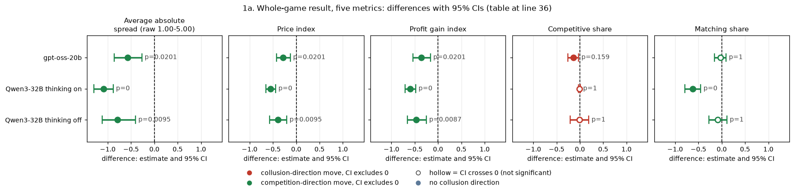
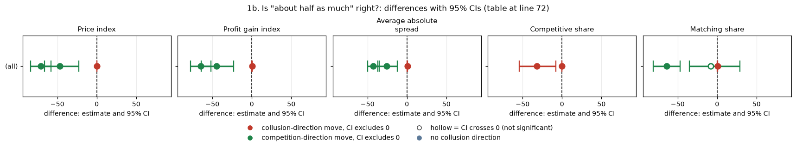
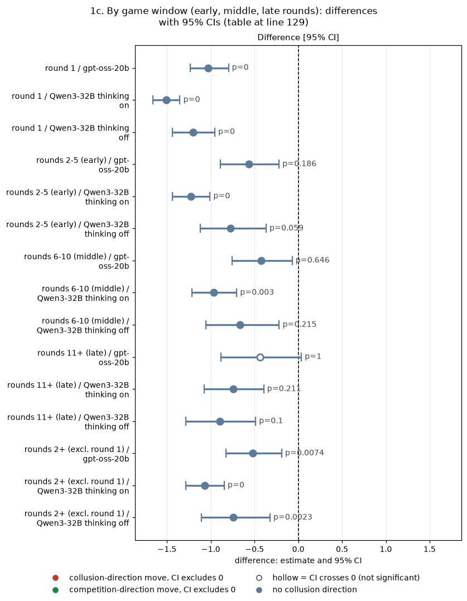
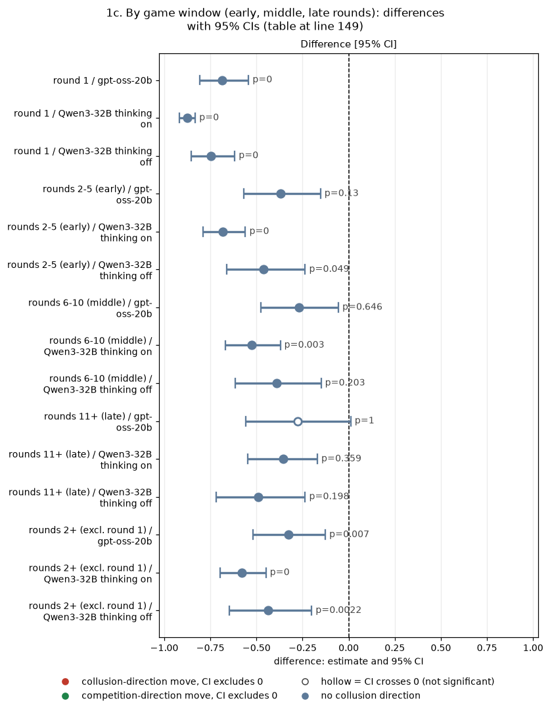
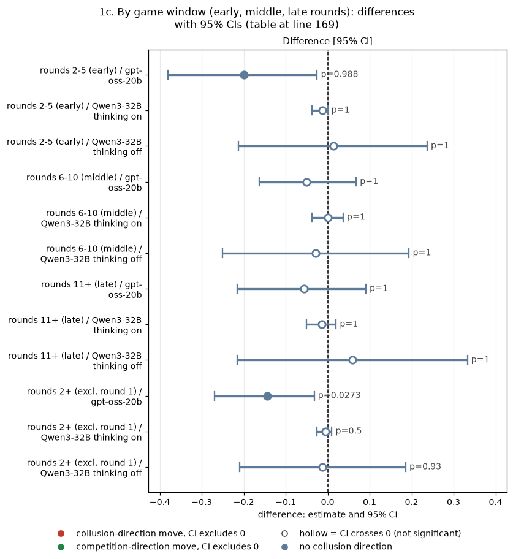
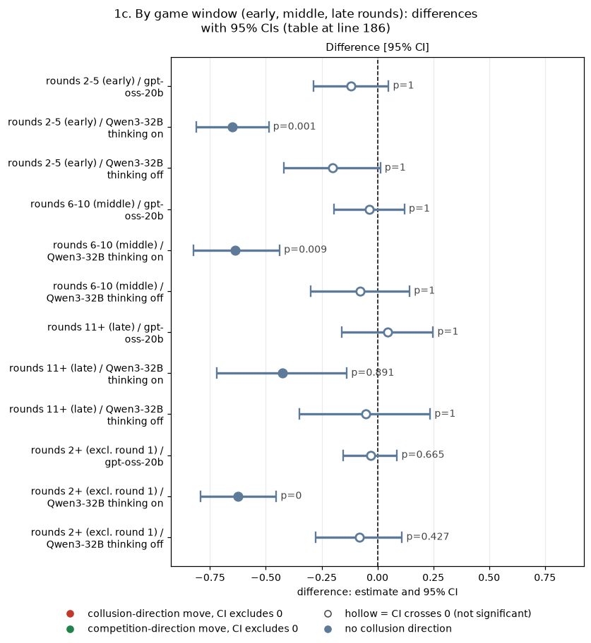
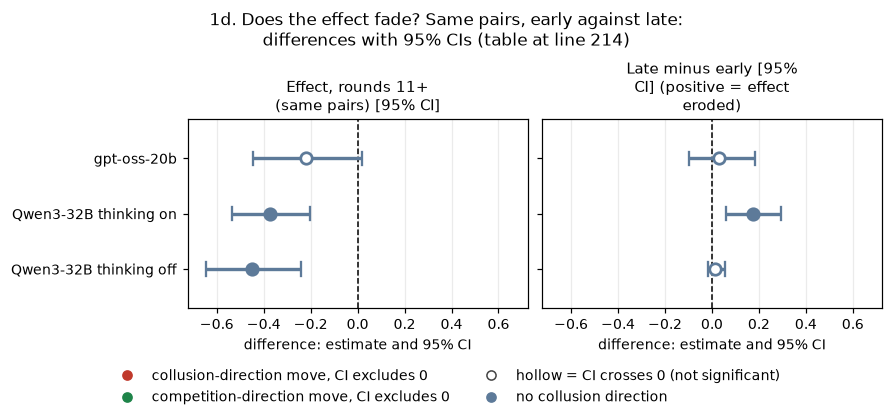
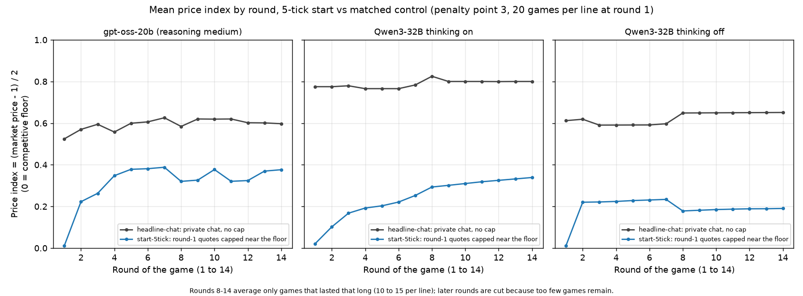
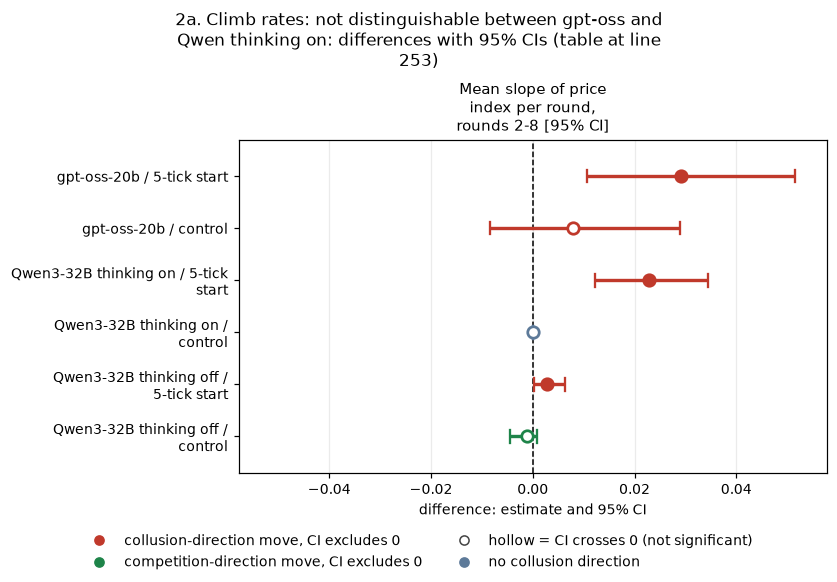
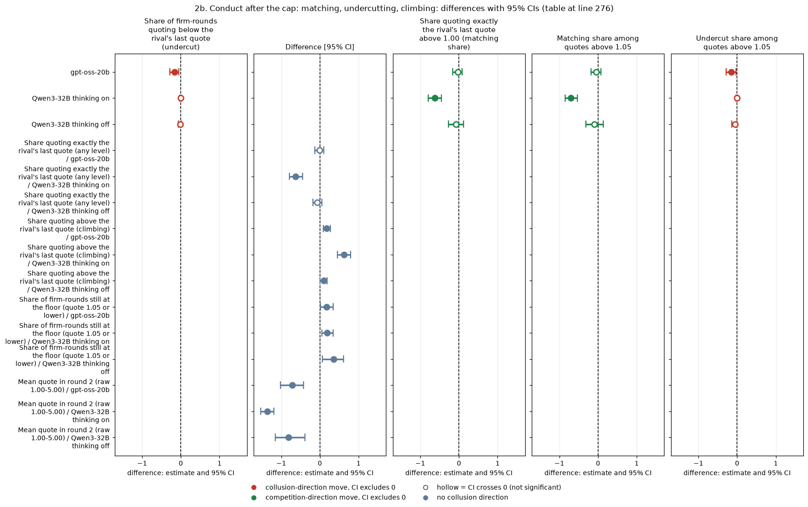

# The 5-tick start: does capping round-1 quotes near the floor lower prices, and is the mechanism different on gpt-oss?

*Dossier 06 of the claims review. Created by Claude at the prompting of the repository owner. Numbers were re-derived from the game tables and the per-round quote records with new scripts (`scripts/main.py`, `scripts/extras.py`); the existing ad hoc scripts were read only for definitions.*

## Orientation

Two LLM "market makers" each quote a **half-spread** every round, from 1.00 (the competitive floor: costs covered, no excess profit) to 5.00, in steps ("ticks") of 0.01. 3.00 is the monopoly price, 70% of customers go to the lowest quote, and a regulator investigates more often when prices are higher. Games last 7 to 20 rounds. This report asks one question: if round-1 quotes are forced to lie between 1.00 and 1.05 (a "5-tick start"; five ticks of 0.01 above the floor), do prices stay lower for the rest of the game, and does the way they stay lower differ between gpt-oss-20b and Qwen3-32B? The 5-tick-start arm is compared with the matched **control** (private chat before each quote, penalty point 3, no cap) with the same prompt wording, seed and thinking mode: 20 pairs (5 wordings x 4 seeds) per model and mode, from the primary (neutral-table) runs, where the payoff table printed evenly spaced example prices and not the theory price 2.09. gpt-oss-20b has one mode only (reasoning effort medium, which corresponds to thinking on), so the like-for-like Qwen comparison is thinking on; thinking off is shown as a second Qwen reference and the thinking-mode difference is a confound that matters here (see section 2).

**Dossier summary.** (1) The 5-tick start lowers prices on all three model-modes and survives Holm correction; on gpt-oss-20b the price index falls by 0.29 (about half of the Qwen thinking-on fall of 0.55). (2) The "half as much" is partly a statement about room: the gpt-oss control is less collusive (price index 0.61 against 0.77); as a share of its own control level the gpt-oss effect is -47% against -71%, with the difference in relative effects +25 points [+1, +52] (unadjusted). (3) The "different mechanism" claim does not survive in its strong form: matching is unchanged on Qwen thinking off too, so the matching collapse is specific to Qwen thinking on, and after the cap the climb rates of gpt-oss and Qwen thinking on are not distinguishable (no formal test). What differs is where the control sits and how high round 2 starts. (4) The ledger's statement that the gpt-oss effect "fades" is not established; on the same pairs it erodes by +0.03, with an interval that includes zero, while the Qwen thinking-on effect does erode.

## How to read the metrics

> **Five metrics, always shown separately.** (1) **Average absolute spread**: the mean market price (the lowest quote of each round) over all rounds, in raw units (1.00 to 5.00). (2) **Price index** = (market price - 1) / 2, where the market price is the lowest quote of the round: 0 is the competitive floor, 1 is the top of the quote range (the monopoly price 3.00 has index 1.00 on a 1-to-3 scale and the 5.00 ceiling is above it). (3) **Profit gain index** = (profit per firm-round - competitive profit) / (monopoly profit - competitive profit); here competitive profit is 0 and monopoly profit 40, so it is profit per firm-round / 40. (4) **Competitive share**: the share of firm-rounds (from round 2) in which a firm quotes below the rival's quote of the previous round, or both firms are at 1.00; higher means more competitive. (5) **Matching share**: the share of firm-rounds (from round 2) in which a firm quotes exactly the rival's previous quote while that quote is above 1.00; high values mean lock-step. Spread, price index, profit gain and matching are collusion-direction metrics (higher = more collusive); competitive share is competition-direction (higher = more competitive). *Worked example:* in a 3-round game with market prices 1.05, 2.49, 2.49 the average absolute spread is 2.01 and the price index is (2.01 - 1) / 2 = 0.51; if each firm earns 1.98, 37.40 and 37.40 in the three rounds, the profit gain index is 25.59 / 40 = 0.64. A firm that quotes 2.49 after the rival's 2.49 is matching; quoting 2.48 would be an undercut (competitive); quoting 2.60 would be climbing. A *difference* is 5-tick start minus control, so a negative difference on the first three means lower prices.

| Term | Meaning |
|---|---|
| 5-tick start (arm start-5tick) | The briefing says, and the engine enforces, that in round 1 only each quote must lie between 1.00 and 1.05. From round 2 on the game is the same as the control. |
| Control (arm headline-chat, penalty point 3) | Private chat before each round's quotes, no cap; the matched headline arm with the same wording, seed and thinking mode. |
| Pair | One (wording, seed) combination run under both arms; all differences are within pair. 20 pairs per model and mode. |
| Penalty point 3 (p3) | The middle fine level; the theory's sustainable collusive level is a half-spread of 2.09 (price index 0.55 on the 1-to-3 scale). The runs analysed here printed evenly spaced example prices ("neutral"), not 2.09. |
| Thinking on / off | Whether the model reasons in a hidden chain of thought before replying. gpt-oss-20b has only the reasoning-on mode. |
| Rival, floor, tick | The other firm; the 1.00 quote; the 0.01 step. |
| 95% CI | Percentile bootstrap over the 20 pairs, 10,000 resamples. |
| p (sign-flip) | Exact two-sided sign-flip permutation test on the 20 pair differences (all 2^20 sign patterns). |
| Holm | Step-down multiplicity correction. Family A: the 15 whole-game tests (5 metrics x 3 model-modes), the contrast declared in the Qwen analysis and carried to gpt-oss. Family B: the 45 window tests (early, middle, late x 5 metrics x 3 model-modes), exploratory. |
| MDE | Minimum detectable effect, about 2.8 x the standard error of the pair differences; used to bound nulls. |

**Design disclosure (cross-wave control).** The gpt-oss control (headline-chat at penalty point 3) was played in waves 107-112 and the 5-tick start in waves 7-12, so the gpt-oss contrast crosses run waves; the Qwen thinking-on 5-tick games were played in wave 6 and their controls in wave 2, within one run. A sensitivity check by the adversarial reviewer compared the gpt-oss 5-tick start with plain private chat at penalty point 1 played in waves 7-12: price index -0.246 [-0.401, -0.085]. We therefore state the gpt-oss effect as about -0.25 to -0.29; the sign is robust to the choice of control.

## 1. Claim G-5tick: capping round-1 quotes near the floor lowers gpt-oss prices over the whole game, about half as much as on Qwen

**Status of the contrast.** The 5-tick start was a declared arm in the Qwen analysis and was carried to gpt-oss as an exploratory transfer (ledger: exploratory); the window split is exploratory. Unit: game; n = 20 pairs per model and mode. Re-derivation: the gpt-oss figures below match the ledger and the ad hoc report (price index -0.285 here against -0.29 in the ledger; profit gain -0.358 against -0.36; matching -0.029 against -0.03; competitive share -0.140 against -0.14; confidence limits agree to about 0.01 to 0.03 because the bootstrap draws differ). The Qwen thinking-on figures match the frozen numbers (price index -0.546, profit gain -0.599, matching -0.624).

### 1a. Whole-game result, five metrics

| Metric | Model | 5-tick start | Control | Difference [95% CI] | p (sign-flip) | Holm p (family A, 15 tests) | MDE (2.8 x SE) |
|---|---|---|---|---|---|---|---|
| Average absolute spread (raw 1.00-5.00) | gpt-oss-20b | 1.655 | 2.226 | -0.571 [-0.857, -0.269] | 0.0026 | 0.0201 | 0.44 |
| Average absolute spread (raw 1.00-5.00) | Qwen3-32B thinking on | 1.438 | 2.530 | -1.093 [-1.294, -0.884] | 0.0000 | 0.0000 | 0.30 |
| Average absolute spread (raw 1.00-5.00) | Qwen3-32B thinking off | 1.431 | 2.221 | -0.789 [-1.121, -0.404] | 0.0010 | 0.0095 | 0.53 |
| Price index | gpt-oss-20b | 0.327 | 0.613 | -0.285 [-0.426, -0.128] | 0.0026 | 0.0201 | 0.22 |
| Price index | Qwen3-32B thinking on | 0.219 | 0.765 | -0.546 [-0.648, -0.442] | 0.0000 | 0.0000 | 0.15 |
| Price index | Qwen3-32B thinking off | 0.216 | 0.610 | -0.395 [-0.567, -0.203] | 0.0010 | 0.0095 | 0.27 |
| Profit gain index | gpt-oss-20b | 0.446 | 0.804 | -0.358 [-0.534, -0.163] | 0.0025 | 0.0201 | 0.27 |
| Profit gain index | Qwen3-32B thinking on | 0.318 | 0.916 | -0.599 [-0.709, -0.479] | 0.0000 | 0.0000 | 0.17 |
| Profit gain index | Qwen3-32B thinking off | 0.309 | 0.777 | -0.467 [-0.658, -0.251] | 0.0008 | 0.0087 | 0.30 |
| Competitive share | gpt-oss-20b | 0.300 | 0.440 | -0.140 [-0.261, -0.028] | 0.0318 | 0.1591 | 0.17 |
| Competitive share | Qwen3-32B thinking on | 0.005 | 0.011 | -0.006 [-0.025, +0.009] | 0.5000 | 1.0000 | 0.03 |
| Competitive share | Qwen3-32B thinking off | 0.112 | 0.125 | -0.013 [-0.209, +0.190] | 0.9297 | 1.0000 | 0.29 |
| Matching share | gpt-oss-20b | 0.347 | 0.376 | -0.029 [-0.153, +0.093] | 0.6654 | 1.0000 | 0.18 |
| Matching share | Qwen3-32B thinking on | 0.348 | 0.971 | -0.624 [-0.791, -0.451] | 0.0000 | 0.0000 | 0.25 |
| Matching share | Qwen3-32B thinking off | 0.757 | 0.839 | -0.082 [-0.274, +0.112] | 0.4271 | 1.0000 | 0.28 |

<!-- ci-forest:1 -->

*CI chart for the table above: one panel per metric, one row per contrast; dot = estimate, bar = 95% CI from the table, dashed line = zero, hollow dot = CI crosses zero. Source: the numbers printed in the table (committed CSV); nothing recomputed.*

<small>

**Reading the chart.** Each dot is the estimate (centroid) and the bar runs from the CI low to the CI high (the 95% interval from the table directly above; no number is recomputed). The dashed vertical line is zero (no difference). Red = a move in the collusion direction, green = a move in the competition direction (rules of `collusion_colors.direction`), blue-grey = the metric has no collusion direction. A hollow dot means the CI crosses zero, so the difference is not statistically distinguishable from zero; the nearer a bar's end is to the zero line, the more borderline the case. Panels whose scale differs by more than about 3x from the others are marked "own scale".

**Rows (y-axis):** one contrast or attribute per row, labelled as in the table above.

**Panels (x-axis = the difference in that metric):**

| Panel | Direction | Red means | Green means |
|---|---|---|---|
| Average absolute spread (raw 1.00-5.00) | higher = more collusive (on the red/green maps: red end) | metric goes up (more collusive) | metric goes down (less collusive) |
| Price index | higher = more collusive (on the red/green maps: red end) | metric goes up (more collusive) | metric goes down (less collusive) |
| Profit gain index | higher = more collusive (on the red/green maps: red end) | metric goes up (more collusive) | metric goes down (less collusive) |
| Competitive share | higher = more competitive (on the red/green maps: green end) | metric goes down (less competitive) | metric goes up (more competitive) |
| Matching share | higher = more collusive (on the red/green maps: red end) | metric goes up (more collusive) | metric goes down (less collusive) |

</small>
<!-- /ci-forest -->

<small>

| Term | Meaning |
|---|---|
| Rows | One metric on one model-mode; arm and control means over 20 games each (run: neutral, penalty point 3, private chat). |
| Difference | 5-tick start minus control, mean over the 20 pairs; negative on spread, price index, profit gain and matching = less collusive. |
| 95% CI | Percentile bootstrap over pairs. |
| p (sign-flip) | Exact two-sided permutation p over all 2^20 sign flips of the pair differences. |
| Holm p | Holm-adjusted p within family A (15 tests). |
| MDE | 2.8 x standard error of the pair differences: effects smaller than this could be missed; a null is reported as the interval, not as "no effect". |
| Qwen3-32B thinking on / off | Qwen with the hidden chain of thought on / off; thinking on is the like-for-like comparison with gpt-oss. |

</small>

**Reading.** The three collusion-direction level metrics (spread, price index, profit gain) fall on every model-mode and survive Holm (gpt-oss Holm p 0.020). Competitive share falls on gpt-oss (-0.140, unadjusted p 0.032, Holm p 0.16: not significant after correction) and is a bounded null on Qwen thinking on ([-0.025, +0.009], MDE 0.025; the Qwen control is already near zero, 0.011, so there is no room to fall) and on Qwen thinking off ([-0.21, +0.19], MDE 0.29, a wide bound). Matching share falls sharply only on Qwen thinking on.

### 1b. Is "about half as much" right?

| Metric | Effect gpt-oss-20b | Effect Qwen3-32B thinking on | gpt-oss minus Qwen [95% CI] | Relative effect gpt-oss (effect / its control level) [95% CI] | Relative effect Qwen on [95% CI] |
|---|---|---|---|---|---|
| Price index | -0.285 | -0.546 | +0.261 [+0.081, +0.446] | -47% [-66%, -23%] | -71% [-84%, -58%] |
| Profit gain index | -0.358 | -0.599 | +0.238 [+0.023, +0.457] | -45% [-64%, -23%] | -65% [-78%, -52%] |
| Average absolute spread | -0.571 | -1.093 | +0.524 [+0.177, +0.894] | -26% [-37%, -12%] | -43% [-50%, -35%] |
| Competitive share | -0.140 | -0.006 | -0.135 [-0.260, -0.022] | -32% [-54%, -8%] | n/a (control near 0) |
| Matching share | -0.029 | -0.624 | +0.596 [+0.388, +0.804] | -8% [-35%, +29%] | -64% [-81%, -47%] |

<!-- ci-forest:2 -->

*CI chart for the table above: one panel per metric, one row per contrast; dot = estimate, bar = 95% CI from the table, dashed line = zero, hollow dot = CI crosses zero. Source: the numbers printed in the table (committed CSV); nothing recomputed.*

<small>

**Reading the chart.** Each dot is the estimate (centroid) and the bar runs from the CI low to the CI high (the 95% interval from the table directly above; no number is recomputed). The dashed vertical line is zero (no difference). Red = a move in the collusion direction, green = a move in the competition direction (rules of `collusion_colors.direction`), blue-grey = the metric has no collusion direction. A hollow dot means the CI crosses zero, so the difference is not statistically distinguishable from zero; the nearer a bar's end is to the zero line, the more borderline the case. Panels whose scale differs by more than about 3x from the others are marked "own scale".

**Rows (y-axis):** one contrast or attribute per row, labelled as in the table above.

**Panels (x-axis = the difference in that metric):**

| Panel | Direction | Red means | Green means |
|---|---|---|---|
| Price index | higher = more collusive (on the red/green maps: red end) | metric goes up (more collusive) | metric goes down (less collusive) |
| Profit gain index | higher = more collusive (on the red/green maps: red end) | metric goes up (more collusive) | metric goes down (less collusive) |
| Average absolute spread | higher = more collusive (on the red/green maps: red end) | metric goes up (more collusive) | metric goes down (less collusive) |
| Competitive share | higher = more competitive (on the red/green maps: green end) | metric goes down (less competitive) | metric goes up (more competitive) |
| Matching share | higher = more collusive (on the red/green maps: red end) | metric goes up (more collusive) | metric goes down (less collusive) |

</small>
<!-- /ci-forest -->

<small>

| Term | Meaning |
|---|---|
| Effect | 5-tick start minus control, mean over 20 pairs, per model. |
| gpt-oss minus Qwen | Difference of the two effects; the two models' pairs are independent, so each is resampled separately (10,000 bootstrap draws). |
| Relative effect | The effect divided by that model's own control mean (the room to fall); for competitive share on Qwen the control is about 0.01, so the ratio is not meaningful. |

</small>

The ratio of the gpt-oss price-index effect to the Qwen thinking-on effect is 0.52 [0.23, 0.83], and the difference between the two effects is +0.26 [+0.08, +0.45], so "about half" is a fair point estimate with a wide interval. The ledger's caveat ("less room to fall") therefore explains part of the gap, not all of it: even relative to its own control level the gpt-oss fall is smaller (-47% against -71%; difference in relative effects +25 points [+1, +52], bootstrap over pairs, unadjusted). Overlapping intervals of the two relative effects are not themselves a test of their difference.

### 1c. By game window (early, middle, late rounds)

Windows are defined by round number. A pair enters a window only if both its games reached it, so the late windows contain fewer pairs (13 for gpt-oss, 10 for Qwen thinking on, 12 for thinking off) and mix game composition with price change; section 1d repeats the early-versus-late comparison on identical pairs. Round 1 is the mechanical cap. "Rounds 2+" is the effect of the cap on everything after round 1.

**Price index**

| Window | Model | Pairs | 5-tick start | Control | Difference [95% CI] | p (sign-flip) | Holm p (family B, 45 tests) |
|---|---|---|---|---|---|---|---|
| round 1 | gpt-oss-20b | 20 | 0.011 | 0.525 | -0.514 [-0.616, -0.400] | 0.0000 | n/a |
| round 1 | Qwen3-32B thinking on | 20 | 0.021 | 0.775 | -0.754 [-0.831, -0.676] | 0.0000 | n/a |
| round 1 | Qwen3-32B thinking off | 20 | 0.012 | 0.612 | -0.600 [-0.718, -0.477] | 0.0000 | n/a |
| rounds 2-5 (early) | gpt-oss-20b | 20 | 0.303 | 0.586 | -0.283 [-0.450, -0.112] | 0.0060 | 0.186 |
| rounds 2-5 (early) | Qwen3-32B thinking on | 20 | 0.161 | 0.775 | -0.614 [-0.716, -0.504] | 0.0000 | 0.000 |
| rounds 2-5 (early) | Qwen3-32B thinking off | 20 | 0.224 | 0.610 | -0.386 [-0.563, -0.181] | 0.0016 | 0.059 |
| rounds 6-10 (middle) | gpt-oss-20b | 19 | 0.408 | 0.620 | -0.211 [-0.373, -0.040] | 0.0299 | 0.646 |
| rounds 6-10 (middle) | Qwen3-32B thinking on | 16 | 0.276 | 0.759 | -0.484 [-0.610, -0.354] | 0.0001 | 0.003 |
| rounds 6-10 (middle) | Qwen3-32B thinking off | 18 | 0.258 | 0.592 | -0.334 [-0.529, -0.115] | 0.0086 | 0.215 |
| rounds 11+ (late) | gpt-oss-20b | 13 | 0.378 | 0.597 | -0.219 [-0.442, +0.014] | 0.0945 | 1.000 |
| rounds 11+ (late) | Qwen3-32B thinking on | 10 | 0.429 | 0.803 | -0.373 [-0.531, -0.203] | 0.0078 | 0.211 |
| rounds 11+ (late) | Qwen3-32B thinking off | 12 | 0.208 | 0.656 | -0.448 [-0.646, -0.245] | 0.0029 | 0.100 |
| rounds 2+ (excl. round 1) | gpt-oss-20b | 20 | 0.360 | 0.619 | -0.259 [-0.413, -0.094] | 0.0074 | n/a |
| rounds 2+ (excl. round 1) | Qwen3-32B thinking on | 20 | 0.234 | 0.768 | -0.534 [-0.644, -0.420] | 0.0000 | n/a |
| rounds 2+ (excl. round 1) | Qwen3-32B thinking off | 20 | 0.238 | 0.611 | -0.373 [-0.554, -0.159] | 0.0023 | n/a |

<!-- ci-forest:3 -->

*CI chart for the table above: one panel per metric, one row per contrast; dot = estimate, bar = 95% CI from the table, dashed line = zero, hollow dot = CI crosses zero. Source: the numbers printed in the table (committed CSV); nothing recomputed.*

<small>

**Reading the chart.** Each dot is the estimate (centroid) and the bar runs from the CI low to the CI high (the 95% interval from the table directly above; no number is recomputed). The dashed vertical line is zero (no difference). Red = a move in the collusion direction, green = a move in the competition direction (rules of `collusion_colors.direction`), blue-grey = the metric has no collusion direction. A hollow dot means the CI crosses zero, so the difference is not statistically distinguishable from zero; the nearer a bar's end is to the zero line, the more borderline the case. Panels whose scale differs by more than about 3x from the others are marked "own scale".

**Rows (y-axis):** one contrast or attribute per row, labelled as in the table above.

**Panels (x-axis = the difference in that metric):**

| Panel | Direction | Red means | Green means |
|---|---|---|---|
| Difference [95% CI] | no collusion direction (neutral hue) | none (blue-grey: no collusion direction) | none (blue-grey: no collusion direction) |

</small>
<!-- /ci-forest -->

<small>

| Term | Meaning |
|---|---|
| Window | Rounds included: round 1 (the capped round), 2-5 early, 6-10 middle, 11+ late (up to round 20), 2+ all rounds after the cap. |
| Pairs | Pairs in which both games reached the window. |
| Price index | (market price - 1) / 2, the market price being the lowest quote of the round; mean over the window's rounds, then over pairs. |
| Holm p | Within family B (45 exploratory window tests); n/a for round 1 and rounds 2+, which are outside the family. |

</small>

**Average absolute spread**

| Window | Model | Pairs | 5-tick start | Control | Difference [95% CI] | p (sign-flip) | Holm p (family B, 45 tests) |
|---|---|---|---|---|---|---|---|
| round 1 | gpt-oss-20b | 20 | 1.022 | 2.049 | -1.027 [-1.235, -0.797] | 0.0000 | n/a |
| round 1 | Qwen3-32B thinking on | 20 | 1.043 | 2.550 | -1.507 [-1.663, -1.352] | 0.0000 | n/a |
| round 1 | Qwen3-32B thinking off | 20 | 1.024 | 2.224 | -1.200 [-1.436, -0.954] | 0.0000 | n/a |
| rounds 2-5 (early) | gpt-oss-20b | 20 | 1.606 | 2.173 | -0.567 [-0.889, -0.220] | 0.0060 | 0.186 |
| rounds 2-5 (early) | Qwen3-32B thinking on | 20 | 1.322 | 2.550 | -1.228 [-1.435, -1.009] | 0.0000 | 0.000 |
| rounds 2-5 (early) | Qwen3-32B thinking off | 20 | 1.447 | 2.220 | -0.772 [-1.122, -0.367] | 0.0016 | 0.059 |
| rounds 6-10 (middle) | gpt-oss-20b | 19 | 1.817 | 2.239 | -0.423 [-0.755, -0.070] | 0.0299 | 0.646 |
| rounds 6-10 (middle) | Qwen3-32B thinking on | 16 | 1.552 | 2.519 | -0.967 [-1.218, -0.704] | 0.0001 | 0.003 |
| rounds 6-10 (middle) | Qwen3-32B thinking off | 18 | 1.516 | 2.184 | -0.668 [-1.053, -0.218] | 0.0086 | 0.215 |
| rounds 11+ (late) | gpt-oss-20b | 13 | 1.755 | 2.193 | -0.438 [-0.881, +0.035] | 0.0945 | 1.000 |
| rounds 11+ (late) | Qwen3-32B thinking on | 10 | 1.859 | 2.605 | -0.746 [-1.075, -0.395] | 0.0078 | 0.211 |
| rounds 11+ (late) | Qwen3-32B thinking off | 12 | 1.416 | 2.312 | -0.895 [-1.285, -0.487] | 0.0029 | 0.100 |
| rounds 2+ (excl. round 1) | gpt-oss-20b | 20 | 1.720 | 2.238 | -0.518 [-0.824, -0.190] | 0.0074 | n/a |
| rounds 2+ (excl. round 1) | Qwen3-32B thinking on | 20 | 1.467 | 2.536 | -1.069 [-1.285, -0.846] | 0.0000 | n/a |
| rounds 2+ (excl. round 1) | Qwen3-32B thinking off | 20 | 1.476 | 2.221 | -0.746 [-1.104, -0.324] | 0.0023 | n/a |

<!-- ci-forest:4 -->

*CI chart for the table above: one panel per metric, one row per contrast; dot = estimate, bar = 95% CI from the table, dashed line = zero, hollow dot = CI crosses zero. Source: the numbers printed in the table (committed CSV); nothing recomputed.*

<small>

**Reading the chart.** Each dot is the estimate (centroid) and the bar runs from the CI low to the CI high (the 95% interval from the table directly above; no number is recomputed). The dashed vertical line is zero (no difference). Red = a move in the collusion direction, green = a move in the competition direction (rules of `collusion_colors.direction`), blue-grey = the metric has no collusion direction. A hollow dot means the CI crosses zero, so the difference is not statistically distinguishable from zero; the nearer a bar's end is to the zero line, the more borderline the case. Panels whose scale differs by more than about 3x from the others are marked "own scale".

**Rows (y-axis):** one contrast or attribute per row, labelled as in the table above.

**Panels (x-axis = the difference in that metric):**

| Panel | Direction | Red means | Green means |
|---|---|---|---|
| Difference [95% CI] | no collusion direction (neutral hue) | none (blue-grey: no collusion direction) | none (blue-grey: no collusion direction) |

</small>
<!-- /ci-forest -->

**Profit gain index**

| Window | Model | Pairs | 5-tick start | Control | Difference [95% CI] | p (sign-flip) | Holm p (family B, 45 tests) |
|---|---|---|---|---|---|---|---|
| round 1 | gpt-oss-20b | 20 | 0.022 | 0.709 | -0.687 [-0.807, -0.543] | 0.0000 | n/a |
| round 1 | Qwen3-32B thinking on | 20 | 0.042 | 0.919 | -0.877 [-0.917, -0.832] | 0.0000 | n/a |
| round 1 | Qwen3-32B thinking off | 20 | 0.023 | 0.771 | -0.748 [-0.854, -0.618] | 0.0000 | n/a |
| rounds 2-5 (early) | gpt-oss-20b | 20 | 0.404 | 0.774 | -0.370 [-0.568, -0.153] | 0.0041 | 0.130 |
| rounds 2-5 (early) | Qwen3-32B thinking on | 20 | 0.236 | 0.919 | -0.683 [-0.788, -0.560] | 0.0000 | 0.000 |
| rounds 2-5 (early) | Qwen3-32B thinking off | 20 | 0.314 | 0.775 | -0.461 [-0.663, -0.236] | 0.0013 | 0.049 |
| rounds 6-10 (middle) | gpt-oss-20b | 19 | 0.548 | 0.816 | -0.268 [-0.476, -0.056] | 0.0294 | 0.646 |
| rounds 6-10 (middle) | Qwen3-32B thinking on | 16 | 0.391 | 0.916 | -0.526 [-0.668, -0.371] | 0.0001 | 0.003 |
| rounds 6-10 (middle) | Qwen3-32B thinking off | 18 | 0.365 | 0.758 | -0.392 [-0.614, -0.150] | 0.0073 | 0.203 |
| rounds 11+ (late) | gpt-oss-20b | 13 | 0.508 | 0.786 | -0.278 [-0.557, +0.011] | 0.0938 | 1.000 |
| rounds 11+ (late) | Qwen3-32B thinking on | 10 | 0.595 | 0.951 | -0.356 [-0.546, -0.170] | 0.0156 | 0.359 |
| rounds 11+ (late) | Qwen3-32B thinking off | 12 | 0.316 | 0.805 | -0.489 [-0.717, -0.236] | 0.0068 | 0.198 |
| rounds 2+ (excl. round 1) | gpt-oss-20b | 20 | 0.483 | 0.811 | -0.328 [-0.519, -0.127] | 0.0070 | n/a |
| rounds 2+ (excl. round 1) | Qwen3-32B thinking on | 20 | 0.339 | 0.917 | -0.578 [-0.696, -0.449] | 0.0000 | n/a |
| rounds 2+ (excl. round 1) | Qwen3-32B thinking off | 20 | 0.339 | 0.777 | -0.438 [-0.647, -0.201] | 0.0022 | n/a |

<!-- ci-forest:5 -->

*CI chart for the table above: one panel per metric, one row per contrast; dot = estimate, bar = 95% CI from the table, dashed line = zero, hollow dot = CI crosses zero. Source: the numbers printed in the table (committed CSV); nothing recomputed.*

<small>

**Reading the chart.** Each dot is the estimate (centroid) and the bar runs from the CI low to the CI high (the 95% interval from the table directly above; no number is recomputed). The dashed vertical line is zero (no difference). Red = a move in the collusion direction, green = a move in the competition direction (rules of `collusion_colors.direction`), blue-grey = the metric has no collusion direction. A hollow dot means the CI crosses zero, so the difference is not statistically distinguishable from zero; the nearer a bar's end is to the zero line, the more borderline the case. Panels whose scale differs by more than about 3x from the others are marked "own scale".

**Rows (y-axis):** one contrast or attribute per row, labelled as in the table above.

**Panels (x-axis = the difference in that metric):**

| Panel | Direction | Red means | Green means |
|---|---|---|---|
| Difference [95% CI] | no collusion direction (neutral hue) | none (blue-grey: no collusion direction) | none (blue-grey: no collusion direction) |

</small>
<!-- /ci-forest -->

**Competitive share** (from round 2)

| Window | Model | Pairs | 5-tick start | Control | Difference [95% CI] | p (sign-flip) | Holm p (family B, 45 tests) |
|---|---|---|---|---|---|---|---|
| rounds 2-5 (early) | gpt-oss-20b | 20 | 0.212 | 0.412 | -0.200 [-0.381, -0.025] | 0.0549 | 0.988 |
| rounds 2-5 (early) | Qwen3-32B thinking on | 20 | 0.000 | 0.013 | -0.013 [-0.037, +0.000] | 1.0000 | 1.000 |
| rounds 2-5 (early) | Qwen3-32B thinking off | 20 | 0.150 | 0.138 | +0.013 [-0.212, +0.237] | 1.0000 | 1.000 |
| rounds 6-10 (middle) | gpt-oss-20b | 19 | 0.366 | 0.416 | -0.050 [-0.163, +0.068] | 0.4411 | 1.000 |
| rounds 6-10 (middle) | Qwen3-32B thinking on | 16 | 0.013 | 0.013 | +0.000 [-0.037, +0.037] | 1.0000 | 1.000 |
| rounds 6-10 (middle) | Qwen3-32B thinking off | 18 | 0.111 | 0.139 | -0.028 [-0.250, +0.194] | 1.0000 | 1.000 |
| rounds 11+ (late) | gpt-oss-20b | 13 | 0.385 | 0.441 | -0.056 [-0.216, +0.091] | 0.5469 | 1.000 |
| rounds 11+ (late) | Qwen3-32B thinking on | 10 | 0.010 | 0.024 | -0.014 [-0.050, +0.020] | 0.5000 | 1.000 |
| rounds 11+ (late) | Qwen3-32B thinking off | 12 | 0.171 | 0.113 | +0.059 [-0.216, +0.333] | 0.7500 | 1.000 |
| rounds 2+ (excl. round 1) | gpt-oss-20b | 20 | 0.295 | 0.439 | -0.144 [-0.269, -0.032] | 0.0273 | n/a |
| rounds 2+ (excl. round 1) | Qwen3-32B thinking on | 20 | 0.005 | 0.011 | -0.006 [-0.025, +0.010] | 0.5000 | n/a |
| rounds 2+ (excl. round 1) | Qwen3-32B thinking off | 20 | 0.112 | 0.125 | -0.013 [-0.209, +0.186] | 0.9297 | n/a |

<!-- ci-forest:6 -->

*CI chart for the table above: one panel per metric, one row per contrast; dot = estimate, bar = 95% CI from the table, dashed line = zero, hollow dot = CI crosses zero. Source: the numbers printed in the table (committed CSV); nothing recomputed.*

<small>

**Reading the chart.** Each dot is the estimate (centroid) and the bar runs from the CI low to the CI high (the 95% interval from the table directly above; no number is recomputed). The dashed vertical line is zero (no difference). Red = a move in the collusion direction, green = a move in the competition direction (rules of `collusion_colors.direction`), blue-grey = the metric has no collusion direction. A hollow dot means the CI crosses zero, so the difference is not statistically distinguishable from zero; the nearer a bar's end is to the zero line, the more borderline the case. Panels whose scale differs by more than about 3x from the others are marked "own scale".

**Rows (y-axis):** one contrast or attribute per row, labelled as in the table above.

**Panels (x-axis = the difference in that metric):**

| Panel | Direction | Red means | Green means |
|---|---|---|---|
| Difference [95% CI] | no collusion direction (neutral hue) | none (blue-grey: no collusion direction) | none (blue-grey: no collusion direction) |

</small>
<!-- /ci-forest -->

**Matching share** (from round 2)

| Window | Model | Pairs | 5-tick start | Control | Difference [95% CI] | p (sign-flip) | Holm p (family B, 45 tests) |
|---|---|---|---|---|---|---|---|
| rounds 2-5 (early) | gpt-oss-20b | 20 | 0.294 | 0.412 | -0.119 [-0.287, +0.050] | 0.2281 | 1.000 |
| rounds 2-5 (early) | Qwen3-32B thinking on | 20 | 0.325 | 0.975 | -0.650 [-0.812, -0.487] | 0.0000 | 0.001 |
| rounds 2-5 (early) | Qwen3-32B thinking off | 20 | 0.619 | 0.819 | -0.200 [-0.419, +0.013] | 0.1042 | 1.000 |
| rounds 6-10 (middle) | gpt-oss-20b | 19 | 0.368 | 0.405 | -0.037 [-0.195, +0.121] | 0.6842 | 1.000 |
| rounds 6-10 (middle) | Qwen3-32B thinking on | 16 | 0.350 | 0.988 | -0.637 [-0.825, -0.438] | 0.0002 | 0.009 |
| rounds 6-10 (middle) | Qwen3-32B thinking off | 18 | 0.756 | 0.833 | -0.078 [-0.300, +0.144] | 0.6250 | 1.000 |
| rounds 11+ (late) | gpt-oss-20b | 13 | 0.349 | 0.303 | +0.046 [-0.161, +0.249] | 0.6699 | 1.000 |
| rounds 11+ (late) | Qwen3-32B thinking on | 10 | 0.526 | 0.953 | -0.427 [-0.720, -0.137] | 0.0469 | 0.891 |
| rounds 11+ (late) | Qwen3-32B thinking off | 12 | 0.789 | 0.842 | -0.053 [-0.350, +0.236] | 0.6875 | 1.000 |
| rounds 2+ (excl. round 1) | gpt-oss-20b | 20 | 0.347 | 0.376 | -0.029 [-0.155, +0.088] | 0.6654 | n/a |
| rounds 2+ (excl. round 1) | Qwen3-32B thinking on | 20 | 0.348 | 0.971 | -0.624 [-0.793, -0.453] | 0.0000 | n/a |
| rounds 2+ (excl. round 1) | Qwen3-32B thinking off | 20 | 0.757 | 0.839 | -0.082 [-0.277, +0.110] | 0.4271 | n/a |

<!-- ci-forest:7 -->

*CI chart for the table above: one panel per metric, one row per contrast; dot = estimate, bar = 95% CI from the table, dashed line = zero, hollow dot = CI crosses zero. Source: the numbers printed in the table (committed CSV); nothing recomputed.*

<small>

**Reading the chart.** Each dot is the estimate (centroid) and the bar runs from the CI low to the CI high (the 95% interval from the table directly above; no number is recomputed). The dashed vertical line is zero (no difference). Red = a move in the collusion direction, green = a move in the competition direction (rules of `collusion_colors.direction`), blue-grey = the metric has no collusion direction. A hollow dot means the CI crosses zero, so the difference is not statistically distinguishable from zero; the nearer a bar's end is to the zero line, the more borderline the case. Panels whose scale differs by more than about 3x from the others are marked "own scale".

**Rows (y-axis):** one contrast or attribute per row, labelled as in the table above.

**Panels (x-axis = the difference in that metric):**

| Panel | Direction | Red means | Green means |
|---|---|---|---|
| Difference [95% CI] | no collusion direction (neutral hue) | none (blue-grey: no collusion direction) | none (blue-grey: no collusion direction) |

</small>
<!-- /ci-forest -->

<small>

| Term | Meaning |
|---|---|
| All five window tables | Same definitions as in section 1a, computed over the rounds in the window from the per-round quote records; competitive and matching shares need a previous round, so they start at round 2. |
| Difference | 5-tick start minus control; negative on spread, price index, profit gain, matching = less collusive; negative on competitive share = more collusive. |

</small>

**Reading.** The gpt-oss price-index effect is present in every window and roughly constant in size (-0.28 early, -0.21 middle, -0.22 late) but the confidence intervals widen as pairs drop out and, under the stricter family-B Holm correction, no single gpt-oss window is significant (smallest Holm p 0.19); the whole-game result is the supported one. The Qwen thinking-on effect is larger in every window and its late window still excludes zero unadjusted. Thinking off sits between.

### 1d. Does the effect fade? Same pairs, early against late

| Model | Pairs that reach round 11 | Effect, rounds 2-5 (same pairs) | Effect, rounds 11+ (same pairs) [95% CI] | Late minus early [95% CI] (positive = effect eroded) | Share of early effect remaining |
|---|---|---|---|---|---|
| gpt-oss-20b | 13 | -0.251 | -0.219 [-0.444, +0.018] | +0.032 [-0.097, +0.183] | 0.87 |
| Qwen3-32B thinking on | 10 | -0.550 | -0.373 [-0.534, -0.202] | +0.177 [+0.060, +0.294] | 0.68 |
| Qwen3-32B thinking off | 12 | -0.463 | -0.448 [-0.646, -0.239] | +0.015 [-0.016, +0.057] | 0.97 |

<!-- ci-forest:8 -->

*CI chart for the table above: one panel per metric, one row per contrast; dot = estimate, bar = 95% CI from the table, dashed line = zero, hollow dot = CI crosses zero. Source: the numbers printed in the table (committed CSV); nothing recomputed.*

<small>

**Reading the chart.** Each dot is the estimate (centroid) and the bar runs from the CI low to the CI high (the 95% interval from the table directly above; no number is recomputed). The dashed vertical line is zero (no difference). Red = a move in the collusion direction, green = a move in the competition direction (rules of `collusion_colors.direction`), blue-grey = the metric has no collusion direction. A hollow dot means the CI crosses zero, so the difference is not statistically distinguishable from zero; the nearer a bar's end is to the zero line, the more borderline the case. Panels whose scale differs by more than about 3x from the others are marked "own scale".

**Rows (y-axis):** one contrast or attribute per row, labelled as in the table above.

**Panels (x-axis = the difference in that metric):**

| Panel | Direction | Red means | Green means |
|---|---|---|---|
| Effect, rounds 11+ (same pairs) [95% CI] | no collusion direction (neutral hue) | none (blue-grey: no collusion direction) | none (blue-grey: no collusion direction) |
| Late minus early [95% CI] (positive = effect eroded) | no collusion direction (neutral hue) | none (blue-grey: no collusion direction) | none (blue-grey: no collusion direction) |

</small>
<!-- /ci-forest -->

<small>

| Term | Meaning |
|---|---|
| Pairs that reach round 11 | Pairs in which both games lasted at least 11 rounds; the same pairs are used for the early and the late number, which removes the changing-sample problem of section 1c. |
| Effect | 5-tick start minus control price index. |
| Late minus early | Positive means the effect shrank toward zero (prices recovered). CI by bootstrap over the pairs. |

</small>

On identical pairs the gpt-oss effect keeps 87% of its early size and the erosion is not distinguishable from zero (+0.032 [-0.097, +0.183]); the Qwen thinking-on effect erodes by +0.177 [+0.060, +0.294], keeping 68%; Qwen thinking off does not erode. The ledger's "fades: rounds 10+ price -0.22 [-0.45, 0.02]" is the same number as ours, but it compares different pairs; it is a wide interval, not evidence of fading. The honest statement is that the gpt-oss effect persists at roughly its early size across the 13 pairs that last into the late rounds, with an interval too wide to exclude either full persistence or a moderate fade (bounds on the change from -0.10 to +0.18 index points).

## 2. The mechanism: matching, undercutting and climbing from the floor

The ledger says the effect works "by a different mechanism": on Qwen the cap collapses the matching share (-0.62) while on gpt-oss matching is unchanged and the competitive share falls. The numbers above reproduce both facts. The question is whether they amount to a different mechanism. Three further checks follow.

*Figure 1. Mean price index (vertical axis: (market price - 1) / 2, 0 = competitive floor) by round of the game (horizontal axis), for the control (grey line) and the 5-tick start (blue line), one panel per model and mode. Each line is the mean over the games still running in that round: 20 games to round 2, falling to 10 to 15 at round 8 and after, so the right-hand part of each line averages fewer games; the axis stops at round 14 because later rounds have too few games. Source: per-round quote records; file `paths_by_round.csv`.*

<small>

| Term | Meaning |
|---|---|
| **Vertical axis (y)** | Mean price index of the games still running in that round: (market price - 1) / 2; 0 = competitive floor. |
| **Horizontal axis (x)** | Round of the game, 1 to 14. Rounds beyond 14 are cut because fewer than 10 games per arm remain; rounds 8-14 average only games that lasted that long. |
| **Lines** | headline-chat (grey): private chat, no cap, penalty point 3, neutral table. start-5tick (blue): round-1 quotes capped near the floor (1.00-1.05); otherwise identical. |
| **Panels** | gpt-oss-20b (reasoning medium); Qwen3-32B with thinking on; Qwen3-32B with thinking off. |

</small>

### 2a. Climb rates: not distinguishable between gpt-oss and Qwen thinking on

| Model | Arm | Games | Mean slope of price index per round, rounds 2-8 [95% CI] | Share of games with a clear upward slope |
|---|---|---|---|---|
| gpt-oss-20b | 5-tick start | 20 | +0.0291 [+0.0107, +0.0516] | 0.40 |
| gpt-oss-20b | control | 19 | +0.0079 [-0.0085, +0.0290] | 0.21 |
| Qwen3-32B thinking on | 5-tick start | 19 | +0.0228 [+0.0122, +0.0345] | 0.68 |
| Qwen3-32B thinking on | control | 16 | +0.0000 [-0.0000, +0.0000] | 0.00 |
| Qwen3-32B thinking off | 5-tick start | 20 | +0.0028 [+0.0003, +0.0063] | 0.15 |
| Qwen3-32B thinking off | control | 18 | -0.0012 [-0.0045, +0.0008] | 0.06 |

<!-- ci-forest:9 -->

*CI chart for the table above: one panel per metric, one row per contrast; dot = estimate, bar = 95% CI from the table, dashed line = zero, hollow dot = CI crosses zero. Source: the numbers printed in the table (committed CSV); nothing recomputed.*

<small>

**Reading the chart.** Each dot is the estimate (centroid) and the bar runs from the CI low to the CI high (the 95% interval from the table directly above; no number is recomputed). The dashed vertical line is zero (no difference). Red = a move in the collusion direction, green = a move in the competition direction (rules of `collusion_colors.direction`), blue-grey = the metric has no collusion direction. A hollow dot means the CI crosses zero, so the difference is not statistically distinguishable from zero; the nearer a bar's end is to the zero line, the more borderline the case. Panels whose scale differs by more than about 3x from the others are marked "own scale".

**Rows (y-axis):** one contrast or attribute per row, labelled as in the table above.

**Panels (x-axis = the difference in that metric):**

| Panel | Direction | Red means | Green means |
|---|---|---|---|
| Mean slope of price index per round, rounds 2-8 [95% CI] | higher = more collusive (on the red/green maps: red end) | metric goes up (more collusive) | metric goes down (less collusive) |

</small>
<!-- /ci-forest -->

<small>

| Term | Meaning |
|---|---|
| Slope | Per-game least-squares slope of the market price index on the round number, rounds 2 to 8 (games with at least 5 such rounds); the mean over games with its bootstrap 95% CI. |
| Clear upward slope | A slope above 0.005 index points per round. |
| Control rows | The control stays level (slope near 0): it starts high and stays there. |

</small>

After the cap the gpt-oss games climb at +0.029 index points per round, a pace not distinguishable from Qwen thinking on (+0.023). Qwen thinking off barely climbs (+0.003): it holds whatever level round 2 sets. In round 2 the gpt-oss 5-tick games are already at price index 0.22 against 0.10 for Qwen thinking on (mean round-2 quote 1.45 against 1.20, raw units). The climb rates are not distinguishable (overlapping intervals, no formal test), but the models differ otherwise: the share of firm-rounds quoting above the rival is 0.35 on gpt-oss against 0.65 on Qwen thinking on, and the starting heights and controls differ.

### 2b. Conduct after the cap: matching, undercutting, climbing

| Quantity (rounds 2 onward) | Model | Pairs | 5-tick start | Control | Difference [95% CI] |
|---|---|---|---|---|---|
| Share of firm-rounds quoting below the rival's last quote (undercut) | gpt-oss-20b | 20 | 0.277 | 0.434 | -0.157 [-0.278, -0.048] |
| Share of firm-rounds quoting below the rival's last quote (undercut) | Qwen3-32B thinking on | 20 | 0.005 | 0.011 | -0.006 [-0.025, +0.009] |
| Share of firm-rounds quoting below the rival's last quote (undercut) | Qwen3-32B thinking off | 20 | 0.004 | 0.025 | -0.020 [-0.067, +0.008] |
| Share quoting exactly the rival's last quote (any level) | gpt-oss-20b | 20 | 0.370 | 0.382 | -0.012 [-0.127, +0.099] |
| Share quoting exactly the rival's last quote (any level) | Qwen3-32B thinking on | 20 | 0.348 | 0.971 | -0.624 [-0.791, -0.448] |
| Share quoting exactly the rival's last quote (any level) | Qwen3-32B thinking off | 20 | 0.865 | 0.939 | -0.074 [-0.181, +0.049] |
| Share quoting exactly the rival's last quote above 1.00 (matching share) | gpt-oss-20b | 20 | 0.347 | 0.376 | -0.029 [-0.158, +0.088] |
| Share quoting exactly the rival's last quote above 1.00 (matching share) | Qwen3-32B thinking on | 20 | 0.348 | 0.971 | -0.624 [-0.788, -0.448] |
| Share quoting exactly the rival's last quote above 1.00 (matching share) | Qwen3-32B thinking off | 20 | 0.757 | 0.839 | -0.082 [-0.275, +0.114] |
| Share quoting above the rival's last quote (climbing) | gpt-oss-20b | 20 | 0.353 | 0.184 | +0.169 [+0.083, +0.272] |
| Share quoting above the rival's last quote (climbing) | Qwen3-32B thinking on | 20 | 0.647 | 0.017 | +0.629 [+0.458, +0.792] |
| Share quoting above the rival's last quote (climbing) | Qwen3-32B thinking off | 20 | 0.131 | 0.036 | +0.095 [+0.009, +0.185] |
| Share of firm-rounds still at the floor (quote 1.05 or lower) | gpt-oss-20b | 20 | 0.235 | 0.056 | +0.179 [+0.010, +0.345] |
| Share of firm-rounds still at the floor (quote 1.05 or lower) | Qwen3-32B thinking on | 20 | 0.185 | 0.000 | +0.185 [+0.057, +0.338] |
| Share of firm-rounds still at the floor (quote 1.05 or lower) | Qwen3-32B thinking off | 20 | 0.453 | 0.100 | +0.353 [+0.063, +0.611] |
| Matching share among quotes above 1.05 | gpt-oss-20b | 19 | 0.322 | 0.372 | -0.050 [-0.176, +0.074] |
| Matching share among quotes above 1.05 | Qwen3-32B thinking on | 19 | 0.273 | 0.970 | -0.697 [-0.847, -0.536] |
| Matching share among quotes above 1.05 | Qwen3-32B thinking off | 10 | 0.787 | 0.881 | -0.095 [-0.313, +0.141] |
| Undercut share among quotes above 1.05 | gpt-oss-20b | 19 | 0.258 | 0.407 | -0.149 [-0.279, -0.026] |
| Undercut share among quotes above 1.05 | Qwen3-32B thinking on | 19 | 0.006 | 0.012 | -0.006 [-0.026, +0.011] |
| Undercut share among quotes above 1.05 | Qwen3-32B thinking off | 10 | 0.000 | 0.049 | -0.049 [-0.133, +0.000] |
| Mean quote in round 2 (raw 1.00-5.00) | gpt-oss-20b | 20 | 1.448 | 2.169 | -0.720 [-1.016, -0.421] |
| Mean quote in round 2 (raw 1.00-5.00) | Qwen3-32B thinking on | 20 | 1.204 | 2.562 | -1.358 [-1.526, -1.188] |
| Mean quote in round 2 (raw 1.00-5.00) | Qwen3-32B thinking off | 20 | 1.441 | 2.250 | -0.809 [-1.158, -0.392] |

<!-- ci-forest:10 -->

*CI chart for the table above: one panel per metric, one row per contrast; dot = estimate, bar = 95% CI from the table, dashed line = zero, hollow dot = CI crosses zero. Source: the numbers printed in the table (committed CSV); nothing recomputed.*

<small>

**Reading the chart.** Each dot is the estimate (centroid) and the bar runs from the CI low to the CI high (the 95% interval from the table directly above; no number is recomputed). The dashed vertical line is zero (no difference). Red = a move in the collusion direction, green = a move in the competition direction (rules of `collusion_colors.direction`), blue-grey = the metric has no collusion direction. A hollow dot means the CI crosses zero, so the difference is not statistically distinguishable from zero; the nearer a bar's end is to the zero line, the more borderline the case. Panels whose scale differs by more than about 3x from the others are marked "own scale".

**Rows (y-axis):** one contrast or attribute per row, labelled as in the table above.

**Panels (x-axis = the difference in that metric):**

| Panel | Direction | Red means | Green means |
|---|---|---|---|
| Share of firm-rounds quoting below the rival's last quote (undercut) | higher = more competitive (on the red/green maps: green end) | metric goes down (less competitive) | metric goes up (more competitive) |
| Difference [95% CI] | no collusion direction (neutral hue) | none (blue-grey: no collusion direction) | none (blue-grey: no collusion direction) |
| Share quoting exactly the rival's last quote above 1.00 (matching share) | higher = more collusive (on the red/green maps: red end) | metric goes up (more collusive) | metric goes down (less collusive) |
| Matching share among quotes above 1.05 | higher = more collusive (on the red/green maps: red end) | metric goes up (more collusive) | metric goes down (less collusive) |
| Undercut share among quotes above 1.05 | higher = more competitive (on the red/green maps: green end) | metric goes down (less competitive) | metric goes up (more competitive) |

</small>
<!-- /ci-forest -->

<small>

| Term | Meaning |
|---|---|
| Rows | Per-game shares of firm-rounds from round 2, averaged over games, then compared within pair; 5-tick start minus control. |
| Climbing | The firm quotes above the rival's quote of the previous round. |
| At the floor | Quote of 1.05 or lower (the capped range). |
| "Among quotes above 1.05" | The same shares computed only over firm-rounds whose own quote is above the capped range; pairs with no such firm-rounds on either side are dropped (so the pair count can be below 20). |

</small>

What the table shows:

1. **Both models climb more after a cap.** The share of firm-rounds quoting above the rival's last quote rises by +0.17 on gpt-oss and by +0.63 on Qwen thinking on, because a game that starts at the floor can only go up.
2. **The matching collapse on Qwen thinking on is a lock-step control meeting a staircase.** The Qwen thinking-on control sits at a matching share of 0.97, i.e. both firms quote the same high price almost every round. After the cap the firms climb in small steps, one ahead of the other, so they rarely repeat the rival's last quote: matching drops to 0.35. The gpt-oss control matches only 0.38 of the time (it churns: 0.43 of firm-rounds are undercuts), so there is much less lock-step to break. gpt-oss matching moves by -0.03 [-0.15, +0.09], which excludes the Qwen thinking-on value of -0.62; as a share of the control, -8% [-35%, +29%] against -64%.
3. **Matching is unchanged on Qwen thinking off too.** Only the changes resemble gpt-oss; the levels are opposite (matching in the thinking-off control 0.84 against 0.38 on gpt-oss; undercut share 0.025 against 0.43). Matching -0.08 [-0.27, +0.11] and competitive share -0.01 [-0.21, +0.19] (bounds, MDE 0.28 and 0.29). The thinking-off interval excludes the thinking-on value (-0.62), so the matching collapse is specific to Qwen thinking on, not to Qwen as such. Because gpt-oss only runs with reasoning on, the comparison with Qwen thinking on is the like-for-like one; but the mechanism contrast is then confounded with the baseline conduct of the control, and the thinking-off result shows the signature can disappear within the same model.
4. **The gpt-oss competitive-share fall is the undercut share falling.** gpt-oss firms undercut the rival's last quote 0.16 less often (a fall of 36% of the control's undercut rate), consistent with a game that is spending more rounds climbing. Lower prices together with a lower competitive share is not a contradiction: competitive share measures how often a firm cuts below the rival, not the price level; the 5-tick games are low because they start low and climb, not because firms undercut more.

### 2c. Is the path set by the opening? Correlations (Spearman and Pearson)

| Model | Correlation computed | n | Pearson | Spearman |
|---|---|---|---|---|
| gpt-oss-20b | across pairs: change in price index vs change in comp | 20 | +0.03 | +0.08 |
| gpt-oss-20b | across pairs: change in price index vs change in match | 20 | +0.15 | -0.03 |
| gpt-oss-20b | across 5-tick games: round-2 mean quote vs price index rounds 3+ | 20 | +0.76 | +0.63 |
| gpt-oss-20b | across 5-tick games: matching-above-floor share vs price index rounds 3+ | 20 | +0.35 | +0.35 |
| Qwen3-32B thinking on | across pairs: change in price index vs change in comp | 20 | -0.34 | -0.15 |
| Qwen3-32B thinking on | across pairs: change in price index vs change in match | 20 | +0.58 | +0.45 |
| Qwen3-32B thinking on | across 5-tick games: round-2 mean quote vs price index rounds 3+ | 19 | +0.85 | +0.83 |
| Qwen3-32B thinking on | across 5-tick games: matching-above-floor share vs price index rounds 3+ | 19 | +0.38 | +0.10 |
| Qwen3-32B thinking off | across pairs: change in price index vs change in comp | 20 | -0.61 | -0.57 |
| Qwen3-32B thinking off | across pairs: change in price index vs change in match | 20 | +0.49 | +0.36 |
| Qwen3-32B thinking off | across 5-tick games: round-2 mean quote vs price index rounds 3+ | 20 | +0.99 | +0.98 |
| Qwen3-32B thinking off | across 5-tick games: matching-above-floor share vs price index rounds 3+ | 20 | +0.25 | +0.09 |

<small>

| Term | Meaning |
|---|---|
| Across pairs | 20 points, one per pair: the 5-tick-minus-control change in price index against the change in another metric. |
| Across 5-tick games | One point per 5-tick game: its mean round-2 quote (or matching share above the floor) against its mean price index from round 3 onward. |
| Pearson / Spearman | Linear and rank correlation; both are shown. With 19 to 20 points a correlation below about 0.45 in size is not distinguishable from zero. |

</small>

The round-2 quote predicts the later price index strongly on every model-mode (Pearson +0.76 and Spearman +0.63 on gpt-oss; +0.85 and +0.83 on Qwen thinking on): the opening sets the path, the path-dependence mechanism is shared. Across pairs, the size of the price-index effect is not linked to the change in matching on gpt-oss (Pearson +0.15, Spearman -0.03) and is moderately linked on Qwen (thinking on +0.58 and +0.45), as expected if matching is the Qwen thinking-on channel.

### 2d. Verdict on "different mechanism"

What survives: the signature differs (Qwen thinking on loses its lock-step; gpt-oss does not, and its undercutting falls instead). What does not survive: the word "mechanism" as a model-level property. In both models the cap acts as a low starting state that the firms climb away from, at climb rates we cannot distinguish, with the opening predicting the later level. The signature difference is mainly produced by the control's baseline (97% lock-step on Qwen thinking on, 38% on gpt-oss) and is absent in Qwen thinking off. We would not claim a different causal route, because we have no intervention that separates them; the data support "same lever, different baseline conduct".

## 3. Claim: the 5-tick start lowers prices on Qwen (headline claim in the frozen numbers)

Re-derivation matches: Qwen thinking on price index -0.546 [-0.648, -0.442] (frozen: -0.546 [-0.648, -0.443]); thinking off -0.395 [-0.567, -0.203] (frozen: about -0.39 [-0.56, -0.18]); windows in section 1c match the frozen by-window table (all rounds, excluding round 1: -0.534; thinking off -0.373). The frozen numbers also show the effect in the anchored run (-0.35 to -0.42, not re-derived here) and in both thinking modes. All five metrics are in section 1a. Qwen thinking on: spread -1.09, price index -0.55, profit gain -0.60, matching -0.62, competitive share a bounded null ([-0.025, +0.009], floor effect). Thinking off: spread -0.79, price index -0.39, profit gain -0.47, matching and competitive share bounded nulls.

The effect is large on Qwen: the thinking-on price index falls by -71% of the control level. Contrary or qualifying evidence: (i) the thinking-on effect erodes on identical pairs by +0.18 index points between early and late rounds (it keeps 68%); (ii) 5 to 7 of the 20 games per cell in the late window are missing because games end, so the late numbers rest on 10 and 12 pairs; (iii) the effect is a lever on the opening state and the climb, not on conduct after the opening (the 5-tick games keep climbing); (iv) the thinking-on result is stronger than thinking off (-0.55 against -0.39), consistent with the thinking-on control being more collusive, so more to remove.

## 4. Limits

One cell per model (penalty point 3, neutral table), 20 pairs each; the minimum detectable price-index effect is about 0.22 on gpt-oss and 0.15 on Qwen thinking on. gpt-oss has no thinking-off mode, so the model contrast is confounded with thinking mode and with the control's baseline conduct. Two gpt-oss games (one 5-tick, one control) contain duplicated round records from an overlapping attempt; the last record per round was kept, the market-price series is unaffected, and whole-game metrics are taken from the game table, which agreed with our per-round recomputation to 0.0001 for price index and matching on every game (competitive share and profit gain differ in those games only). Games end at random, so late windows contain fewer, differently composed games. The competitive share cannot be compared across models in absolute terms because the Qwen control is near zero. A fall in the share of firms matching is a description of conduct, not of intent.

## 5. Proposed wording and status

| Claim | Proposed status | Main-text sentence | Appendix sentence |
|---|---|---|---|
| G-5tick (gpt-oss) | Confirmed for the price effect; the "different mechanism" part downgraded to "different signature, same lever"; the "fades" caveat dropped. | Capping round-1 quotes near the floor lowers prices on gpt-oss-20b (price index -0.29 [-0.43, -0.13], 20 pairs), roughly half the Qwen thinking-on effect, partly because the gpt-oss control has less room to fall (relative to its own control level the fall is still smaller: -47% against -71%, difference +25 points [+1, +52], unadjusted); against a plain-chat control from the same waves the effect is -0.25, so we report about -0.25 to -0.29. | The effect is present in the early, middle and late rounds (-0.28, -0.21, -0.22 [-0.44, +0.01]; the late interval crosses zero on 13 pairs and only the whole-game test survives correction) and the firms climb back at a rate not distinguishable from Qwen thinking on (+0.029 index points per round); matching share is unchanged (-0.03 [-0.15, +0.09]) which fits a gpt-oss control that is not locked in step to begin with; matching is also unchanged on Qwen thinking off, so the matching collapse is specific to Qwen thinking on. |
| Qwen headline | Confirmed (price level, both thinking modes); phrasing on persistence qualified. | A one-round cap at the floor lowers Qwen3-32B prices for the whole game (price index -0.55 with thinking on, -0.39 off). | With thinking on the effect keeps 68% of its early size on the pairs that last 11 or more rounds (erosion +0.18 [+0.06, +0.29]); the 5-tick games keep climbing at about +0.023 index points per round. |

Sub-questions: 1.5 (a cheap opening restriction with a lasting but incomplete effect) and 1.1 (the opening state as a necessary variable of the price path); 3.1 (matching share is not what carries the effect on gpt-oss).

## Files

`whole_game_contrasts.csv`, `window_contrasts.csv`, `mechanism_contrasts.csv`, `climb_slopes.csv`, `climb_summary.csv`, `early_vs_late_same_pairs.csv`, `correlations.csv`, `cross_model.csv`, `paths_by_round.csv`, `per_game_metrics.csv`, `per_game_mechanism.csv`; scripts in `scripts/` (`common.py`, `main.py`, `extras.py`, `fig.py`, `make_md.py`).
