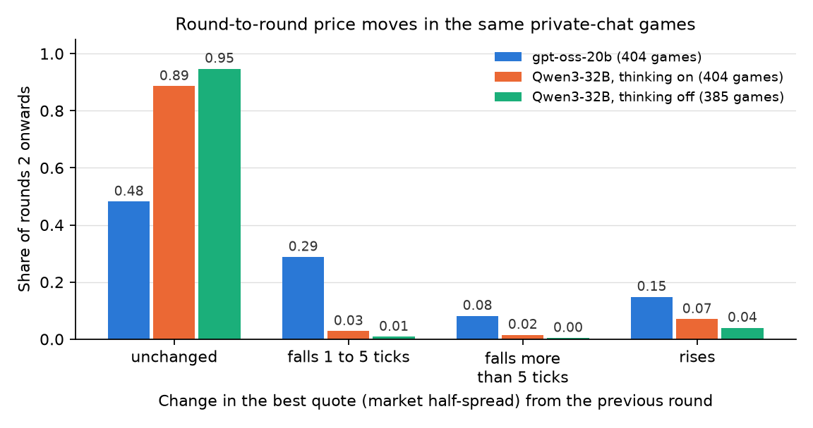
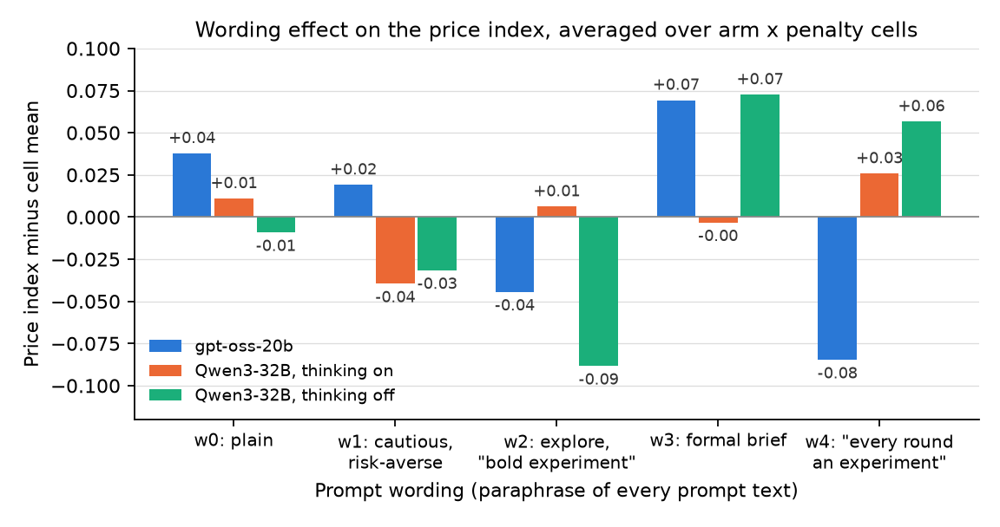
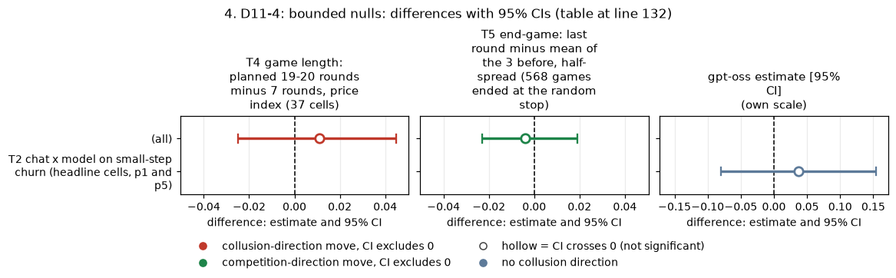

# Dossier 11: fresh discovery on the gpt-oss-20b data

*Rigorous ad hoc stage, claims dossiers. Everything here is exploratory and post hoc. Compiled by the coordinator from the discovery agent's findings and an adversarial review (section 6); scripts in `scripts/`, tables in `tables/`, figures in `figures/`.*

**Orientation.** In this game two (sometimes three) LLM "market makers" each quote a **half-spread** (the distance from the mid-price to their bid and ask) from 1.00 (competitive: costs covered, no excess profit) to 5.00, in 0.01 ticks; 3.00 is the monopoly price, 70% of customers go to the lowest quote, a regulator investigates more often at higher prices, and games last 7 to 20 rounds. This dossier scanned the gpt-oss-20b data with fresh eyes, not from the existing topic list, for large unexplained effects, interactions, surprising nulls and round-by-round patterns, and compared each with Qwen3-32B. Data: the gpt-oss neutral run (720 games, leaving out the 99 build-bug replicate games), and the Qwen neutral run (1,360 games, thinking on and off), with round tables rebuilt from the raw game logs. gpt-oss runs only at medium reasoning effort; it is compared with Qwen thinking on, so every cross-model contrast confounds model with reasoning mode.

> **How to read the metrics** (per game; differences are gpt-oss minus Qwen unless stated).
> - **Average absolute spread**: mean market quote, 1.00 to 5.00. Higher = more collusive.
> - **Price index** = (market price - 1) / 2; 0 = competitive, 1 = monopoly. Example: a mean quote of 2.20 gives 0.60. Higher = more collusive.
> - **Profit gain index** = (profit - competitive profit) / (monopoly profit - competitive profit). Higher = more collusive.
> - **Competitive share (U16)**: share of firm-rounds quoting below the lowest rival quote of the previous round, or both at 1.00. Higher = more competitive.
> - **Matching share**: share of firm-rounds quoting exactly the lowest rival quote of the previous round, above 1.00. Higher = more collusive.

<small>

| Term | Plain-English definition |
|---|---|
| best quote | The lower of the two firms' quotes in a round (the market price) |
| small-step churn ("erosion share") | Share of rounds 2+ in which the best quote falls by 1 to 5 ticks from the previous round (this definition was chosen after looking at the distribution of steps) |
| matched chat games | 404 private-chat games in the 19 arms run on both models, matched on arm, penalty point, wording and seed; the strict-compete control is left out |
| wording w0 to w4 | Five paraphrases of the role sentence and headers; every payoff number is identical. w0 plain; w1 "steady, well-understood choices... weigh downside risks"; w2 "treat the early rounds as a chance to explore... A bold experiment that teaches you something is worth more than sitting still"; w3 "SIMULATION BRIEF"; w4 "Think of every round as an experiment: you may deliberately vary your quote" |
| seed-regrouping (nested) test | Wording labels are permuted across seeds within each planned game length; tests whether wordings differ more than random groups of seeds would (seeds are nested in wordings, so a single wording's effect cannot be separated from its own 4 seeds) |
| pair | One (wording, seed) combination; CIs are 95% bootstraps over the 20 pairs (10,000 resamples) unless stated; p = sign-flip permutation |
| MDE | Minimum detectable effect = 2.8 x SE |
| thinking on / off | Whether Qwen reasons in a hidden chain of thought before replying |

</small>

**Multiplicity.** Seven formal tests make up the family "discovery candidates" (Holm, m = 7), but they were chosen after a scan of about 20 quantities (the distribution of price steps, floor rounds, price by round, planned length, early ending, round-1 quote, war after a first undercut, recovery, equal-quote share, wording and seed residuals on four metrics, slope, end-game). The T3 family member was switched after the fact from the post hoc "explore" contrast to the wording-heterogeneity test (the more conservative choice). The kept findings stay below 0.02 even under Holm with m of about 25.

## 1. D11-1: gpt-oss keeps nudging its price; Qwen holds still

**Finding.** In matched private-chat games, gpt-oss's best quote changes in about half of all rounds, mostly by 1 to 5 ticks in either direction, while Qwen (thinking on) holds its quote in about 9 rounds out of 10.

| Measure (matched chat games, rounds 2+) | gpt-oss | Qwen thinking on | Qwen thinking off |
|---|---|---|---|
| Best quote falls 1 to 5 ticks | 0.288 | 0.028 | 0.008 |
| Best quote unchanged | 0.48 | 0.89 | 0.95 |
| Both firms step down together | 0.063 | 0.004 | 0.006 |

- gpt-oss minus Qwen thinking on, small-step falls: **+0.26 [0.23, 0.29]**, sign-flip p about 1e-5, Holm < 0.0001; higher in **19 of 19 arms**. Against Qwen thinking off +0.28 [0.24, 0.31].
- **Not explained by the price level.** Within bands of the previous best quote (1.05-1.5, 1.5-2.0, 2.0-2.5), gpt-oss's small-step fall rate is 0.26, 0.27, 0.34; Qwen's is 0.01, 0.05, 0.02.
- **Tied to cent-level quoting.** Only 35% of gpt-oss quotes sit on the 0.05 grid, against 87% for Qwen: gpt-oss quotes values like 2.07 and nudges them; Qwen quotes round numbers and holds.
- **It is churn, not net erosion.** gpt-oss's best quote also rises in 15% of rounds, and its mean over rounds 2+ (2.16) is above its round-1 value (2.10).
- **The level gap is set in round 1.** Round-1 best quote: gpt-oss -0.34 [-0.43, -0.25] below Qwen; rounds 2+: -0.30. So the churn does not cause the lower price.
- **Five metrics** (gpt-oss minus Qwen thinking on, matched chat games, 20 pairs): spread -0.30 [-0.38, -0.22] (MDE 0.12); price index -0.15 [-0.19, -0.11]; profit gain index -0.11 [-0.14, -0.07]; competitive share +0.35 [0.32, 0.39]; matching share -0.47 [-0.51, -0.43].
- **Round 1 predicts the rest less tightly on gpt-oss** (within-cell, round-1 best quote vs mean of rounds 2+, Spearman / Pearson): gpt-oss 0.72 / 0.69 (720 games), Qwen thinking on 0.85 / 0.82 (699), off 0.90 / 0.88 (660); difference -0.13 [-0.18, -0.07] (bootstrap tail, Holm 0.0025). This follows mechanically from more round-to-round churn, so it is a consequence of D11-1, not separate evidence.
- **Churn is barely related to the price level** within cells (gpt-oss Spearman 0.14, Pearson 0.21, n 720; Qwen thinking on -0.05 / 0.02).
- **Contrary evidence.** Qwen thinking on also churns without chat (0.27 of rounds); the difference is in chat (Qwen 0.01 vs gpt-oss 0.26), and chat reduces churn by a similar absolute amount on both models (section 4).

*Figure 1. Share of rounds 2+ by the move of the best quote from the previous round (falls 1 to 5 ticks; larger falls; unchanged; rises), for gpt-oss-20b (medium effort), Qwen3-32B thinking on and Qwen3-32B thinking off, in the 404 matched private-chat games.*

<small>

| Axis / element | Meaning |
|---|---|
| Columns (x-axis) | Model and mode: gpt-oss-20b medium effort; Qwen3-32B thinking on; Qwen3-32B thinking off |
| Rows (y-axis) | Share of rounds 2+ (0 to 1) |
| Colour / segment | Move of the best quote from the previous round (falls 1-5 ticks, larger falls, unchanged, rises) |

</small>

**Status: confirmed (exploratory, new angle), relabelled as small-step churn tied to cent-level quoting.** Sub-questions 1.2, 2.3, 1.3.

- **Main text:** "In matched private-chat games, gpt-oss's best quote changes in about half of all rounds, mostly by 1 to 5 ticks in either direction, while Qwen (thinking on) holds its quote in about 9 rounds out of 10; gpt-oss's lower price is already fully present in round 1, so this churn does not cause the lower price."
- **Appendix:** "In 404 private-chat games matched on arm, penalty, wording and seed, the best quote fell by 1 to 5 ticks in 28.8% of gpt-oss rounds against 2.8% for Qwen3-32B thinking on (+0.26 [0.23, 0.29], 20 pairs, higher in all 19 arms), at every price band; only 35% of gpt-oss quotes sit on the 0.05 grid against 87% for Qwen; the 0.30 lower average spread is already present in round 1 (-0.34)."

## 2. D11-2: on gpt-oss, competitive share mostly counts small undercuts at high prices

Each competitive firm-round in two-firm private-chat games was split into small undercuts at a high price (1 to 5 ticks below the rival while quoting 2.00 or more) and the rest. The flag reproduces the game table's `competitive_share` exactly (Pearson 1.00).

| Model | Firm-rounds | Competitive share | Share of competitive rounds that are small undercuts at >= 2.00 |
|---|---|---|---|
| gpt-oss | 13,486 | 0.41 | 0.43 |
| Qwen thinking on | 9,226 | 0.13 | 0.14 |
| Qwen thinking off | 8,878 | 0.13 | 0.06 |

**The size of the correction depends on the cut-off.** Remaining gpt-oss minus Qwen thinking-on gap in competitive share after removing small undercuts (reviewer's recomputation, formula arms excluded; full gap about 0.31):

| Undercut size removed | Quoting >= 1.50 | Quoting >= 2.00 |
|---|---|---|
| 1 tick | 0.17 | 0.19 |
| up to 5 ticks | 0.09 | 0.13 |
| up to 10 ticks | 0.06 | 0.11 |

The direction holds at every cut-off: a large share of gpt-oss's "competitive" rounds are tiny undercuts at high prices, and a residual gap of 0.06 to 0.19 remains. This explains owner observation 12 ("the competitive-share metric doesn't match the other metrics" on gpt-oss): it is definitional, not a bug.

**Status: confirmed as a measurement caveat** (descriptive, post hoc; no test). Recommendation: report competitive share and matching share across models only with a materiality threshold (for example an undercut of at least 5 ticks). Sub-questions 2.3, 1.3.

- **Main text:** "Competitive share overstates gpt-oss's competitiveness: depending on the cut-off, 30 to 60% of its 'competitive' rounds are undercuts of a few ticks while quoting above about 1.5 to 2.0 (Qwen 10 to 20%), and excluding them roughly halves the gap to Qwen."

## 3. D11-3: prompt wording alone moves gpt-oss prices

**Finding.** With every payoff number identical, the five wordings shift gpt-oss's price index by up to about 0.15, consistently across conditions. Wording means of the price index minus the cell mean, w0 to w4: +0.04, +0.02, -0.04, +0.07, -0.09.

| Metric (gpt-oss, 37 cells) | Seed-regrouping p |
|---|---|
| Price index | 0.0001 (Holm 0.0006) |
| Average absolute spread | < 0.0001 |
| Profit gain index | 0.0002 |
| Competitive share | < 0.0001 |
| Matching share | < 0.0001 |

- **Consistent across arms:** split-half correlation of the wording profiles 0.93 (0.74 to 0.99). Not driven by one seed: w2 and w4 are below zero for all 8 of their seeds, w3 above zero for all 4. Nested F(4, 12) = 10.0 (formula arms excluded; range 0.164, stratified p 0.0003).
- **Size:** the range (about 0.15) is as large as the private-chat effect at p1 (+0.19).
- **Not specific to gpt-oss:** Qwen thinking on range 0.065 (p 0.04), Qwen thinking off range 0.16 (p 0.02), as large as gpt-oss but with a different pattern (w2 low, w4 high).
- **Reconciliation with dossier 04,** which found the gpt-oss wording effect inconclusive (epsilon-squared 0.036, p 0.17): that test used only the 100 headline games; on those the reviewer also gets range 0.14, p 0.18. The pooled 37-cell test has far more power. The two are consistent.
- **The "explore / experiment" wordings (w2, w4) price lowest:** w2 and w4 minus the other three, gpt-oss, 37 cells: spread -0.21 [-0.28, -0.15]; price index -0.11 [-0.14, -0.07] (MDE 0.05); profit gain -0.11 [-0.15, -0.07]; competitive share +0.13 [0.08, 0.18]; matching share -0.19 [-0.24, -0.15]; lower in 84% of cells. This pair was picked after looking: the selection-adjusted max-pair p is 0.001; the model interaction (-0.12 [-0.17, -0.06] vs Qwen thinking on +0.03) is not selection-adjusted. **Hypothesis-generating only**; the next test is to vary that one sentence alone.

*Figure 2. Price-index residual (game price index minus its cell mean) by wording w0 to w4, for gpt-oss-20b, Qwen3-32B thinking on and Qwen3-32B thinking off, averaged over cells; neutral run.*

<small>

| Axis / element | Meaning |
|---|---|
| Columns (x-axis) | Wording w0 plain; w1 steady choices; w2 explore early; w3 simulation brief; w4 every round an experiment |
| Rows (y-axis) | Price-index residual (price index minus cell mean); positive = more collusive than the cell average |
| Series | gpt-oss-20b medium effort; Qwen3-32B thinking on; Qwen3-32B thinking off |

</small>

**Status: confirmed that wording matters on gpt-oss (and on Qwen); the explore-framing effect stays a hypothesis.** For evaluation design: a single-wording study could misstate gpt-oss's price level by up to about 0.09. Sub-questions 2.1, 1.1.

- **Main text:** "Paraphrasing the instructions with identical numbers shifts gpt-oss's price index by up to 0.15 across five wordings, consistently across 37 conditions (nested permutation p < 0.001); the two wordings that invite the agent to 'explore' or 'experiment' price lowest, a post hoc pattern that needs confirmation (Qwen thinking off shows a wording spread of similar size)."

## 4. D11-4: bounded nulls

| Test | gpt-oss estimate [95% CI] | MDE | Qwen |
|---|---|---|---|
| T4 game length: planned 19-20 rounds minus 7 rounds, price index (37 cells) | +0.011 [-0.025, 0.045], p 0.54 | 0.05 | thinking on +0.004 [-0.017, 0.027]; off +0.023 [-0.019, 0.065] |
| T5 end-game: last round minus mean of the 3 before, half-spread (568 games ended at the random stop) | -0.004 [-0.023, 0.019], p 0.75 | 0.03 | null |
| T2 chat x model on small-step churn (headline cells, p1 and p5) | +0.037 [-0.080, 0.154], p 0.56 | 0.17 (weak bound) | chat cuts churn 0.27 to 0.01 on Qwen thinking on, 0.48 to 0.26 on gpt-oss |

<!-- ci-forest:1 -->

*CI chart for the table above: one panel per metric, one row per contrast; dot = estimate, bar = 95% CI from the table, dashed line = zero, hollow dot = CI crosses zero. Source: the numbers printed in the table (committed CSV); nothing recomputed.*

<small>

**Reading the chart.** Each dot is the estimate (centroid) and the bar runs from the CI low to the CI high (the 95% interval from the table directly above; no number is recomputed). The dashed vertical line is zero (no difference). Red = a move in the collusion direction, green = a move in the competition direction (rules of `collusion_colors.direction`), blue-grey = the metric has no collusion direction. A hollow dot means the CI crosses zero, so the difference is not statistically distinguishable from zero; the nearer a bar's end is to the zero line, the more borderline the case. Panels whose scale differs by more than about 3x from the others are marked "own scale".

**Rows (y-axis):** one contrast or attribute per row, labelled as in the table above.

**Panels (x-axis = the difference in that metric):**

| Panel | Direction | Red means | Green means |
|---|---|---|---|
| T4 game length: planned 19-20 rounds minus 7 rounds, price index (37 cells) | higher = more collusive (on the red/green maps: red end) | metric goes up (more collusive) | metric goes down (less collusive) |
| T5 end-game: last round minus mean of the 3 before, half-spread (568 games ended at the random stop) | higher = more collusive (on the red/green maps: red end) | metric goes up (more collusive) | metric goes down (less collusive) |
| gpt-oss estimate [95% CI] | no collusion direction (neutral hue) | none (blue-grey: no collusion direction) | none (blue-grey: no collusion direction) |

</small>
<!-- /ci-forest -->

Game length, five metrics (gpt-oss): spread +0.02 [-0.05, 0.09]; profit gain +0.02 [-0.03, 0.05]; competitive share -0.01 [-0.04, 0.03]; matching share 0.00 [-0.03, 0.04]. Holm p = 1 for all three tests. Sub-question 1.1.

- **Main text:** "We find no effect of planned game length (price-index difference within +-0.05) or of the final round (within +-0.02 half-spread) on gpt-oss pricing."

**Rejected or folded-in candidates.**

| Candidate | Outcome |
|---|---|
| Round-1 lock-in (T6) | Real but a consequence of churn; folded into D11-1 |
| Mean price index falls from 0.46 to 0.34 over rounds | Composition: short games drop out; the within-game slope is about 0 (+0.001 per round) |
| Price-war recovery | Not informative: the war flag fires in 90% of gpt-oss games because gpt-oss levels sit below its 0.8 trigger |
| Share of games ended by an investigation (gpt-oss 22% vs Qwen 34%) | Mechanical consequence of the lower price level (the hazard rises with price) |
| Largest single-game residuals | Formula-arm games near 0.95, already covered by the focal-point dossier |

## 5. Data trap for anyone joining round tables

In the gpt-oss round tables (`tables_t2`), the fx-*/nx-* trial ids hold the **formula-fix games** (all 119 match the game table). The trap is that the 98 build-bug replicate (hrep) rows in the game table carry the **same trial_id strings**, so joining by trial_id gives those replicate rows the formula-fix games' rounds (about 14% of neutral-root rows mismatch, all of them hrep rows). Join on (source_root, played_trial_id) or row_id, never on trial_id alone. No number in this dossier is affected (the rounds were rebuilt from the event logs via source_root, and hrep, fx and nx are left out of D11-1).

## 6. Adversarial review

A fresh reviewer re-derived D11-1, D11-2 and D11-3 with an independent script (all match). Changes made: "erosion" relabelled as small-step churn (it is not net erosion and is tied to cent-level quoting; level bands rule out a price-level artefact); round-1 lock-in reframed as a consequence of churn; the D11-2 correction reported over a range of cut-offs instead of one; D11-3 stated as not specific to gpt-oss, the nested test judged valid, the conflict with dossier 04 resolved as power, and the explore contrast made hypothesis-generating; the data-trap statement corrected (it was stated backwards); the Holm family relabelled as tests chosen after a scan of about 20 quantities.

## 7. Files

| File | Contents |
|---|---|
| scripts/build_rounds.py | Independent round table from the raw game logs |
| scripts/discovery.py, scripts/discovery_b.py | Tests T1 to T6, five metrics, correlations; wording null and U16 split |
| scripts/holm_final.py, scripts/figures.py | Holm family; figures |
| tables/*.csv | contrasts, holm_family_final, t1_* (churn), t2_*, t3_* (wording), correlations, pergame_dynamics_oss |
| figures/fig1_round_moves.png, figures/fig2_wording_effects.png | Figures 1 and 2 |
