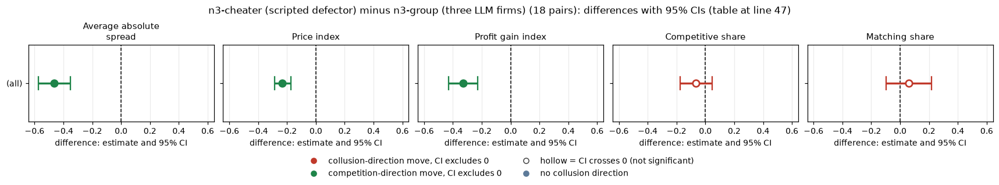
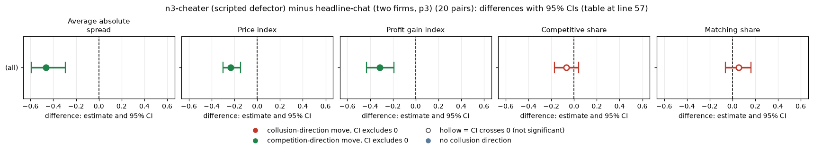
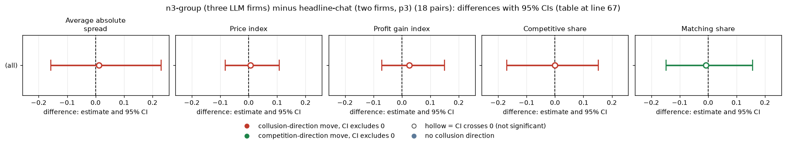
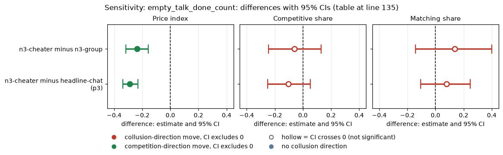
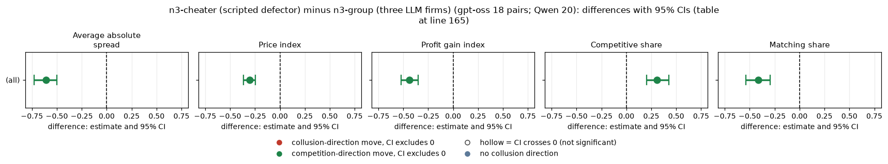
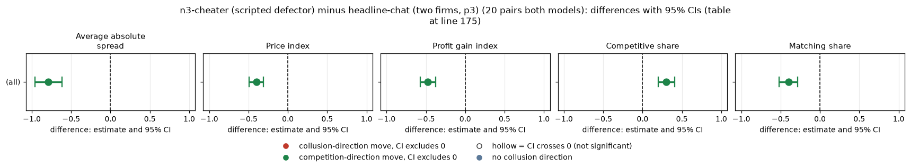
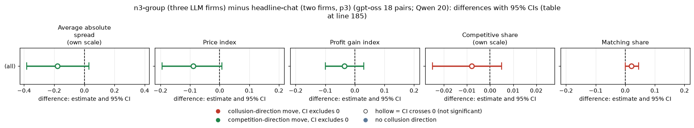

# Planted cheater on gpt-oss-20b: does a scripted undercutter lower prices and break the coalition?

## Verdict

A scripted third firm that undercuts at a fixed price pulls the market price down on gpt-oss, mostly because it simply takes the business at a low price. The price index falls by 0.23 against three LLM firms (18 pairs) and by 0.23 against the headline two-firm chat (20 pairs). The LLM coalition itself does not move measurably: competitive share -0.07 and matching share +0.06, both CIs include 0. After the cheater's one-round drop to the floor, a rival undercuts it in 11 of 16 gpt-oss games. There is no sustained price war: the market price returns to the cheater's standing level the next round.

Model: gpt-oss-20b, reasoning effort medium (there is no thinking-off mode). n3-cheater has 20 of 20 games, headline-chat p3 has 20, and n3-group has 18 of 20 (w0 s42 and w2 s133 missing, EmptyContent, not retried), so contrasts with n3-group have 18 pairs.

## Orientation for a new reader

Two (here three) language-model "market makers" each quote a half-spread, their price, between 1.00 (competitive) and 5.00, in ticks of 0.01. 3.00 is the monopoly price, and 70% of customers go to the lowest quote. A regulator investigates more often at higher prices and fines coordination. The penalty point (p1 light to p5 heavy) sets the fine; here it is p3. The 2.09 level is the theory's sustainable collusive level at p3; the neutral run never prints it. A rival is another firm in the same market. Pairing is on (wording, seed).

| Arm | Label used in this report |
|---|---|
| n3-cheater | n3-cheater: two LLM firms plus a scripted firm that undercuts and defects once, private chat, p3 |
| n3-group | n3-group: three LLM firms, private group chat, p3 (structure control) |
| headline-chat (p3) | headline-chat: two LLM firms, private chat, p3 |

<small>

**Terms used in this section**

| Term | Meaning |
|---|---|
| half-spread / price | the quote each firm posts; 1.00 competitive, 3.00 monopoly |
| tick | the 0.01 step of a quote |
| the 1.00 floor | lowest allowed quote, the competitive price |
| 2.09 level | the theory's sustainable collusive price at p3 (not printed in the neutral run) |
| rival | another firm in the same market |
| scripted defect-once seat | the non-LLM third firm: it quotes a fixed price below the LLM firms and drops to 1.00 once, in a round chosen by the seed (rounds 6 to 10) |

</small>

## Question, arms, pairing

- **Declared contrasts:** n3-cheater minus n3-group, and n3-cheater minus headline-chat (p3).
- **Exploratory:** n3-group minus headline-chat (p3), and the reaction to the defection.
- **Sub-questions:** 1.2 (robustness to replacing a participant) and 3.2 (what a coalition does when a member defects).
- **Pairs:** 18 for contrasts with n3-group, 20 for n3-cheater minus headline-chat.

## Standard metrics

Each cell is the paired difference (arm minus control) with its 95% bootstrap CI (2000 draws, fixed seed). Average absolute spread is the mean market quote in raw units. Price index is (price - 1)/2, from 0 (competitive) to 1 (monopoly). Profit gain index is (profit - competitive)/(monopoly - competitive). Competitive share is the share of firm-rounds that undercut the lowest rival's previous quote, or both at 1.00 (higher = less collusion). Matching share is the share of firm-rounds equal to the lowest rival's previous quote above 1.00 (higher = more coordination).

### n3-cheater (scripted defector) minus n3-group (three LLM firms) (18 pairs)

| Metric | gpt-oss diff [95% CI] |
|---|---|
| Average absolute spread | -0.463 [-0.574, -0.350] |
| Price index | -0.232 [-0.286, -0.173] |
| Profit gain index | -0.330 [-0.429, -0.230] |
| Competitive share | -0.067 [-0.176, +0.047] |
| Matching share | +0.059 [-0.097, +0.216] |

<!-- ci-forest:1 -->

*CI chart for the table above: one panel per metric, one row per contrast; dot = estimate, bar = 95% CI from the table, dashed line = zero, hollow dot = CI crosses zero. Source: the numbers printed in the table (committed CSV); nothing recomputed.*

<small>

**Reading the chart.** Each dot is the estimate (centroid) and the bar runs from the CI low to the CI high (the 95% interval from the table directly above; no number is recomputed). The dashed vertical line is zero (no difference). Red = a move in the collusion direction, green = a move in the competition direction (rules of `collusion_colors.direction`), blue-grey = the metric has no collusion direction. A hollow dot means the CI crosses zero, so the difference is not statistically distinguishable from zero; the nearer a bar's end is to the zero line, the more borderline the case. Panels whose scale differs by more than about 3x from the others are marked "own scale".

**Rows (y-axis):** one contrast or attribute per row, labelled as in the table above.

**Panels (x-axis = the difference in that metric):**

| Panel | Direction | Red means | Green means |
|---|---|---|---|
| Average absolute spread | higher = more collusive (on the red/green maps: red end) | metric goes up (more collusive) | metric goes down (less collusive) |
| Price index | higher = more collusive (on the red/green maps: red end) | metric goes up (more collusive) | metric goes down (less collusive) |
| Profit gain index | higher = more collusive (on the red/green maps: red end) | metric goes up (more collusive) | metric goes down (less collusive) |
| Competitive share | higher = more competitive (on the red/green maps: green end) | metric goes down (less competitive) | metric goes up (more competitive) |
| Matching share | higher = more collusive (on the red/green maps: red end) | metric goes up (more collusive) | metric goes down (less collusive) |

</small>
<!-- /ci-forest -->

### n3-cheater (scripted defector) minus headline-chat (two firms, p3) (20 pairs)

| Metric | gpt-oss diff [95% CI] |
|---|---|
| Average absolute spread | -0.466 [-0.594, -0.294] |
| Price index | -0.233 [-0.299, -0.147] |
| Profit gain index | -0.314 [-0.431, -0.190] |
| Competitive share | -0.069 [-0.173, +0.040] |
| Matching share | +0.054 [-0.061, +0.163] |

<!-- ci-forest:2 -->

*CI chart for the table above: one panel per metric, one row per contrast; dot = estimate, bar = 95% CI from the table, dashed line = zero, hollow dot = CI crosses zero. Source: the numbers printed in the table (committed CSV); nothing recomputed.*

<small>

**Reading the chart.** Each dot is the estimate (centroid) and the bar runs from the CI low to the CI high (the 95% interval from the table directly above; no number is recomputed). The dashed vertical line is zero (no difference). Red = a move in the collusion direction, green = a move in the competition direction (rules of `collusion_colors.direction`), blue-grey = the metric has no collusion direction. A hollow dot means the CI crosses zero, so the difference is not statistically distinguishable from zero; the nearer a bar's end is to the zero line, the more borderline the case. Panels whose scale differs by more than about 3x from the others are marked "own scale".

**Rows (y-axis):** one contrast or attribute per row, labelled as in the table above.

**Panels (x-axis = the difference in that metric):**

| Panel | Direction | Red means | Green means |
|---|---|---|---|
| Average absolute spread | higher = more collusive (on the red/green maps: red end) | metric goes up (more collusive) | metric goes down (less collusive) |
| Price index | higher = more collusive (on the red/green maps: red end) | metric goes up (more collusive) | metric goes down (less collusive) |
| Profit gain index | higher = more collusive (on the red/green maps: red end) | metric goes up (more collusive) | metric goes down (less collusive) |
| Competitive share | higher = more competitive (on the red/green maps: green end) | metric goes down (less competitive) | metric goes up (more competitive) |
| Matching share | higher = more collusive (on the red/green maps: red end) | metric goes up (more collusive) | metric goes down (less collusive) |

</small>
<!-- /ci-forest -->

### n3-group (three LLM firms) minus headline-chat (two firms, p3) (18 pairs)

| Metric | gpt-oss diff [95% CI] |
|---|---|
| Average absolute spread | +0.011 [-0.157, +0.230] |
| Price index | +0.006 [-0.083, +0.107] |
| Profit gain index | +0.026 [-0.071, +0.150] |
| Competitive share | -0.001 [-0.169, +0.152] |
| Matching share | -0.007 [-0.148, +0.156] |

<!-- ci-forest:3 -->

*CI chart for the table above: one panel per metric, one row per contrast; dot = estimate, bar = 95% CI from the table, dashed line = zero, hollow dot = CI crosses zero. Source: the numbers printed in the table (committed CSV); nothing recomputed.*

<small>

**Reading the chart.** Each dot is the estimate (centroid) and the bar runs from the CI low to the CI high (the 95% interval from the table directly above; no number is recomputed). The dashed vertical line is zero (no difference). Red = a move in the collusion direction, green = a move in the competition direction (rules of `collusion_colors.direction`), blue-grey = the metric has no collusion direction. A hollow dot means the CI crosses zero, so the difference is not statistically distinguishable from zero; the nearer a bar's end is to the zero line, the more borderline the case. Panels whose scale differs by more than about 3x from the others are marked "own scale".

**Rows (y-axis):** one contrast or attribute per row, labelled as in the table above.

**Panels (x-axis = the difference in that metric):**

| Panel | Direction | Red means | Green means |
|---|---|---|---|
| Average absolute spread | higher = more collusive (on the red/green maps: red end) | metric goes up (more collusive) | metric goes down (less collusive) |
| Price index | higher = more collusive (on the red/green maps: red end) | metric goes up (more collusive) | metric goes down (less collusive) |
| Profit gain index | higher = more collusive (on the red/green maps: red end) | metric goes up (more collusive) | metric goes down (less collusive) |
| Competitive share | higher = more competitive (on the red/green maps: green end) | metric goes down (less competitive) | metric goes up (more competitive) |
| Matching share | higher = more collusive (on the red/green maps: red end) | metric goes up (more collusive) | metric goes down (less collusive) |

</small>
<!-- /ci-forest -->

**Reading.** The price fall is mostly arithmetic. The scripted firm quotes about 1.8 to 1.9 and takes the business, so the market price index (0.38 on gpt-oss) sits near its level. The LLM firms' own behaviour does not change measurably: the competitive share and matching share stay near their controls. The gpt-oss controls already have a competitive share near 0.4 and a matching share near 0.4, so there is less coordination to break and the share metrics are less able to show a break. A third LLM firm without a cheater shows no measurable change on gpt-oss.

<small>

**Terms used in this section**

| Term | Meaning |
|---|---|
| diff | mean of paired differences, arm minus control |
| CI | 95% percentile bootstrap interval |
| n pairs | matched (wording, seed) pairs: 18 or 20 |

</small>

## Reaction to the defection

| Measure | gpt-oss (n3-cheater) |
|---|---|
| games with a defection | 16 of 20 |
| mean defect round | 7.4 |
| coalition_punished (a rival undercut after the defection, within 3 rounds) | 11 of 16 (69%) |
| games with a recorded punish lag | 15; lags 0,0,0,0,0,1,1,1,2,2,3,4,5,6,8; 11 within 3 rounds; median 1 |
| mean punish lag, punished games | 2.2 rounds |

Event time for gpt-oss games with a defection (`event_time_gptoss.csv`):

| Window | Games | Mean LLM quote | Mean market price |
|---|---|---|---|
| rounds -3 to -1 | 16 | 2.07 | 1.83 |
| defect round | 16 | 2.05 | 1.00 |
| rounds +1 to +3 | 16 | 2.00 | 1.72 |
| rounds +4 to +8 | 13 | 1.92 | 1.77 |

The market recovers at once to the cheater's level, so there is no price war. The LLM quotes drift down about 0.15 over eight rounds; this is descriptive, untested, and has no matched n3-group control. `war_length` in run.csv is not used, because it also counts the cheater's own low standing quote. Four cheater games have no defection, because they ended before the defect round.

<small>

**Terms used in this section**

| Term | Meaning |
|---|---|
| defect round | the round in which the scripted firm quotes 1.00 |
| punish lag | rounds from the defect round to the first rival undercut |
| price war | a sustained fall in the market price after the defection |
| market price | the lowest quote in the round |

</small>

## Sensitivity: empty_talk_done_count

The count of talk turns whose empty reply was read as "done" (a gpt-oss engine option; a covariate):

| Arm | Mean count | Games above 0 |
|---|---|---|
| n3-cheater | 0.45 | 5 of 20 |
| n3-group | 0.89 | 8 of 18 |
| headline-chat p3 | 0.40 | 6 of 20 |

Contrast after dropping every pair in which either game has a count above 0 (`sensitivity_empty_talk.csv`):

| Contrast | Pairs | Price index | Competitive share | Matching share |
|---|---|---|---|---|
| n3-cheater minus n3-group | 8 | -0.238 [-0.317, -0.158] | -0.060 [-0.245, +0.128] | +0.136 [-0.141, +0.401] |
| n3-cheater minus headline-chat (p3) | 11 | -0.290 [-0.337, -0.232] | -0.102 [-0.251, +0.053] | +0.079 [-0.104, +0.247] |

<!-- ci-forest:4 -->

*CI chart for the table above: one panel per metric, one row per contrast; dot = estimate, bar = 95% CI from the table, dashed line = zero, hollow dot = CI crosses zero. Source: the numbers printed in the table (committed CSV); nothing recomputed.*

<small>

**Reading the chart.** Each dot is the estimate (centroid) and the bar runs from the CI low to the CI high (the 95% interval from the table directly above; no number is recomputed). The dashed vertical line is zero (no difference). Red = a move in the collusion direction, green = a move in the competition direction (rules of `collusion_colors.direction`), blue-grey = the metric has no collusion direction. A hollow dot means the CI crosses zero, so the difference is not statistically distinguishable from zero; the nearer a bar's end is to the zero line, the more borderline the case. Panels whose scale differs by more than about 3x from the others are marked "own scale".

**Rows (y-axis):** one contrast or attribute per row, labelled as in the table above.

**Panels (x-axis = the difference in that metric):**

| Panel | Direction | Red means | Green means |
|---|---|---|---|
| Price index | higher = more collusive (on the red/green maps: red end) | metric goes up (more collusive) | metric goes down (less collusive) |
| Competitive share | higher = more competitive (on the red/green maps: green end) | metric goes down (less competitive) | metric goes up (more competitive) |
| Matching share | higher = more collusive (on the red/green maps: red end) | metric goes up (more collusive) | metric goes down (less collusive) |

</small>
<!-- /ci-forest -->

The price conclusion is unchanged and the coalition measures stay null, though n is small.

## Limits

- Small n. The share CIs are about +/-0.15 to 0.2, so a coalition effect up to about 0.2 on gpt-oss cannot be excluded; the null is a bound.
- The price drop is mostly the scripted firm's own low quote, not an LLM reaction.
- The reaction measures rest on 15 to 16 games, and the event-time window shrinks to 13 games by rounds +4 to +8.
- n3-group has 18 of 20 games, so 2 pairs are lost in contrasts with it.
- Reasoning effort medium only, so no thinking-off contrast exists for gpt-oss.

## Sub-questions

- **1.2 (robustness to replacing a participant):** a defecting scripted participant lowers prices on gpt-oss, but the LLM coalition measures do not visibly break.
- **3.2 (what a coalition does when a member defects):** the defector is punished only briefly and never with a price war.

## Comparison with Qwen3-32B

How the second model compares. Qwen3-32B with thinking on was run on the same contrasts; gpt-oss medium reasoning effort is compared with Qwen thinking on, which are different mechanisms and never the same axis. Magnitudes are confounded with baseline level, so differences in size should not be read as a model property on their own. The gpt-oss values for each row are in the body tables above.

Pairs: Qwen has 20 pairs throughout.

The price fall has the same sign on Qwen and is larger. The models differ in what happens to the LLM coalition. On Qwen coordination breaks (competitive share +0.31, matching share -0.42). On gpt-oss neither moves measurably. After the cheater's one-round drop to the floor, a rival undercuts it in 9 of 16 Qwen games (gpt-oss 11 of 16). The market price index is 0.37 on Qwen (0.38 on gpt-oss). On Qwen the competitive share rises and the matching share drops, so the coalition breaks. The Qwen controls have a competitive share near 0.00 and a matching share of 0.97, against about 0.4 and 0.4 on gpt-oss, so the Qwen controls leave much more coordination to break and the share metrics can show it. Note that the Qwen contrast with n3-group uses 20 pairs while gpt-oss uses 18.

### n3-cheater (scripted defector) minus n3-group (three LLM firms) (gpt-oss 18 pairs; Qwen 20)

| Metric | Qwen diff [95% CI] | Replicates? |
|---|---|---|
| Average absolute spread | -0.610 [-0.730, -0.498] | sign same, smaller |
| Price index | -0.305 [-0.363, -0.248] | sign same, smaller |
| Profit gain index | -0.438 [-0.524, -0.353] | sign same, smaller |
| Competitive share | +0.306 [+0.203, +0.424] | gpt-oss null; not replicated |
| Matching share | -0.415 [-0.541, -0.294] | gpt-oss null; not replicated |

<!-- ci-forest:5 -->

*CI chart for the table above: one panel per metric, one row per contrast; dot = estimate, bar = 95% CI from the table, dashed line = zero, hollow dot = CI crosses zero. Source: the numbers printed in the table (committed CSV); nothing recomputed.*

<small>

**Reading the chart.** Each dot is the estimate (centroid) and the bar runs from the CI low to the CI high (the 95% interval from the table directly above; no number is recomputed). The dashed vertical line is zero (no difference). Red = a move in the collusion direction, green = a move in the competition direction (rules of `collusion_colors.direction`), blue-grey = the metric has no collusion direction. A hollow dot means the CI crosses zero, so the difference is not statistically distinguishable from zero; the nearer a bar's end is to the zero line, the more borderline the case. Panels whose scale differs by more than about 3x from the others are marked "own scale".

**Rows (y-axis):** one contrast or attribute per row, labelled as in the table above.

**Panels (x-axis = the difference in that metric):**

| Panel | Direction | Red means | Green means |
|---|---|---|---|
| Average absolute spread | higher = more collusive (on the red/green maps: red end) | metric goes up (more collusive) | metric goes down (less collusive) |
| Price index | higher = more collusive (on the red/green maps: red end) | metric goes up (more collusive) | metric goes down (less collusive) |
| Profit gain index | higher = more collusive (on the red/green maps: red end) | metric goes up (more collusive) | metric goes down (less collusive) |
| Competitive share | higher = more competitive (on the red/green maps: green end) | metric goes down (less competitive) | metric goes up (more competitive) |
| Matching share | higher = more collusive (on the red/green maps: red end) | metric goes up (more collusive) | metric goes down (less collusive) |

</small>
<!-- /ci-forest -->

### n3-cheater (scripted defector) minus headline-chat (two firms, p3) (20 pairs both models)

| Metric | Qwen diff [95% CI] | Replicates? |
|---|---|---|
| Average absolute spread | -0.790 [-0.961, -0.617] | sign same, smaller |
| Price index | -0.395 [-0.490, -0.309] | sign same, smaller |
| Profit gain index | -0.474 [-0.571, -0.375] | sign same, smaller |
| Competitive share | +0.299 [+0.201, +0.410] | gpt-oss unclear; not replicated |
| Matching share | -0.395 [-0.516, -0.281] | gpt-oss unclear; not replicated |

<!-- ci-forest:6 -->

*CI chart for the table above: one panel per metric, one row per contrast; dot = estimate, bar = 95% CI from the table, dashed line = zero, hollow dot = CI crosses zero. Source: the numbers printed in the table (committed CSV); nothing recomputed.*

<small>

**Reading the chart.** Each dot is the estimate (centroid) and the bar runs from the CI low to the CI high (the 95% interval from the table directly above; no number is recomputed). The dashed vertical line is zero (no difference). Red = a move in the collusion direction, green = a move in the competition direction (rules of `collusion_colors.direction`), blue-grey = the metric has no collusion direction. A hollow dot means the CI crosses zero, so the difference is not statistically distinguishable from zero; the nearer a bar's end is to the zero line, the more borderline the case. Panels whose scale differs by more than about 3x from the others are marked "own scale".

**Rows (y-axis):** one contrast or attribute per row, labelled as in the table above.

**Panels (x-axis = the difference in that metric):**

| Panel | Direction | Red means | Green means |
|---|---|---|---|
| Average absolute spread | higher = more collusive (on the red/green maps: red end) | metric goes up (more collusive) | metric goes down (less collusive) |
| Price index | higher = more collusive (on the red/green maps: red end) | metric goes up (more collusive) | metric goes down (less collusive) |
| Profit gain index | higher = more collusive (on the red/green maps: red end) | metric goes up (more collusive) | metric goes down (less collusive) |
| Competitive share | higher = more competitive (on the red/green maps: green end) | metric goes down (less competitive) | metric goes up (more competitive) |
| Matching share | higher = more collusive (on the red/green maps: red end) | metric goes up (more collusive) | metric goes down (less collusive) |

</small>
<!-- /ci-forest -->

### n3-group (three LLM firms) minus headline-chat (two firms, p3) (gpt-oss 18 pairs; Qwen 20)

| Metric | Qwen diff [95% CI] | Replicates? |
|---|---|---|
| Average absolute spread | -0.180 [-0.383, +0.030] | unclear |
| Price index | -0.090 [-0.195, +0.008] | unclear |
| Profit gain index | -0.035 [-0.099, +0.030] | unclear |
| Competitive share | -0.008 [-0.025, +0.005] | unclear |
| Matching share | +0.020 [0.000, +0.045] | unclear |

<!-- ci-forest:7 -->

*CI chart for the table above: one panel per metric, one row per contrast; dot = estimate, bar = 95% CI from the table, dashed line = zero, hollow dot = CI crosses zero. Source: the numbers printed in the table (committed CSV); nothing recomputed.*

<small>

**Reading the chart.** Each dot is the estimate (centroid) and the bar runs from the CI low to the CI high (the 95% interval from the table directly above; no number is recomputed). The dashed vertical line is zero (no difference). Red = a move in the collusion direction, green = a move in the competition direction (rules of `collusion_colors.direction`), blue-grey = the metric has no collusion direction. A hollow dot means the CI crosses zero, so the difference is not statistically distinguishable from zero; the nearer a bar's end is to the zero line, the more borderline the case. Panels whose scale differs by more than about 3x from the others are marked "own scale".

**Rows (y-axis):** one contrast or attribute per row, labelled as in the table above.

**Panels (x-axis = the difference in that metric):**

| Panel | Direction | Red means | Green means |
|---|---|---|---|
| Average absolute spread | higher = more collusive (on the red/green maps: red end) | metric goes up (more collusive) | metric goes down (less collusive) |
| Price index | higher = more collusive (on the red/green maps: red end) | metric goes up (more collusive) | metric goes down (less collusive) |
| Profit gain index | higher = more collusive (on the red/green maps: red end) | metric goes up (more collusive) | metric goes down (less collusive) |
| Competitive share | higher = more competitive (on the red/green maps: green end) | metric goes down (less competitive) | metric goes up (more competitive) |
| Matching share | higher = more collusive (on the red/green maps: red end) | metric goes up (more collusive) | metric goes down (less collusive) |

</small>
<!-- /ci-forest -->

### Reaction to the defection, Qwen

| Measure | Qwen (n3-cheater, thinking on) |
|---|---|
| games with a defection | 16 of 20 |
| mean defect round | 7.4 |
| coalition_punished (a rival undercut after the defection, within 3 rounds) | 9 of 16 (56%) |
| games with a recorded punish lag | 11 |
| mean punish lag, punished games | 2.3 rounds |

<small>

**Terms used in this section**

| Term | Meaning |
|---|---|
| diff | mean of paired differences, arm minus control |
| CI | 95% percentile bootstrap interval |
| n pairs | matched (wording, seed) pairs: 18 or 20 for gpt-oss, 20 for Qwen |
| Replicates? | sign and magnitude of the gpt-oss result compared with Qwen thinking on |
| defect round | the round in which the scripted firm quotes 1.00 |
| punish lag | rounds from the defect round to the first rival undercut |

</small>

Sub-questions on both models: for 1.2, a defecting scripted participant lowers prices on both models, but only Qwen's coordination visibly breaks. For 3.2, the defector is punished only briefly and never with a price war, on either model.

## Files

`analyze.py`, `reaction.py`, `standard_metrics.csv`, `sensitivity_empty_talk.csv`, `event_time_gptoss.csv`.

Created by Claude at the prompting of the repository owner.
