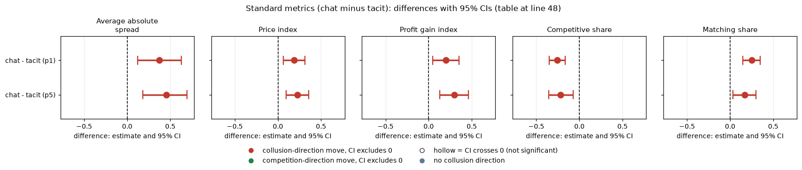
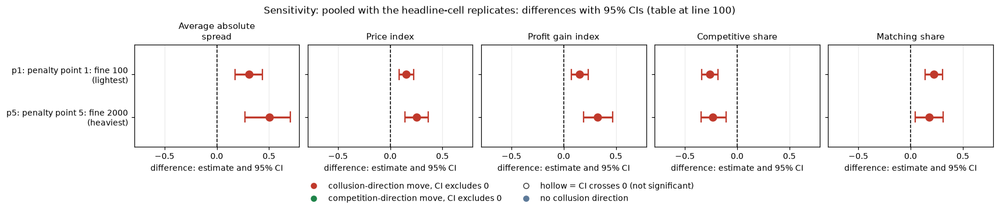
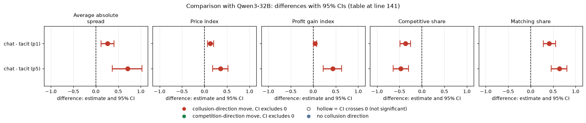

# Communication on gpt-oss-20b: does letting the firms chat raise prices?

## Verdict
Letting the two gpt-oss-20b firms (reasoning effort medium) chat raises prices over silence at both penalty points tested: the price index rises by 0.19 at the light penalty (p1) and 0.23 at the heavy penalty (p5), and the profit gain index by 0.20 and 0.30. The matching share (how often a firm copies the rival's previous above-floor quote) rises from 0.16 to 0.41 at p1 and to 0.33 at p5. At p3, gpt-oss chat stays below the joint-profit control (price index 0.61 against 0.74): ordinary chat uses only part of the coordination the firms are capable of when told to. Every contrast has n = 20 pairs, so the CIs are wide. Pooling with the independent headline-cell replicates leaves the effect intact.

| Term | Meaning |
|---|---|
| price index | mean quote rescaled: 0 at the 1.00 floor, 1 at the 3.00 monopoly price |
| profit gain index | 0 at competitive profit, 1 at monopoly profit |

## Orientation for an outside reader
Two (sometimes three) language-model "market makers" each quote a **half-spread** (the price, from 1.00 to 5.00, in steps of 0.01 called **ticks**); 70% of customers go to the lower quote. 1.00 is the **floor**, the fully competitive quote; **3.00** is the monopoly price. The "2.09 level" is the theory price printed in the earlier anchored run; this neutral run prints evenly spaced example prices instead. The **rival** is the other firm. A regulator investigates high prices more often and fines them; **p1** is the lightest fine and **p5** the heaviest. **Chat** = the firms can message each other each round; **tacit** = no channel. A **control** is a variant with an explicit instruction. Model: gpt-oss-20b, reasoning effort medium; it has no thinking-off mode, so every cell is medium effort.

| Term | Meaning |
|---|---|
| half-spread | the quoted price, 1.00 to 5.00 |
| tick | 0.01, the smallest price step |
| floor | 1.00, the competitive quote |
| monopoly price | 3.00 |
| 2.09 level | theory price printed in the anchored run (not printed here) |
| rival | the other firm |
| control | variant with an explicit instruction (see arms) |

## Arms
| Arm | Description |
|---|---|
| headline-chat: private chat | the firms can message each other; headline prompt, run at p1, p3 and p5 |
| headline-tacit: silence | no chat channel; headline prompt, run at p1 and p5 |
| ctl-32b-joint: joint-profit control | firms told to maximise joint profit (p3); the arm name says 32b for historical reasons, it ran on gpt-oss-20b |
| ctl-32b-compete: strict-compete control | firms told to compete (p3); same naming note |
| hrep-*: headline-cell replicates | same prompt as the headline cell, independent sampling (hrep-fx-chat-p1, hrep-nx-chat-p1, hrep-fx-tacit-p1, hrep-nx-tacit-p1, hrep-fx-chat-p5); sensitivity use only |

| Term | Meaning |
|---|---|
| p1 / p3 / p5 | penalty point: light / middle / heavy fine rule |

## Question, pairing
Declared question (sub-questions 1.1 and 3.1: is a chat channel a conduit for coordination?). Contrasts: headline-chat minus headline-tacit at p1 and at p5 (20 games per arm, 20 pairs). At p3 there is a chat arm only (no tacit arm), so p3 is used only to place chat between the two controls. There is no monitored-chat arm. Pairing is on (wording, seed); 95% percentile bootstrap CIs (2000 draws, fixed seed). No missing games in these cells.

| Term | Meaning |
|---|---|
| pair | one (wording, seed) combination; chat and tacit games share it |
| 95% CI | percentile bootstrap over the pairs |

## Standard metrics (chat minus tacit)
Each cell: diff [95% CI] (chat mean; tacit mean). n = 20 pairs in every row. Competitive share = share of firm-rounds that undercut the rival or sit at the floor (lower = more collusive). Matching share = share of rounds matching the rival's previous quote above the floor.

| Contrast | Metric | gpt-oss-20b |
|---|---|---|
| chat - tacit (p1) | Average absolute spread | +0.372 [0.121, 0.626] (2.15; 1.78) |
| chat - tacit (p1) | Price index | +0.186 [0.062, 0.315] (0.57; 0.39) |
| chat - tacit (p1) | Profit gain index | +0.198 [0.049, 0.351] (0.77; 0.57) |
| chat - tacit (p1) | Competitive share | -0.255 [-0.348, -0.164] (0.43; 0.68) |
| chat - tacit (p1) | Matching share | +0.249 [0.149, 0.351] (0.41; 0.16) |
| chat - tacit (p5) | Average absolute spread | +0.455 [0.182, 0.691] (1.85; 1.39) |
| chat - tacit (p5) | Price index | +0.228 [0.095, 0.359] (0.42; 0.19) |
| chat - tacit (p5) | Profit gain index | +0.300 [0.128, 0.462] (0.58; 0.28) |
| chat - tacit (p5) | Competitive share | -0.217 [-0.354, -0.071] (0.46; 0.67) |
| chat - tacit (p5) | Matching share | +0.171 [0.035, 0.299] (0.33; 0.16) |

<!-- ci-forest:1 -->

*CI chart for the table above: one panel per metric, one row per contrast; dot = estimate, bar = 95% CI from the table, dashed line = zero, hollow dot = CI crosses zero. Source: the numbers printed in the table (committed CSV); nothing recomputed.*

<small>

**Reading the chart.** Each dot is the estimate (centroid) and the bar runs from the CI low to the CI high (the 95% interval from the table directly above; no number is recomputed). The dashed vertical line is zero (no difference). Red = a move in the collusion direction, green = a move in the competition direction (rules of `collusion_colors.direction`), blue-grey = the metric has no collusion direction. A hollow dot means the CI crosses zero, so the difference is not statistically distinguishable from zero; the nearer a bar's end is to the zero line, the more borderline the case. Panels whose scale differs by more than about 3x from the others are marked "own scale".

**Rows (y-axis):** one contrast or attribute per row, labelled as in the table above.

**Panels (x-axis = the difference in that metric):**

| Panel | Direction | Red means | Green means |
|---|---|---|---|
| Average absolute spread | higher = more collusive (on the red/green maps: red end) | metric goes up (more collusive) | metric goes down (less collusive) |
| Price index | higher = more collusive (on the red/green maps: red end) | metric goes up (more collusive) | metric goes down (less collusive) |
| Profit gain index | higher = more collusive (on the red/green maps: red end) | metric goes up (more collusive) | metric goes down (less collusive) |
| Competitive share | higher = more competitive (on the red/green maps: green end) | metric goes down (less competitive) | metric goes up (more competitive) |
| Matching share | higher = more collusive (on the red/green maps: red end) | metric goes up (more collusive) | metric goes down (less collusive) |

</small>
<!-- /ci-forest -->

Overall: all five metrics move in the collusive direction at both penalty points and every CI excludes zero. The silent baseline is low at p1 (price index 0.39), leaving room to rise.

| Term | Meaning |
|---|---|
| diff | chat mean minus tacit mean per pair, averaged over pairs |
| (chat; tacit) | mean over chat games; mean over tacit games |
| competitive share | share of firm-rounds undercutting the rival or at the floor |
| matching share | share of rounds matching the rival's previous quote above the floor |

## Chat against the two controls (penalty p3)
Full rows in `standard_metrics.csv`.

| Metric | gpt-oss chat | gpt-oss joint-profit control | gpt-oss strict-compete control |
|---|---|---|---|
| Price index | 0.613 | 0.744 | 0.005 |
| Profit gain index | 0.805 | 0.932 | 0.007 |
| Competitive share | 0.440 | 0.249 | 0.990 |
| Matching share | 0.376 | 0.607 | 0.000 |

gpt-oss chat minus joint-profit control (n = 20): price index -0.132 [-0.216, -0.065], profit gain -0.128 [-0.231, -0.050], competitive share +0.191 [0.084, 0.304], matching share -0.231 [-0.377, -0.082]. Chat minus strict-compete control: price index +0.607. gpt-oss chat reaches about 82% of the way from the strict-compete level to the joint-profit level on price index. The firms can coordinate when told to; ordinary chat uses part of that capability. The gap to the joint-profit control is detectable.

| Term | Meaning |
|---|---|
| joint-profit control | instruction to maximise joint profit |
| strict-compete control | instruction to compete |

## Topic-specific measures and the empty-talk covariate
Every chat game contained an explicit agreement (share 1.00 in all chat arms; 0.95 in the strict-compete control). Messages per round: about 11.7 (p1), 12.5 (p3), 11.9 (p5). `empty_talk_done_count` mean: 0.80 at p1 chat (9 of 20 games above zero), 0.40 at p3 (6) and 0.40 at p5 (6); tacit arms 0; joint-profit control 0.55 (7); strict-compete control 0.10 (2).

Sensitivity, dropping games with count > 0 (pairs fall to 11 at p1 and 14 at p5): the contrast does not shrink. Price index +0.245 [0.072, 0.418] at p1 and +0.240 [0.087, 0.396] at p5; the p5 matching-share CI then just reaches zero (+0.172 [-0.001, 0.332]).

| Term | Meaning |
|---|---|
| empty_talk_done_count | talk turns whose empty reply was read as done (covariate) |
| explicit agreement | the conversation contains an agreement between the firms |

## Sensitivity: pooled with the headline-cell replicates
Chat minus tacit with the headline cells pooled with the hrep-* replicates (same prompt, independent sampling; averaged within each pair), n = 20 pairs per row.

| Contrast | Metric | Diff [95% CI] |
|---|---|---|
| p1 | Average absolute spread | +0.307 [0.175, 0.439] |
| p1 | Price index | +0.153 [0.086, 0.223] |
| p1 | Profit gain index | +0.153 [0.071, 0.236] |
| p1 | Competitive share | -0.259 [-0.340, -0.185] |
| p1 | Matching share | +0.223 [0.139, 0.307] |
| p5 | Average absolute spread | +0.502 [0.271, 0.705] |
| p5 | Price index | +0.251 [0.140, 0.362] |
| p5 | Profit gain index | +0.327 [0.188, 0.468] |
| p5 | Competitive share | -0.231 [-0.347, -0.107] |
| p5 | Matching share | +0.179 [0.045, 0.310] |

<!-- ci-forest:2 -->

*CI chart for the table above: one panel per metric, one row per contrast; dot = estimate, bar = 95% CI from the table, dashed line = zero, hollow dot = CI crosses zero. Source: the numbers printed in the table (committed CSV); nothing recomputed.*

<small>

**Reading the chart.** Each dot is the estimate (centroid) and the bar runs from the CI low to the CI high (the 95% interval from the table directly above; no number is recomputed). The dashed vertical line is zero (no difference). Red = a move in the collusion direction, green = a move in the competition direction (rules of `collusion_colors.direction`), blue-grey = the metric has no collusion direction. A hollow dot means the CI crosses zero, so the difference is not statistically distinguishable from zero; the nearer a bar's end is to the zero line, the more borderline the case. Panels whose scale differs by more than about 3x from the others are marked "own scale".

**Rows (y-axis):** one contrast or attribute per row, labelled as in the table above (a glossary slug is expanded to "slug: short label").

| Slug | Meaning |
|---|---|
| p1 | penalty point 1: fine 100 (lightest) |
| p5 | penalty point 5: fine 2000 (heaviest) |

**Panels (x-axis = the difference in that metric):**

| Panel | Direction | Red means | Green means |
|---|---|---|---|
| Average absolute spread | higher = more collusive (on the red/green maps: red end) | metric goes up (more collusive) | metric goes down (less collusive) |
| Price index | higher = more collusive (on the red/green maps: red end) | metric goes up (more collusive) | metric goes down (less collusive) |
| Profit gain index | higher = more collusive (on the red/green maps: red end) | metric goes up (more collusive) | metric goes down (less collusive) |
| Competitive share | higher = more competitive (on the red/green maps: green end) | metric goes down (less competitive) | metric goes up (more competitive) |
| Matching share | higher = more collusive (on the red/green maps: red end) | metric goes up (more collusive) | metric goes down (less collusive) |

</small>
<!-- /ci-forest -->

Pooling does not weaken the effect: all five metrics keep their sign at both penalty points and every CI excludes zero. The replicates agree with the headline cells.

| Term | Meaning |
|---|---|
| pooled | headline cell plus its hrep-* replicate cells, averaged within each (wording, seed) |

## Limits
n = 20 pairs per contrast, so only effects of roughly 0.1 to 0.15 index points are reliably detectable; nulls would be bounds, not zeros. Chat is a bundle (talk turns plus agreement text), so the contrast shows the channel's effect, not the content's. There is no p3 tacit arm, so the chat effect cannot be traced across all three penalty points. No monitored arm.

| Term | Meaning |
|---|---|
| bound | a null result limits the effect to the CI, it does not show zero |

## Research sub-questions addressed
1.1 (necessary variables): chat is not necessary for above-floor prices on gpt-oss (tacit price index 0.39 at p1) but adds 0.19 to 0.23. 3.1 (conduits): chat is a conduit; every chat game contained an explicit agreement, and the joint-profit control shows how much more coordination is possible.

| Term | Meaning |
|---|---|
| 1.1 | which variables are necessary for collusion to emerge |
| 3.1 | actions, tools or side channels as conduits of coordination |

## Comparison with Qwen3-32B
How the second model compares. Qwen3-32B was run with its reasoning mode on (thinking on); gpt-oss at effort medium is compared with it, but the two are not the same axis, and magnitudes are confounded with each model's baseline level. The model gap is descriptive (different model, same design).

The sign matches Qwen3-32B (thinking on) in all ten comparisons. At p1 the size is similar for price (Qwen +0.13); at p5 gpt-oss is smaller (Qwen +0.36), and on matching share much smaller (0.33 against 0.83 for Qwen chat). gpt-oss chat at p3 stays below the joint-profit control (price index 0.61 against 0.74), whereas Qwen chat already equals its joint-profit control (0.77 against 0.73).

Chat minus tacit, same format as the gpt-oss table (diff [95% CI] (chat mean; tacit mean)); n = 20 pairs for Qwen in every row. Competitive share = share of firm-rounds that undercut the rival or sit at the floor (lower = more collusive). Matching share = share of rounds matching the rival's previous quote above the floor.

| Contrast | Metric | Qwen3-32B (thinking on) | Replicates? |
|---|---|---|---|
| chat - tacit (p1) | Average absolute spread | +0.261 [0.118, 0.403] (2.69; 2.43) | same sign, similar |
| chat - tacit (p1) | Price index | +0.131 [0.063, 0.204] (0.85; 0.72) | same sign, similar |
| chat - tacit (p1) | Profit gain index | +0.041 [0.005, 0.076] (0.95; 0.91) | same sign, larger on gpt-oss (Qwen near ceiling) |
| chat - tacit (p1) | Competitive share | -0.366 [-0.492, -0.250] (0.01; 0.38) | same sign, somewhat smaller |
| chat - tacit (p1) | Matching share | +0.411 [0.282, 0.554] (0.98; 0.56) | same sign, smaller |
| chat - tacit (p5) | Average absolute spread | +0.710 [0.366, 1.031] (2.08; 1.37) | same sign, smaller (CIs overlap) |
| chat - tacit (p5) | Price index | +0.355 [0.182, 0.522] (0.54; 0.18) | same sign, smaller (CIs overlap) |
| chat - tacit (p5) | Profit gain index | +0.438 [0.223, 0.632] (0.69; 0.25) | same sign, smaller (CIs overlap) |
| chat - tacit (p5) | Competitive share | -0.473 [-0.642, -0.295] (0.14; 0.61) | same sign, smaller |
| chat - tacit (p5) | Matching share | +0.641 [0.458, 0.806] (0.83; 0.19) | same sign, much smaller |

<!-- ci-forest:3 -->

*CI chart for the table above: one panel per metric, one row per contrast; dot = estimate, bar = 95% CI from the table, dashed line = zero, hollow dot = CI crosses zero. Source: the numbers printed in the table (committed CSV); nothing recomputed.*

<small>

**Reading the chart.** Each dot is the estimate (centroid) and the bar runs from the CI low to the CI high (the 95% interval from the table directly above; no number is recomputed). The dashed vertical line is zero (no difference). Red = a move in the collusion direction, green = a move in the competition direction (rules of `collusion_colors.direction`), blue-grey = the metric has no collusion direction. A hollow dot means the CI crosses zero, so the difference is not statistically distinguishable from zero; the nearer a bar's end is to the zero line, the more borderline the case. Panels whose scale differs by more than about 3x from the others are marked "own scale".

**Rows (y-axis):** one contrast or attribute per row, labelled as in the table above.

**Panels (x-axis = the difference in that metric):**

| Panel | Direction | Red means | Green means |
|---|---|---|---|
| Average absolute spread | higher = more collusive (on the red/green maps: red end) | metric goes up (more collusive) | metric goes down (less collusive) |
| Price index | higher = more collusive (on the red/green maps: red end) | metric goes up (more collusive) | metric goes down (less collusive) |
| Profit gain index | higher = more collusive (on the red/green maps: red end) | metric goes up (more collusive) | metric goes down (less collusive) |
| Competitive share | higher = more competitive (on the red/green maps: green end) | metric goes down (less competitive) | metric goes up (more competitive) |
| Matching share | higher = more collusive (on the red/green maps: red end) | metric goes up (more collusive) | metric goes down (less collusive) |

</small>
<!-- /ci-forest -->

Overall: sign the same on all ten; magnitude similar at p1 for price, smaller on gpt-oss for matching and competitive share and for all p5 measures, larger for profit gain at p1. The silent gpt-oss baseline is lower than Qwen's at p1 (price index 0.39 against 0.72), leaving more room to rise.

| Term | Meaning |
|---|---|
| thinking on (Qwen) | Qwen3-32B with its reasoning mode on; the nearest analogue of gpt-oss effort medium, not the same axis |
| diff | chat mean minus tacit mean per pair, averaged over pairs |
| (chat; tacit) | mean over chat games; mean over tacit games |
| Replicates? | sign (same/opposite/unclear) then magnitude on gpt-oss relative to Qwen |
| competitive share | share of firm-rounds undercutting the rival or at the floor |
| matching share | share of rounds matching the rival's previous quote above the floor |

Penalty p3, chat against the joint-profit control (Qwen columns of the p3 table; the gpt-oss columns are in the body).

| Metric | Qwen chat | Qwen joint-profit control |
|---|---|---|
| Price index | 0.765 | 0.725 |
| Profit gain index | 0.916 | 0.919 |
| Competitive share | 0.011 | 0.000 |
| Matching share | 0.972 | 0.999 |

Qwen chat minus joint-profit control: price +0.040 [-0.023, 0.100], profit gain -0.003 [-0.033, 0.024]. Chat minus strict-compete control: price index +0.765 for Qwen. Qwen chat is at the joint-profit level, while gpt-oss chat reaches about 82% of the way on price index. The gap to the joint-profit control is detectable on gpt-oss but not on Qwen.

| Term | Meaning |
|---|---|
| joint-profit control | instruction to maximise joint profit |
| strict-compete control | instruction to compete |

Files: communication.py, standard_metrics.csv, cell_means.csv, sensitivity_empty_talk.csv, sensitivity_pooled_replicates.csv.

Created by Claude at the prompting of the repository owner.
