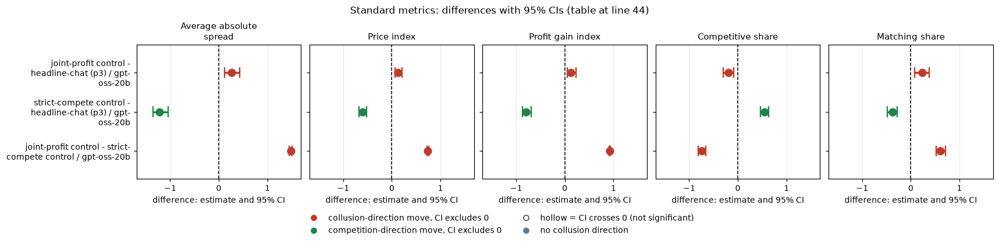
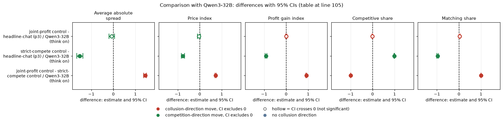

# Controls on gpt-oss-20b: do the joint-profit and strict-compete controls bracket the headline game?

*Model: gpt-oss-20b, reasoning effort medium (no thinking-off mode exists). Tier t1, neutral payoff examples, penalty point 3 (p3), private chat.*

## Verdict

Both controls work on gpt-oss-20b. Told to quote the competitive price, the firms drop to the floor (price index 0.005); told to maximise joint profit, they sit high (price index 0.744, profit gain index 0.93), so the measurements separate competition from collusion. The ordinary private-chat game (headline-chat, p3) sits close to, but clearly below, the joint-profit control: about 82% of the way from the floor to the joint-profit level on the price index (0.613), with the joint-profit control higher by +0.13 (95% CI +0.07 to +0.22). The gpt-oss joint-profit control also does not reach monopoly (average spread 2.49 against 3.00). All contrasts are exploratory; n = 20 pairs each. The second model's result on the same contrasts is in the final comparison section.

## Orientation for a new reader

Two LLM "market makers" quote a **half-spread** (a price) each round, in 0.01 **ticks**, from the **1.00 floor** (competitive, zero margin) to 5.00; **3.00** is the monopoly price, and the lowest quote wins 70% of customers. A regulator investigates more often at higher prices, and the penalty point (p1 light to p5 heavy; here p3) sets the fine. The **2.09 level** is the theory's collusive level at p3; this neutral run prints evenly spaced example prices, not 2.09. The **rival** is the other firm. **Controls** give both firms a replacement objective, as a check that the metrics can tell competition from collusion. The arm names `ctl-32b-compete` / `ctl-32b-joint` are historical; these games ran on gpt-oss-20b.

| Term | Meaning |
|---|---|
| half-spread | the quoted price, 1.00 to 5.00 |
| tick | 0.01, the smallest price step |
| 1.00 floor / 3.00 | competitive price / monopoly price |
| 2.09 level | theory's collusive level at p3; not printed in this neutral run |
| p3 | penalty point 3 |
| rival | the other firm |

## Arms

| Arm | Description |
|---|---|
| ctl-32b-joint: joint-profit control | positive control: both firms told to maximise the joint cumulative profit of all market makers (private chat, p3) |
| ctl-32b-compete: strict-compete control | negative control: both firms told their only objective is to quote exactly 1.00 (private chat, p3) |
| headline-chat: ordinary private-chat game | two firms, private chat before each round's quotes, no extra instruction (p3) |
| fx-ctl-joint: joint-profit control, formula payoff block | the joint-profit instruction with the formula payoff block (no printed example prices); exploratory extra only |

## Question and pairing

Where does headline chat sit between the two controls? 20 games per arm, none missing. Pairing is on (wording, seed), 20 pairs per contrast. Intervals are 95% percentile bootstraps over pairs (2000 draws, fixed seed). Exploratory: no pre-declared prediction on gpt-oss.

| Term | Meaning |
|---|---|
| pair | one (wording, seed) combination played in both arms |
| CI | 95% percentile bootstrap interval over pairs |

## Standard metrics

Each cell is the paired difference (first arm minus second) with its 95% CI; n = 20 pairs everywhere. Arm means are in `standard_metrics.csv`. Average absolute spread = mean market quote in raw units (1.00 to 5.00). Price index = (price - 1)/2 averaged over rounds (0 floor, 1 = monopoly 3.00). Profit gain index = (profit - competitive profit)/(monopoly - competitive profit). Competitive share = share of firm-rounds that undercut the rival's previous quote or sit at the floor against the floor (higher = more competitive). Matching share = share of firm-rounds that equal the rival's previous lowest quote above 1.00 (the coordination signature). The five are analysed separately.

| Contrast | Model | Average absolute spread | Price index | Profit gain index | Competitive share | Matching share |
|---|---|---|---|---|---|---|
| joint-profit control - headline-chat (p3) | gpt-oss-20b | +0.263 [+0.124, +0.433] | +0.132 [+0.065, +0.215] | +0.127 [+0.050, +0.230] | -0.191 [-0.304, -0.084] | +0.231 [+0.082, +0.377] |
| strict-compete control - headline-chat (p3) | gpt-oss-20b | -1.215 [-1.351, -1.041] | -0.607 [-0.675, -0.524] | -0.798 [-0.875, -0.695] | +0.550 [+0.461, +0.636] | -0.376 [-0.482, -0.286] |
| joint-profit control - strict-compete control | gpt-oss-20b | +1.478 [+1.444, +1.510] | +0.739 [+0.723, +0.755] | +0.925 [+0.909, +0.936] | -0.741 [-0.815, -0.661] | +0.607 [+0.516, +0.709] |

<!-- ci-forest:1 -->

*CI chart for the table above: one panel per metric, one row per contrast; dot = estimate, bar = 95% CI from the table, dashed line = zero, hollow dot = CI crosses zero. Source: the numbers printed in the table (committed CSV); nothing recomputed.*

<small>

**Reading the chart.** Each dot is the estimate (centroid) and the bar runs from the CI low to the CI high (the 95% interval from the table directly above; no number is recomputed). The dashed vertical line is zero (no difference). Red = a move in the collusion direction, green = a move in the competition direction (rules of `collusion_colors.direction`), blue-grey = the metric has no collusion direction. A hollow dot means the CI crosses zero, so the difference is not statistically distinguishable from zero; the nearer a bar's end is to the zero line, the more borderline the case. Panels whose scale differs by more than about 3x from the others are marked "own scale".

**Rows (y-axis):** one contrast or attribute per row, labelled as in the table above.

**Panels (x-axis = the difference in that metric):**

| Panel | Direction | Red means | Green means |
|---|---|---|---|
| Average absolute spread | higher = more collusive (on the red/green maps: red end) | metric goes up (more collusive) | metric goes down (less collusive) |
| Price index | higher = more collusive (on the red/green maps: red end) | metric goes up (more collusive) | metric goes down (less collusive) |
| Profit gain index | higher = more collusive (on the red/green maps: red end) | metric goes up (more collusive) | metric goes down (less collusive) |
| Competitive share | higher = more competitive (on the red/green maps: green end) | metric goes down (less competitive) | metric goes up (more competitive) |
| Matching share | higher = more collusive (on the red/green maps: red end) | metric goes up (more collusive) | metric goes down (less collusive) |

</small>
<!-- /ci-forest -->

Arm levels (mean over 20 games; `cell_means.csv`):

| Arm | Model | Spread | Price index | Profit gain | Competitive share | Matching share |
|---|---|---|---|---|---|---|
| joint-profit control | gpt-oss-20b | 2.489 | 0.744 | 0.932 | 0.249 | 0.607 |
| headline-chat p3 | gpt-oss-20b | 2.226 | 0.613 | 0.804 | 0.440 | 0.376 |
| strict-compete control | gpt-oss-20b | 1.011 | 0.005 | 0.007 | 0.990 | 0.000 |

| Term | Meaning |
|---|---|
| Average absolute spread | mean quote over a game's rounds, raw units |
| Price index | (price - 1)/2, 0 = floor, 1 = monopoly |
| Profit gain index | share of the competitive-to-monopoly profit gap earned |
| Competitive share | share of firm-rounds undercutting the rival or at floor-vs-floor |
| Matching share | share of firm-rounds matching the rival's previous lowest quote above 1.00 |

## Topic-specific measures

- Strict-compete control: mean quote 1.011; competitive share 0.990, so a few firm-rounds left the floor. None of 20 games ended on the regulator's evidence rule.
- Early endings by the evidence rule, joint / headline / compete: 7 / 4 / 0 of 20 (mean rounds played 11.35 / 13.15 / 15.25). Per-game indices for early-ending arms rest on fewer rounds.
- The joint-profit control is short of monopoly (spread 2.49 vs 3.00; price index 0.744 vs 1).
- Exploratory extra, fx-ctl-joint: joint-profit control, formula payoff block: spread 2.238 and price index 0.618; versus headline-chat p3 (20 pairs) spread +0.012 [-0.232, +0.224], price index +0.006 [-0.110, +0.117], profit gain -0.039 [-0.164, +0.062], competitive share -0.257 [-0.341, -0.178], matching share +0.114 [+0.014, +0.209]. It differs from the standard joint control in its payoff block, so this is a separate descriptive comparison.

| Term | Meaning |
|---|---|
| evidence rule | the regulator ends a game early when enough evidence of high pricing accumulates |

## Empty-talk sensitivity

Mean `empty_talk_done_count` (talk turns whose empty reply was read as "done") per game: joint-profit control 0.55 (7 of 20 games above 0), headline-chat 0.40 (6 of 20), strict-compete 0.10 (2 of 20). Dropping games with count > 0 (`empty_talk_sensitivity.csv`): joint - headline falls to 9 pairs, spread +0.124 [+0.005, +0.273], price index +0.062 [+0.002, +0.130], profit gain +0.046 [+0.002, +0.103], competitive share -0.118 [-0.284, +0.024], matching share +0.133 [-0.068, +0.337]. The sign is the same but the gap roughly halves and two intervals now include zero (n = 9 pairs). Strict-compete - headline (13 pairs) and joint - strict-compete (12 pairs) are essentially unchanged (spread -1.349 and +1.475). So "joint control above headline chat" is modest and sensitive to the empty-talk games.

| Term | Meaning |
|---|---|
| empty_talk_done_count | talk turns whose empty reply was read as "done" (a covariate) |

## Limits

20 pairs per contrast. One model, one penalty point, one payoff-block family (neutral); one run per arm (no replicate of the controls). The fx-ctl-joint check is not matched on the payoff block.

## Sub-questions addressed

Evaluation design and 2.3 (what counts as convincing evidence): both controls move behaviour in the required direction on gpt-oss, so a high or low price in this game is readable. Headline chat sitting near but below the positive control is a calibration for 1.1 (how much collusion a plain chat produces relative to an instructed ceiling).

| Term | Meaning |
|---|---|
| 1.1 / 2.3 | research sub-questions: necessary variables for collusion / what counts as convincing evidence |

## Comparison with Qwen3-32B

How the second model compares. Qwen3-32B was run with thinking ON, on the neutral run, same arms and pairing, 20 pairs. gpt-oss medium reasoning effort is compared with Qwen thinking on; these are not the same axis. Magnitudes are confounded with baseline level: Qwen headline chat already sits at the joint-profit level, so its contrasts are bounded by ceilings and floors that gpt-oss does not hit.

Headline result: where gpt-oss headline chat sits clearly below the joint-profit control, Qwen3-32B headline chat is indistinguishable from it (price index -0.04, CI -0.10 to +0.02). The Qwen joint-profit control also does not reach monopoly in spread terms (2.450).

Paired contrasts (first arm minus second, 95% CI, n = 20 pairs; legend as in the Standard metrics section above):

| Contrast | Model | Average absolute spread | Price index | Profit gain index | Competitive share | Matching share |
|---|---|---|---|---|---|---|
| joint-profit control - headline-chat (p3) | Qwen3-32B (think on) | -0.080 [-0.195, +0.048] | -0.040 [-0.100, +0.023] | +0.002 [-0.024, +0.033] | -0.011 [-0.028, 0.000] | +0.027 [0.000, +0.061] |
| strict-compete control - headline-chat (p3) | Qwen3-32B (think on) | -1.530 [-1.665, -1.383] | -0.765 [-0.838, -0.692] | -0.916 [-0.951, -0.875] | +0.989 [+0.972, +1.000] | -0.971 [-1.000, -0.936] |
| joint-profit control - strict-compete control | Qwen3-32B (think on) | +1.450 [+1.375, +1.500] | +0.725 [+0.688, +0.750] | +0.919 [+0.891, +0.938] | -1.000 [-1.000, -1.000] | +0.999 [+0.996, +1.000] |

<!-- ci-forest:2 -->

*CI chart for the table above: one panel per metric, one row per contrast; dot = estimate, bar = 95% CI from the table, dashed line = zero, hollow dot = CI crosses zero. Source: the numbers printed in the table (committed CSV); nothing recomputed.*

<small>

**Reading the chart.** Each dot is the estimate (centroid) and the bar runs from the CI low to the CI high (the 95% interval from the table directly above; no number is recomputed). The dashed vertical line is zero (no difference). Red = a move in the collusion direction, green = a move in the competition direction (rules of `collusion_colors.direction`), blue-grey = the metric has no collusion direction. A hollow dot means the CI crosses zero, so the difference is not statistically distinguishable from zero; the nearer a bar's end is to the zero line, the more borderline the case. Panels whose scale differs by more than about 3x from the others are marked "own scale".

**Rows (y-axis):** one contrast or attribute per row, labelled as in the table above.

**Panels (x-axis = the difference in that metric):**

| Panel | Direction | Red means | Green means |
|---|---|---|---|
| Average absolute spread | higher = more collusive (on the red/green maps: red end) | metric goes up (more collusive) | metric goes down (less collusive) |
| Price index | higher = more collusive (on the red/green maps: red end) | metric goes up (more collusive) | metric goes down (less collusive) |
| Profit gain index | higher = more collusive (on the red/green maps: red end) | metric goes up (more collusive) | metric goes down (less collusive) |
| Competitive share | higher = more competitive (on the red/green maps: green end) | metric goes down (less competitive) | metric goes up (more competitive) |
| Matching share | higher = more collusive (on the red/green maps: red end) | metric goes up (more collusive) | metric goes down (less collusive) |

</small>
<!-- /ci-forest -->

Arm levels (mean over 20 games):

| Arm | Model | Spread | Price index | Profit gain | Competitive share | Matching share |
|---|---|---|---|---|---|---|
| joint-profit control | Qwen3-32B | 2.450 | 0.725 | 0.919 | 0.000 | 0.999 |
| headline-chat p3 | Qwen3-32B | 2.530 | 0.765 | 0.916 | 0.011 | 0.971 |
| strict-compete control | Qwen3-32B | 1.000 | 0.000 | 0.000 | 1.000 | 0.000 |

| Term | Meaning |
|---|---|
| Average absolute spread | mean quote over a game's rounds, raw units |
| Price index | (price - 1)/2, 0 = floor, 1 = monopoly |
| Profit gain index | share of the competitive-to-monopoly profit gap earned |
| Competitive share | share of firm-rounds undercutting the rival or at floor-vs-floor |
| Matching share | share of firm-rounds matching the rival's previous lowest quote above 1.00 |

**Replicates?** (gpt-oss vs Qwen thinking on)
- joint-profit control - strict-compete control: sign same on all five metrics; magnitude similar on spread, price index and profit gain; smaller on competitive share and matching share (Qwen is pinned at the ceilings 0 and 1, gpt-oss is not).
- strict-compete control - headline-chat: sign same; magnitude somewhat smaller on spread, price index and profit gain; smaller on competitive share (+0.55 vs +0.99) and matching share (-0.38 vs -0.97), because gpt-oss headline chat is far less matched and more competitive than Qwen's.
- joint-profit control - headline-chat: NOT replicated. Sign opposite on spread and price index (gpt-oss positive with CI excluding 0; Qwen slightly negative with CI including 0); same sign but larger on profit gain, competitive share and matching share.

Other Qwen notes:
- Strict-compete control: Qwen mean quote exactly 1.00, so it has no variance and its CIs sit at the ceiling.
- Early endings by the evidence rule, joint / headline / compete: Qwen 7 / 8 / 0 of 20.
- No Qwen analogue was computed for the fx-ctl-joint exploratory extra.

Files: standard_metrics.csv, cell_means.csv, empty_talk_sensitivity.csv, controls_oss.py.

Created by Claude at the prompting of the repository owner.
