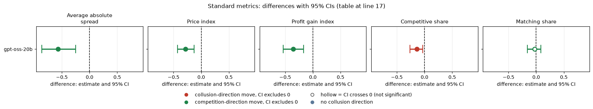
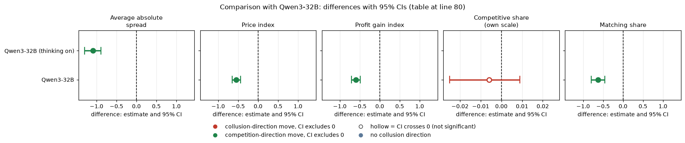

# 5-tick start on gpt-oss-20b: does capping round 1 near the floor lower prices for the whole game?

Model: gpt-oss-20b, reasoning effort medium (no thinking-off mode exists, so there is no t0/t1 contrast). Created by Claude at the prompting of the repository owner. Code: `analyze.py`. Data: the frozen t1 tier (`run.csv` and the per-round `rounds.csv`).

## Verdict

Forcing both firms to quote between 1.00 and 1.05 in round 1 lowers gpt-oss prices over the whole game: price index -0.29 [-0.43, -0.13], 20 pairs. Round 1 itself is 0.01 against 0.52 in the control. The effect fades with time: -0.28 in rounds 2-5, -0.20 [-0.37, -0.04] in rounds 5+, and -0.22 [-0.45, +0.02] in rounds 10+ (13 pairs, CI touches zero). The mechanism is not a drop in matching: matching is unchanged (-0.03 [-0.16, +0.09]) and the competitive share falls (-0.14 [-0.26, -0.03]). The gpt-oss control is itself fairly collusive (price index 0.61), so there is room for the cap to act.

## Orientation

Two LLM market makers quote a half-spread each round (1.00 to 5.00, ticks of 0.01). 1.00 is the competitive floor and 3.00 the monopoly price; the lower quote wins 70% of customers; a regulator may investigate more often at higher prices (penalty point p3 here). The rival is the other firm. In the 5-tick-start arm the briefing says, and the engine enforces, that in round 1 only each quote must lie between 1.00 and 1.05. The control is headline-chat at p3 (private chat, no cap). Question [sub-question 1.5, the single restriction that removes the most collusion]: does a one-round cap near the floor have a lasting effect? Contrast: start-5tick minus headline-chat, both p3, paired on (wording, seed), 20 pairs. Declared (carried over from the earlier Qwen study); the by-round-window split is exploratory.

## Standard metrics

Paired difference, arm minus control, 95% percentile bootstrap CI (2000 draws, fixed seed), over the pairs. Average absolute spread is the mean quote in raw units (1.00 to 5.00); price index = (price - 1)/2; profit gain index = (profit - competitive)/(monopoly - competitive); competitive share = share of firm-rounds undercutting the rival's last quote or both at 1.00 (higher = less collusive); matching share = share of firm-rounds matching the rival's last quote above 1.00.

| metric | model | n pairs | 5-tick | control | diff [95% CI] |
|---|---|---|---|---|---|
| Average absolute spread | gpt-oss-20b | 20 | 1.655 | 2.226 | -0.571 [-0.860, -0.250] |
| Price index | gpt-oss-20b | 20 | 0.327 | 0.613 | -0.285 [-0.428, -0.126] |
| Profit gain index | gpt-oss-20b | 20 | 0.446 | 0.804 | -0.358 [-0.537, -0.169] |
| Competitive share | gpt-oss-20b | 20 | 0.300 | 0.440 | -0.140 [-0.264, -0.030] |
| Matching share | gpt-oss-20b | 20 | 0.347 | 0.376 | -0.029 [-0.158, +0.086] |

<!-- ci-forest:1 -->

*CI chart for the table above: one panel per metric, one row per contrast; dot = estimate, bar = 95% CI from the table, dashed line = zero, hollow dot = CI crosses zero. Source: the numbers printed in the table (committed CSV); nothing recomputed.*

<small>

**Reading the chart.** Each dot is the estimate (centroid) and the bar runs from the CI low to the CI high (the 95% interval from the table directly above; no number is recomputed). The dashed vertical line is zero (no difference). Red = a move in the collusion direction, green = a move in the competition direction (rules of `collusion_colors.direction`), blue-grey = the metric has no collusion direction. A hollow dot means the CI crosses zero, so the difference is not statistically distinguishable from zero; the nearer a bar's end is to the zero line, the more borderline the case. Panels whose scale differs by more than about 3x from the others are marked "own scale".

**Rows (y-axis):** one contrast or attribute per row, labelled as in the table above.

**Panels (x-axis = the difference in that metric):**

| Panel | Direction | Red means | Green means |
|---|---|---|---|
| Average absolute spread | higher = more collusive (on the red/green maps: red end) | metric goes up (more collusive) | metric goes down (less collusive) |
| Price index | higher = more collusive (on the red/green maps: red end) | metric goes up (more collusive) | metric goes down (less collusive) |
| Profit gain index | higher = more collusive (on the red/green maps: red end) | metric goes up (more collusive) | metric goes down (less collusive) |
| Competitive share | higher = more competitive (on the red/green maps: green end) | metric goes down (less competitive) | metric goes up (more competitive) |
| Matching share | higher = more collusive (on the red/green maps: red end) | metric goes up (more collusive) | metric goes down (less collusive) |

</small>
<!-- /ci-forest -->

Rows are in `standard_metrics.csv`.

<small>

| Term | Meaning |
|---|---|
| diff | 5-tick minus control per (wording, seed) pair, averaged |
| n pairs | pairs entering the difference (5 wordings x 4 seeds = 20 possible) |

</small>

## By round window (price index, gpt-oss; `windows.csv`)

| window | n pairs | 5-tick | control | diff [95% CI] |
|---|---|---|---|---|
| round 1 only | 20 | 0.011 | 0.525 | -0.514 [-0.617, -0.396] |
| all rounds | 20 | 0.327 | 0.613 | -0.285 [-0.430, -0.125] |
| excluding round 1 | 20 | 0.360 | 0.619 | -0.259 [-0.411, -0.098] |
| rounds 2-5 | 20 | 0.303 | 0.586 | -0.283 [-0.448, -0.107] |
| rounds 5+ | 19 | 0.415 | 0.619 | -0.204 [-0.371, -0.038] |
| rounds 10+ | 13 | 0.380 | 0.600 | -0.220 [-0.445, +0.022] |

<!-- ci-forest:2 -->

*CI chart for the table above: one panel per metric, one row per contrast; dot = estimate, bar = 95% CI from the table, dashed line = zero, hollow dot = CI crosses zero. Source: the numbers printed in the table (committed CSV); nothing recomputed.*

<small>

**Reading the chart.** Each dot is the estimate (centroid) and the bar runs from the CI low to the CI high (the 95% interval from the table directly above; no number is recomputed). The dashed vertical line is zero (no difference). Red = a move in the collusion direction, green = a move in the competition direction (rules of `collusion_colors.direction`), blue-grey = the metric has no collusion direction. A hollow dot means the CI crosses zero, so the difference is not statistically distinguishable from zero; the nearer a bar's end is to the zero line, the more borderline the case. Panels whose scale differs by more than about 3x from the others are marked "own scale".

**Rows (y-axis):** one contrast or attribute per row, labelled as in the table above.

**Panels (x-axis = the difference in that metric):**

| Panel | Direction | Red means | Green means |
|---|---|---|---|
| diff [95% CI] | no collusion direction (neutral hue) | none (blue-grey: no collusion direction) | none (blue-grey: no collusion direction) |

</small>
<!-- /ci-forest -->

<small>

| Term | Meaning |
|---|---|
| window | the rounds averaged; a pair enters a window only if both games reached it |
| diff | 5-tick minus control per (wording, seed) pair, averaged, with 95% bootstrap CI |

</small>

A pair enters a window only if both games reached it. Reading: the cap is carried forward (round 2 is 0.22 against 0.57), then the 5-tick games climb (0.22 in round 2, 0.38 in round 5) while the control stays near 0.55 to 0.62, so the gap shrinks from about -0.35 to about -0.2 but does not close within the game. The rounds 10+ interval touches zero on only 13 pairs, so the late persistence is not established. Climb-back (`climb_back.csv`): 60% of 5-tick games ever reach a market price index of 0.5 (price 2.00) after round 1 against 85% of controls; none reaches 0.8 in either arm. Mean per-game peak after round 1: 0.48 against 0.68. `paths_by_round.csv` has the full path.

## Empty-talk sensitivity

empty_talk_done_count (talk turns whose empty reply was read as 'done'): mean 0.85 in the 5-tick arm (10 of 20 games above zero) and 0.40 in the control (6 of 20). Keeping only pairs where both games have count 0 (9 pairs; `sensitivity_empty_talk.csv`): price index -0.264 [-0.407, -0.128], spread -0.529, profit gain -0.334, competitive share -0.111 [-0.292, +0.048], matching -0.106 [-0.313, +0.046]. The headline effect is unchanged in size and sign; the competitive-share effect becomes imprecise.

## Limits

Twenty pairs, so the minimum detectable price-index effect is about 0.15 to 0.25; the late-round windows have 13 to 19 pairs and games end early, so the later-round averages come from fewer games and mix game composition with price change. The empty-talk covariate is unbalanced (more in the 5-tick arm). One cell for this model; the cap text may cue gpt-oss in a particular way (a competitive-share fall without a matching fall means firms undercut each other less often but do not copy more). Not a claim about any trait of the model. No bug-replicate pooling applies: the replicate arms sit at p1 and p5, not p3.

## Sub-questions

1.5 (a cheap restriction): the 5-tick start lowers gpt-oss prices, with partial erosion over the game. 3.1 (what carries coordination): matching share is not what moves on gpt-oss.

## Comparison with Qwen3-32B

How the second model compares. Qwen3-32B is run with thinking ON; gpt-oss runs at medium reasoning effort, so these are two different settings and not the same axis. The comparison is with Qwen thinking on only. Magnitudes are confounded with baseline level: the Qwen control is more collusive than the gpt-oss one (price index 0.77 against 0.61), so there is more room for a cap to act.

Same sign, different size. The gpt-oss effect is about half the Qwen effect (-0.55). The sign replicates Qwen; the magnitude is smaller.

The mechanism differs: on Qwen the cap collapses matching (-0.62), while on gpt-oss matching is unchanged and the competitive share falls.

Qwen rows of the standard-metrics table (the gpt-oss rows are in the body above), with the "replicates?" verdict on each metric:

| metric | model | n pairs | 5-tick | control | diff [95% CI] | replicates? |
|---|---|---|---|---|---|---|
| Average absolute spread | Qwen3-32B (thinking on) | 20 | 1.438 | 2.530 | -1.093 [-1.296, -0.890] | sign same, magnitude smaller (about half) |
| Price index | Qwen3-32B | 20 | 0.219 | 0.765 | -0.546 [-0.650, -0.443] | sign same, smaller |
| Profit gain index | Qwen3-32B | 20 | 0.318 | 0.916 | -0.599 [-0.709, -0.490] | sign same, smaller |
| Competitive share | Qwen3-32B | 20 | 0.005 | 0.011 | -0.006 [-0.025, +0.009] | not comparable: Qwen is at the floor (0.005 vs 0.011), difference about 0 |
| Matching share | Qwen3-32B | 20 | 0.348 | 0.971 | -0.624 [-0.791, -0.459] | opposite/unclear: Qwen -0.62, gpt-oss about 0 (CI spans zero) |

<!-- ci-forest:3 -->

*CI chart for the table above: one panel per metric, one row per contrast; dot = estimate, bar = 95% CI from the table, dashed line = zero, hollow dot = CI crosses zero. Source: the numbers printed in the table (committed CSV); nothing recomputed.*

<small>

**Reading the chart.** Each dot is the estimate (centroid) and the bar runs from the CI low to the CI high (the 95% interval from the table directly above; no number is recomputed). The dashed vertical line is zero (no difference). Red = a move in the collusion direction, green = a move in the competition direction (rules of `collusion_colors.direction`), blue-grey = the metric has no collusion direction. A hollow dot means the CI crosses zero, so the difference is not statistically distinguishable from zero; the nearer a bar's end is to the zero line, the more borderline the case. Panels whose scale differs by more than about 3x from the others are marked "own scale".

**Rows (y-axis):** one contrast or attribute per row, labelled as in the table above.

**Panels (x-axis = the difference in that metric):**

| Panel | Direction | Red means | Green means |
|---|---|---|---|
| Average absolute spread | higher = more collusive (on the red/green maps: red end) | metric goes up (more collusive) | metric goes down (less collusive) |
| Price index | higher = more collusive (on the red/green maps: red end) | metric goes up (more collusive) | metric goes down (less collusive) |
| Profit gain index | higher = more collusive (on the red/green maps: red end) | metric goes up (more collusive) | metric goes down (less collusive) |
| Competitive share | higher = more competitive (on the red/green maps: green end) | metric goes down (less competitive) | metric goes up (more competitive) |
| Matching share | higher = more collusive (on the red/green maps: red end) | metric goes up (more collusive) | metric goes down (less collusive) |

</small>
<!-- /ci-forest -->

Both models' CIs here use the same bootstrap helper, so the Qwen CIs differ slightly (third decimal) from the Qwen ad-hoc report. Qwen window numbers below are quoted from that report. Rows are in `standard_metrics.csv`.

| window (price index) | Qwen (on) diff |
|---|---|
| round 1 only | n/a (mechanical) |
| all rounds | -0.564 |
| excluding round 1 | -0.554 |
| rounds 2-5 | n/a |
| rounds 5+ | -0.477 |
| rounds 10+ | -0.391 |

<small>

| Term | Meaning |
|---|---|
| diff | 5-tick minus control per (wording, seed) pair, averaged |
| n pairs | pairs entering the difference (5 wordings x 4 seeds = 20 possible) |
| replicates? | same sign / magnitude relative to Qwen thinking on |
| Qwen (on) diff | the same window difference for Qwen3-32B with thinking ON, quoted from the Qwen ad-hoc report; the matching gpt-oss window differences are in the body table |

</small>

Cross-model limit: one cell per model, so a difference in mechanism (matching collapse on Qwen, a competitive-share fall on gpt-oss) may reflect how each model reads the cap text rather than anything about the models themselves.

Sub-question reading: 1.5 (a cheap restriction): the 5-tick start lowers prices on both models, but on gpt-oss about half as much as on Qwen and with partial erosion. 3.1 (what carries coordination): matching share moves on Qwen but not on gpt-oss.
