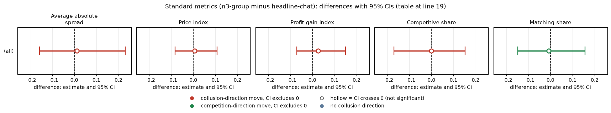
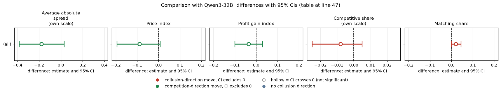

# Market structure on gpt-oss-20b: does a third firm change prices?

**Verdict.** On gpt-oss-20b (reasoning effort medium), adding a third firm to the two-firm market changed nothing detectable: price index +0.006 [-0.083, 0.107], 18 pairs (a bound of about +/-0.1). The interval is centred near zero and rules out large effects in either direction, so there is no evidence that group size matters at these sizes, and no evidence that a third firm breaks collusion. This is an exploratory contrast (sub-questions 1.1 and 1.2).

## Orientation
Firms quote a half-spread each round (1.00 competitive floor to 5.00; 3.00 monopoly; 2.09 the theory's sustainable collusive level at penalty point 3, never printed in the neutral run). The lowest quote wins 70% of customers; a tick is 0.01; games here have a planned 15 rounds. Rivals are the other firms in the game. gpt-oss has only reasoning effort medium.

## Question, arms, pairing
Paired on (wording, seed), exploratory (1.1, 1.2).

| Arm | Description |
|---|---|
| n3-group: three firms, private group chat, no extra text | the three-firm arm, p3 |
| headline-chat: two firms, private chat, no extra text (control) | the p3 headline cell |

n = 18 pairs for gpt-oss: n3-group lost w0 s42 and w2 s133 (EmptyContent, not retried).

## Standard metrics (n3-group minus headline-chat)
| metric | gpt-oss-20b diff [CI] (arm / control) |
|---|---|
| Average absolute spread | +0.011 [-0.157, 0.230] (2.220 / 2.209) |
| Price index | +0.006 [-0.083, 0.107] (0.610 / 0.604) |
| Profit gain index | +0.026 [-0.071, 0.150] (0.820 / 0.794) |
| Competitive share | -0.001 [-0.169, 0.152] (0.436 / 0.437) |
| Matching share | -0.007 [-0.148, 0.156] (0.384 / 0.391) |

<!-- ci-forest:1 -->

*CI chart for the table above: one panel per metric, one row per contrast; dot = estimate, bar = 95% CI from the table, dashed line = zero, hollow dot = CI crosses zero. Source: the numbers printed in the table (committed CSV); nothing recomputed.*

<small>

**Reading the chart.** Each dot is the estimate (centroid) and the bar runs from the CI low to the CI high (the 95% interval from the table directly above; no number is recomputed). The dashed vertical line is zero (no difference). Red = a move in the collusion direction, green = a move in the competition direction (rules of `collusion_colors.direction`), blue-grey = the metric has no collusion direction. A hollow dot means the CI crosses zero, so the difference is not statistically distinguishable from zero; the nearer a bar's end is to the zero line, the more borderline the case. Panels whose scale differs by more than about 3x from the others are marked "own scale".

**Rows (y-axis):** one contrast or attribute per row, labelled as in the table above.

**Panels (x-axis = the difference in that metric):**

| Panel | Direction | Red means | Green means |
|---|---|---|---|
| Average absolute spread | higher = more collusive (on the red/green maps: red end) | metric goes up (more collusive) | metric goes down (less collusive) |
| Price index | higher = more collusive (on the red/green maps: red end) | metric goes up (more collusive) | metric goes down (less collusive) |
| Profit gain index | higher = more collusive (on the red/green maps: red end) | metric goes up (more collusive) | metric goes down (less collusive) |
| Competitive share | higher = more competitive (on the red/green maps: green end) | metric goes down (less competitive) | metric goes up (more competitive) |
| Matching share | higher = more collusive (on the red/green maps: red end) | metric goes up (more collusive) | metric goes down (less collusive) |

</small>
<!-- /ci-forest -->

Every metric is near zero with an interval spanning zero: spread, price index, profit gain, competitive share and matching share all show no clear difference between three firms and two.

| Term | Meaning |
|---|---|
| Average absolute spread, Price index, Profit gain index | mean half-spread; (price-1)/2; share of the way from competitive to monopoly profit |
| Competitive / matching share | share of firm-rounds undercutting or at the floor / matching the rival's previous quote above the floor |
| Pairing | (wording, seed) |

## Empty-talk covariate
Mean "done"-read empty talk count: two firms 0.40 (6 of 20 games), three firms 0.89 (8 of 18). Dropping pairs with count > 0 leaves 8 pairs (under 10: not a finding): price index -0.026 [-0.094, 0.017]. Three-firm games have more empty-talk turns, so the contrast is slightly confounded with chat length (about 19.6 vs 12.5 messages per round).

## Limits
MDE (80% power, price index) about 0.14 on gpt-oss. The null is a bound, not proof of equality. Rounds played are similar (12.7 vs 13.2 on gpt-oss).

## Sub-question
1.1 and 1.2: group size is not a necessary variable at these sizes; no evidence that a third firm breaks collusion on gpt-oss.

## Comparison with Qwen3-32B
How the second model compares. Qwen3-32B (thinking on) was run on the same contrast with 20 pairs. Its price index leans lower with three firms (-0.090 [-0.195, 0.008]), but its interval also touches zero, so neither model shows a clear market-size effect; the models are not shown to differ. gpt-oss medium reasoning effort is compared with Qwen thinking on; these are different settings, not the same axis, and magnitudes are confounded with each model's baseline level. MDE (80% power, price index) is about 0.15 on Qwen.

| metric | Qwen3-32B thinking on diff [CI] |
|---|---|
| Average absolute spread | -0.180 [-0.383, 0.030] |
| Price index | -0.090 [-0.195, 0.008] |
| Profit gain index | -0.035 [-0.099, 0.030] |
| Competitive share | -0.008 [-0.025, 0.005] |
| Matching share | +0.020 [0.000, 0.045] |

<!-- ci-forest:2 -->

*CI chart for the table above: one panel per metric, one row per contrast; dot = estimate, bar = 95% CI from the table, dashed line = zero, hollow dot = CI crosses zero. Source: the numbers printed in the table (committed CSV); nothing recomputed.*

<small>

**Reading the chart.** Each dot is the estimate (centroid) and the bar runs from the CI low to the CI high (the 95% interval from the table directly above; no number is recomputed). The dashed vertical line is zero (no difference). Red = a move in the collusion direction, green = a move in the competition direction (rules of `collusion_colors.direction`), blue-grey = the metric has no collusion direction. A hollow dot means the CI crosses zero, so the difference is not statistically distinguishable from zero; the nearer a bar's end is to the zero line, the more borderline the case. Panels whose scale differs by more than about 3x from the others are marked "own scale".

**Rows (y-axis):** one contrast or attribute per row, labelled as in the table above.

**Panels (x-axis = the difference in that metric):**

| Panel | Direction | Red means | Green means |
|---|---|---|---|
| Average absolute spread | higher = more collusive (on the red/green maps: red end) | metric goes up (more collusive) | metric goes down (less collusive) |
| Price index | higher = more collusive (on the red/green maps: red end) | metric goes up (more collusive) | metric goes down (less collusive) |
| Profit gain index | higher = more collusive (on the red/green maps: red end) | metric goes up (more collusive) | metric goes down (less collusive) |
| Competitive share | higher = more competitive (on the red/green maps: green end) | metric goes down (less competitive) | metric goes up (more competitive) |
| Matching share | higher = more collusive (on the red/green maps: red end) | metric goes up (more collusive) | metric goes down (less collusive) |

</small>
<!-- /ci-forest -->

Replicates? Price index and spread: sign unclear/opposite (gpt-oss about zero, Qwen negative), smaller on gpt-oss. Profit gain: unclear. Competitive and matching share: sign mixed, all near zero. Nothing is a clear difference between models.

| Term | Meaning |
|---|---|
| Average absolute spread, Price index, Profit gain index | mean half-spread; (price-1)/2; share of the way from competitive to monopoly profit |
| Competitive / matching share | share of firm-rounds undercutting or at the floor / matching the rival's previous quote above the floor |
| Pairing | (wording, seed) |

Created by Claude at the prompting of the repository owner.
