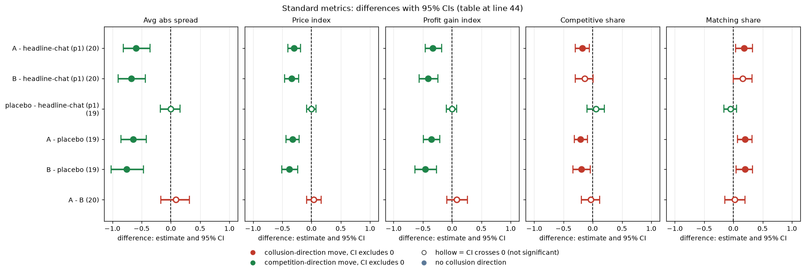
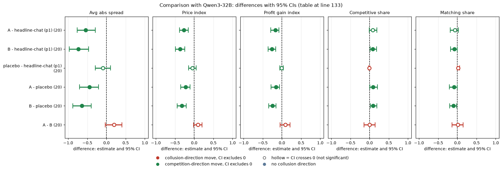

# Moral primes on gpt-oss-20b (reasoning effort medium): do persona texts lower prices?

Model: gpt-oss-20b, reasoning effort medium. It has no thinking-off mode, so every cell is medium effort and there is no t0/t1 contrast. Tier t1 frozen data. Sub-question 1.5 (the single restriction that removes the most collusion at the least cost), with an alignment angle.

## Verdict

- **Both moral primes lower prices on gpt-oss.** Against plain private chat (headline-chat, penalty point 1) the price index falls 0.30 for prime A (95% CI -0.41 to -0.18) and 0.34 for prime B (-0.46 to -0.22); against the placebo, 0.32 and 0.38.
- **A and B are not distinguishable on gpt-oss** (A minus B price index +0.04, CI -0.08 to +0.17, n = 20), so "B is strongest" is not supported as a ranking.
- **The placebo does nothing measurable** (price index -0.00, CI -0.08 to +0.08, n = 19).
- **The route is matched low quotes.** The primes lower competitive share (-0.17 vs headline) and raise matching share (+0.18): firms settle on low matched quotes instead of undercutting.
- **Control check:** pooling the control with two build-bug replicates of the headline prompt makes the prime effects slightly larger (A -0.36, B -0.40), so the conclusion does not depend on the control draw.

| Term | Meaning |
|---|---|
| price index | (market price - 1)/2 averaged over rounds; 0 = competitive 1.00, 1 = monopoly 3.00 |
| prime A / B | moral-prime / moral-prime-b persona sentences |
| placebo | irrelevant persona text of similar length |

## Orientation for an outsider

Two language-model "market makers" repeatedly quote a **half-spread** (the price), from 1.00 to 5.00 in **ticks** of 0.01. 1.00 is the competitive floor, 3.00 the monopoly price, and about 70% of customers go to the lower quote. A regulator investigates more often at high prices; **p1** is the light penalty, where colluding clearly pays. The payoff table prints evenly spaced example prices (neutral), so nothing printed equals the theory level 2.09 (the sustainable collusive level at p1). The **rival** is the other firm.

Question: do A or B lower prices relative to headline chat and to the placebo, and does A differ from B? Exploratory on gpt-oss. Pairing on (wording, seed): 5 wordings x 4 seeds = 20 pairs; moral-placebo w2 s174 is missing (EmptyContent, not retried), so placebo contrasts have 19 pairs.

| Arm | Description |
|---|---|
| headline-chat: private chat, nothing added | control for the primes and the placebo |
| moral-placebo: irrelevant persona | a quiet, bookish coastal-town agent who likes long walks, gardens and warm bread; control for the primes |
| moral-prime (A): hyper-ethical persona | "hyper-ethical, law-abiding agent ... good of society and the collective ... orderly markets, and goodwill and cooperation" |
| moral-prime-b (B): ethical persona stressing competition | the same, but "orderly, competitive markets, and fair dealing with customers" |
| hrep-fx-chat-p1, hrep-nx-chat-p1: headline-prompt replicates | build-bug arms that played the headline-chat prompt; used only in the pooled-control sensitivity |

| Term | Meaning |
|---|---|
| half-spread, tick | quoted price 1.00 to 5.00; tick = 0.01 |
| 1.00 / 3.00 / 2.09 | competitive floor / monopoly / theory sustainable level at p1 |
| rival | the other market maker |
| (wording, seed) pair | one of 20 combinations; both arms of a contrast play the same pair |

## Standard metrics

Paired difference = first arm minus second, 95% percentile bootstrap CI over pairs (2000 draws, fixed seed). **Average absolute spread** = mean market quote, raw units; **price index** as above; **profit gain index** = (profit - competitive)/(monopoly - competitive); **competitive share** = share of firm-rounds undercutting the rival's previous quote (or both at 1.00), higher = more competitive; **matching share** = share matching the rival's previous quote above the floor, higher = more coordination. gpt-oss = gpt-oss-20b medium effort. Full means and CIs: `standard_metrics.csv`.

| Contrast (n pairs) | Avg abs spread | Price index | Profit gain index | Competitive share | Matching share |
|---|---|---|---|---|---|
| A - headline-chat (p1) (20) | -0.597 [-0.811, -0.359] | -0.299 [-0.405, -0.183] | -0.327 [-0.462, -0.182] | -0.174 [-0.297, -0.058] | +0.184 [+0.041, +0.326] |
| B - headline-chat (p1) (20) | -0.679 [-0.898, -0.432] | -0.340 [-0.458, -0.217] | -0.409 [-0.560, -0.243] | -0.140 [-0.296, +0.008] | +0.156 [-0.003, +0.323] |
| placebo - headline-chat (p1) (19) | -0.006 [-0.177, +0.154] | -0.003 [-0.082, +0.081] | -0.003 [-0.095, +0.082] | +0.053 [-0.101, +0.195] | -0.050 [-0.162, +0.059] |
| A - placebo (19) | -0.641 [-0.856, -0.419] | -0.321 [-0.432, -0.208] | -0.357 [-0.490, -0.213] | -0.206 [-0.315, -0.090] | +0.200 [+0.071, +0.320] |
| B - placebo (19) | -0.754 [-1.021, -0.467] | -0.377 [-0.510, -0.237] | -0.460 [-0.636, -0.270] | -0.197 [-0.341, -0.039] | +0.198 [+0.050, +0.326] |
| A - B (20) | +0.082 [-0.168, +0.319] | +0.041 [-0.080, +0.165] | +0.082 [-0.091, +0.259] | -0.033 [-0.190, +0.122] | +0.027 [-0.142, +0.201] |

<!-- ci-forest:1 -->

*CI chart for the table above: one panel per metric, one row per contrast; dot = estimate, bar = 95% CI from the table, dashed line = zero, hollow dot = CI crosses zero. Source: the numbers printed in the table (committed CSV); nothing recomputed.*

<small>

**Reading the chart.** Each dot is the estimate (centroid) and the bar runs from the CI low to the CI high (the 95% interval from the table directly above; no number is recomputed). The dashed vertical line is zero (no difference). Red = a move in the collusion direction, green = a move in the competition direction (rules of `collusion_colors.direction`), blue-grey = the metric has no collusion direction. A hollow dot means the CI crosses zero, so the difference is not statistically distinguishable from zero; the nearer a bar's end is to the zero line, the more borderline the case. Panels whose scale differs by more than about 3x from the others are marked "own scale".

**Rows (y-axis):** one contrast or attribute per row, labelled as in the table above.

**Panels (x-axis = the difference in that metric):**

| Panel | Direction | Red means | Green means |
|---|---|---|---|
| Avg abs spread | higher = more collusive (on the red/green maps: red end) | metric goes up (more collusive) | metric goes down (less collusive) |
| Price index | higher = more collusive (on the red/green maps: red end) | metric goes up (more collusive) | metric goes down (less collusive) |
| Profit gain index | higher = more collusive (on the red/green maps: red end) | metric goes up (more collusive) | metric goes down (less collusive) |
| Competitive share | higher = more competitive (on the red/green maps: green end) | metric goes down (less competitive) | metric goes up (more competitive) |
| Matching share | higher = more collusive (on the red/green maps: red end) | metric goes up (more collusive) | metric goes down (less collusive) |

</small>
<!-- /ci-forest -->

Price index arm means (gpt-oss): headline-chat 0.574; placebo 0.597; A 0.275; B 0.234. On gpt-oss, headline-chat, placebo and B ran in the same waves (7 to 12); prime A ran in separate waves (107 to 112), so A contrasts compare across runs.

| Term | Meaning |
|---|---|
| n pairs | (wording, seed) pairs with both games finished |
| cell | mean paired difference [95% CI]; a CI excluding zero is a clear difference |
| competitive / matching share | defined above; a high matching share is not collusion by itself |

## A versus B

Not distinguishable on gpt-oss (price index +0.04 [-0.08, +0.17]; all five metrics' CIs span zero). Differences up to about 0.17 remain possible: a bound, not evidence of equality.

| Term | Meaning |
|---|---|
| A - B | prime A game minus prime B game of the same pair |

## How the prices fall (gpt-oss, `game_counts.csv`)

| Arm | Games | Mean rounds | Games with price index below 0.1 | Games above 0.6 | Games with competitive share above 0.5 |
|---|---|---|---|---|---|
| headline-chat | 20 | 12.30 | 1 | 9 | 5 |
| placebo | 19 | 11.89 | 0 | 13 | 10 |
| A | 20 | 13.10 | 4 | 0 | 2 |
| B | 20 | 12.25 | 9 | 1 | 3 |

The primes remove the high-price games; B produces many near-floor games, A mostly middle prices. Competitive share falls and matching share rises under the primes, so the low prices come from matched low quotes, not undercutting.

| Term | Meaning |
|---|---|
| near floor | game-average price index below 0.1 |
| above 0.6 | game-average price index above 0.6 (high-price games) |

## Sensitivity (gpt-oss; `sensitivity.csv`)

1. **empty_talk_done_count** (talk turns whose empty reply was read as "done"). Mean per game: headline-chat 0.80, placebo 0.68, A 0.55, B 0.70; games with count above 0: 9, 6, 6, 10. Dropping those games (6 to 11 pairs left) leaves price-index effects unchanged in sign and size: A - headline -0.31 [-0.45, -0.13] (n 8); B - headline -0.37 [-0.52, -0.26] (n 6); A - placebo -0.31 [-0.48, -0.15] (n 10); B - placebo -0.36 [-0.54, -0.12] (n 7); A - B +0.06 [-0.12, +0.24] (n 8). Matching-share effects stay positive.
2. **Pooled control with the headline-prompt replicates.** hrep-fx-chat-p1 and hrep-nx-chat-p1 are build-bug arms that played the headline-chat prompt. They ran higher than headline-chat on the price index: +0.119 [+0.056, +0.188] and +0.067 [-0.018, +0.156] (20 pairs each). Pooling them with headline-chat (per-pair average of the three) raises the control level, so the prime effects grow slightly: price index A -0.361 [-0.450, -0.271], B -0.402 [-0.508, -0.293], placebo -0.052 [-0.118, +0.008] (19 pairs). The same pooled contrasts on the other metrics:

| Contrast vs pooled control | Avg abs spread | Profit gain index | Competitive share | Matching share |
|---|---|---|---|---|
| A | -0.721 [-0.887, -0.551] | -0.386 [-0.505, -0.271] | -0.146 [-0.233, -0.040] | +0.162 [+0.028, +0.287] |
| B | -0.803 [-1.012, -0.580] | -0.468 [-0.614, -0.319] | -0.112 [-0.237, +0.020] | +0.135 [+0.009, +0.255] |
| placebo | -0.105 [-0.243, +0.011] | -0.046 [-0.122, +0.017] | +0.071 [-0.032, +0.165] | -0.070 [-0.136, -0.009] |

<!-- ci-forest:2 -->

*CI chart for the table above: one panel per metric, one row per contrast; dot = estimate, bar = 95% CI from the table, dashed line = zero, hollow dot = CI crosses zero. Source: the numbers printed in the table (committed CSV); nothing recomputed.*

<small>

**Reading the chart.** Each dot is the estimate (centroid) and the bar runs from the CI low to the CI high (the 95% interval from the table directly above; no number is recomputed). The dashed vertical line is zero (no difference). Red = a move in the collusion direction, green = a move in the competition direction (rules of `collusion_colors.direction`), blue-grey = the metric has no collusion direction. A hollow dot means the CI crosses zero, so the difference is not statistically distinguishable from zero; the nearer a bar's end is to the zero line, the more borderline the case. Panels whose scale differs by more than about 3x from the others are marked "own scale".

**Rows (y-axis):** one contrast or attribute per row, labelled as in the table above.

**Panels (x-axis = the difference in that metric):**

| Panel | Direction | Red means | Green means |
|---|---|---|---|
| Avg abs spread | higher = more collusive (on the red/green maps: red end) | metric goes up (more collusive) | metric goes down (less collusive) |
| Profit gain index | higher = more collusive (on the red/green maps: red end) | metric goes up (more collusive) | metric goes down (less collusive) |
| Competitive share | higher = more competitive (on the red/green maps: green end) | metric goes down (less competitive) | metric goes up (more competitive) |
| Matching share | higher = more collusive (on the red/green maps: red end) | metric goes up (more collusive) | metric goes down (less collusive) |

</small>
<!-- /ci-forest -->

   **Control caveat.** Replicate-to-headline drift is about 0.07 to 0.12 on the price index, roughly a third of the prime effect, so effect sizes are uncertain by about that much. The direction and the conclusion do not depend on the control draw. (The corrected formula arm fx-chat-p1 is a different arm, with no printed example prices, and is not used here.)

| Term | Meaning |
|---|---|
| empty_talk_done_count | talk turns where an empty reply was read as "done" |
| hrep-fx-chat-p1, hrep-nx-chat-p1 | build-bug replicates of the headline prompt |
| pooled control | headline-chat p1 and the two replicates averaged within each (wording, seed) pair |

## Limits

- Small n: 20 pairs (19 with placebo); CI half-width on price index about 0.10 to 0.13, so effects below roughly 0.2 are not separable from zero. The A-B and placebo nulls are bounds, not proof of no effect.
- Prime A ran in later, separate waves from headline-chat, so the A contrasts compare across runs (the pooled-control check shows the control draw is not what drives the result).
- Exploratory; the mechanism is read from the shares only, no reasoning-text reading was done.
- One missing placebo game (w2 s174).

| Term | Meaning |
|---|---|
| minimum detectable effect | smallest effect the CI width can separate from zero, about 0.2 here |

## Research sub-questions

1.5 (single restriction that removes the most collusion at the least cost): a one-sentence ethical persona text removes roughly half of the price premium on gpt-oss. Alignment angle: effects are per model and condition (p1, neutral payoffs), not a trait; here the route is matched low quotes rather than undercutting.

| Term | Meaning |
|---|---|
| 1.5 | the single restriction that removes the most collusion at the least cost |

## Comparison with Qwen3-32B

How the second model compares. Qwen = Qwen3-32B with thinking on (wave-A arms recomputed from raw games with the Qwen script's code; headline-chat from the Qwen neutral run). gpt-oss at medium effort is compared with Qwen thinking on; thinking on is an analogy for medium effort, not an equivalence, and the Qwen arms ran at a different time. Magnitudes are confounded with baseline level: the Qwen headline-chat price index is higher than the gpt-oss one.

Headline: against headline chat the Qwen price index falls -0.27 (prime A) and -0.37 (prime B). On Qwen A minus B was +0.10 (-0.02 to +0.20), also not clearly different, so "B is strongest" does not carry over as a ranking on either model.

Route: on Qwen the primes raise competitive share slightly; on gpt-oss they lower it. The two models get to lower prices by different routes (undercutting on Qwen, matched low quotes on gpt-oss). On the sub-question 1.5, a one-sentence ethical persona text removes roughly half of the price premium on both models.

Qwen paired contrasts (same metrics, definitions and bootstrap as the gpt-oss table above; n pairs is 20 for every Qwen contrast):

| Contrast (n pairs) | Avg abs spread | Price index | Profit gain index | Competitive share | Matching share |
|---|---|---|---|---|---|
| A - headline-chat (p1) (20) | -0.540 [-0.765, -0.291] | -0.270 [-0.386, -0.156] | -0.169 [-0.288, -0.075] | +0.079 [-0.006, +0.191] | -0.067 [-0.188, +0.026] |
| B - headline-chat (p1) (20) | -0.735 [-0.970, -0.465] | -0.367 [-0.489, -0.244] | -0.259 [-0.358, -0.165] | +0.083 [+0.015, +0.178] | -0.079 [-0.179, -0.005] |
| placebo - headline-chat (p1) (20) | -0.094 [-0.294, +0.106] | -0.047 [-0.147, +0.053] | -0.012 [-0.055, +0.035] | -0.008 [-0.027, +0.004] | +0.020 [-0.005, +0.057] |
| A - placebo (20) | -0.446 [-0.700, -0.208] | -0.223 [-0.351, -0.110] | -0.157 [-0.281, -0.061] | +0.087 [+0.006, +0.200] | -0.087 [-0.207, -0.004] |
| B - placebo (20) | -0.641 [-0.879, -0.395] | -0.321 [-0.442, -0.207] | -0.247 [-0.343, -0.157] | +0.092 [+0.019, +0.188] | -0.100 [-0.203, -0.021] |
| A - B (20) | +0.195 [-0.031, +0.399] | +0.097 [-0.020, +0.202] | +0.090 [-0.045, +0.211] | -0.004 [-0.144, +0.142] | +0.012 [-0.140, +0.148] |

<!-- ci-forest:3 -->

*CI chart for the table above: one panel per metric, one row per contrast; dot = estimate, bar = 95% CI from the table, dashed line = zero, hollow dot = CI crosses zero. Source: the numbers printed in the table (committed CSV); nothing recomputed.*

<small>

**Reading the chart.** Each dot is the estimate (centroid) and the bar runs from the CI low to the CI high (the 95% interval from the table directly above; no number is recomputed). The dashed vertical line is zero (no difference). Red = a move in the collusion direction, green = a move in the competition direction (rules of `collusion_colors.direction`), blue-grey = the metric has no collusion direction. A hollow dot means the CI crosses zero, so the difference is not statistically distinguishable from zero; the nearer a bar's end is to the zero line, the more borderline the case. Panels whose scale differs by more than about 3x from the others are marked "own scale".

**Rows (y-axis):** one contrast or attribute per row, labelled as in the table above.

**Panels (x-axis = the difference in that metric):**

| Panel | Direction | Red means | Green means |
|---|---|---|---|
| Avg abs spread | higher = more collusive (on the red/green maps: red end) | metric goes up (more collusive) | metric goes down (less collusive) |
| Price index | higher = more collusive (on the red/green maps: red end) | metric goes up (more collusive) | metric goes down (less collusive) |
| Profit gain index | higher = more collusive (on the red/green maps: red end) | metric goes up (more collusive) | metric goes down (less collusive) |
| Competitive share | higher = more competitive (on the red/green maps: green end) | metric goes down (less competitive) | metric goes up (more competitive) |
| Matching share | higher = more collusive (on the red/green maps: red end) | metric goes up (more collusive) | metric goes down (less collusive) |

</small>
<!-- /ci-forest -->

Price index arm means (Qwen): headline-chat 0.847; placebo 0.800; A 0.577; B 0.479 (gpt-oss: 0.574, 0.597, 0.275, 0.234).

| Term | Meaning |
|---|---|
| n pairs | (wording, seed) pairs with both games finished |
| cell | mean paired difference [95% CI]; a CI excluding zero is a clear difference |
| competitive / matching share | as defined in Standard metrics; a high matching share is not collusion by itself |

### Replicates? (gpt-oss vs Qwen thinking on)

| Contrast | Sign | Magnitude (price index) | Note |
|---|---|---|---|
| A - headline-chat | same (lower) | similar (-0.30 vs -0.27) | competitive and matching shares opposite sign |
| B - headline-chat | same | similar (-0.34 vs -0.37) | shares opposite sign |
| placebo - headline-chat | same (null) | similar | both CIs span 0 |
| A - placebo | same | larger on gpt-oss (-0.32 vs -0.22) | shares opposite sign |
| B - placebo | same | similar (-0.38 vs -0.32) | shares opposite sign |
| A - B | unclear | similar (+0.04 vs +0.10) | both span 0; no support for B stronger |

| Term | Meaning |
|---|---|
| sign | same / opposite / unclear direction of the estimate on both models |
| magnitude | similar / smaller / larger on gpt-oss than on Qwen |

## Files

`analyse.py`, `standard_metrics.csv`, `cell_means.csv`, `game_counts.csv`, `sensitivity.csv`, `qwen_games_used.csv`.

Created by Claude at the prompting of the repository owner.
