# Payoff-table focal points on gpt-oss-20b: do the printed numbers set the price level, and can the firms collude without them?

Model: gpt-oss-20b, reasoning effort medium (no thinking-off mode exists, so every cell is "medium"). Tier t1. Status: declared for the corrected formula / no-numbers contrasts (A to E); exploratory for the quote-share measures and the capability test (F to I). Script `focal_points_oss.py`; every number below is in a CSV in this folder.

## Verdict

**Printing example prices in the prompt sets the gpt-oss price level: taking them out lowers the price index in all five corrected cells, by 0.22 to 0.56 (every 95% interval excludes zero).** The manipulation is the payoff table in the prompt: the neutral (headline) prompt prints worked examples; the corrected arms print only the formula, or no payoff numbers at all. The share of gpt-oss quotes exactly on a printed value falls from 37-56% in the headline cells to 14-20% (formula only) and 4-6% (no numbers). gpt-oss follows the printed numbers loosely: headline-chat exact share is 40-56%, and 27-46% of its headline-chat quotes sit 1 to 3 ticks under a printed value (2.48 and 2.47 beside 2.49 and 2.50). What it loses without printed numbers is that shading around 2.49 and 2.50.

**Capability test: told to maximise joint profit with only the formula, gpt-oss reaches the level of its headline cell.** fx-ctl-joint cell mean price index 0.62 [0.49, 0.73] (average spread 2.24, n = 20), +0.34 [0.15, 0.52] above uninstructed formula chat, +0.01 [-0.11, 0.12] against headline chat p3, and -0.13 [-0.25, -0.02] below the joint-profit control with printed prices. Only 15% of its quotes are on a printed value (control 68%), so the high prices were computed. The low uninstructed formula prices therefore look like a disposition, not an inability. With 20 games per cell this is a bound, and the gap to the control is not robust to the empty-talk check in the sensitivity section. For sub-questions 1.1 and 2.1 and for evaluation design: report results with and without printed example prices. How the second model compares is in the last section.

## Orientation for a new reader

Two language-model "market makers" (the firms) each quote a **half-spread** (their price) every round, in steps of 0.01 (one **tick**), from 1.00 to 5.00. The lowest quote wins 70% of the customers. **1.00 is the competitive floor** (zero profit); **3.00 is the monopoly price**; **2.09 is the level theory says collusion could sustain at the lightest penalty** (the first, anchored run printed it and firms anchored on it, which is why this topic exists). The **rival** is the other firm. A regulator investigates more often at high prices; p1 is the lightest penalty and p5 the heaviest. Games last 7 to 20 rounds.

The prompt carries a payoff table. In the neutral (headline) prompt it prints worked examples at 1.00, 1.50, 2.00, 2.49, 2.50, 3.00, 3.50, 4.00. In the corrected arms nothing is printed or only the formula is.

| Term | Meaning |
|---|---|
| Half-spread / quote | The firm's price in a round |
| Tick | 0.01 |
| Exact on a printed value | Quote equals one of the eight printed examples |
| Within one tick | Exact, or one tick above or below a printed value (1.01 counts, as one tick above 1.00) |
| 1 to 3 ticks under | Not exact, but 0.01 to 0.03 below some printed value |
| Price index | (market price - 1) / 2, averaged over rounds: 0 competitive, 1 monopoly |
| Profit gain index | (profit - competitive profit) / (monopoly profit - competitive profit) |
| Competitive share | Share of scored rounds where a firm undercuts the rival's previous quote or both quote 1.00 |
| Matching share | Share of scored rounds where a firm matches the rival's previous quote above the floor |
| Average absolute spread | Mean winning quote |
| Control | The cell an arm is compared with |

## Question, arms, control and pairing

Question: how much of the price level comes from the printed example numbers, and can the firms collude when told to without them? Pairing is on (wording, seed): 5 wordings x 4 seeds = 20 pairs per cell (fx-chat-p1 has 19 games, one deterministic empty-reply failure at w4 s126, so 19 pairs). Intervals are 95% percentile bootstrap over pairs (2,000 draws, fixed seed).

| Arm label | Contrast letters |
|---|---|
| headline-chat / headline-tacit: neutral prompt, chat or no chat; example prices printed (the controls) | A to E controls |
| fx-chat-p1, fx-tacit-p1, fx-chat-p5: formula printed, no example prices (chat or tacit; penalty p1 or p5) | A, B, C |
| nx-chat-p1, nx-tacit-p1: no payoff numbers at all | D, E |
| ctl-32b-joint: told to maximise joint profit; example prices printed (p3; the name is historical, it ran on gpt-oss) | F control |
| fx-ctl-joint: told to maximise joint profit; formula, no example prices (p3) | F, G, H |

Contrasts: A fx-chat-p1 minus headline-chat p1; B fx-tacit-p1 minus headline-tacit p1; C fx-chat-p5 minus headline-chat p5; D nx-chat-p1 minus headline-chat p1; E nx-tacit-p1 minus headline-tacit p1; F fx-ctl-joint p3 minus ctl-32b-joint p3 (the capability test); G fx-ctl-joint p3 minus fx-chat-p1; H fx-ctl-joint p3 minus headline-chat p3; I fx-chat-p1 minus nx-chat-p1. A and D share their control games, as do B and E. The hrep-* cells (headline prompt run under the formula names, build bug) appear only in the sensitivity section.

## Cell means

Price index [95% CI over games], average absolute spread, n games.

| Cell | n | Price index | Avg spread |
|---|---|---|---|
| headline-chat p1 | 20 | 0.57 [0.48, 0.65] | 2.15 |
| headline-chat p3 | 20 | 0.61 [0.53, 0.68] | 2.23 |
| headline-chat p5 | 20 | 0.42 [0.34, 0.50] | 1.85 |
| headline-tacit p1 | 20 | 0.39 [0.29, 0.48] | 1.78 |
| headline-tacit p5 | 20 | 0.19 [0.11, 0.30] | 1.39 |
| fx-chat-p1 | 19 | 0.27 [0.14, 0.42] | 1.54 |
| fx-tacit-p1 | 20 | 0.17 [0.07, 0.28] | 1.33 |
| fx-chat-p5 | 20 | 0.06 [0.03, 0.09] | 1.11 |
| nx-chat-p1 | 20 | 0.02 [0.01, 0.03] | 1.03 |
| nx-tacit-p1 | 20 | 0.01 [0.01, 0.01] | 1.02 |
| ctl-32b-joint p3 | 20 | 0.74 [0.73, 0.76] | 2.49 |
| **fx-ctl-joint p3** | 20 | **0.62 [0.49, 0.73]** | 2.24 |

fx-ctl-joint also has profit gain 0.77, competitive share 0.18, matching share 0.49. All cell means, all five metrics, are in `cell_means.csv`.

*Terms: price index, spread and the other metrics as in the table above; CI = 95% bootstrap over games.*

## Standard metrics

Paired difference (arm minus control) on gpt-oss-20b (medium effort); the same rows are in `standard_metrics.csv`. n pairs: A 19, G 19, I 19, all others 20.

**Price index**

| Contrast | gpt-oss diff [95% CI] |
|---|---|
| A formula, chat, p1 | -0.30 [-0.43, -0.16] |
| B formula, tacit, p1 | -0.22 [-0.35, -0.09] |
| C formula, chat, p5 | -0.37 [-0.45, -0.29] |
| D no numbers, chat, p1 | -0.56 [-0.63, -0.46] |
| E no numbers, tacit, p1 | -0.38 [-0.47, -0.29] |
| F capability test | -0.13 [-0.25, -0.02] |
| G fx-ctl-joint minus fx-chat-p1 | +0.34 [0.15, 0.52] |
| H fx-ctl-joint minus headline-chat p3 | +0.01 [-0.11, 0.12] |
| I formula minus no numbers, chat | +0.25 [0.12, 0.40] |

<!-- ci-forest:1 -->
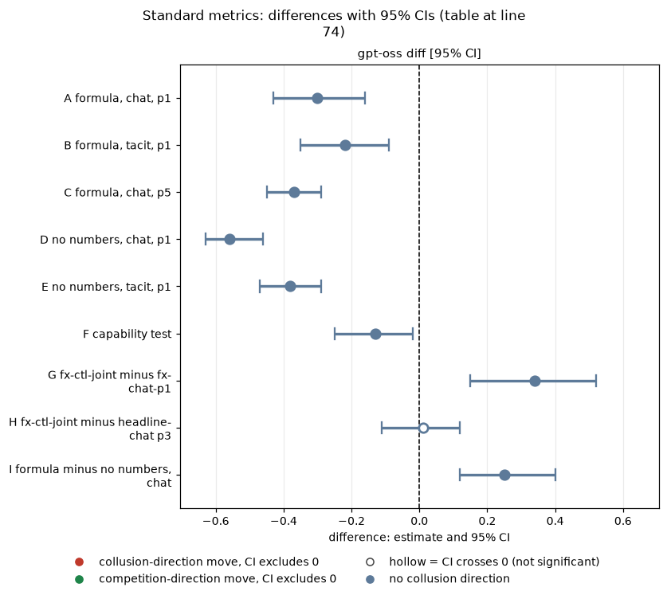

*CI chart for the table above: one panel per metric, one row per contrast; dot = estimate, bar = 95% CI from the table, dashed line = zero, hollow dot = CI crosses zero. Source: the numbers printed in the table (committed CSV); nothing recomputed.*

<small>

**Reading the chart.** Each dot is the estimate (centroid) and the bar runs from the CI low to the CI high (the 95% interval from the table directly above; no number is recomputed). The dashed vertical line is zero (no difference). Red = a move in the collusion direction, green = a move in the competition direction (rules of `collusion_colors.direction`), blue-grey = the metric has no collusion direction. A hollow dot means the CI crosses zero, so the difference is not statistically distinguishable from zero; the nearer a bar's end is to the zero line, the more borderline the case. Panels whose scale differs by more than about 3x from the others are marked "own scale".

**Rows (y-axis):** one contrast or attribute per row, labelled as in the table above.

**Panels (x-axis = the difference in that metric):**

| Panel | Direction | Red means | Green means |
|---|---|---|---|
| gpt-oss diff [95% CI] | no collusion direction (neutral hue) | none (blue-grey: no collusion direction) | none (blue-grey: no collusion direction) |

</small>
<!-- /ci-forest -->

**Profit gain index**

| Contrast | gpt-oss diff [95% CI] |
|---|---|
| A | -0.40 [-0.55, -0.25] |
| B | -0.35 [-0.51, -0.19] |
| C | -0.47 [-0.57, -0.38] |
| D | -0.74 [-0.82, -0.63] |
| E | -0.55 [-0.67, -0.44] |
| F | -0.17 [-0.29, -0.05] |
| G | +0.40 [0.19, 0.61] |
| H | -0.04 [-0.16, 0.06] |
| I | +0.33 [0.18, 0.50] |

<!-- ci-forest:2 -->
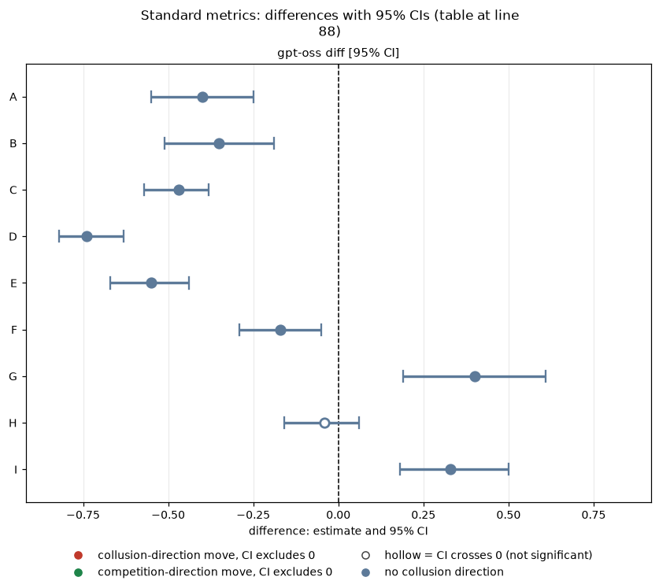

*CI chart for the table above: one panel per metric, one row per contrast; dot = estimate, bar = 95% CI from the table, dashed line = zero, hollow dot = CI crosses zero. Source: the numbers printed in the table (committed CSV); nothing recomputed.*

<small>

**Reading the chart.** Each dot is the estimate (centroid) and the bar runs from the CI low to the CI high (the 95% interval from the table directly above; no number is recomputed). The dashed vertical line is zero (no difference). Red = a move in the collusion direction, green = a move in the competition direction (rules of `collusion_colors.direction`), blue-grey = the metric has no collusion direction. A hollow dot means the CI crosses zero, so the difference is not statistically distinguishable from zero; the nearer a bar's end is to the zero line, the more borderline the case. Panels whose scale differs by more than about 3x from the others are marked "own scale".

**Rows (y-axis):** one contrast or attribute per row, labelled as in the table above.

**Panels (x-axis = the difference in that metric):**

| Panel | Direction | Red means | Green means |
|---|---|---|---|
| gpt-oss diff [95% CI] | no collusion direction (neutral hue) | none (blue-grey: no collusion direction) | none (blue-grey: no collusion direction) |

</small>
<!-- /ci-forest -->

**Average absolute spread**

| Contrast | gpt-oss diff [95% CI] |
|---|---|
| A | -0.60 [-0.87, -0.33] |
| B | -0.44 [-0.70, -0.18] |
| C | -0.73 [-0.89, -0.58] |
| D | -1.11 [-1.26, -0.94] |
| E | -0.76 [-0.95, -0.58] |
| F | -0.25 [-0.50, -0.02] |
| G | +0.68 [0.29, 1.05] |
| H | +0.01 [-0.23, 0.22] |
| I | +0.51 [0.23, 0.81] |

<!-- ci-forest:3 -->
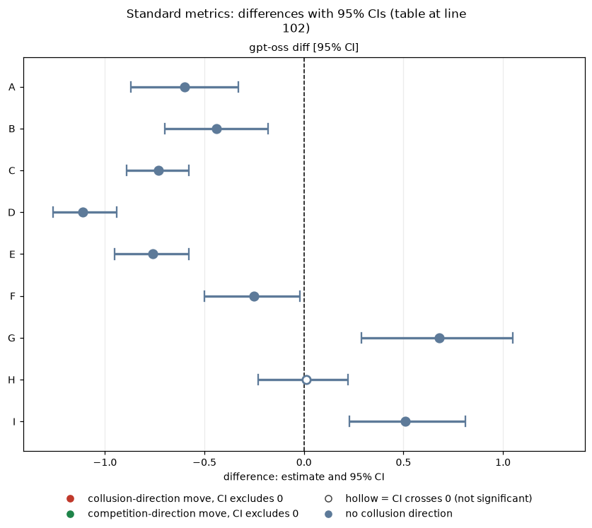

*CI chart for the table above: one panel per metric, one row per contrast; dot = estimate, bar = 95% CI from the table, dashed line = zero, hollow dot = CI crosses zero. Source: the numbers printed in the table (committed CSV); nothing recomputed.*

<small>

**Reading the chart.** Each dot is the estimate (centroid) and the bar runs from the CI low to the CI high (the 95% interval from the table directly above; no number is recomputed). The dashed vertical line is zero (no difference). Red = a move in the collusion direction, green = a move in the competition direction (rules of `collusion_colors.direction`), blue-grey = the metric has no collusion direction. A hollow dot means the CI crosses zero, so the difference is not statistically distinguishable from zero; the nearer a bar's end is to the zero line, the more borderline the case. Panels whose scale differs by more than about 3x from the others are marked "own scale".

**Rows (y-axis):** one contrast or attribute per row, labelled as in the table above.

**Panels (x-axis = the difference in that metric):**

| Panel | Direction | Red means | Green means |
|---|---|---|---|
| gpt-oss diff [95% CI] | no collusion direction (neutral hue) | none (blue-grey: no collusion direction) | none (blue-grey: no collusion direction) |

</small>
<!-- /ci-forest -->

**Competitive share**

| Contrast | gpt-oss diff [95% CI] |
|---|---|
| A | -0.13 [-0.24, -0.03] |
| B | -0.27 [-0.36, -0.16] |
| C | -0.14 [-0.24, -0.07] |
| D | -0.20 [-0.31, -0.08] |
| E | -0.38 [-0.46, -0.31] |
| F | -0.07 [-0.15, 0.02] |
| G | -0.11 [-0.19, -0.01] |
| H | -0.26 [-0.34, -0.18] |
| I | +0.07 [-0.02, 0.16] |

<!-- ci-forest:4 -->
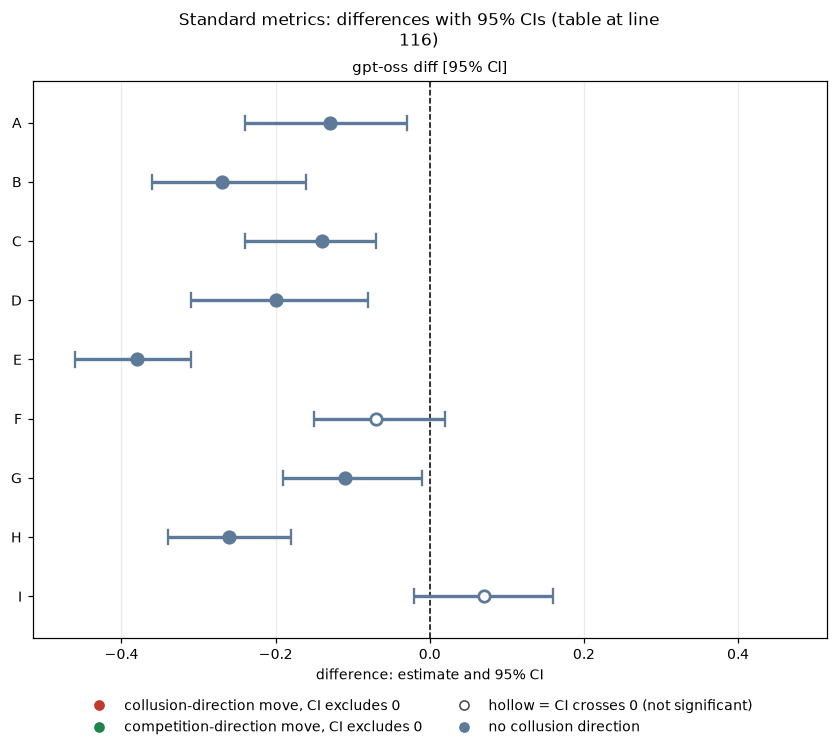

*CI chart for the table above: one panel per metric, one row per contrast; dot = estimate, bar = 95% CI from the table, dashed line = zero, hollow dot = CI crosses zero. Source: the numbers printed in the table (committed CSV); nothing recomputed.*

<small>

**Reading the chart.** Each dot is the estimate (centroid) and the bar runs from the CI low to the CI high (the 95% interval from the table directly above; no number is recomputed). The dashed vertical line is zero (no difference). Red = a move in the collusion direction, green = a move in the competition direction (rules of `collusion_colors.direction`), blue-grey = the metric has no collusion direction. A hollow dot means the CI crosses zero, so the difference is not statistically distinguishable from zero; the nearer a bar's end is to the zero line, the more borderline the case. Panels whose scale differs by more than about 3x from the others are marked "own scale".

**Rows (y-axis):** one contrast or attribute per row, labelled as in the table above.

**Panels (x-axis = the difference in that metric):**

| Panel | Direction | Red means | Green means |
|---|---|---|---|
| gpt-oss diff [95% CI] | no collusion direction (neutral hue) | none (blue-grey: no collusion direction) | none (blue-grey: no collusion direction) |

</small>
<!-- /ci-forest -->

**Matching share**

| Contrast | gpt-oss diff [95% CI] |
|---|---|
| A | -0.01 [-0.15, 0.12] |
| B | +0.15 [0.06, 0.25] |
| C | 0.00 [-0.09, 0.08] |
| D | +0.14 [-0.02, 0.29] |
| E | +0.29 [0.21, 0.38] |
| F | -0.12 [-0.28, 0.03] |
| G | +0.09 [-0.01, 0.18] |
| H | +0.11 [0.01, 0.21] |
| I | -0.16 [-0.29, -0.05] |

<!-- ci-forest:5 -->
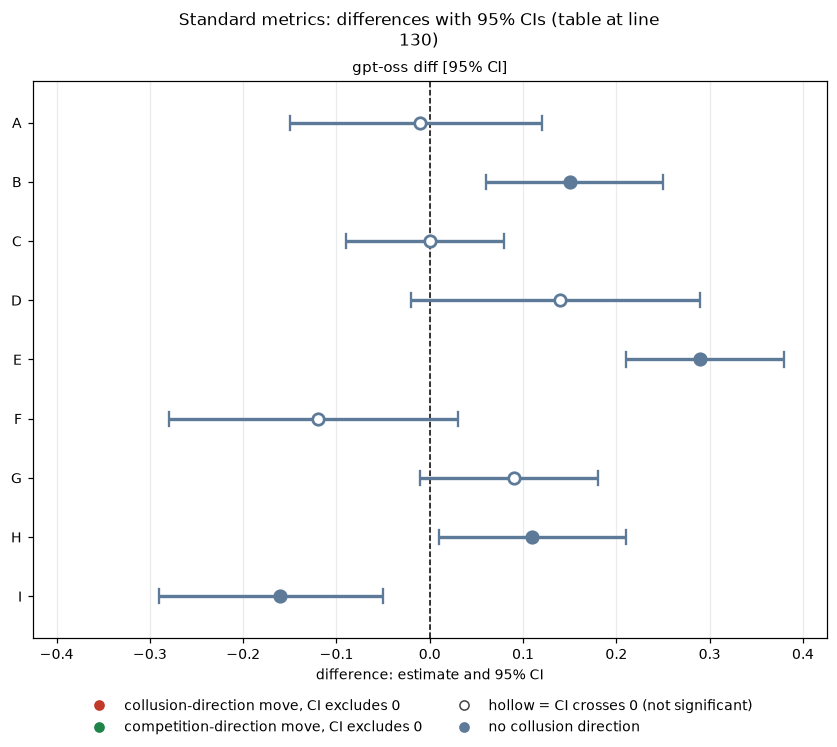

*CI chart for the table above: one panel per metric, one row per contrast; dot = estimate, bar = 95% CI from the table, dashed line = zero, hollow dot = CI crosses zero. Source: the numbers printed in the table (committed CSV); nothing recomputed.*

<small>

**Reading the chart.** Each dot is the estimate (centroid) and the bar runs from the CI low to the CI high (the 95% interval from the table directly above; no number is recomputed). The dashed vertical line is zero (no difference). Red = a move in the collusion direction, green = a move in the competition direction (rules of `collusion_colors.direction`), blue-grey = the metric has no collusion direction. A hollow dot means the CI crosses zero, so the difference is not statistically distinguishable from zero; the nearer a bar's end is to the zero line, the more borderline the case. Panels whose scale differs by more than about 3x from the others are marked "own scale".

**Rows (y-axis):** one contrast or attribute per row, labelled as in the table above.

**Panels (x-axis = the difference in that metric):**

| Panel | Direction | Red means | Green means |
|---|---|---|---|
| gpt-oss diff [95% CI] | no collusion direction (neutral hue) | none (blue-grey: no collusion direction) | none (blue-grey: no collusion direction) |

</small>
<!-- /ci-forest -->

**Reading (price index).** A, B, C, D, E, F: the gpt-oss price falls when printed prices are removed or the instruction is added without them. G: the joint-profit instruction raises the price over uninstructed formula chat. H: with the instruction and only the formula, gpt-oss reaches its headline level (the difference is null). I: the formula alone adds to a prompt with no numbers.

*Terms: diff = arm minus control; CI = 95% bootstrap over pairs.*

## How many quotes sit on a printed value (quote shares)

Shares are game-averaged with a 95% bootstrap CI over games; quotes are the firms' non-imputed quotes. Printed values: 1.00, 1.50, 2.00, 2.49, 2.50, 3.00, 3.50, 4.00.

| Cell | Exact [CI] | Within 1 tick | 1-3 ticks under |
|---|---|---|---|
| headline-chat p1 | 40% [25, 55] | 56% | 40% |
| headline-chat p3 | 40% [25, 55] | 57% | 46% |
| headline-chat p5 | 56% [42, 71] | 67% | 27% |
| headline-tacit p1 | 37% [29, 46] | 54% | 32% |
| headline-tacit p5 | 63% [50, 76] | 81% | 22% |
| fx-chat-p1 | 17% [8, 27] | 26% | 5% |
| fx-tacit-p1 | 14% [8, 20] | 40% | 13% |
| fx-chat-p5 | 20% [13, 28] | 26% | 1% |
| nx-chat-p1 | 4% [1, 8] | 26% | 0% |
| nx-tacit-p1 | 6% [3, 9] | 49% | 0% |
| ctl-32b-joint p3 | 68% [57, 81] | 87% | 45% |
| fx-ctl-joint p3 | 15% [6, 26] | 16% | 2% |

The 1-to-3-under column is split into 1, 2 and 3 ticks, with CIs, in `quote_shares_by_arm.csv`.

**Cautions.**
- 1.00 is itself a printed value, so floor-heavy cells get "exact" credit for competing: gpt-oss headline-chat p5 has 18.5% of quotes at 1.00, headline-tacit p5 38%. Excluding the floor, the pooled exact share of gpt-oss headline-chat p5 is 43% against 52% with it (`quote_shares_extras.csv`).
- In the arms with nothing printed, "exact" mostly measures round-number habit, since several printed values (1.50, 2.00) are round numbers a model can pick unprompted.
- The cleaner signature of the printed numbers is 2.49 and the quotes 1 to 3 ticks under it. gpt-oss at 2.49: headline-chat p1 20% of quotes, p3 24%, ctl-32b-joint 33%, about 0% in the corrected arms.
- "Within one tick" counts 1.01 as one tick above the printed 1.00, so the no-number arms' 26-49% is floor-hugging, not following the printed numbers.

**Paired exact-share differences** (`quote_share_paired.csv`; gpt-oss): A -0.26 [-0.37, -0.14]; B -0.23 [-0.33, -0.13]; C -0.36 [-0.50, -0.23]; D -0.36 [-0.49, -0.23]; E -0.31 [-0.40, -0.24]; F -0.54 [-0.69, -0.39]. The gpt-oss 1-to-3-under share falls by 0.19 to 0.44 in the corrected arms: what gpt-oss loses without printed numbers is the shading around 2.49 and 2.50.

*Terms: exact, within one tick and 1 to 3 under as in the Orientation table; CI over games.*

## Quote histograms

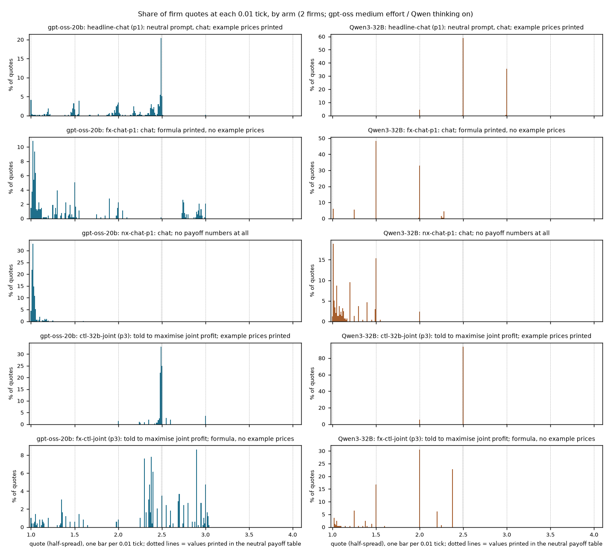

*Figure: share of firm quotes at each 0.01 tick for five arms (rows, labelled "slug: short description"), gpt-oss-20b medium effort (blue, left); the right-hand panels (orange) show the second model, Qwen3-32B thinking on, discussed in the comparison section. Dotted lines mark the printed example prices 1.00, 1.50, 2.00, 2.49, 2.50, 3.00, 3.50, 4.00. Each panel has its own vertical scale (percent of that arm's quotes).*

The gpt-oss headline cell spreads over 2.40 to 2.50 with a spike at 2.49. Without printed prices gpt-oss falls to 1.01-1.05 (no numbers) or a spread of low values and 2.7-3.0 (formula only). gpt-oss fx-ctl-joint produces a spread around 2.3 to 3.0 with none on a printed value.

| Arm | gpt-oss top quotes (share) |
|---|---|
| headline-chat p1 | 2.49 (20%), 2.48 (6%), 2.50 (5%), 1.00 (4%), 1.55 (4%) |
| fx-chat-p1 | 1.02 (11%), 1.04 (9%), 1.05 (6%) |
| nx-chat-p1 | 1.02 (33%), 1.01 (22%), 1.03 (15%) |
| ctl-32b-joint p3 | 2.49 (33%), 2.50 (25%), 2.48 (22%) |
| fx-ctl-joint p3 | 2.90 (9%), 2.38 (8%), 2.30 (8%), 2.40 (6%), 3.00 (5%) |

All 17-bin shares per cell: `quote_histogram_bins.csv`.

*Terms: top quotes = the most frequent quote values and their share of all quotes in the cell.*

## Capability test

Can the firms collude when told to, with no printed number? fx-ctl-joint (joint-profit instruction, formula, no example prices, p3) against ctl-32b-joint (instruction, printed examples, p3), against uninstructed formula chat and against headline chat p3.

- Price index 0.62 [0.49, 0.73]; against the control -0.13 [-0.25, -0.02] (profit gain -0.17 [-0.29, -0.05]); against uninstructed formula chat +0.34 [0.15, 0.52]; against headline chat p3 +0.01 [-0.11, 0.12]. Competitive share 0.18, matching share 0.49: high computed prices without a locked matching price.
- Reading for evaluation design: the low uninstructed formula prices are not an inability to compute a high price; they look like a disposition (gpt-oss does not choose to collude unprompted). With 20 games per cell this is a bound, and the gap to the control is not robust to the empty-talk check below.

*Terms: capability = reaching a high price when instructed; disposition = what it does uninstructed.*

## Sensitivity

**empty_talk_done_count** (talk turns whose empty reply was read as 'done'; chat arms only): mean per arm (games with count above 0 in brackets): headline-chat p1 0.80 (9), p3 0.40 (6), p5 0.40 (6); fx-chat-p1 0.58 (8); fx-chat-p5 0.35 (4); nx-chat-p1 0.55 (7); ctl-32b-joint 0.55 (7); fx-ctl-joint 0.85 (7); tacit cells 0. Dropping every pair with a game above 0: A -0.25 [-0.42, -0.06] (7 pairs), C -0.35 [-0.47, -0.23] (12), D -0.65 [-0.71, -0.59] (10); B and E unchanged. The capability gap F becomes -0.09 [-0.25, +0.01] on 9 pairs, so the -0.13 below the control does not survive it (`empty_talk_sensitivity.csv`).

**hrep replicates (labelled sensitivity; headline prompt played under the formula names, build bug).** Averaging each headline game with its replicate games per (wording, seed), the price-index diffs are A -0.37 [-0.48, -0.24], B -0.32 [-0.42, -0.19], C -0.39 [-0.46, -0.32], D -0.62 [-0.66, -0.56], E -0.47 [-0.53, -0.42] (headline only: -0.30, -0.22, -0.37, -0.56, -0.38). Larger, same sign: the replicate games sit higher than the first headline games. No quote-share check on hrep (rounds not in the collected tables).

*Terms: hrep = replicate of the headline cell; pooled control = per-pair mean of headline game and replicates.*

## Limits and caveats

- 19-20 games per cell; a price-index difference of about 0.1 is the smallest resolvable. Nulls are bounds.
- A and D share control games, as do B and E: not independent.
- No thinking contrast on gpt-oss.
- "Exact" share is partly round-number habit where nothing is printed; use the 2.49 share, exact-above-floor and 1-to-3-under shares.

## Research sub-questions

1.1 (necessary variables: printed focal numbers set the price level; computed collusion exists on gpt-oss when instructed), 2.1 (the payoff-table block is a task-design variable that changes the verdict), and evaluation design (prompt artefacts in benchmarks: report results with and without printed example prices).

## Comparison with Qwen3-32B

This section layers the second model on the gpt-oss results above: Qwen3-32B, thinking on, on the same arms and contrasts. gpt-oss at medium reasoning effort is compared with Qwen with thinking on; these are different settings, never the same axis. Magnitudes are confounded with baseline level: the two models start from different headline prices, so a smaller or larger fall is partly a smaller or larger amount to remove.

**Headline.** The gpt-oss result replicates on Qwen in the same direction and in a stronger form, and the mechanism looks different. Taking the printed example prices out lowers the Qwen price index by 0.50 to 0.74 across the five corrected cells, against 0.22 to 0.56 for gpt-oss: same sign everywhere, similar size in two cells, gpt-oss smaller in three. Qwen follows the printed numbers more tightly than gpt-oss: headline-chat exact share 92-100% against 40-56% for gpt-oss, and 0-4% of Qwen headline-chat quotes sit 1 to 3 ticks under a printed value against 27-46% for gpt-oss. In the capability test Qwen mostly does not reach the headline level: its equivalent is 0.41 against 0.73.

### Cell means (Qwen)

Price index [95% CI over games] and average absolute spread; n is 20 games in every Qwen cell (fx-chat-p1 is 20 for Qwen, 19 for gpt-oss). The gpt-oss values for the same cells are in the Cell means section above.

| Cell | Qwen price index | Qwen avg spread |
|---|---|---|
| headline-chat p1 | 0.85 [0.78, 0.91] | 2.69 |
| headline-chat p3 | 0.77 [0.69, 0.83] | 2.53 |
| headline-chat p5 | 0.54 [0.41, 0.66] | 2.08 |
| headline-tacit p1 | 0.72 [0.67, 0.76] | 2.43 |
| headline-tacit p5 | 0.18 [0.08, 0.29] | 1.37 |
| fx-chat-p1 | 0.34 [0.27, 0.41] | 1.67 |
| fx-tacit-p1 | 0.09 [0.03, 0.16] | 1.17 |
| fx-chat-p5 | 0.04 [0.01, 0.08] | 1.09 |
| nx-chat-p1 | 0.11 [0.06, 0.17] | 1.22 |
| nx-tacit-p1 | 0.02 [0.01, 0.03] | 1.04 |
| ctl-32b-joint p3 | 0.73 [0.69, 0.75] | 2.45 |
| **fx-ctl-joint p3** | 0.41 [0.31, 0.50] | 1.81 |

*Terms: as in the Cell means section above; Qwen3-32B thinking on.*

### Standard metrics (Qwen beside gpt-oss)

Paired difference (arm minus control), gpt-oss-20b (medium effort) beside Qwen3-32B (thinking on) with identical contrast strings; the same rows are in `standard_metrics.csv`. n pairs gpt-oss / Qwen: A 19/20, G 19/20, I 19/20, all others 20/20.

**Price index**

| Contrast | gpt-oss diff [95% CI] | Qwen diff [95% CI] | Same as gpt-oss? |
|---|---|---|---|
| A formula, chat, p1 | -0.30 [-0.43, -0.16] | -0.51 [-0.62, -0.40] | same sign; gpt-oss smaller |
| B formula, tacit, p1 | -0.22 [-0.35, -0.09] | -0.63 [-0.69, -0.56] | same sign; gpt-oss smaller |
| C formula, chat, p5 | -0.37 [-0.45, -0.29] | -0.50 [-0.64, -0.35] | same sign; similar |
| D no numbers, chat, p1 | -0.56 [-0.63, -0.46] | -0.74 [-0.82, -0.65] | same sign; similar |
| E no numbers, tacit, p1 | -0.38 [-0.47, -0.29] | -0.70 [-0.75, -0.65] | same sign; gpt-oss smaller |
| F capability test | -0.13 [-0.25, -0.02] | -0.32 [-0.41, -0.23] | same sign; gpt-oss smaller |
| G fx-ctl-joint minus fx-chat-p1 | +0.34 [0.15, 0.52] | +0.07 [-0.02, 0.17] | models differ (gpt-oss up, Qwen null) |
| H fx-ctl-joint minus headline-chat p3 | +0.01 [-0.11, 0.12] | -0.36 [-0.45, -0.27] | models differ (gpt-oss null, Qwen down) |
| I formula minus no numbers, chat | +0.25 [0.12, 0.40] | +0.23 [0.12, 0.32] | same sign; similar |

<!-- ci-forest:6 -->
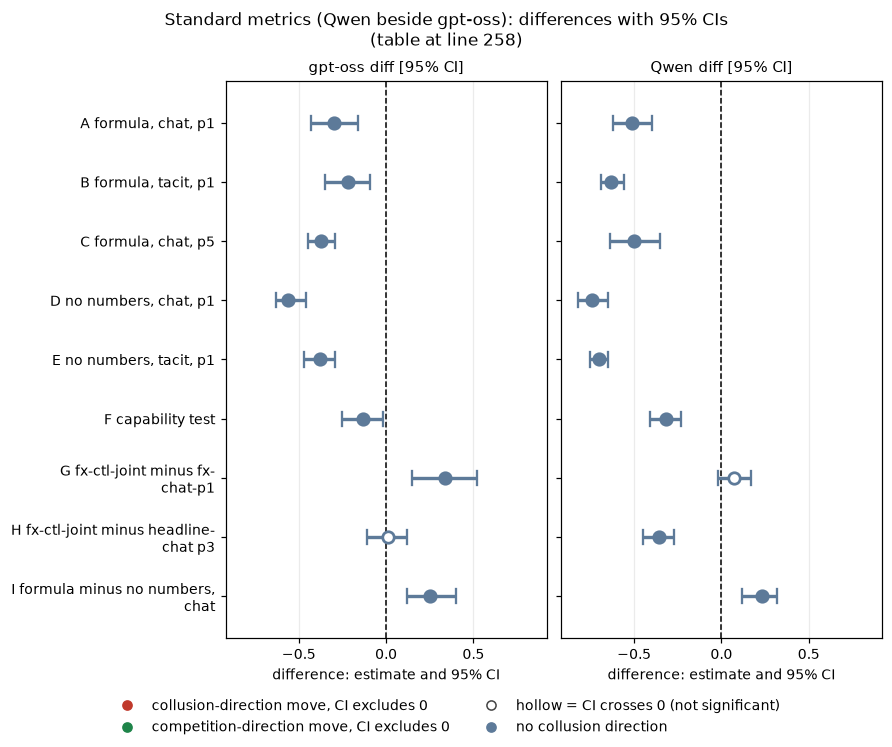

*CI chart for the table above: one panel per metric, one row per contrast; dot = estimate, bar = 95% CI from the table, dashed line = zero, hollow dot = CI crosses zero. Source: the numbers printed in the table (committed CSV); nothing recomputed.*

<small>

**Reading the chart.** Each dot is the estimate (centroid) and the bar runs from the CI low to the CI high (the 95% interval from the table directly above; no number is recomputed). The dashed vertical line is zero (no difference). Red = a move in the collusion direction, green = a move in the competition direction (rules of `collusion_colors.direction`), blue-grey = the metric has no collusion direction. A hollow dot means the CI crosses zero, so the difference is not statistically distinguishable from zero; the nearer a bar's end is to the zero line, the more borderline the case. Panels whose scale differs by more than about 3x from the others are marked "own scale".

**Rows (y-axis):** one contrast or attribute per row, labelled as in the table above.

**Panels (x-axis = the difference in that metric):**

| Panel | Direction | Red means | Green means |
|---|---|---|---|
| gpt-oss diff [95% CI] | no collusion direction (neutral hue) | none (blue-grey: no collusion direction) | none (blue-grey: no collusion direction) |
| Qwen diff [95% CI] | no collusion direction (neutral hue) | none (blue-grey: no collusion direction) | none (blue-grey: no collusion direction) |

</small>
<!-- /ci-forest -->

**Profit gain index**

| Contrast | gpt-oss diff [95% CI] | Qwen diff [95% CI] |
|---|---|---|
| A | -0.40 [-0.55, -0.25] | -0.41 [-0.51, -0.31] |
| B | -0.35 [-0.51, -0.19] | -0.77 [-0.87, -0.65] |
| C | -0.47 [-0.57, -0.38] | -0.61 [-0.76, -0.44] |
| D | -0.74 [-0.82, -0.63] | -0.75 [-0.83, -0.66] |
| E | -0.55 [-0.67, -0.44] | -0.87 [-0.91, -0.83] |
| F | -0.17 [-0.29, -0.05] | -0.32 [-0.43, -0.21] |
| G | +0.40 [0.19, 0.61] | +0.07 [-0.05, 0.18] |
| H | -0.04 [-0.16, 0.06] | -0.31 [-0.43, -0.22] |
| I | +0.33 [0.18, 0.50] | +0.34 [0.20, 0.47] |

<!-- ci-forest:7 -->
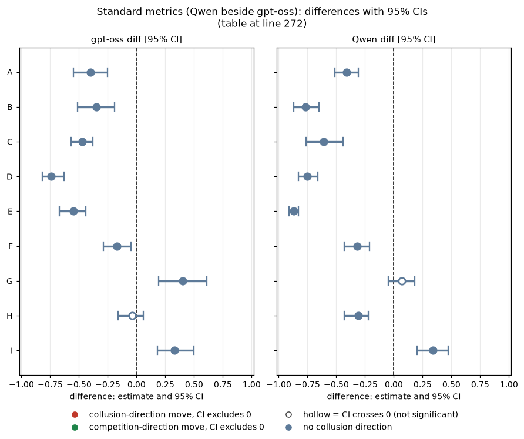

*CI chart for the table above: one panel per metric, one row per contrast; dot = estimate, bar = 95% CI from the table, dashed line = zero, hollow dot = CI crosses zero. Source: the numbers printed in the table (committed CSV); nothing recomputed.*

<small>

**Reading the chart.** Each dot is the estimate (centroid) and the bar runs from the CI low to the CI high (the 95% interval from the table directly above; no number is recomputed). The dashed vertical line is zero (no difference). Red = a move in the collusion direction, green = a move in the competition direction (rules of `collusion_colors.direction`), blue-grey = the metric has no collusion direction. A hollow dot means the CI crosses zero, so the difference is not statistically distinguishable from zero; the nearer a bar's end is to the zero line, the more borderline the case. Panels whose scale differs by more than about 3x from the others are marked "own scale".

**Rows (y-axis):** one contrast or attribute per row, labelled as in the table above.

**Panels (x-axis = the difference in that metric):**

| Panel | Direction | Red means | Green means |
|---|---|---|---|
| gpt-oss diff [95% CI] | no collusion direction (neutral hue) | none (blue-grey: no collusion direction) | none (blue-grey: no collusion direction) |
| Qwen diff [95% CI] | no collusion direction (neutral hue) | none (blue-grey: no collusion direction) | none (blue-grey: no collusion direction) |

</small>
<!-- /ci-forest -->

**Average absolute spread**

| Contrast | gpt-oss diff [95% CI] | Qwen diff [95% CI] |
|---|---|---|
| A | -0.60 [-0.87, -0.33] | -1.02 [-1.22, -0.80] |
| B | -0.44 [-0.70, -0.18] | -1.26 [-1.39, -1.11] |
| C | -0.73 [-0.89, -0.58] | -0.99 [-1.28, -0.70] |
| D | -1.11 [-1.26, -0.94] | -1.47 [-1.62, -1.29] |
| E | -0.76 [-0.95, -0.58] | -1.40 [-1.49, -1.30] |
| F | -0.25 [-0.50, -0.02] | -0.64 [-0.83, -0.47] |
| G | +0.68 [0.29, 1.05] | +0.14 [-0.06, 0.33] |
| H | +0.01 [-0.23, 0.22] | -0.72 [-0.90, -0.54] |
| I | +0.51 [0.23, 0.81] | +0.45 [0.25, 0.64] |

<!-- ci-forest:8 -->
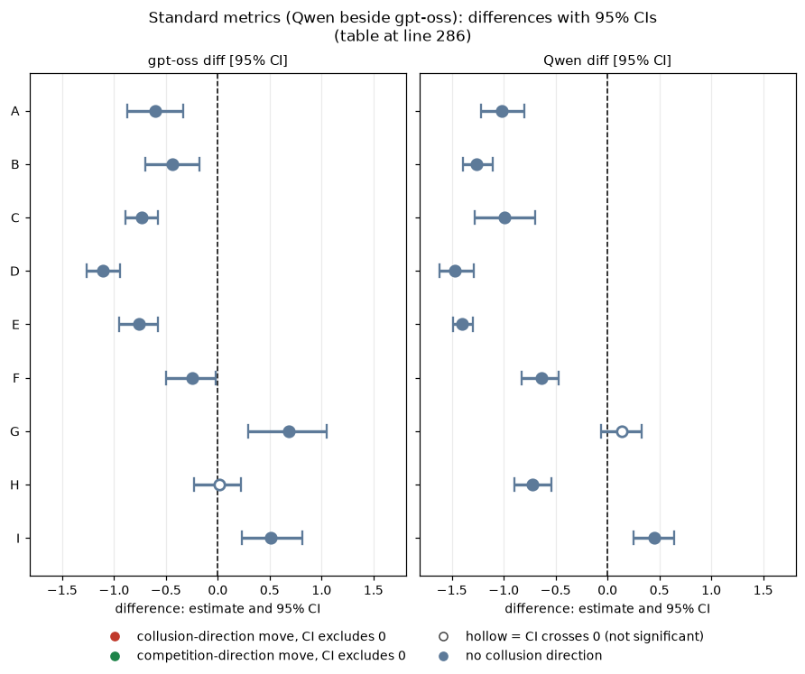

*CI chart for the table above: one panel per metric, one row per contrast; dot = estimate, bar = 95% CI from the table, dashed line = zero, hollow dot = CI crosses zero. Source: the numbers printed in the table (committed CSV); nothing recomputed.*

<small>

**Reading the chart.** Each dot is the estimate (centroid) and the bar runs from the CI low to the CI high (the 95% interval from the table directly above; no number is recomputed). The dashed vertical line is zero (no difference). Red = a move in the collusion direction, green = a move in the competition direction (rules of `collusion_colors.direction`), blue-grey = the metric has no collusion direction. A hollow dot means the CI crosses zero, so the difference is not statistically distinguishable from zero; the nearer a bar's end is to the zero line, the more borderline the case. Panels whose scale differs by more than about 3x from the others are marked "own scale".

**Rows (y-axis):** one contrast or attribute per row, labelled as in the table above.

**Panels (x-axis = the difference in that metric):**

| Panel | Direction | Red means | Green means |
|---|---|---|---|
| gpt-oss diff [95% CI] | no collusion direction (neutral hue) | none (blue-grey: no collusion direction) | none (blue-grey: no collusion direction) |
| Qwen diff [95% CI] | no collusion direction (neutral hue) | none (blue-grey: no collusion direction) | none (blue-grey: no collusion direction) |

</small>
<!-- /ci-forest -->

**Competitive share**

| Contrast | gpt-oss diff [95% CI] | Qwen diff [95% CI] |
|---|---|---|
| A | -0.13 [-0.24, -0.03] | -0.01 [-0.03, 0.00] |
| B | -0.27 [-0.36, -0.16] | -0.16 [-0.33, 0.00] |
| C | -0.14 [-0.24, -0.07] | +0.48 [0.23, 0.72] |
| D | -0.20 [-0.31, -0.08] | 0.00 [-0.02, 0.01] |
| E | -0.38 [-0.46, -0.31] | -0.25 [-0.39, -0.12] |
| F | -0.07 [-0.15, 0.02] | 0.00 [0.00, 0.00] |
| G | -0.11 [-0.19, -0.01] | 0.00 [0.00, 0.00] |
| H | -0.26 [-0.34, -0.18] | -0.01 [-0.03, 0.00] |
| I | +0.07 [-0.02, 0.16] | -0.01 [-0.02, 0.00] |

<!-- ci-forest:9 -->
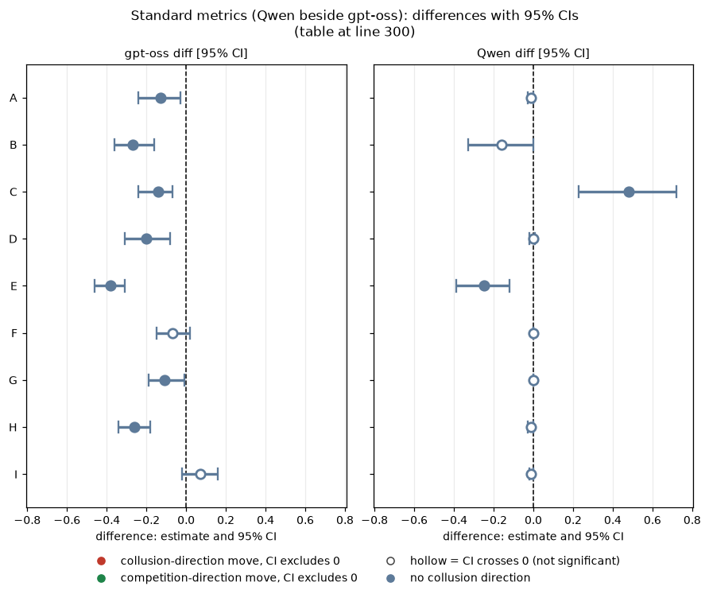

*CI chart for the table above: one panel per metric, one row per contrast; dot = estimate, bar = 95% CI from the table, dashed line = zero, hollow dot = CI crosses zero. Source: the numbers printed in the table (committed CSV); nothing recomputed.*

<small>

**Reading the chart.** Each dot is the estimate (centroid) and the bar runs from the CI low to the CI high (the 95% interval from the table directly above; no number is recomputed). The dashed vertical line is zero (no difference). Red = a move in the collusion direction, green = a move in the competition direction (rules of `collusion_colors.direction`), blue-grey = the metric has no collusion direction. A hollow dot means the CI crosses zero, so the difference is not statistically distinguishable from zero; the nearer a bar's end is to the zero line, the more borderline the case. Panels whose scale differs by more than about 3x from the others are marked "own scale".

**Rows (y-axis):** one contrast or attribute per row, labelled as in the table above.

**Panels (x-axis = the difference in that metric):**

| Panel | Direction | Red means | Green means |
|---|---|---|---|
| gpt-oss diff [95% CI] | no collusion direction (neutral hue) | none (blue-grey: no collusion direction) | none (blue-grey: no collusion direction) |
| Qwen diff [95% CI] | no collusion direction (neutral hue) | none (blue-grey: no collusion direction) | none (blue-grey: no collusion direction) |

</small>
<!-- /ci-forest -->

**Matching share**

| Contrast | gpt-oss diff [95% CI] | Qwen diff [95% CI] |
|---|---|---|
| A | -0.01 [-0.15, 0.12] | +0.01 [-0.02, 0.05] |
| B | +0.15 [0.06, 0.25] | +0.18 [0.00, 0.34] |
| C | 0.00 [-0.09, 0.08] | -0.52 [-0.74, -0.31] |
| D | +0.14 [-0.02, 0.29] | -0.23 [-0.36, -0.10] |
| E | +0.29 [0.21, 0.38] | +0.02 [-0.18, 0.21] |
| F | -0.12 [-0.28, 0.03] | -0.10 [-0.22, -0.01] |
| G | +0.09 [-0.01, 0.18] | -0.09 [-0.21, 0.01] |
| H | +0.11 [0.01, 0.21] | -0.07 [-0.20, 0.02] |
| I | -0.16 [-0.29, -0.05] | +0.24 [0.10, 0.39] |

<!-- ci-forest:10 -->
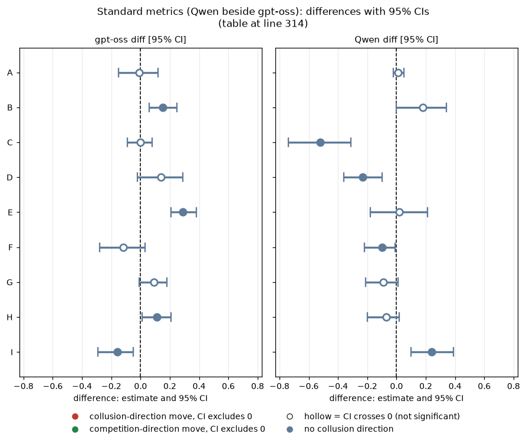

*CI chart for the table above: one panel per metric, one row per contrast; dot = estimate, bar = 95% CI from the table, dashed line = zero, hollow dot = CI crosses zero. Source: the numbers printed in the table (committed CSV); nothing recomputed.*

<small>

**Reading the chart.** Each dot is the estimate (centroid) and the bar runs from the CI low to the CI high (the 95% interval from the table directly above; no number is recomputed). The dashed vertical line is zero (no difference). Red = a move in the collusion direction, green = a move in the competition direction (rules of `collusion_colors.direction`), blue-grey = the metric has no collusion direction. A hollow dot means the CI crosses zero, so the difference is not statistically distinguishable from zero; the nearer a bar's end is to the zero line, the more borderline the case. Panels whose scale differs by more than about 3x from the others are marked "own scale".

**Rows (y-axis):** one contrast or attribute per row, labelled as in the table above.

**Panels (x-axis = the difference in that metric):**

| Panel | Direction | Red means | Green means |
|---|---|---|---|
| gpt-oss diff [95% CI] | no collusion direction (neutral hue) | none (blue-grey: no collusion direction) | none (blue-grey: no collusion direction) |
| Qwen diff [95% CI] | no collusion direction (neutral hue) | none (blue-grey: no collusion direction) | none (blue-grey: no collusion direction) |

</small>
<!-- /ci-forest -->

**Does the gpt-oss result replicate? (price index).** A, B, C, D, E, F: same sign. The gpt-oss fall is smaller for A, B, E, F and similar for C and D (gpt-oss headline prices are lower to begin with: headline-chat p1 0.57 against Qwen 0.85, headline-tacit p1 0.39 against 0.72, so there is less to remove). I: same sign, similar size. G and H: not a replication, the models differ (gpt-oss reaches its headline level, Qwen does not). Competitive share and matching share are mostly unclear or inconsistent across models because Qwen chat firms almost never undercut; read only the price index and profit gain index across models.

*Terms: diff = arm minus control; "same sign" = both intervals exclude 0 and agree; size compares gpt-oss diff to Qwen diff (below 0.67 smaller, above 1.5 larger, otherwise similar).*

### Quote shares (Qwen beside gpt-oss)

Same definitions and printed values as in the quote-shares section above. The gpt-oss columns are repeated for reading across.

| Cell | gpt-oss exact [CI] | gpt-oss within 1 tick | gpt-oss 1-3 ticks under | Qwen exact | Qwen within 1 tick | Qwen 1-3 ticks under |
|---|---|---|---|---|---|---|
| headline-chat p1 | 40% [25, 55] | 56% | 40% | 99% | 100% | 1% |
| headline-chat p3 | 40% [25, 55] | 57% | 46% | 100% | 100% | 0% |
| headline-chat p5 | 56% [42, 71] | 67% | 27% | 92% | 98% | 4% |
| headline-tacit p1 | 37% [29, 46] | 54% | 32% | 74% | 81% | 19% |
| headline-tacit p5 | 63% [50, 76] | 81% | 22% | 72% | 80% | 6% |
| fx-chat-p1 | 17% [8, 27] | 26% | 5% | 86% | 91% | 0% |
| fx-tacit-p1 | 14% [8, 20] | 40% | 13% | 6% | 73% | 9% |
| fx-chat-p5 | 20% [13, 28] | 26% | 1% | 74% | 80% | 0% |
| nx-chat-p1 | 4% [1, 8] | 26% | 0% | 19% | 43% | 3% |
| nx-tacit-p1 | 6% [3, 9] | 49% | 0% | 1% | 49% | 0% |
| ctl-32b-joint p3 | 68% [57, 81] | 87% | 45% | 100% | 100% | 0% |
| fx-ctl-joint p3 | 15% [6, 26] | 16% | 2% | 50% | 50% | 0% |

**Qwen cautions.**
- Floor credit: Qwen fx-chat-p5 has 57% of quotes at 1.00, a printed value, so its "exact" share partly measures competing.
- Round-number habit: where nothing is printed, Qwen fx-chat-p1's 86% is 1.50 (48%) and 2.00 (33%), both printed values and both round numbers a model picks unprompted.
- Qwen at 2.49: about 0% in chat, 25% in headline-tacit p1, against 20-33% for gpt-oss in the headline and joint-instruction chat arms.

**Paired exact-share differences** (`quote_share_paired.csv`; gpt-oss, then Qwen): A -0.26 [-0.37, -0.14], -0.14 [-0.30, 0.00]; B -0.23 [-0.33, -0.13], -0.67 [-0.83, -0.50]; C -0.36 [-0.50, -0.23], -0.18 [-0.39, 0.02]; D -0.36 [-0.49, -0.23], -0.80 [-0.94, -0.63]; E -0.31 [-0.40, -0.24], -0.72 [-0.87, -0.57]; F -0.54 [-0.69, -0.39], -0.50 [-0.70, -0.30].

*Terms: exact, within one tick and 1 to 3 under as in the Orientation table; CI over games.*

### Quote histograms (second model)

The figure above shows both models. The Qwen headline cell is two spikes at 2.50 and 3.00; without printed prices Qwen goes to 1.50 and 2.00 (formula) or the floor (no numbers). The gpt-oss headline cell is instead a spread over 2.40 to 2.50 with a spike at 2.49.

| Arm | Qwen top quotes (share) |
|---|---|
| headline-chat p1 | 2.50 (59%), 3.00 (36%), 2.00 (5%) |
| fx-chat-p1 | 1.50 (48%), 2.00 (33%), 1.01 (6%) |
| nx-chat-p1 | 1.01 (19%), 1.50 (15%), 1.20 (10%) |
| ctl-32b-joint p3 | 2.50 (94%), 2.00 (6%) |
| fx-ctl-joint p3 | 2.00 (31%), 2.38 (23%), 1.50 (17%) |

*Terms: top quotes = the most frequent quote values and their share of all quotes in the cell.*

### Capability test (Qwen)

Qwen: price index 0.41 against 0.73 (-0.32 [-0.41, -0.23]); no firm-round competitive, about 90% matching, but low self-chosen levels (2.00, 2.38, 1.50). For Qwen the capability is only partly there when no number is printed, whereas gpt-oss reaches its headline level (contrasts G and H in the table above: the models differ).

### Limits specific to the comparison

- Qwen corrected-arm metrics come from the earlier per-game file; I checked that its price-index diffs match the Qwen ad-hoc paired table for A to E. Qwen quote tables for those arms were re-collected from raw trials (reruns substituted). Qwen fx-ctl-joint is a one-off 20-game run.
- gpt-oss at medium effort and Qwen with thinking on are different settings; there is no thinking contrast on gpt-oss, so effort and model family cannot be separated.
- Cross-model size comparisons are confounded with baseline level (see the framing above).

## Files

`focal_points_oss.py`, `standard_metrics.csv`, `cell_means.csv`, `quote_shares_by_arm.csv`, `quote_shares_extras.csv`, `quote_share_paired.csv`, `quote_histogram_bins.csv`, `empty_talk_by_arm.csv`, `empty_talk_sensitivity.csv`, `hrep_sensitivity.csv`, `fig_quote_histograms.png`.

Created by Claude at the prompting of the repository owner.
