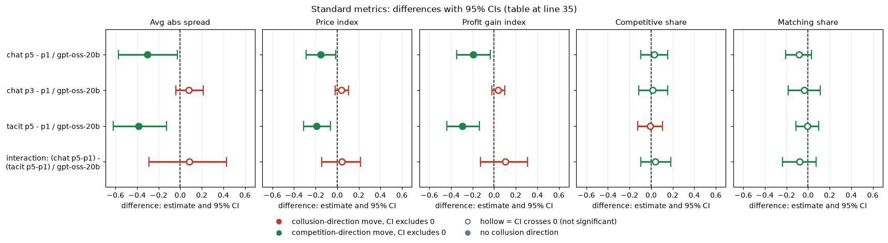
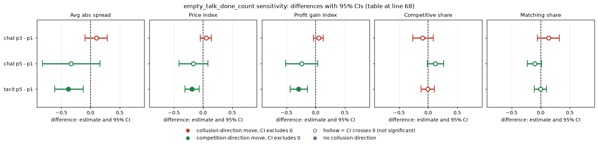
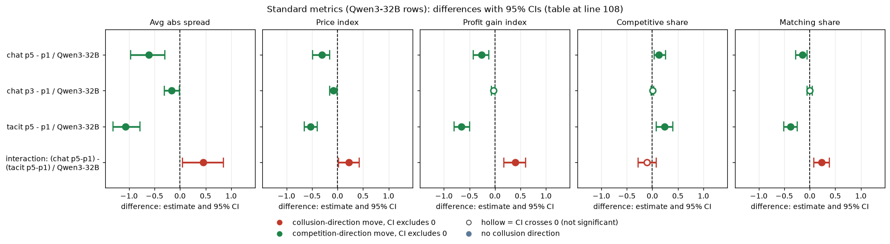

# Penalty on gpt-oss-20b: does a heavier expected fine lower prices?

Model: gpt-oss-20b, reasoning effort medium (it has no thinking-off mode, so every cell is medium effort). Neutral run, tier t1.

## Verdict

Yes, partly. The manipulation is the penalty point (the expected fine a regulator would levy on detected collusion), set at p1 (lightest), p3 or p5 (heaviest). For gpt-oss the heaviest penalty (p5) lowers prices relative to the lightest (p1) in both communication settings: with chat the price index falls by 0.15 [-0.29, -0.01] and the profit gain index by 0.19 [-0.34, -0.04]; with silence (tacit) by 0.19 [-0.31, -0.06] and 0.30 [-0.44, -0.14]. The middle point p3 does nothing for gpt-oss chat (+0.04 [-0.02, +0.11]), so the response appears only at the heaviest penalty. The communication x penalty interaction is not resolved for gpt-oss (+0.10 [-0.13, +0.31] on the profit gain index, CI includes 0). At p5, where theory says no collusion is sustainable, gpt-oss chat still earns 0.58 of the monopoly gain (price index 0.42); tacit falls to 0.28 (0.19). All contrasts are paired on (wording, seed), 20 pairs each; they are exploratory. How the second model compares is in the last section.

## Orientation for a new reader

Two (sometimes three) LLM "market makers" repeatedly quote a **half-spread** (a price) between 1.00 and 5.00 in steps ("ticks") of 0.01. Customers favour the lowest quote (70% go to it). **1.00 is the competitive floor** (no excess profit); **3.00 is the monopoly price**. A regulator may investigate and fine collusion; the **penalty point** sets the expected fine: p1 fine 100 (collusion clearly pays; theory's sustainable level is 2.41), p3 fine 500 (the **2.09 level**), p5 fine 2000 (theory: no collusion above 1.00 is sustainable). The **rival** is the other firm. **Chat** = a private chat channel between the firms; **tacit** = no chat, firms see only each other's quotes. Reasoning-effort medium is the only mode gpt-oss has.

## Question, arms, control, pairing

Question (1.1, 1.5): does a heavier expected fine lower prices, and does chat change that? The penalty slope was first declared in an earlier study, so contrasts here are the matched ones (exploratory for gpt-oss). Arms: headline-chat at p1, p3, p5; headline-tacit at p1, p5 (gpt-oss has no tacit p3, no p4, no monitored arm). Control for each contrast: the same arm at p1. Pairing: on (wording, seed), 20 pairs per contrast, 95% percentile bootstrap (2000 draws, fixed seed). The interaction is (chat p5-p1) minus (tacit p5-p1) within the same (wording, seed).

## Baseline levels (effects must be read against these)

Mean over 20 games per cell, price index (profit gain index), `cells.csv`:

| cell | gpt-oss-20b |
|---|---|
| chat p1 | 0.57 (0.77) |
| chat p3 | 0.61 (0.80) |
| chat p5 | 0.42 (0.58) |
| tacit p1 | 0.39 (0.57) |
| tacit p5 | 0.19 (0.28) |

gpt-oss starts from a moderate baseline (lower when tacit), so the room to fall is bounded by the competitive floor; at p5 tacit it reaches 0.19.

## Standard metrics

Paired difference (arm minus p1 control) with 95% CI, n = 20 pairs each. Interaction rows: mean_arm and mean_control in `standard_metrics.csv` are the chat and tacit slopes. Competitive share and matching share move little for gpt-oss; no metric is degenerate here (gpt-oss tacit competitive share is about 0.67-0.68 in both cells, so it carries no contrast).

| contrast | model | n pairs | Avg abs spread | Price index | Profit gain index | Competitive share | Matching share |
|---|---|---|---|---|---|---|---|
| chat p5 - p1 | gpt-oss-20b | 20 | -0.302 [-0.571, -0.025] | -0.151 [-0.285, -0.013] | -0.193 [-0.345, -0.036] | +0.029 [-0.097, +0.153] | -0.084 [-0.207, +0.031] |
| chat p3 - p1 | gpt-oss-20b | 20 | +0.079 [-0.042, +0.212] | +0.039 [-0.021, +0.106] | +0.036 [-0.023, +0.101] | +0.014 [-0.116, +0.152] | -0.036 [-0.182, +0.111] |
| tacit p5 - p1 | gpt-oss-20b | 20 | -0.385 [-0.618, -0.128] | -0.193 [-0.309, -0.064] | -0.295 [-0.439, -0.136] | -0.008 [-0.123, +0.107] | -0.005 [-0.111, +0.100] |
| interaction: (chat p5-p1) - (tacit p5-p1) | gpt-oss-20b | 20 | +0.083 [-0.290, +0.430] | +0.042 [-0.145, +0.215] | +0.102 [-0.126, +0.311] | +0.038 [-0.094, +0.185] | -0.078 [-0.235, +0.073] |

<!-- ci-forest:1 -->

*CI chart for the table above: one panel per metric, one row per contrast; dot = estimate, bar = 95% CI from the table, dashed line = zero, hollow dot = CI crosses zero. Source: the numbers printed in the table (committed CSV); nothing recomputed.*

<small>

**Reading the chart.** Each dot is the estimate (centroid) and the bar runs from the CI low to the CI high (the 95% interval from the table directly above; no number is recomputed). The dashed vertical line is zero (no difference). Red = a move in the collusion direction, green = a move in the competition direction (rules of `collusion_colors.direction`), blue-grey = the metric has no collusion direction. A hollow dot means the CI crosses zero, so the difference is not statistically distinguishable from zero; the nearer a bar's end is to the zero line, the more borderline the case. Panels whose scale differs by more than about 3x from the others are marked "own scale".

**Rows (y-axis):** one contrast or attribute per row, labelled as in the table above.

**Panels (x-axis = the difference in that metric):**

| Panel | Direction | Red means | Green means |
|---|---|---|---|
| Avg abs spread | higher = more collusive (on the red/green maps: red end) | metric goes up (more collusive) | metric goes down (less collusive) |
| Price index | higher = more collusive (on the red/green maps: red end) | metric goes up (more collusive) | metric goes down (less collusive) |
| Profit gain index | higher = more collusive (on the red/green maps: red end) | metric goes up (more collusive) | metric goes down (less collusive) |
| Competitive share | higher = more competitive (on the red/green maps: green end) | metric goes down (less competitive) | metric goes up (more competitive) |
| Matching share | higher = more collusive (on the red/green maps: red end) | metric goes up (more collusive) | metric goes down (less collusive) |

</small>
<!-- /ci-forest -->

<small>

| Term | Meaning |
|---|---|
| Avg abs spread | mean market quote (half-spread) in raw units, 1.00 to 5.00; lower = less collusion |
| Price index | (price - 1)/2, 0 competitive, 1 monopoly (3.00) |
| Profit gain index | (profit - competitive)/(monopoly - competitive) |
| Competitive share | share of firm-rounds quoting below the rival's previous quote, or both at 1.00; higher = less collusion |
| Matching share | share of firm-rounds equal to the rival's previous quote above 1.00; coordination signature |
| contrast "X - p1" | arm X (penalty point) minus the same arm at p1, paired on (wording, seed) |
| interaction | slope of chat minus slope of tacit; positive = chat dampens the penalty effect |
| [lo, hi] | 95% percentile bootstrap CI over the pairs |

</small>

Reading the table for gpt-oss:

- chat p5 - p1: all collusion metrics fall; the competitive share is unclear (+0.03); matching share falls (CI just includes 0).
- chat p3 - p1: price index +0.04, CI includes 0. gpt-oss shows no p3 response.
- tacit p5 - p1: competitive and matching shares are flat: the drop is in price level without a shift toward undercutting.
- chat x penalty interaction: unclear (CI includes 0), not resolved.

## empty_talk_done_count sensitivity

Mean empty_talk_done_count (talk turns whose empty reply was read as done): chat p1 0.8, chat p3 0.4, chat p5 0.4, tacit 0 (no talk). Dropping pairs in which either game has count > 0 (`sensitivity_empty_talk.csv`):

| contrast | n pairs | Avg abs spread | Price index | Profit gain index | Competitive share | Matching share |
|---|---|---|---|---|---|---|
| chat p3 - p1 | 9 | +0.102 [-0.095, +0.287] | +0.051 [-0.048, +0.143] | +0.050 [-0.036, +0.127] | -0.096 [-0.265, +0.085] | +0.136 [-0.059, +0.321] |
| chat p5 - p1 | 9 | -0.334 [-0.823, +0.160] | -0.167 [-0.411, +0.080] | -0.239 [-0.514, +0.034] | +0.124 [-0.013, +0.268] | -0.104 [-0.229, +0.012] |
| tacit p5 - p1 | 20 | -0.385 [-0.618, -0.128] | -0.193 [-0.309, -0.064] | -0.295 [-0.439, -0.136] | -0.008 [-0.123, +0.107] | -0.005 [-0.111, +0.100] |

<!-- ci-forest:2 -->

*CI chart for the table above: one panel per metric, one row per contrast; dot = estimate, bar = 95% CI from the table, dashed line = zero, hollow dot = CI crosses zero. Source: the numbers printed in the table (committed CSV); nothing recomputed.*

<small>

**Reading the chart.** Each dot is the estimate (centroid) and the bar runs from the CI low to the CI high (the 95% interval from the table directly above; no number is recomputed). The dashed vertical line is zero (no difference). Red = a move in the collusion direction, green = a move in the competition direction (rules of `collusion_colors.direction`), blue-grey = the metric has no collusion direction. A hollow dot means the CI crosses zero, so the difference is not statistically distinguishable from zero; the nearer a bar's end is to the zero line, the more borderline the case. Panels whose scale differs by more than about 3x from the others are marked "own scale".

**Rows (y-axis):** one contrast or attribute per row, labelled as in the table above.

**Panels (x-axis = the difference in that metric):**

| Panel | Direction | Red means | Green means |
|---|---|---|---|
| Avg abs spread | higher = more collusive (on the red/green maps: red end) | metric goes up (more collusive) | metric goes down (less collusive) |
| Price index | higher = more collusive (on the red/green maps: red end) | metric goes up (more collusive) | metric goes down (less collusive) |
| Profit gain index | higher = more collusive (on the red/green maps: red end) | metric goes up (more collusive) | metric goes down (less collusive) |
| Competitive share | higher = more competitive (on the red/green maps: green end) | metric goes down (less competitive) | metric goes up (more competitive) |
| Matching share | higher = more collusive (on the red/green maps: red end) | metric goes up (more collusive) | metric goes down (less collusive) |

</small>
<!-- /ci-forest -->

Chat p5 - p1 keeps its sign and size (price index -0.17 vs -0.15) but the CI widens to include 0 with only 9 pairs, so the chat result is not confirmed on the clean subset (it is underpowered, not contradicted). Chat p3 - p1 stays near zero. Tacit is unaffected (no talk turns).

## Limits

20 pairs per contrast; CIs of 0.2 to 0.3 wide on the profit gain index, so effects below about 0.15 on that index cannot be excluded for p3 (a null is a bound: p3 - p1 on gain lies within [-0.02, +0.10]). One game, one model; a text-only penalty manipulation. The headline-cell replicates (build-bug arms) were not pooled. 5 prompt wordings x 4 seeds define the pairs. Penalty points p3 only in chat; tacit p3 and p4 were not run on gpt-oss.

## Sub-questions addressed

1.1 (necessary variables): a heavy expected fine is a variable that lowers gpt-oss prices, but only at p5. 1.5 (single restriction that removes the most collusion): the penalty is the biggest lever for gpt-oss tacit play, yet the chat setting stays well above the competitive floor (price index 0.42 at p5). Communication x penalty: unresolved.

## Comparison with Qwen3-32B

How the second model, Qwen3-32B with thinking ON, compares. Gpt-oss medium reasoning effort is compared with Qwen thinking on; these are different mechanisms, not the same axis. Gpt-oss has no thinking-off mode, so the penalty x thinking interaction is not addressed.

Headline: the direction matches Qwen3-32B thinking on, but gpt-oss responds about half as strongly (chat, price index -0.15 vs -0.31; tacit, -0.19 vs -0.53). The communication x penalty interaction is not resolved for gpt-oss, whereas Qwen shows chat dampening the penalty effect (+0.40 [+0.17, +0.60]).

### Baseline levels (Qwen3-32B thinking on)

Mean over 20 games per cell, price index (profit gain index), `cells.csv`:

| cell | gpt-oss-20b | Qwen3-32B thinking on |
|---|---|---|
| chat p1 | 0.57 (0.77) | 0.85 (0.95) |
| chat p3 | 0.61 (0.80) | 0.77 (0.92) |
| chat p5 | 0.42 (0.58) | 0.54 (0.69) |
| tacit p1 | 0.39 (0.57) | 0.72 (0.91) |
| tacit p5 | 0.19 (0.28) | 0.18 (0.25) |

gpt-oss starts from a lower baseline (especially tacit), so less room to fall, yet at p5 tacit it reaches the same low level as Qwen (0.19 vs 0.18). Qwen chat p1 is near the ceiling (0.95 gain), so part of its larger drop is headroom. Magnitudes are confounded with baseline level.

### Standard metrics (Qwen3-32B rows)

Same paired design and n = 20 pairs per contrast. Competitive share and matching share are informative for Qwen chat/tacit but small-moving for gpt-oss.

| contrast | model | n pairs | Avg abs spread | Price index | Profit gain index | Competitive share | Matching share |
|---|---|---|---|---|---|---|---|
| chat p5 - p1 | Qwen3-32B | 20 | -0.616 [-0.971, -0.301] | -0.308 [-0.485, -0.151] | -0.259 [-0.429, -0.118] | +0.131 [+0.035, +0.264] | -0.145 [-0.277, -0.050] |
| chat p3 - p1 | Qwen3-32B | 20 | -0.163 [-0.311, -0.015] | -0.082 [-0.156, -0.007] | -0.033 [-0.073, +0.004] | +0.001 [-0.023, +0.023] | -0.005 [-0.048, +0.046] |
| tacit p5 - p1 | Qwen3-32B | 20 | -1.065 [-1.311, -0.787] | -0.533 [-0.655, -0.394] | -0.655 [-0.800, -0.494] | +0.238 [+0.077, +0.400] | -0.376 [-0.511, -0.249] |
| interaction: (chat p5-p1) - (tacit p5-p1) | Qwen3-32B | 20 | +0.450 [+0.047, +0.852] | +0.225 [+0.024, +0.426] | +0.397 [+0.172, +0.603] | -0.106 [-0.284, +0.073] | +0.230 [+0.076, +0.384] |

<!-- ci-forest:3 -->

*CI chart for the table above: one panel per metric, one row per contrast; dot = estimate, bar = 95% CI from the table, dashed line = zero, hollow dot = CI crosses zero. Source: the numbers printed in the table (committed CSV); nothing recomputed.*

<small>

**Reading the chart.** Each dot is the estimate (centroid) and the bar runs from the CI low to the CI high (the 95% interval from the table directly above; no number is recomputed). The dashed vertical line is zero (no difference). Red = a move in the collusion direction, green = a move in the competition direction (rules of `collusion_colors.direction`), blue-grey = the metric has no collusion direction. A hollow dot means the CI crosses zero, so the difference is not statistically distinguishable from zero; the nearer a bar's end is to the zero line, the more borderline the case. Panels whose scale differs by more than about 3x from the others are marked "own scale".

**Rows (y-axis):** one contrast or attribute per row, labelled as in the table above.

**Panels (x-axis = the difference in that metric):**

| Panel | Direction | Red means | Green means |
|---|---|---|---|
| Avg abs spread | higher = more collusive (on the red/green maps: red end) | metric goes up (more collusive) | metric goes down (less collusive) |
| Price index | higher = more collusive (on the red/green maps: red end) | metric goes up (more collusive) | metric goes down (less collusive) |
| Profit gain index | higher = more collusive (on the red/green maps: red end) | metric goes up (more collusive) | metric goes down (less collusive) |
| Competitive share | higher = more competitive (on the red/green maps: green end) | metric goes down (less competitive) | metric goes up (more competitive) |
| Matching share | higher = more collusive (on the red/green maps: red end) | metric goes up (more collusive) | metric goes down (less collusive) |

</small>
<!-- /ci-forest -->

<small>

| Term | Meaning |
|---|---|
| Avg abs spread | mean market quote (half-spread) in raw units, 1.00 to 5.00; lower = less collusion |
| Price index | (price - 1)/2, 0 competitive, 1 monopoly (3.00) |
| Profit gain index | (profit - competitive)/(monopoly - competitive) |
| Competitive share | share of firm-rounds quoting below the rival's previous quote, or both at 1.00; higher = less collusion |
| Matching share | share of firm-rounds equal to the rival's previous quote above 1.00; coordination signature |
| contrast "X - p1" | arm X (penalty point) minus the same arm at p1, paired on (wording, seed) |
| interaction | slope of chat minus slope of tacit; positive = chat dampens the penalty effect |
| [lo, hi] | 95% percentile bootstrap CI over the pairs |

</small>

### Replicates?

- chat p5 - p1: sign same (all collusion metrics fall for both models); magnitude smaller for gpt-oss (about half of Qwen on spread and price index, 0.19 vs 0.26 on gain, similar-ish). The competitive share rises for Qwen (+0.13, CI excludes 0) but is unclear for gpt-oss (+0.03); matching share falls in both (gpt-oss CI just includes 0).
- chat p3 - p1: sign opposite/unclear (gpt-oss +0.04 price index, CI includes 0; Qwen -0.08, small and mostly CI-excluding 0 on spread and price). Not replicated: gpt-oss shows no p3 response.
- tacit p5 - p1: sign same; magnitude smaller for gpt-oss (price index -0.19 vs -0.53; gain -0.30 vs -0.66). Competitive and matching shares move for Qwen (+0.24, -0.38) but are flat for gpt-oss: its drop is in price level without a shift toward undercutting.
- chat x penalty interaction: unclear for gpt-oss (CI includes 0, sign same as Qwen, magnitude about a quarter of Qwen's on gain), not resolved.

### Cross-model limits and sub-questions

Each model is one run of one game, so cross-model differences are suggestive only. For sub-question 1.1, the effect of a heavy expected fine is weaker for gpt-oss than for Qwen.

## Files

`penalty_oss.py` (script), `standard_metrics.csv`, `sensitivity_empty_talk.csv`, `cells.csv`, `ANALYSIS.md`, `ANALYSIS.html`.
