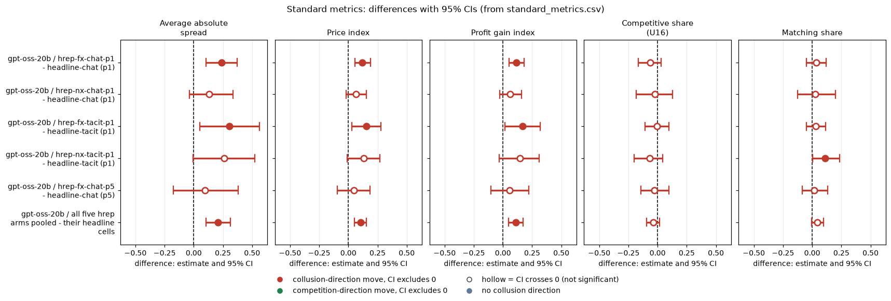

# Reproducibility on gpt-oss-20b: does re-running the same prompt reproduce a headline game?

*Model: gpt-oss-20b, reasoning effort medium (no thinking-off mode exists, so there is no t0/t1 contrast). Data: the frozen t1 tier. Declared analysis, sub-question 2.3 (what counts as convincing evidence) and the evidence standards.*

## Verdict

Replaying the same prompt with an independent sample does not reproduce a game: of 99 headline/replicate pairs only one has an identical quote sequence (a 2-round game that ended at once), and the typical gap between two games on the same (wording, seed) is large (mean absolute difference 0.22 on the price index, 0.43 on the average absolute spread). The replicates also ran systematically higher than the headline games: price index +0.10 on average (95% CI +0.05 to +0.16 over all 99 pairs; +0.03 to +0.16 after averaging the copies per headline game), the same sign in all five replicate arms and in all three headline cells, though only two of the three headline cells have a CI that excludes zero. Competitive share and matching share move less and their CIs include zero. With 20 pairs a cell, the smallest cell difference we can reliably see (80% power) is about 0.12 on the price index for chat at p1 and about 0.20 for tacit at p1 and chat at p5; the headline effects of chat versus tacit (-0.19) and p5 versus p1 (-0.15) sit right at that limit, and the p3 versus p1 difference (+0.04) is inside the noise.

## Orientation for a new reader

| Term | Meaning |
|---|---|
| Game | Two LLM market makers each quote a half-spread (the price they charge, from 1.00 to 5.00 in 0.01 ticks) for 7 to 20 rounds; 70% of customers go to the lower quote. |
| Half-spread, tick | The quote itself; a tick is the smallest step, 0.01. |
| 1.00 floor | The competitive quote: zero margin. 3.00 is the monopoly (fully collusive) quote. The 2.09 level is the theory price that the older anchored run printed in its payoff table; the neutral run, analysed here, prints evenly spaced example prices instead. |
| Rival | The other market maker in the game. |
| Headline cell | A fixed condition: headline-chat (the firms may chat) or headline-tacit (no chat), at penalty point p1, p3 or p5 (p1 = light fine, p5 = heavy). |
| Control / comparison here | Each replicate game is compared with the headline game of the same wording and seed, so the "control" is the headline game. |
| Replicate | A second (or third) independent sampling of the same prompt; the seed fixes the game plan and wording but the model's text sampling is not replayed. |

**The five standard metrics**, each analysed on its own: the average absolute spread (mean quoted half-spread over the game, 1.00 to 5.00, higher is more collusive); the price index (the average quote placed between competitive 0 and monopoly 1, so 0.46 is about a third of the way up from the floor to the monopoly price); the profit gain index (profit between the competitive and the monopoly profit, 0 to 1); the competitive share (share of firm-rounds in which the firm undercuts the lowest rival quote of the previous round by at least one tick, or both firms are at 1.00; higher is more competitive); the matching share (share of firm-rounds in which the firm matches the lowest rival quote of the previous round, within half a tick, above 1.00). Both are read from the run.csv columns competitive_share and matching_share.

## The question, arms, pairing

Does the same prompt give the same result when run again? Five arms were planned as formula / no-numbers conditions (fx-chat-p1, fx-tacit-p1, fx-chat-p5, nx-chat-p1, nx-tacit-p1), but because of a build bug (a global grid override replaced their payoff block) they played the neutral headline prompt. The prompt fingerprint and code commit of every replicate game match the headline games, so they are valid same-prompt replicates, labelled "hrep-*" here; the correct formula / no-numbers games live in a separate run. Replicate arm to headline cell: hrep-fx-chat-p1 and hrep-nx-chat-p1 to headline-chat p1; hrep-fx-tacit-p1 and hrep-nx-tacit-p1 to headline-tacit p1; hrep-fx-chat-p5 to headline-chat p5. Pairing is on (wording, seed). Because two arms copy each of the first two headline cells, the 99 pairs are not independent (59 distinct headline games); a de-duplicated check is given below. n is 20 pairs per arm, 19 for hrep-fx-chat-p5 (one game failed with EmptyContent and was not retried, so the arm has 19 completed games). The replicates and the headline games ran in the same session (overlapping in time), so time of day is not a confound.

## Standard metrics

Contrast is replicate minus headline, per cell, with a 95% percentile bootstrap CI over pairs. Positive means the replicate was higher. For the competitive share a positive difference means more competitive.

| Contrast (replicate - headline) | Metric | n pairs | Mean replicate | Mean headline | Diff | 95% CI | CI vs 0 |
|---|---|---|---|---|---|---|---|
| hrep-fx-chat-p1 - headline-chat (p1) | Average absolute spread | 20 | 2.386 | 2.147 | +0.239 | [+0.104, +0.370] | excludes 0 |
| hrep-fx-chat-p1 - headline-chat (p1) | Price index | 20 | 0.693 | 0.574 | +0.119 | [+0.056, +0.188] | excludes 0 |
| hrep-fx-chat-p1 - headline-chat (p1) | Profit gain index | 20 | 0.885 | 0.769 | +0.116 | [+0.051, +0.183] | excludes 0 |
| hrep-fx-chat-p1 - headline-chat (p1) | Competitive share | 20 | 0.363 | 0.426 | -0.063 | [-0.163, +0.029] | includes 0 |
| hrep-fx-chat-p1 - headline-chat (p1) | Matching share | 20 | 0.448 | 0.412 | +0.036 | [-0.048, +0.119] | includes 0 |
| hrep-nx-chat-p1 - headline-chat (p1) | Average absolute spread | 20 | 2.281 | 2.147 | +0.134 | [-0.035, +0.335] | includes 0 |
| hrep-nx-chat-p1 - headline-chat (p1) | Price index | 20 | 0.640 | 0.574 | +0.067 | [-0.018, +0.156] | includes 0 |
| hrep-nx-chat-p1 - headline-chat (p1) | Profit gain index | 20 | 0.831 | 0.769 | +0.062 | [-0.026, +0.160] | includes 0 |
| hrep-nx-chat-p1 - headline-chat (p1) | Competitive share | 20 | 0.404 | 0.426 | -0.022 | [-0.183, +0.127] | includes 0 |
| hrep-nx-chat-p1 - headline-chat (p1) | Matching share | 20 | 0.440 | 0.412 | +0.028 | [-0.125, +0.199] | includes 0 |
| hrep-fx-tacit-p1 - headline-tacit (p1) | Average absolute spread | 20 | 2.082 | 1.775 | +0.307 | [+0.052, +0.563] | excludes 0 |
| hrep-fx-tacit-p1 - headline-tacit (p1) | Price index | 20 | 0.541 | 0.387 | +0.154 | [+0.029, +0.279] | excludes 0 |
| hrep-fx-tacit-p1 - headline-tacit (p1) | Profit gain index | 20 | 0.737 | 0.571 | +0.166 | [+0.015, +0.319] | excludes 0 |
| hrep-fx-tacit-p1 - headline-tacit (p1) | Competitive share | 20 | 0.676 | 0.681 | -0.005 | [-0.109, +0.096] | includes 0 |
| hrep-fx-tacit-p1 - headline-tacit (p1) | Matching share | 20 | 0.192 | 0.163 | +0.029 | [-0.048, +0.116] | includes 0 |
| hrep-nx-tacit-p1 - headline-tacit (p1) | Average absolute spread | 20 | 2.036 | 1.775 | +0.261 | [-0.006, +0.523] | includes 0 |
| hrep-nx-tacit-p1 - headline-tacit (p1) | Price index | 20 | 0.518 | 0.387 | +0.130 | [-0.009, +0.269] | includes 0 |
| hrep-nx-tacit-p1 - headline-tacit (p1) | Profit gain index | 20 | 0.717 | 0.571 | +0.146 | [-0.033, +0.311] | includes 0 |
| hrep-nx-tacit-p1 - headline-tacit (p1) | Competitive share | 20 | 0.612 | 0.681 | -0.069 | [-0.201, +0.043] | includes 0 |
| hrep-nx-tacit-p1 - headline-tacit (p1) | Matching share | 20 | 0.276 | 0.163 | +0.113 | [+0.003, +0.237] | excludes 0 |
| hrep-fx-chat-p5 - headline-chat (p5) | Average absolute spread | 19 | 1.931 | 1.833 | +0.098 | [-0.173, +0.382] | includes 0 |
| hrep-fx-chat-p5 - headline-chat (p5) | Price index | 19 | 0.465 | 0.416 | +0.049 | [-0.094, +0.185] | includes 0 |
| hrep-fx-chat-p5 - headline-chat (p5) | Profit gain index | 19 | 0.623 | 0.567 | +0.056 | [-0.105, +0.222] | includes 0 |
| hrep-fx-chat-p5 - headline-chat (p5) | Competitive share | 19 | 0.426 | 0.455 | -0.029 | [-0.143, +0.095] | includes 0 |
| hrep-fx-chat-p5 - headline-chat (p5) | Matching share | 19 | 0.344 | 0.328 | +0.017 | [-0.087, +0.134] | includes 0 |
| all five hrep arms pooled - their headline cells | Average absolute spread | 99 | 2.145 | 1.936 | +0.209 | [+0.105, +0.312] | excludes 0 |
| all five hrep arms pooled - their headline cells | Price index | 99 | 0.573 | 0.468 | +0.104 | [+0.052, +0.156] | excludes 0 |
| all five hrep arms pooled - their headline cells | Profit gain index | 99 | 0.760 | 0.650 | +0.110 | [+0.047, +0.171] | excludes 0 |
| all five hrep arms pooled - their headline cells | Competitive share | 99 | 0.497 | 0.535 | -0.037 | [-0.095, +0.018] | includes 0 |
| all five hrep arms pooled - their headline cells | Matching share | 99 | 0.340 | 0.295 | +0.045 | [-0.005, +0.098] | includes 0 |

**Replicates?** (here this means: does the replicate game reproduce the headline game's number). Sign and magnitude, price index: all five arms same sign (replicate higher), magnitudes +0.05 to +0.15; the individual CIs exclude zero for hrep-fx-chat-p1 and hrep-fx-tacit-p1 only. The competitive share has a mixed sign and no CI excludes zero (it shifts by -0.07 to 0.00 in the replicate arms). The matching share is small and positive in all arms, excluding zero only for hrep-nx-tacit-p1. Overall: the level of the headline cells is reproduced to within roughly +/-0.15 on the price index, but the replicate mean is reliably higher in the pooled data.

| Term | Definition |
|---|---|
| Diff | Mean over pairs of (replicate value minus headline value) for that metric. |
| 95% CI | 2.5th to 97.5th percentile of 2000 bootstrap resamples of the pair differences (fixed seed 20261026). |
| CI vs 0 | Whether that interval contains zero; if it excludes zero the replicate mean differs from the headline mean beyond sampling noise. |

## Share of identical games and mean absolute differences

| Group | Pairs | Identical quote sequence | Identical all five metrics | Identical replay digest | Same rounds played | Pairs with empty_talk_done_count > 0 |
|---|---|---|---|---|---|---|
| hrep-fx-chat-p1 | 20 | 1 | 1 | 0 | 18 | 9 |
| hrep-nx-chat-p1 | 20 | 0 | 0 | 0 | 18 | 10 |
| hrep-fx-tacit-p1 | 20 | 0 | 0 | 0 | 19 | 0 |
| hrep-nx-tacit-p1 | 20 | 0 | 0 | 0 | 18 | 0 |
| hrep-fx-chat-p5 | 19 | 0 | 0 | 0 | 14 | 10 |
| ALL | 99 | 1 | 1 | 0 | 87 | 29 |

Only one of 99 pairs is identical (hrep-fx-chat-p1, wording 0 seed 226: a 2-round game; the headline copy of the same seed ended after 2 rounds too). No pair has the same replay digest. The 12 pairs whose number of rounds differs (87 of 99 are equal) mostly come from games that ended early on the evidence rule in one copy and not the other, so a part of the replicate noise is whether and when a game stops. (Note: the "identical first prompts" check in pairs.csv is not used: in the chat arms the stored request hash of the first call differs between arms for a reason not investigated here, and tacit games have no chat call; the prompt fingerprints in run.csv are identical across all these arms.)

| Group | Metric | n | Mean abs diff | SD of diff | Max abs diff | Share exactly equal | Corr(headline, replicate) |
|---|---|---|---|---|---|---|---|
| hrep-fx-chat-p1 | Average absolute spread | 20 | 0.287 | 0.318 | 0.962 | 0.05 | 0.55 |
| hrep-fx-chat-p1 | Price index | 20 | 0.144 | 0.159 | 0.481 | 0.05 | 0.55 |
| hrep-fx-chat-p1 | Profit gain index | 20 | 0.134 | 0.156 | 0.477 | 0.05 | 0.68 |
| hrep-fx-chat-p1 | Competitive share | 20 | 0.162 | 0.230 | 0.579 | 0.30 | 0.59 |
| hrep-fx-chat-p1 | Matching share | 20 | 0.145 | 0.194 | 0.417 | 0.20 | 0.77 |
| hrep-nx-chat-p1 | Average absolute spread | 20 | 0.277 | 0.420 | 1.345 | 0.00 | 0.29 |
| hrep-nx-chat-p1 | Price index | 20 | 0.139 | 0.210 | 0.672 | 0.00 | 0.29 |
| hrep-nx-chat-p1 | Profit gain index | 20 | 0.141 | 0.232 | 0.805 | 0.00 | 0.32 |
| hrep-nx-chat-p1 | Competitive share | 20 | 0.262 | 0.356 | 1.000 | 0.10 | -0.11 |
| hrep-nx-chat-p1 | Matching share | 20 | 0.298 | 0.384 | 1.000 | 0.00 | -0.16 |
| hrep-fx-tacit-p1 | Average absolute spread | 20 | 0.497 | 0.606 | 1.290 | 0.00 | -0.01 |
| hrep-fx-tacit-p1 | Price index | 20 | 0.248 | 0.303 | 0.645 | 0.00 | -0.01 |
| hrep-fx-tacit-p1 | Profit gain index | 20 | 0.284 | 0.357 | 0.825 | 0.00 | -0.03 |
| hrep-fx-tacit-p1 | Competitive share | 20 | 0.177 | 0.245 | 0.500 | 0.10 | 0.01 |
| hrep-fx-tacit-p1 | Matching share | 20 | 0.131 | 0.198 | 0.500 | 0.20 | 0.30 |
| hrep-nx-tacit-p1 | Average absolute spread | 20 | 0.584 | 0.651 | 1.332 | 0.00 | -0.14 |
| hrep-nx-tacit-p1 | Price index | 20 | 0.292 | 0.325 | 0.666 | 0.00 | -0.14 |
| hrep-nx-tacit-p1 | Profit gain index | 20 | 0.330 | 0.390 | 0.838 | 0.00 | -0.13 |
| hrep-nx-tacit-p1 | Competitive share | 20 | 0.182 | 0.298 | 1.000 | 0.15 | -0.08 |
| hrep-nx-tacit-p1 | Matching share | 20 | 0.191 | 0.288 | 1.000 | 0.15 | -0.04 |
| hrep-fx-chat-p5 | Average absolute spread | 19 | 0.524 | 0.638 | 1.154 | 0.00 | 0.05 |
| hrep-fx-chat-p5 | Price index | 19 | 0.262 | 0.319 | 0.577 | 0.00 | 0.05 |
| hrep-fx-chat-p5 | Profit gain index | 19 | 0.310 | 0.385 | 0.760 | 0.00 | 0.07 |
| hrep-fx-chat-p5 | Competitive share | 19 | 0.218 | 0.275 | 0.722 | 0.00 | 0.07 |
| hrep-fx-chat-p5 | Matching share | 19 | 0.193 | 0.252 | 0.502 | 0.05 | 0.42 |
| ALL five arms pooled | Average absolute spread | 99 | 0.433 | 0.537 | 1.345 | 0.01 | 0.21 |
| ALL five arms pooled | Price index | 99 | 0.216 | 0.268 | 0.672 | 0.01 | 0.21 |
| ALL five arms pooled | Profit gain index | 99 | 0.239 | 0.314 | 0.838 | 0.01 | 0.20 |
| ALL five arms pooled | Competitive share | 99 | 0.200 | 0.280 | 1.000 | 0.13 | 0.35 |
| ALL five arms pooled | Matching share | 99 | 0.191 | 0.269 | 1.000 | 0.12 | 0.41 |
| p1 arms pooled (4) | Average absolute spread | 80 | 0.411 | 0.511 | 1.345 | 0.01 | 0.23 |
| p1 arms pooled (4) | Price index | 80 | 0.206 | 0.255 | 0.672 | 0.01 | 0.23 |
| p1 arms pooled (4) | Profit gain index | 80 | 0.222 | 0.296 | 0.838 | 0.01 | 0.21 |
| p1 arms pooled (4) | Competitive share | 80 | 0.196 | 0.282 | 1.000 | 0.16 | 0.37 |
| p1 arms pooled (4) | Matching share | 80 | 0.191 | 0.274 | 1.000 | 0.14 | 0.42 |

Reading the table: the mean absolute difference (average size of the gap between replicate and headline for the same pair, ignoring sign) is 0.43 on the average spread, 0.22 on the price index, 0.24 on the profit gain index, 0.20 on the competitive share and 0.19 on the matching share when all pairs are pooled. It is smallest in headline-chat at p1 (price index 0.14) and about double that in tacit and p5 cells (0.25 to 0.29). The correlation between a headline game and its replicate is low (0.21 for the price index pooled; 0.55 and 0.29 for the two chat-p1 arms; around zero for tacit and p5), meaning that pairing on (wording, seed) removes very little noise: the seed fixes the setup but not the model's sampled text.

| Term | Definition |
|---|---|
| Mean abs diff | Mean over pairs of the absolute value of (replicate minus headline). |
| SD of diff | Standard deviation across pairs of (replicate minus headline); the noise scale of one paired comparison. |
| Share exactly equal | Share of pairs with the identical metric value (mostly games at the same boundary value, such as a share of 0 or 1). |
| Corr | Pearson correlation across pairs between the headline game's value and its replicate's value. |

## Systematic drift (are replicates higher than headline games?)

Pooled over all 99 pairs the replicate minus headline difference is +0.209 on the average spread, +0.104 on the price index (CI +0.052 to +0.156) and +0.110 on the profit gain index. The pooled CI treats 99 pairs as independent although the two chat-p1 copies and the two tacit-p1 copies share a headline game. The de-duplicated table averages the copies per headline game (59 headline games):

| Group | Metric | n headline games | Mean headline | Mean replicate copies | Diff | 95% CI | Share of games with replicate higher |
|---|---|---|---|---|---|---|---|
| all 60 headline games (copies averaged) | Average absolute spread | 59 | 1.920 | 2.111 | +0.191 | [+0.062, +0.322] | 0.63 |
| all 60 headline games (copies averaged) | Price index | 59 | 0.460 | 0.555 | +0.095 | [+0.031, +0.161] | 0.63 |
| all 60 headline games (copies averaged) | Profit gain index | 59 | 0.637 | 0.738 | +0.101 | [+0.025, +0.179] | 0.59 |
| all 60 headline games (copies averaged) | Competitive share | 59 | 0.522 | 0.486 | -0.036 | [-0.099, +0.028] | 0.47 |
| all 60 headline games (copies averaged) | Matching share | 59 | 0.301 | 0.341 | +0.040 | [-0.019, +0.100] | 0.53 |
| headline-chat p1 (n copies avg) | Average absolute spread | 20 | 2.147 | 2.333 | +0.186 | [+0.064, +0.328] | 0.65 |
| headline-chat p1 (n copies avg) | Price index | 20 | 0.574 | 0.667 | +0.093 | [+0.032, +0.164] | 0.65 |
| headline-chat p1 (n copies avg) | Profit gain index | 20 | 0.769 | 0.858 | +0.089 | [+0.029, +0.162] | 0.65 |
| headline-chat p1 (n copies avg) | Competitive share | 20 | 0.426 | 0.384 | -0.042 | [-0.143, +0.056] | 0.55 |
| headline-chat p1 (n copies avg) | Matching share | 20 | 0.412 | 0.444 | +0.032 | [-0.066, +0.136] | 0.55 |
| headline-tacit p1 (n copies avg) | Average absolute spread | 20 | 1.775 | 2.059 | +0.284 | [+0.033, +0.540] | 0.60 |
| headline-tacit p1 (n copies avg) | Price index | 20 | 0.387 | 0.529 | +0.142 | [+0.017, +0.270] | 0.60 |
| headline-tacit p1 (n copies avg) | Profit gain index | 20 | 0.571 | 0.727 | +0.156 | [+0.011, +0.310] | 0.50 |
| headline-tacit p1 (n copies avg) | Competitive share | 20 | 0.681 | 0.644 | -0.037 | [-0.150, +0.059] | 0.45 |
| headline-tacit p1 (n copies avg) | Matching share | 20 | 0.163 | 0.234 | +0.071 | [-0.020, +0.174] | 0.55 |
| headline-chat p5 (n copies avg) | Average absolute spread | 19 | 1.833 | 1.931 | +0.098 | [-0.183, +0.385] | 0.63 |
| headline-chat p5 (n copies avg) | Price index | 19 | 0.416 | 0.465 | +0.049 | [-0.092, +0.193] | 0.63 |
| headline-chat p5 (n copies avg) | Profit gain index | 19 | 0.567 | 0.623 | +0.056 | [-0.115, +0.227] | 0.63 |
| headline-chat p5 (n copies avg) | Competitive share | 19 | 0.455 | 0.426 | -0.029 | [-0.145, +0.093] | 0.42 |
| headline-chat p5 (n copies avg) | Matching share | 19 | 0.328 | 0.344 | +0.017 | [-0.094, +0.133] | 0.47 |

The replicate is above the headline game in about 60% of headline games. Drift does not depend on the wave or the seed: the correlation of the pair difference with wave and with seed is within -0.31 to +0.36 in every arm and metric, and about 0 pooled (see replicate_summary.csv). Two replicates of the same cell agree much better with each other than either does with the headline (for chat p1 the fx-minus-nx price index difference is +0.05, CI -0.03 to +0.15; for tacit p1 +0.02, CI -0.07 to +0.11), which fits with the headline cells being a little low by chance (3 headline cells, all low, probability 1/8 if direction were random) rather than with the replicates being biased; we cannot tell these apart with this design, and calling it "drift" would overreach. The prompt fingerprint, the code commit and the run window were the same, so no known cause exists.

| Cell | Metric | n | fx minus nx | 95% CI | Mean abs diff |
|---|---|---|---|---|---|
| chat p1 | Average absolute spread | 20 | +0.105 | [-0.078, +0.277] | 0.264 |
| chat p1 | Price index | 20 | +0.052 | [-0.028, +0.146] | 0.132 |
| chat p1 | Profit gain index | 20 | +0.055 | [-0.039, +0.155] | 0.133 |
| chat p1 | Competitive share | 20 | -0.041 | [-0.198, +0.126] | 0.289 |
| chat p1 | Matching share | 20 | +0.008 | [-0.170, +0.165] | 0.285 |
| tacit p1 | Average absolute spread | 20 | +0.046 | [-0.148, +0.220] | 0.295 |
| tacit p1 | Price index | 20 | +0.023 | [-0.067, +0.114] | 0.148 |
| tacit p1 | Profit gain index | 20 | +0.021 | [-0.086, +0.137] | 0.169 |
| tacit p1 | Competitive share | 20 | +0.064 | [-0.029, +0.153] | 0.179 |
| tacit p1 | Matching share | 20 | -0.084 | [-0.167, -0.007] | 0.144 |

| Term | Definition |
|---|---|
| fx minus nx | The hrep-fx arm minus the hrep-nx arm for the same headline cell, paired on (wording, seed): replicate against replicate. |

## What difference is distinguishable from replicate noise?

The spread of a paired difference between two independent games of the same prompt is the noise floor for any cell-to-cell comparison with 20 pairs. The 95% CI half-width is 1.96 times the SD divided by the square root of 20; the minimum detectable effect at 80% power and a 5% two-sided level is 2.8 times that SD over the square root of 20.

| Cell type | Metric | SD of a paired difference | 95% CI half-width at n = 20 | Minimum detectable effect (80% power, n = 20) |
|---|---|---|---|---|
| chat p1 (fx+nx, 40 pairs) | Average absolute spread | 0.372 | 0.163 | 0.233 |
| chat p1 (fx+nx, 40 pairs) | Price index | 0.186 | 0.081 | 0.116 |
| chat p1 (fx+nx, 40 pairs) | Profit gain index | 0.197 | 0.086 | 0.123 |
| chat p1 (fx+nx, 40 pairs) | Competitive share | 0.296 | 0.130 | 0.186 |
| chat p1 (fx+nx, 40 pairs) | Matching share | 0.300 | 0.132 | 0.188 |
| tacit p1 (fx+nx, 40 pairs) | Average absolute spread | 0.621 | 0.272 | 0.389 |
| tacit p1 (fx+nx, 40 pairs) | Price index | 0.311 | 0.136 | 0.194 |
| tacit p1 (fx+nx, 40 pairs) | Profit gain index | 0.370 | 0.162 | 0.231 |
| tacit p1 (fx+nx, 40 pairs) | Competitive share | 0.272 | 0.119 | 0.170 |
| tacit p1 (fx+nx, 40 pairs) | Matching share | 0.248 | 0.109 | 0.155 |
| chat p5 (19 pairs) | Average absolute spread | 0.638 | 0.280 | 0.400 |
| chat p5 (19 pairs) | Price index | 0.319 | 0.140 | 0.200 |
| chat p5 (19 pairs) | Profit gain index | 0.385 | 0.169 | 0.241 |
| chat p5 (19 pairs) | Competitive share | 0.275 | 0.121 | 0.172 |
| chat p5 (19 pairs) | Matching share | 0.252 | 0.111 | 0.158 |

On the price index the minimum detectable effect is about 0.12 for headline-chat p1 and about 0.19 to 0.20 for tacit p1 and chat p5; for the competitive share and matching share it is about 0.16 to 0.19. For comparison, the between-condition effects in the headline cells (same pairing, headline games only):

| Between-condition contrast | Metric | n | Diff | 95% CI |
|---|---|---|---|---|
| headline-chat (p5) - headline-chat (p1) | Average absolute spread | 20 | -0.302 | [-0.571, -0.025] |
| headline-chat (p5) - headline-chat (p1) | Price index | 20 | -0.151 | [-0.284, -0.015] |
| headline-chat (p5) - headline-chat (p1) | Profit gain index | 20 | -0.193 | [-0.354, -0.040] |
| headline-chat (p5) - headline-chat (p1) | Competitive share | 20 | +0.029 | [-0.094, +0.148] |
| headline-chat (p5) - headline-chat (p1) | Matching share | 20 | -0.084 | [-0.204, +0.039] |
| headline-chat (p3) - headline-chat (p1) | Average absolute spread | 20 | +0.078 | [-0.042, +0.213] |
| headline-chat (p3) - headline-chat (p1) | Price index | 20 | +0.039 | [-0.018, +0.101] |
| headline-chat (p3) - headline-chat (p1) | Profit gain index | 20 | +0.036 | [-0.021, +0.098] |
| headline-chat (p3) - headline-chat (p1) | Competitive share | 20 | +0.014 | [-0.116, +0.154] |
| headline-chat (p3) - headline-chat (p1) | Matching share | 20 | -0.036 | [-0.178, +0.114] |
| headline-tacit (p1) - headline-chat (p1) | Average absolute spread | 20 | -0.372 | [-0.626, -0.121] |
| headline-tacit (p1) - headline-chat (p1) | Price index | 20 | -0.186 | [-0.315, -0.062] |
| headline-tacit (p1) - headline-chat (p1) | Profit gain index | 20 | -0.198 | [-0.351, -0.049] |
| headline-tacit (p1) - headline-chat (p1) | Competitive share | 20 | +0.255 | [+0.164, +0.348] |
| headline-tacit (p1) - headline-chat (p1) | Matching share | 20 | -0.249 | [-0.351, -0.149] |
| headline-tacit (p5) - headline-chat (p5) | Average absolute spread | 20 | -0.455 | [-0.690, -0.182] |
| headline-tacit (p5) - headline-chat (p5) | Price index | 20 | -0.228 | [-0.359, -0.095] |
| headline-tacit (p5) - headline-chat (p5) | Profit gain index | 20 | -0.300 | [-0.462, -0.128] |
| headline-tacit (p5) - headline-chat (p5) | Competitive share | 20 | +0.217 | [+0.071, +0.354] |
| headline-tacit (p5) - headline-chat (p5) | Matching share | 20 | -0.171 | [-0.299, -0.035] |
| headline-tacit (p5) - headline-tacit (p1) | Average absolute spread | 20 | -0.385 | [-0.618, -0.128] |
| headline-tacit (p5) - headline-tacit (p1) | Price index | 20 | -0.193 | [-0.307, -0.066] |
| headline-tacit (p5) - headline-tacit (p1) | Profit gain index | 20 | -0.295 | [-0.446, -0.140] |
| headline-tacit (p5) - headline-tacit (p1) | Competitive share | 20 | -0.008 | [-0.126, +0.106] |
| headline-tacit (p5) - headline-tacit (p1) | Matching share | 20 | -0.006 | [-0.106, +0.104] |

Penalty p5 versus p1 in chat (-0.15 on the price index) and tacit versus chat at p1 (-0.19) and at p5 (-0.23) are of the same order as the minimum detectable effect (0.12 to 0.20), so they are visible but not far above the noise; the tacit cells have the largest noise. The p3 versus p1 difference (+0.04) and the matching share contrast p5 versus p1 are smaller than the noise floor and should be reported as "not distinguishable" and not as bounded nulls of precision. The replicate offset (+0.10) is of the same size as these effects, so one 20-pair cell is not a reliable reading of a cell's true level. Sensitivity: when each headline cell is pooled with its replicate copies (the right-hand mean of up to 3 games per wording and seed) the signs are unchanged and the effects are mostly of similar or larger size:

| Contrast, pooled cells (headline plus its replicate copies) | Metric | n | Diff | 95% CI |
|---|---|---|---|---|
| headline-chat (p5) - headline-chat (p1), pooled cells (2 and 3 copies) | Average absolute spread | 20 | -0.379 | [-0.557, -0.208] |
| headline-chat (p5) - headline-chat (p1), pooled cells (2 and 3 copies) | Price index | 20 | -0.190 | [-0.279, -0.104] |
| headline-chat (p5) - headline-chat (p1), pooled cells (2 and 3 copies) | Profit gain index | 20 | -0.226 | [-0.337, -0.121] |
| headline-chat (p5) - headline-chat (p1), pooled cells (2 and 3 copies) | Competitive share | 20 | +0.044 | [-0.028, +0.121] |
| headline-chat (p5) - headline-chat (p1), pooled cells (2 and 3 copies) | Matching share | 20 | -0.097 | [-0.192, -0.003] |
| headline-tacit (p1) - headline-chat (p1), pooled cells (3 and 3 copies) | Average absolute spread | 20 | -0.307 | [-0.439, -0.174] |
| headline-tacit (p1) - headline-chat (p1), pooled cells (3 and 3 copies) | Price index | 20 | -0.153 | [-0.220, -0.087] |
| headline-tacit (p1) - headline-chat (p1), pooled cells (3 and 3 copies) | Profit gain index | 20 | -0.153 | [-0.237, -0.073] |
| headline-tacit (p1) - headline-chat (p1), pooled cells (3 and 3 copies) | Competitive share | 20 | +0.259 | [+0.182, +0.331] |
| headline-tacit (p1) - headline-chat (p1), pooled cells (3 and 3 copies) | Matching share | 20 | -0.223 | [-0.308, -0.139] |
| headline-tacit (p5) - headline-chat (p5), pooled cells (1 and 2 copies) | Average absolute spread | 20 | -0.502 | [-0.705, -0.271] |
| headline-tacit (p5) - headline-chat (p5), pooled cells (1 and 2 copies) | Price index | 20 | -0.251 | [-0.353, -0.135] |
| headline-tacit (p5) - headline-chat (p5), pooled cells (1 and 2 copies) | Profit gain index | 20 | -0.327 | [-0.456, -0.183] |
| headline-tacit (p5) - headline-chat (p5), pooled cells (1 and 2 copies) | Competitive share | 20 | +0.231 | [+0.115, +0.343] |
| headline-tacit (p5) - headline-chat (p5), pooled cells (1 and 2 copies) | Matching share | 20 | -0.179 | [-0.310, -0.042] |
| headline-tacit (p5) - headline-tacit (p1), pooled cells (1 and 3 copies) | Average absolute spread | 20 | -0.575 | [-0.804, -0.286] |
| headline-tacit (p5) - headline-tacit (p1), pooled cells (1 and 3 copies) | Price index | 20 | -0.287 | [-0.402, -0.143] |
| headline-tacit (p5) - headline-tacit (p1), pooled cells (1 and 3 copies) | Profit gain index | 20 | -0.399 | [-0.540, -0.223] |
| headline-tacit (p5) - headline-tacit (p1), pooled cells (1 and 3 copies) | Competitive share | 20 | +0.016 | [-0.082, +0.111] |
| headline-tacit (p5) - headline-tacit (p1), pooled cells (1 and 3 copies) | Matching share | 20 | -0.053 | [-0.140, +0.034] |

| Term | Definition |
|---|---|
| Minimum detectable effect | The smallest true difference a paired 20-pair comparison detects with 80% power at a two-sided 5% level, here 2.8 x SD / sqrt(20). |
| Pooled cell | For each (wording, seed), the average over the headline game and its replicate copies. |

## Empty-talk sensitivity

empty_talk_done_count is the number of talk turns whose empty reply was read as "done". It occurs only in chat arms. Mean per arm: headline-chat p1 0.80, p3 0.40, p5 0.40; hrep-fx-chat-p1 0.50, hrep-nx-chat-p1 0.80, hrep-fx-chat-p5 0.63; every tacit arm 0.00 (by-arm numbers with the number of affected games are in empty_talk_by_arm.csv). 29 of the 99 pairs have a count above 0 in at least one game. Dropping those pairs leaves 70 pairs and the contrast changes little: the price index difference is +0.114 (CI +0.047 to +0.181) against +0.104; the matching share difference rises to +0.089 (CI +0.026 to +0.155) against +0.045.

| Group | Metric | n | Diff | 95% CI |
|---|---|---|---|---|
| pairs with empty_talk_done_count = 0 in both games | Average absolute spread | 70 | +0.228 | [+0.093, +0.363] |
| pairs with empty_talk_done_count = 0 in both games | Price index | 70 | +0.114 | [+0.047, +0.181] |
| pairs with empty_talk_done_count = 0 in both games | Profit gain index | 70 | +0.119 | [+0.038, +0.201] |
| pairs with empty_talk_done_count = 0 in both games | Competitive share | 70 | -0.057 | [-0.127, +0.012] |
| pairs with empty_talk_done_count = 0 in both games | Matching share | 70 | +0.089 | [+0.026, +0.155] |
| all pairs | Average absolute spread | 99 | +0.209 | [+0.105, +0.312] |
| all pairs | Price index | 99 | +0.104 | [+0.052, +0.156] |
| all pairs | Profit gain index | 99 | +0.110 | [+0.047, +0.171] |
| all pairs | Competitive share | 99 | -0.037 | [-0.095, +0.018] |
| all pairs | Matching share | 99 | +0.045 | [-0.005, +0.098] |

## Limits

- Three headline cells only (chat p1, tacit p1, chat p5), 19 to 20 games each; the 99 pairs are not independent. The strongest honest statement is about those three cells and the 59 distinct headline games.
- The replicates share the headline's seed and wording, but the model's text sampling is not reproducible, so "replicate noise" here is the noise of an independent sample for a given setup.
- We cannot separate chance from a hidden systematic difference between the replicate and headline runs; no cause was found.
- Minimum detectable effects use the observed SD of paired differences in 19 to 40 pairs, which is itself uncertain.
- This is a single-model topic; see the final comparison section for the second model.

## Which sub-question this addresses

Sub-question 2.3 (what should count as convincing evidence) and the evidence standards: a single 20-game cell has a price index uncertainty of about +/-0.1, replication within a prompt does not reproduce individual games, and effects below about 0.12 to 0.2 on the price index cannot be told apart from replicate noise at this n.

## Comparison with Qwen3-32B

How the second model compares: no Qwen3-32B replicate games exist for these headline cells, so there are no Qwen rows in any table above and no cross-model comparison of replicate noise, drift or minimum detectable effects is available. The replicate-noise floor measured here is therefore specific to gpt-oss-20b at medium reasoning effort; whether a thinking-on Qwen3-32B would show the same sign or size of replicate offset is untested, and any magnitude comparison would in any case be confounded with baseline level.

## Files

standard_metrics.csv, replicate_summary.csv, identity_summary.csv, pairs.csv, pairs_per_headline_game.csv, drift_dedup.csv, replicate_vs_replicate.csv, between_condition_effects.csv, pooled_cell_sensitivity.csv, empty_talk_by_arm.csv; scripts repro.py (computation) and gen_report.py with template.md (this report).

<!-- ci-forest:csv -->
## CI chart of the standard-metrics differences

Built from the committed `standard_metrics.csv` (the contrasts reported above; nothing recomputed).

<small>

**Reading the chart.** Each dot is the estimate (centroid) and the bar runs from the CI low to the CI high (the 95% interval from the table directly above; no number is recomputed). The dashed vertical line is zero (no difference). Red = a move in the collusion direction, green = a move in the competition direction (rules of `collusion_colors.direction`), blue-grey = the metric has no collusion direction. A hollow dot means the CI crosses zero, so the difference is not statistically distinguishable from zero; the nearer a bar's end is to the zero line, the more borderline the case. Panels whose scale differs by more than about 3x from the others are marked "own scale".

**Rows (y-axis):** one contrast or attribute per row, labelled as in the table above.

**Panels (x-axis = the difference in that metric):**

| Panel | Direction | Red means | Green means |
|---|---|---|---|
| Average absolute spread | higher = more collusive (on the red/green maps: red end) | metric goes up (more collusive) | metric goes down (less collusive) |
| Price index | higher = more collusive (on the red/green maps: red end) | metric goes up (more collusive) | metric goes down (less collusive) |
| Profit gain index | higher = more collusive (on the red/green maps: red end) | metric goes up (more collusive) | metric goes down (less collusive) |
| Competitive share (U16) | higher = more competitive (on the red/green maps: green end) | metric goes down (less competitive) | metric goes up (more competitive) |
| Matching share | higher = more collusive (on the red/green maps: red end) | metric goes up (more collusive) | metric goes down (less collusive) |

</small>
<!-- /ci-forest -->
