# Ripeness map: every pair of inputs

Open `pair_charts.html` for the formatted version. Each PNG in `charts/` shows one pair: both charts side by side, the terms table, the **Interpretation** and the details.

## Patience × Number of market makers

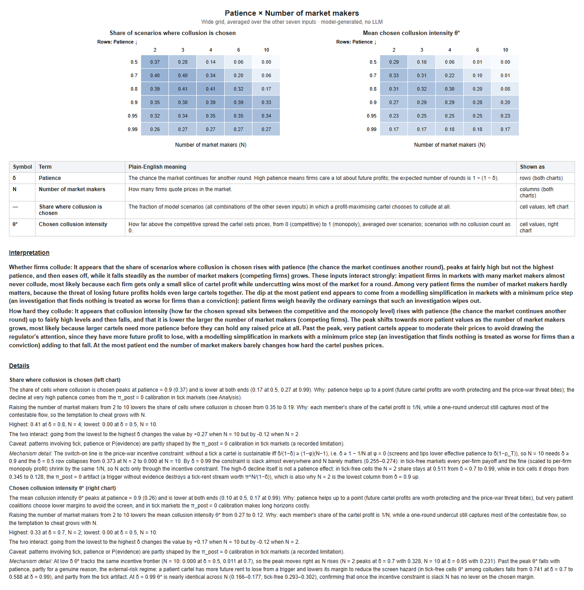

<u>**Interpretation**</u>

**Whether firms collude: It appears that the share of scenarios where collusion is chosen rises with patience (the chance the market continues another round), peaks at fairly high but not the highest patience, and then eases off, while it falls steadily as the number of market makers (competing firms) grows. These inputs interact strongly: impatient firms in markets with many market makers almost never collude, most likely because each firm gets only a small slice of cartel profit while undercutting wins most of the market for a round. Among very patient firms the number of market makers hardly matters, because the threat of losing future profits holds even large cartels together. The dip at the most patient end appears to come from a modelling simplification in markets with a minimum price step (an investigation that finds nothing is treated as worse for firms than a conviction): patient firms weigh heavily the ordinary earnings that such an investigation wipes out.**

**How hard they collude: It appears that collusion intensity (how far the chosen spread sits between the competitive and the monopoly level) rises with patience (the chance the market continues another round) up to fairly high levels and then falls, and that it is lower the larger the number of market makers (competing firms). The peak shifts towards more patient values as the number of market makers grows, most likely because larger cartels need more patience before they can hold any raised price at all. Past the peak, very patient cartels appear to moderate their prices to avoid drawing the regulator's attention, since they have more future profit to lose, with a modelling simplification in markets with a minimum price step (an investigation that finds nothing is treated as worse for firms than a conviction) adding to that fall. At the most patient end the number of market makers barely changes how hard the cartel pushes prices.**

## Patience × Preferenced volume share

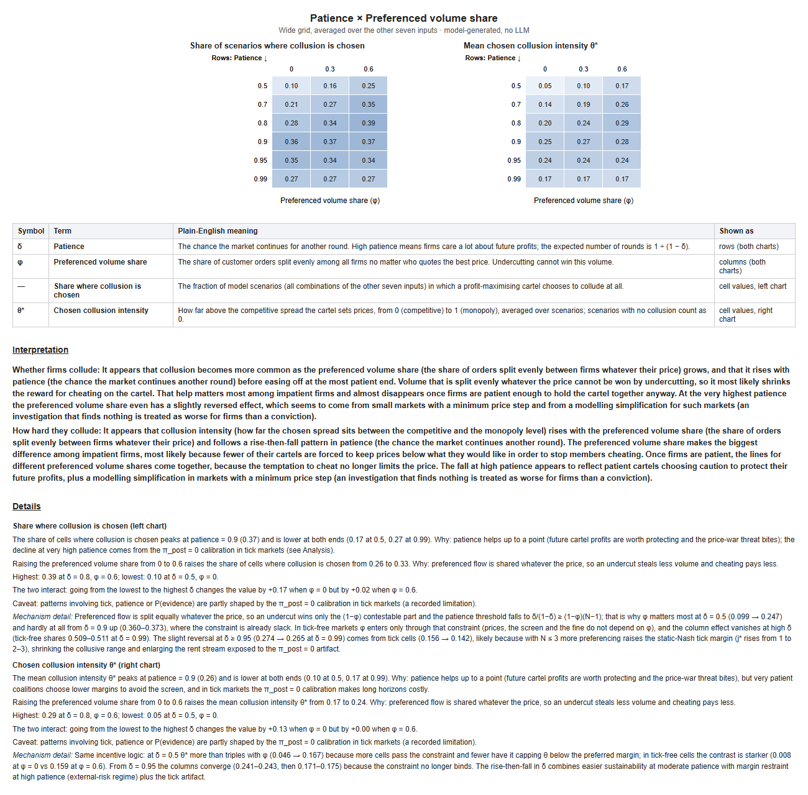

<u>**Interpretation**</u>

**Whether firms collude: It appears that collusion becomes more common as the preferenced volume share (the share of orders split evenly between firms whatever their price) grows, and that it rises with patience (the chance the market continues another round) before easing off at the most patient end. Volume that is split evenly whatever the price cannot be won by undercutting, so it most likely shrinks the reward for cheating on the cartel. That help matters most among impatient firms and almost disappears once firms are patient enough to hold the cartel together anyway. At the very highest patience the preferenced volume share even has a slightly reversed effect, which seems to come from small markets with a minimum price step and from a modelling simplification for such markets (an investigation that finds nothing is treated as worse for firms than a conviction).**

**How hard they collude: It appears that collusion intensity (how far the chosen spread sits between the competitive and the monopoly level) rises with the preferenced volume share (the share of orders split evenly between firms whatever their price) and follows a rise-then-fall pattern in patience (the chance the market continues another round). The preferenced volume share makes the biggest difference among impatient firms, most likely because fewer of their cartels are forced to keep prices below what they would like in order to stop members cheating. Once firms are patient, the lines for different preferenced volume shares come together, because the temptation to cheat no longer limits the price. The fall at high patience appears to reflect patient cartels choosing caution to protect their future profits, plus a modelling simplification in markets with a minimum price step (an investigation that finds nothing is treated as worse for firms than a conviction).**

## Patience × Tick size

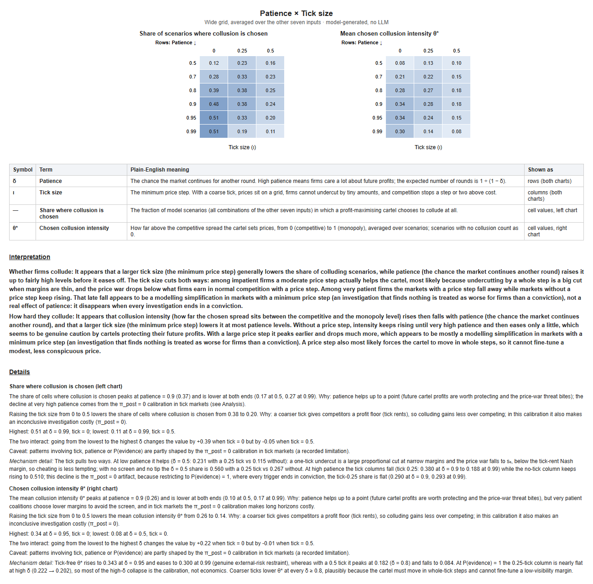

<u>**Interpretation**</u>

**Whether firms collude: It appears that a larger tick size (the minimum price step) generally lowers the share of colluding scenarios, while patience (the chance the market continues another round) raises it up to fairly high levels before it eases off. The tick size cuts both ways: among impatient firms a moderate price step actually helps the cartel, most likely because undercutting by a whole step is a big cut when margins are thin, and the price war drops below what firms earn in normal competition with a price step. Among very patient firms the markets with a price step fall away while markets without a price step keep rising. That late fall appears to be a modelling simplification in markets with a minimum price step (an investigation that finds nothing is treated as worse for firms than a conviction), not a real effect of patience: it disappears when every investigation ends in a conviction.**

**How hard they collude: It appears that collusion intensity (how far the chosen spread sits between the competitive and the monopoly level) rises then falls with patience (the chance the market continues another round), and that a larger tick size (the minimum price step) lowers it at most patience levels. Without a price step, intensity keeps rising until very high patience and then eases only a little, which seems to be genuine caution by cartels protecting their future profits. With a large price step it peaks earlier and drops much more, which appears to be mostly a modelling simplification in markets with a minimum price step (an investigation that finds nothing is treated as worse for firms than a conviction). A price step also most likely forces the cartel to move in whole steps, so it cannot fine-tune a modest, less conspicuous price.**

## Patience × Regulator screen slope

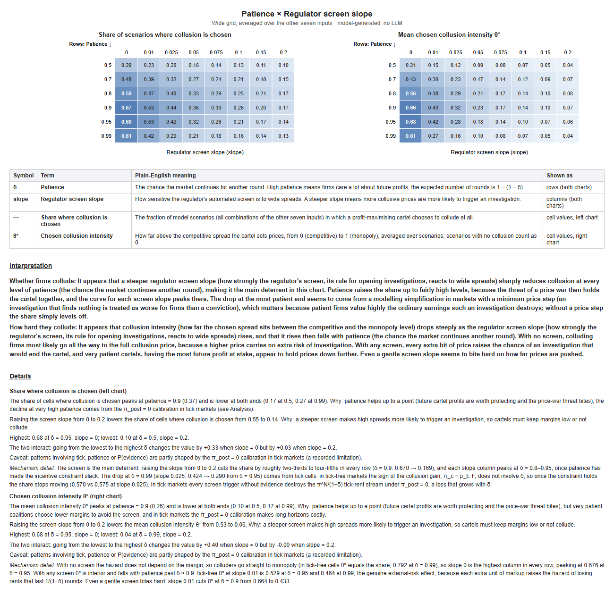

<u>**Interpretation**</u>

**Whether firms collude: It appears that a steeper regulator screen slope (how strongly the regulator's screen, its rule for opening investigations, reacts to wide spreads) sharply reduces collusion at every level of patience (the chance the market continues another round), making it the main deterrent in this chart. Patience raises the share up to fairly high levels, because the threat of a price war then holds the cartel together, and the curve for each screen slope peaks there. The drop at the most patient end seems to come from a modelling simplification in markets with a minimum price step (an investigation that finds nothing is treated as worse for firms than a conviction), which matters because patient firms value highly the ordinary earnings such an investigation destroys; without a price step the share simply levels off.**

**How hard they collude: It appears that collusion intensity (how far the chosen spread sits between the competitive and the monopoly level) drops steeply as the regulator screen slope (how strongly the regulator's screen, its rule for opening investigations, reacts to wide spreads) rises, and that it rises then falls with patience (the chance the market continues another round). With no screen, colluding firms most likely go all the way to the full-collusion price, because a higher price carries no extra risk of investigation. With any screen, every extra bit of price raises the chance of an investigation that would end the cartel, and very patient cartels, having the most future profit at stake, appear to hold prices down further. Even a gentle screen slope seems to bite hard on how far prices are pushed.**

## Patience × Tip probability

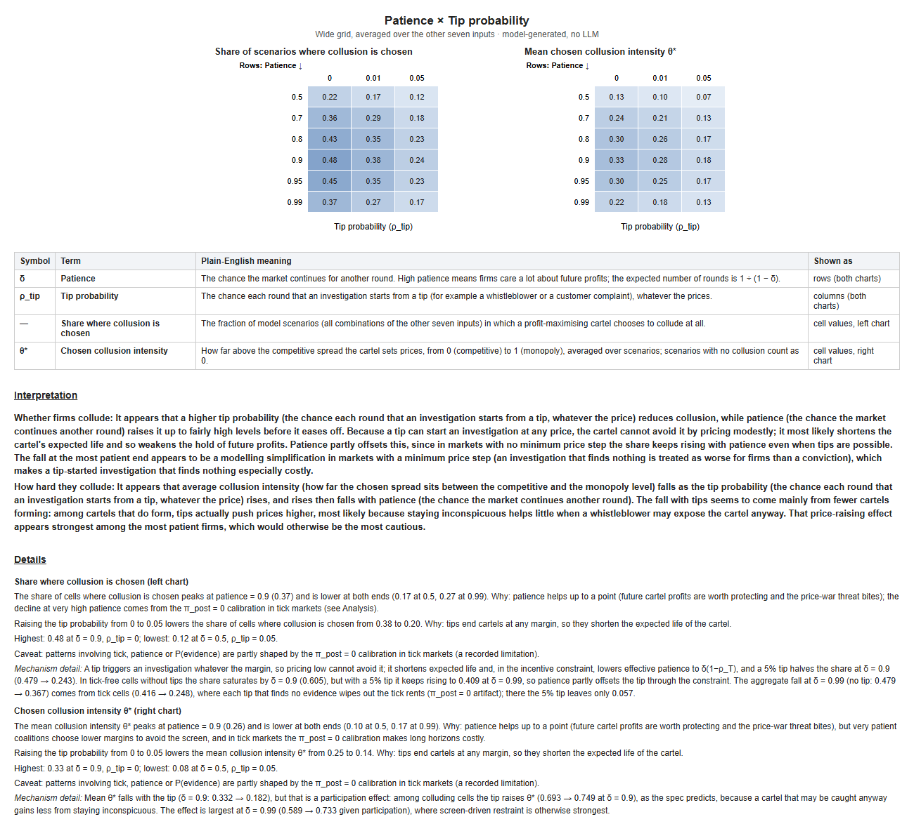

<u>**Interpretation**</u>

**Whether firms collude: It appears that a higher tip probability (the chance each round that an investigation starts from a tip, whatever the price) reduces collusion, while patience (the chance the market continues another round) raises it up to fairly high levels before it eases off. Because a tip can start an investigation at any price, the cartel cannot avoid it by pricing modestly; it most likely shortens the cartel's expected life and so weakens the hold of future profits. Patience partly offsets this, since in markets with no minimum price step the share keeps rising with patience even when tips are possible. The fall at the most patient end appears to be a modelling simplification in markets with a minimum price step (an investigation that finds nothing is treated as worse for firms than a conviction), which makes a tip-started investigation that finds nothing especially costly.**

**How hard they collude: It appears that average collusion intensity (how far the chosen spread sits between the competitive and the monopoly level) falls as the tip probability (the chance each round that an investigation starts from a tip, whatever the price) rises, and rises then falls with patience (the chance the market continues another round). The fall with tips seems to come mainly from fewer cartels forming: among cartels that do form, tips actually push prices higher, most likely because staying inconspicuous helps little when a whistleblower may expose the cartel anyway. That price-raising effect appears strongest among the most patient firms, which would otherwise be the most cautious.**

## Patience × P(evidence | investigation)

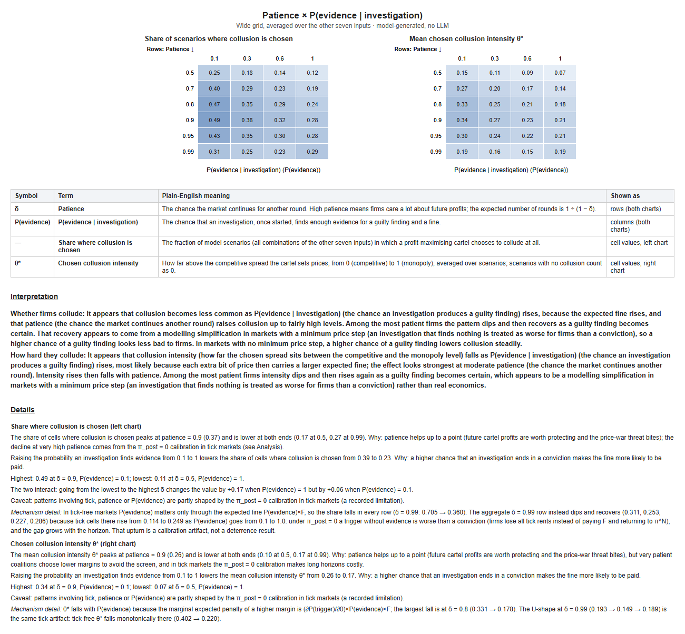

<u>**Interpretation**</u>

**Whether firms collude: It appears that collusion becomes less common as P(evidence | investigation) (the chance an investigation produces a guilty finding) rises, because the expected fine rises, and that patience (the chance the market continues another round) raises collusion up to fairly high levels. Among the most patient firms the pattern dips and then recovers as a guilty finding becomes certain. That recovery appears to come from a modelling simplification in markets with a minimum price step (an investigation that finds nothing is treated as worse for firms than a conviction), so a higher chance of a guilty finding looks less bad to firms. In markets with no minimum price step, a higher chance of a guilty finding lowers collusion steadily.**

**How hard they collude: It appears that collusion intensity (how far the chosen spread sits between the competitive and the monopoly level) falls as P(evidence | investigation) (the chance an investigation produces a guilty finding) rises, most likely because each extra bit of price then carries a larger expected fine; the effect looks strongest at moderate patience (the chance the market continues another round). Intensity rises then falls with patience. Among the most patient firms intensity dips and then rises again as a guilty finding becomes certain, which appears to be a modelling simplification in markets with a minimum price step (an investigation that finds nothing is treated as worse for firms than a conviction) rather than real economics.**

## Patience × Fine ratio

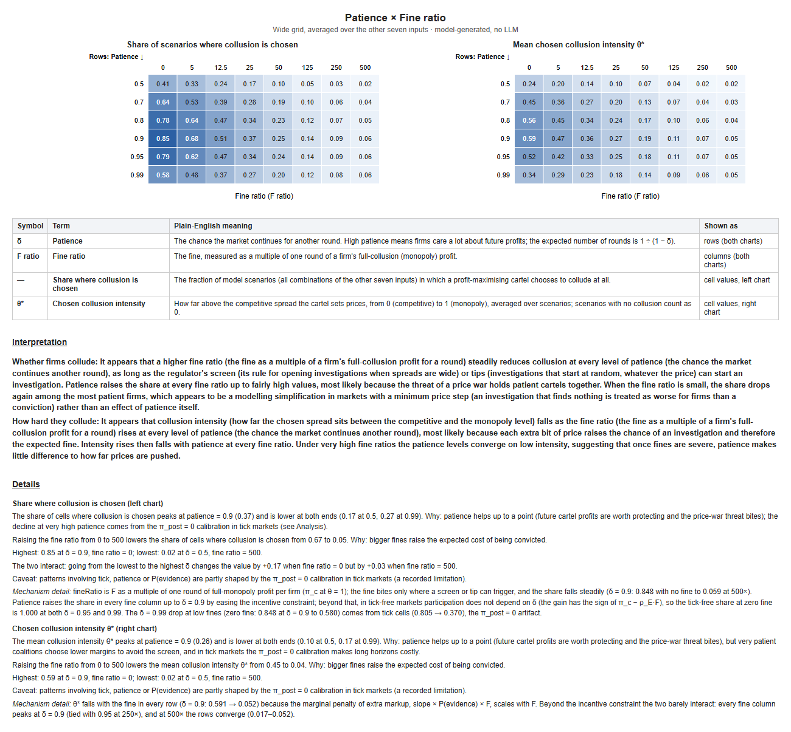

<u>**Interpretation**</u>

**Whether firms collude: It appears that a higher fine ratio (the fine as a multiple of a firm's full-collusion profit for a round) steadily reduces collusion at every level of patience (the chance the market continues another round), as long as the regulator's screen (its rule for opening investigations when spreads are wide) or tips (investigations that start at random, whatever the price) can start an investigation. Patience raises the share at every fine ratio up to fairly high values, most likely because the threat of a price war holds patient cartels together. When the fine ratio is small, the share drops again among the most patient firms, which appears to be a modelling simplification in markets with a minimum price step (an investigation that finds nothing is treated as worse for firms than a conviction) rather than an effect of patience itself.**

**How hard they collude: It appears that collusion intensity (how far the chosen spread sits between the competitive and the monopoly level) falls as the fine ratio (the fine as a multiple of a firm's full-collusion profit for a round) rises at every level of patience (the chance the market continues another round), most likely because each extra bit of price raises the chance of an investigation and therefore the expected fine. Intensity rises then falls with patience at every fine ratio. Under very high fine ratios the patience levels converge on low intensity, suggesting that once fines are severe, patience makes little difference to how far prices are pushed.**

## Patience × Reservation spread ratio

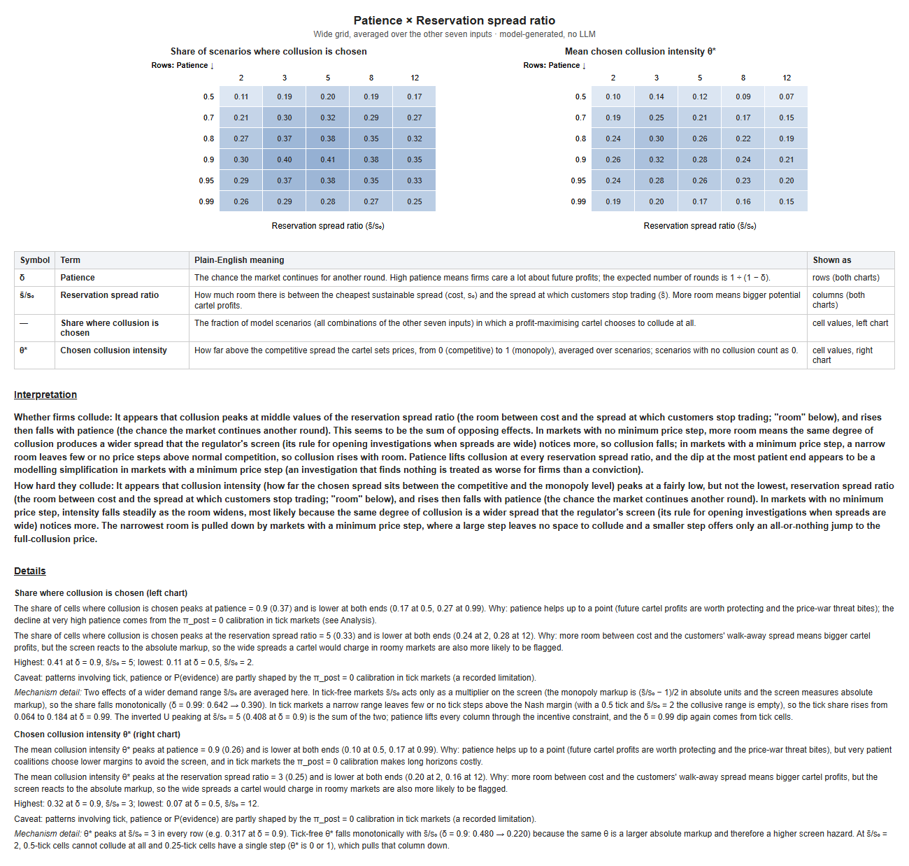

<u>**Interpretation**</u>

**Whether firms collude: It appears that collusion peaks at middle values of the reservation spread ratio (the room between cost and the spread at which customers stop trading; "room" below), and rises then falls with patience (the chance the market continues another round). This seems to be the sum of opposing effects. In markets with no minimum price step, more room means the same degree of collusion produces a wider spread that the regulator's screen (its rule for opening investigations when spreads are wide) notices more, so collusion falls; in markets with a minimum price step, a narrow room leaves few or no price steps above normal competition, so collusion rises with room. Patience lifts collusion at every reservation spread ratio, and the dip at the most patient end appears to be a modelling simplification in markets with a minimum price step (an investigation that finds nothing is treated as worse for firms than a conviction).**

**How hard they collude: It appears that collusion intensity (how far the chosen spread sits between the competitive and the monopoly level) peaks at a fairly low, but not the lowest, reservation spread ratio (the room between cost and the spread at which customers stop trading; "room" below), and rises then falls with patience (the chance the market continues another round). In markets with no minimum price step, intensity falls steadily as the room widens, most likely because the same degree of collusion is a wider spread that the regulator's screen (its rule for opening investigations when spreads are wide) notices more. The narrowest room is pulled down by markets with a minimum price step, where a large step leaves no space to collude and a smaller step offers only an all-or-nothing jump to the full-collusion price.**

## Number of market makers × Preferenced volume share

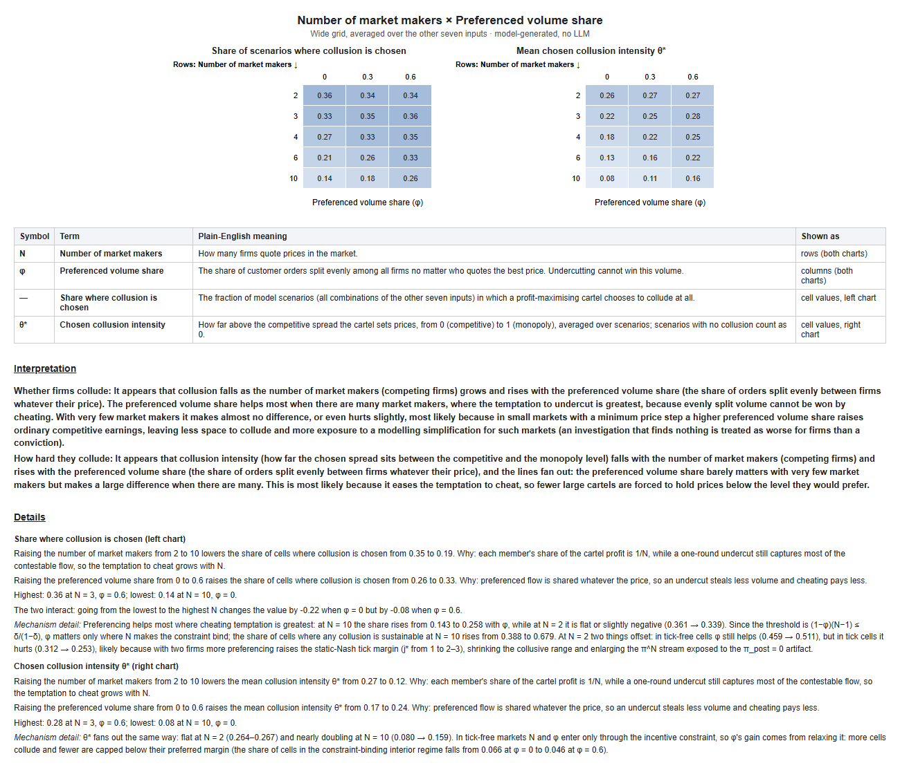

<u>**Interpretation**</u>

**Whether firms collude: It appears that collusion falls as the number of market makers (competing firms) grows and rises with the preferenced volume share (the share of orders split evenly between firms whatever their price). The preferenced volume share helps most when there are many market makers, where the temptation to undercut is greatest, because evenly split volume cannot be won by cheating. With very few market makers it makes almost no difference, or even hurts slightly, most likely because in small markets with a minimum price step a higher preferenced volume share raises ordinary competitive earnings, leaving less space to collude and more exposure to a modelling simplification for such markets (an investigation that finds nothing is treated as worse for firms than a conviction).**

**How hard they collude: It appears that collusion intensity (how far the chosen spread sits between the competitive and the monopoly level) falls with the number of market makers (competing firms) and rises with the preferenced volume share (the share of orders split evenly between firms whatever their price), and the lines fan out: the preferenced volume share barely matters with very few market makers but makes a large difference when there are many. This is most likely because it eases the temptation to cheat, so fewer large cartels are forced to hold prices below the level they would prefer.**

## Number of market makers × Tick size

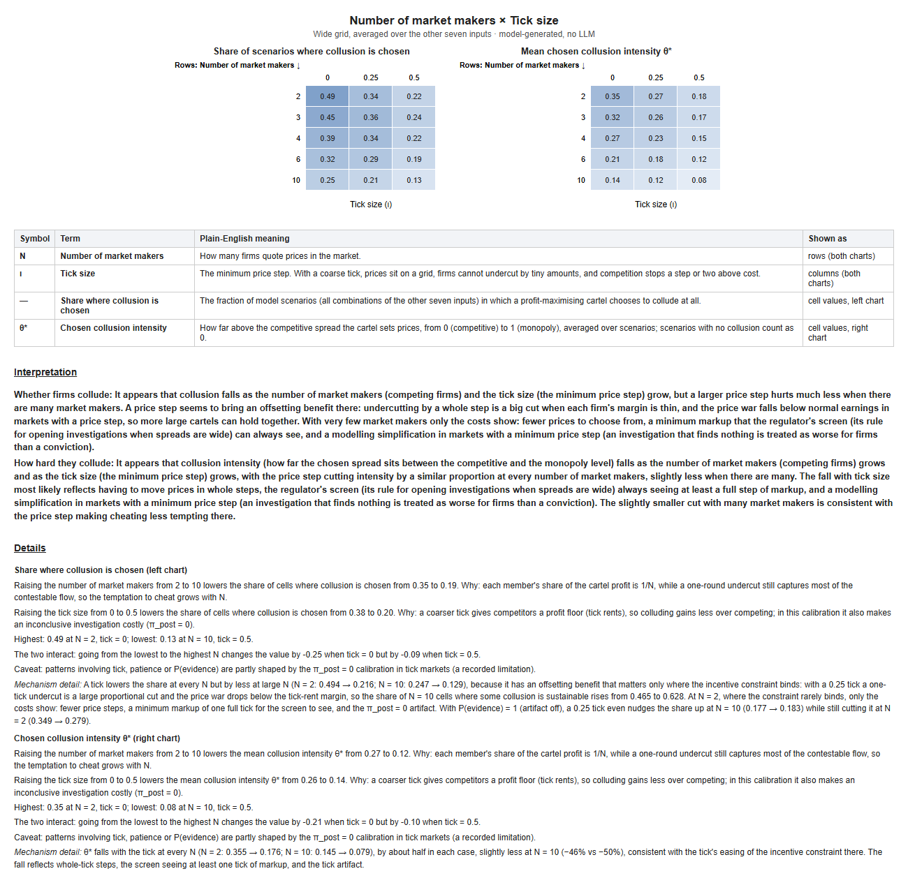

<u>**Interpretation**</u>

**Whether firms collude: It appears that collusion falls as the number of market makers (competing firms) and the tick size (the minimum price step) grow, but a larger price step hurts much less when there are many market makers. A price step seems to bring an offsetting benefit there: undercutting by a whole step is a big cut when each firm's margin is thin, and the price war falls below normal earnings in markets with a price step, so more large cartels can hold together. With very few market makers only the costs show: fewer prices to choose from, a minimum markup that the regulator's screen (its rule for opening investigations when spreads are wide) can always see, and a modelling simplification in markets with a minimum price step (an investigation that finds nothing is treated as worse for firms than a conviction).**

**How hard they collude: It appears that collusion intensity (how far the chosen spread sits between the competitive and the monopoly level) falls as the number of market makers (competing firms) grows and as the tick size (the minimum price step) grows, with the price step cutting intensity by a similar proportion at every number of market makers, slightly less when there are many. The fall with tick size most likely reflects having to move prices in whole steps, the regulator's screen (its rule for opening investigations when spreads are wide) always seeing at least a full step of markup, and a modelling simplification in markets with a minimum price step (an investigation that finds nothing is treated as worse for firms than a conviction). The slightly smaller cut with many market makers is consistent with the price step making cheating less tempting there.**

## Number of market makers × Regulator screen slope

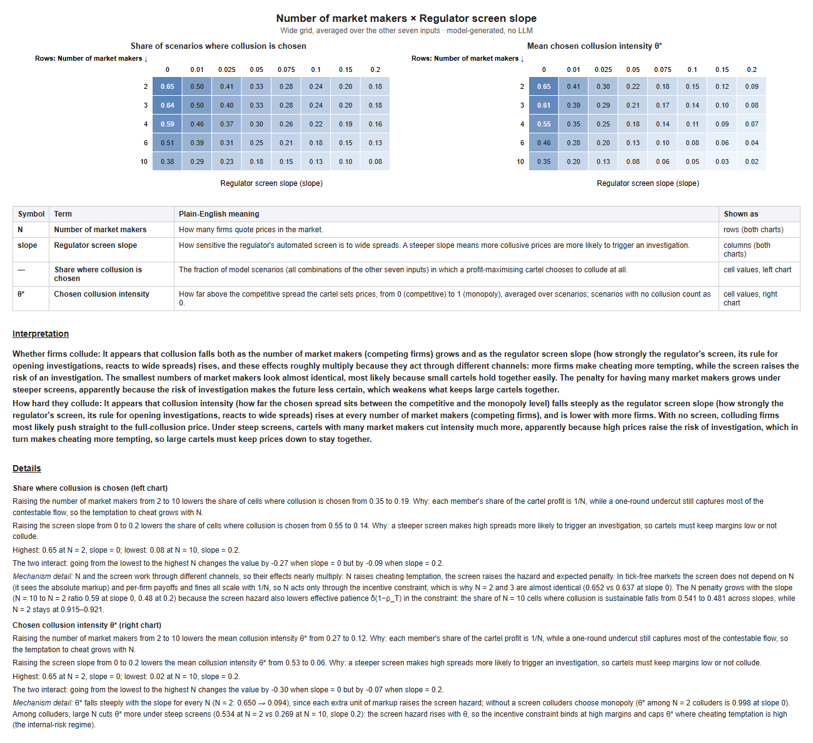

<u>**Interpretation**</u>

**Whether firms collude: It appears that collusion falls both as the number of market makers (competing firms) grows and as the regulator screen slope (how strongly the regulator's screen, its rule for opening investigations, reacts to wide spreads) rises, and these effects roughly multiply because they act through different channels: more firms make cheating more tempting, while the screen raises the risk of an investigation. The smallest numbers of market makers look almost identical, most likely because small cartels hold together easily. The penalty for having many market makers grows under steeper screens, apparently because the risk of investigation makes the future less certain, which weakens what keeps large cartels together.**

**How hard they collude: It appears that collusion intensity (how far the chosen spread sits between the competitive and the monopoly level) falls steeply as the regulator screen slope (how strongly the regulator's screen, its rule for opening investigations, reacts to wide spreads) rises at every number of market makers (competing firms), and is lower with more firms. With no screen, colluding firms most likely push straight to the full-collusion price. Under steep screens, cartels with many market makers cut intensity much more, apparently because high prices raise the risk of investigation, which in turn makes cheating more tempting, so large cartels must keep prices down to stay together.**

## Number of market makers × Tip probability

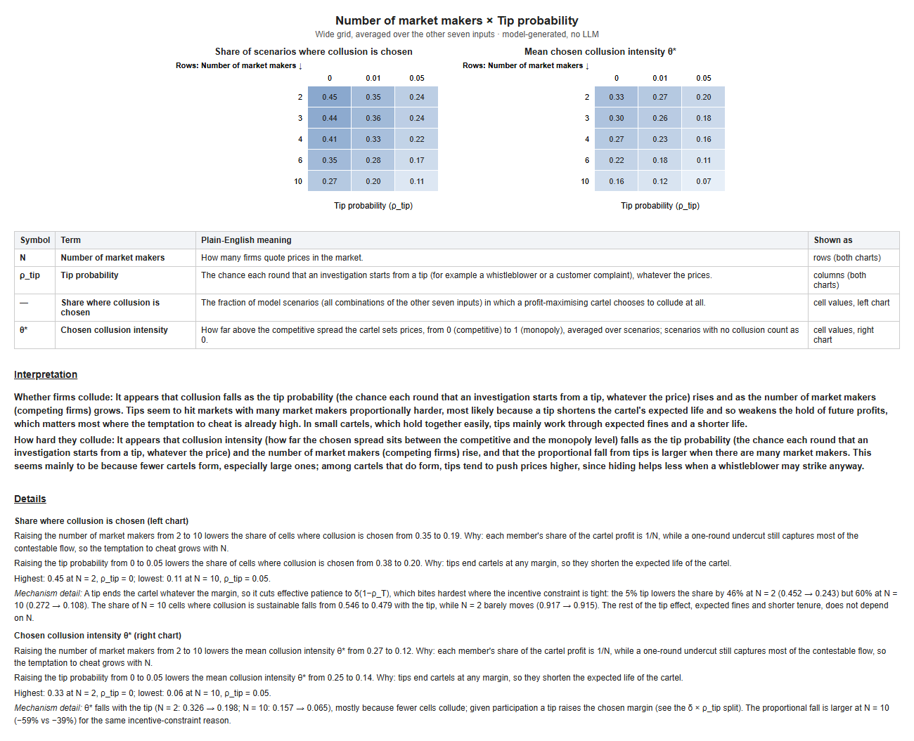

<u>**Interpretation**</u>

**Whether firms collude: It appears that collusion falls as the tip probability (the chance each round that an investigation starts from a tip, whatever the price) rises and as the number of market makers (competing firms) grows. Tips seem to hit markets with many market makers proportionally harder, most likely because a tip shortens the cartel's expected life and so weakens the hold of future profits, which matters most where the temptation to cheat is already high. In small cartels, which hold together easily, tips mainly work through expected fines and a shorter life.**

**How hard they collude: It appears that collusion intensity (how far the chosen spread sits between the competitive and the monopoly level) falls as the tip probability (the chance each round that an investigation starts from a tip, whatever the price) and the number of market makers (competing firms) rise, and that the proportional fall from tips is larger when there are many market makers. This seems mainly to be because fewer cartels form, especially large ones; among cartels that do form, tips tend to push prices higher, since hiding helps less when a whistleblower may strike anyway.**

## Number of market makers × P(evidence | investigation)

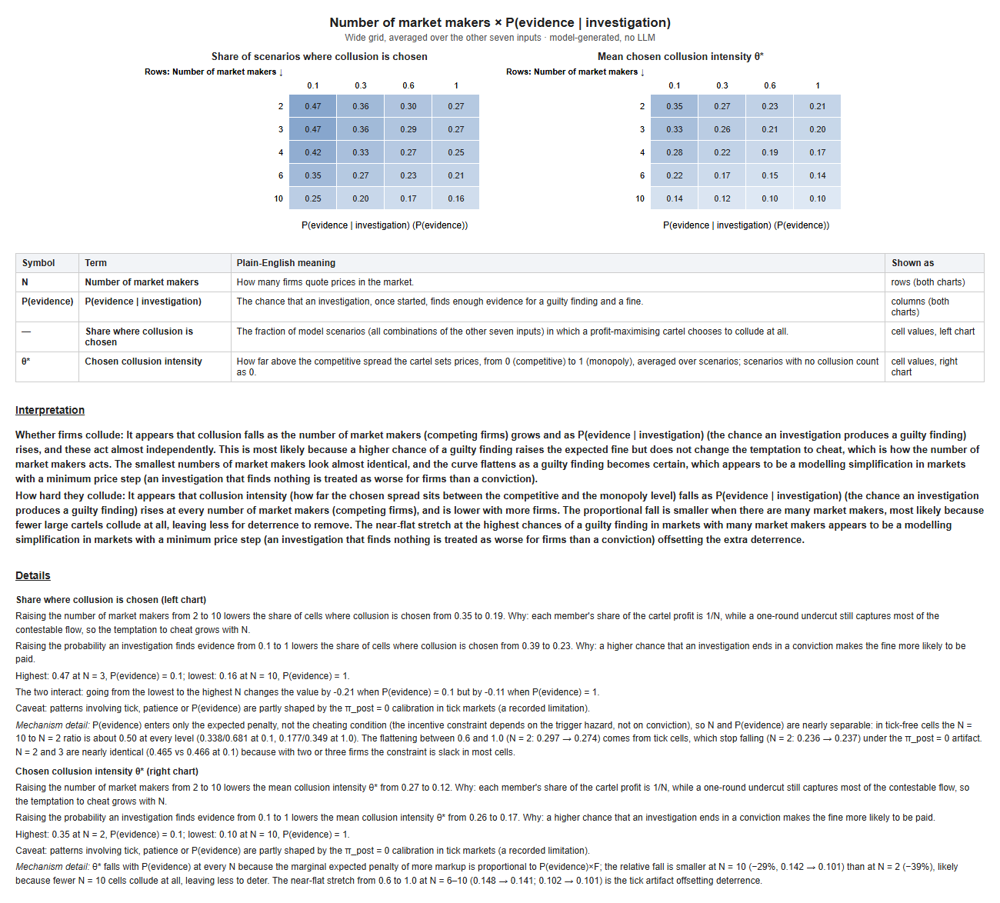

<u>**Interpretation**</u>

**Whether firms collude: It appears that collusion falls as the number of market makers (competing firms) grows and as P(evidence | investigation) (the chance an investigation produces a guilty finding) rises, and these act almost independently. This is most likely because a higher chance of a guilty finding raises the expected fine but does not change the temptation to cheat, which is how the number of market makers acts. The smallest numbers of market makers look almost identical, and the curve flattens as a guilty finding becomes certain, which appears to be a modelling simplification in markets with a minimum price step (an investigation that finds nothing is treated as worse for firms than a conviction).**

**How hard they collude: It appears that collusion intensity (how far the chosen spread sits between the competitive and the monopoly level) falls as P(evidence | investigation) (the chance an investigation produces a guilty finding) rises at every number of market makers (competing firms), and is lower with more firms. The proportional fall is smaller when there are many market makers, most likely because fewer large cartels collude at all, leaving less for deterrence to remove. The near-flat stretch at the highest chances of a guilty finding in markets with many market makers appears to be a modelling simplification in markets with a minimum price step (an investigation that finds nothing is treated as worse for firms than a conviction) offsetting the extra deterrence.**

## Number of market makers × Fine ratio

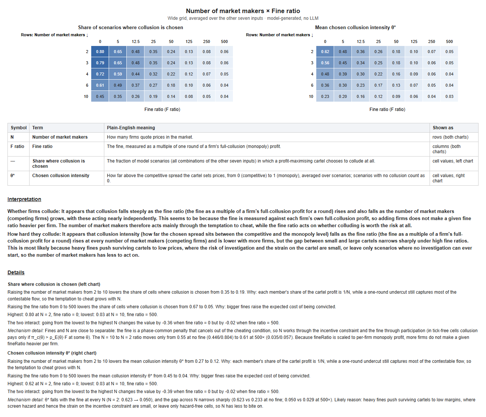

<u>**Interpretation**</u>

**Whether firms collude: It appears that collusion falls steeply as the fine ratio (the fine as a multiple of a firm's full-collusion profit for a round) rises and also falls as the number of market makers (competing firms) grows, with these acting nearly independently. This seems to be because the fine is measured against each firm's own full-collusion profit, so adding firms does not make a given fine ratio heavier per firm. The number of market makers therefore acts mainly through the temptation to cheat, while the fine ratio acts on whether colluding is worth the risk at all.**

**How hard they collude: It appears that collusion intensity (how far the chosen spread sits between the competitive and the monopoly level) falls as the fine ratio (the fine as a multiple of a firm's full-collusion profit for a round) rises at every number of market makers (competing firms) and is lower with more firms, but the gap between small and large cartels narrows sharply under high fine ratios. This is most likely because heavy fines push surviving cartels to low prices, where the risk of investigation and the strain on the cartel are small, or leave only scenarios where no investigation can ever start, so the number of market makers has less to act on.**

## Number of market makers × Reservation spread ratio

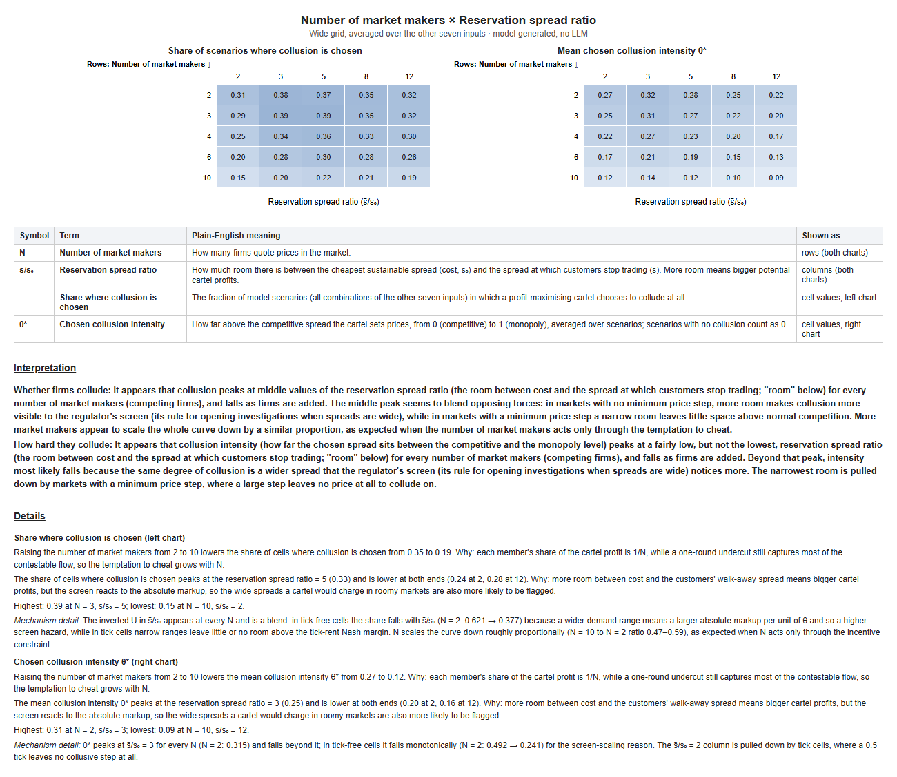

<u>**Interpretation**</u>

**Whether firms collude: It appears that collusion peaks at middle values of the reservation spread ratio (the room between cost and the spread at which customers stop trading; "room" below) for every number of market makers (competing firms), and falls as firms are added. The middle peak seems to blend opposing forces: in markets with no minimum price step, more room makes collusion more visible to the regulator's screen (its rule for opening investigations when spreads are wide), while in markets with a minimum price step a narrow room leaves little space above normal competition. More market makers appear to scale the whole curve down by a similar proportion, as expected when the number of market makers acts only through the temptation to cheat.**

**How hard they collude: It appears that collusion intensity (how far the chosen spread sits between the competitive and the monopoly level) peaks at a fairly low, but not the lowest, reservation spread ratio (the room between cost and the spread at which customers stop trading; "room" below) for every number of market makers (competing firms), and falls as firms are added. Beyond that peak, intensity most likely falls because the same degree of collusion is a wider spread that the regulator's screen (its rule for opening investigations when spreads are wide) notices more. The narrowest room is pulled down by markets with a minimum price step, where a large step leaves no price at all to collude on.**

## Preferenced volume share × Tick size

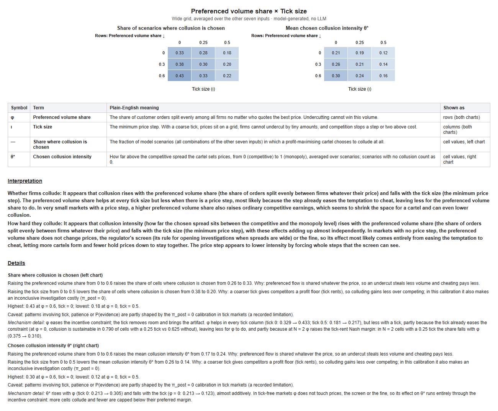

<u>**Interpretation**</u>

**Whether firms collude: It appears that collusion rises with the preferenced volume share (the share of orders split evenly between firms whatever their price) and falls with the tick size (the minimum price step). The preferenced volume share helps at every tick size but less when there is a price step, most likely because the step already eases the temptation to cheat, leaving less for the preferenced volume share to do. In very small markets with a price step, a higher preferenced volume share also raises ordinary competitive earnings, which seems to shrink the space for a cartel and can even lower collusion.**

**How hard they collude: It appears that collusion intensity (how far the chosen spread sits between the competitive and the monopoly level) rises with the preferenced volume share (the share of orders split evenly between firms whatever their price) and falls with the tick size (the minimum price step), with these effects adding up almost independently. In markets with no price step, the preferenced volume share does not change prices, the regulator's screen (its rule for opening investigations when spreads are wide) or the fine, so its effect most likely comes entirely from easing the temptation to cheat, letting more cartels form and fewer hold prices down to stay together. The price step appears to lower intensity by forcing whole steps that the screen can see.**

## Preferenced volume share × Regulator screen slope

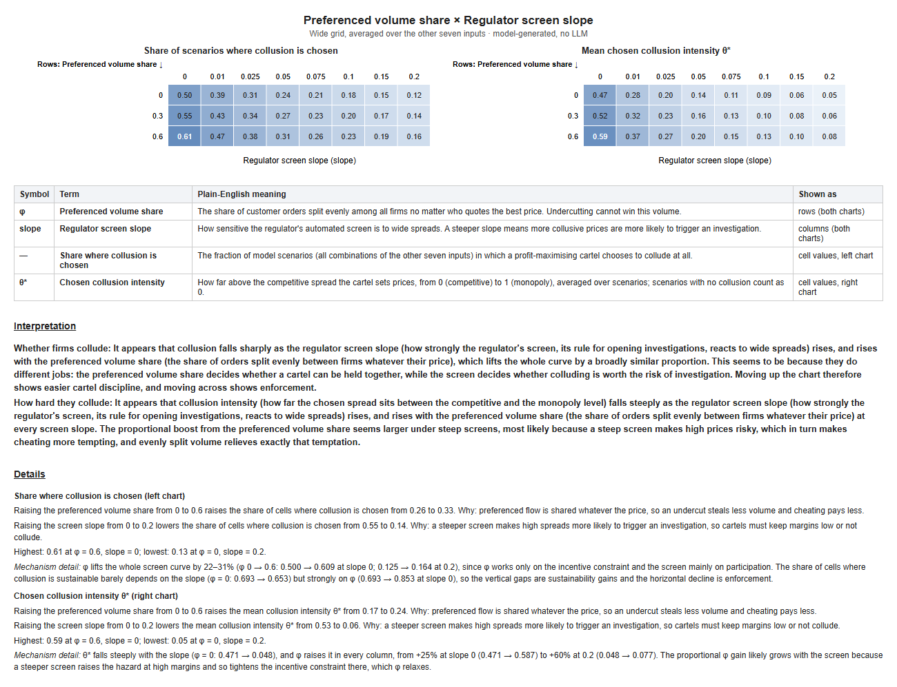

<u>**Interpretation**</u>

**Whether firms collude: It appears that collusion falls sharply as the regulator screen slope (how strongly the regulator's screen, its rule for opening investigations, reacts to wide spreads) rises, and rises with the preferenced volume share (the share of orders split evenly between firms whatever their price), which lifts the whole curve by a broadly similar proportion. This seems to be because they do different jobs: the preferenced volume share decides whether a cartel can be held together, while the screen decides whether colluding is worth the risk of investigation. Moving up the chart therefore shows easier cartel discipline, and moving across shows enforcement.**

**How hard they collude: It appears that collusion intensity (how far the chosen spread sits between the competitive and the monopoly level) falls steeply as the regulator screen slope (how strongly the regulator's screen, its rule for opening investigations, reacts to wide spreads) rises, and rises with the preferenced volume share (the share of orders split evenly between firms whatever their price) at every screen slope. The proportional boost from the preferenced volume share seems larger under steep screens, most likely because a steep screen makes high prices risky, which in turn makes cheating more tempting, and evenly split volume relieves exactly that temptation.**

## Preferenced volume share × Tip probability

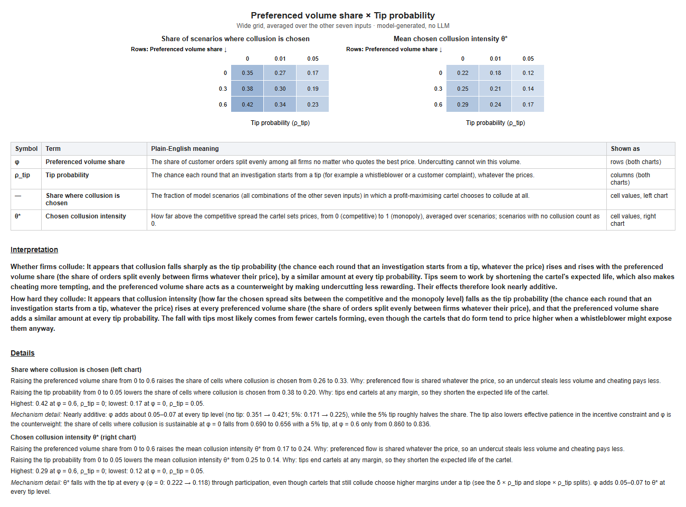

<u>**Interpretation**</u>

**Whether firms collude: It appears that collusion falls sharply as the tip probability (the chance each round that an investigation starts from a tip, whatever the price) rises and rises with the preferenced volume share (the share of orders split evenly between firms whatever their price), by a similar amount at every tip probability. Tips seem to work by shortening the cartel's expected life, which also makes cheating more tempting, and the preferenced volume share acts as a counterweight by making undercutting less rewarding. Their effects therefore look nearly additive.**

**How hard they collude: It appears that collusion intensity (how far the chosen spread sits between the competitive and the monopoly level) falls as the tip probability (the chance each round that an investigation starts from a tip, whatever the price) rises at every preferenced volume share (the share of orders split evenly between firms whatever their price), and that the preferenced volume share adds a similar amount at every tip probability. The fall with tips most likely comes from fewer cartels forming, even though the cartels that do form tend to price higher when a whistleblower might expose them anyway.**

## Preferenced volume share × P(evidence | investigation)

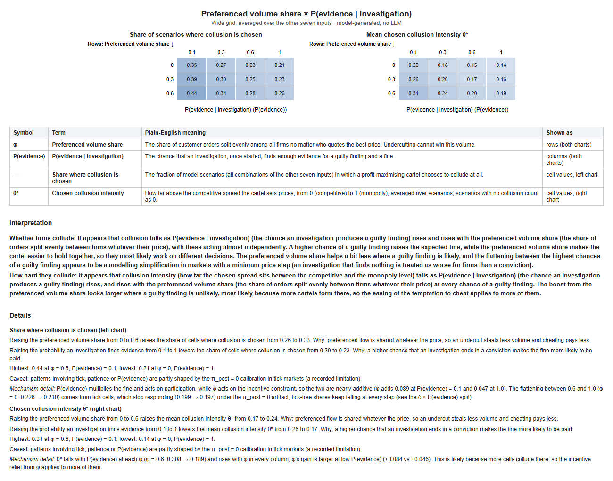

<u>**Interpretation**</u>

**Whether firms collude: It appears that collusion falls as P(evidence | investigation) (the chance an investigation produces a guilty finding) rises and rises with the preferenced volume share (the share of orders split evenly between firms whatever their price), with these acting almost independently. A higher chance of a guilty finding raises the expected fine, while the preferenced volume share makes the cartel easier to hold together, so they most likely work on different decisions. The preferenced volume share helps a bit less where a guilty finding is likely, and the flattening between the highest chances of a guilty finding appears to be a modelling simplification in markets with a minimum price step (an investigation that finds nothing is treated as worse for firms than a conviction).**

**How hard they collude: It appears that collusion intensity (how far the chosen spread sits between the competitive and the monopoly level) falls as P(evidence | investigation) (the chance an investigation produces a guilty finding) rises, and rises with the preferenced volume share (the share of orders split evenly between firms whatever their price) at every chance of a guilty finding. The boost from the preferenced volume share looks larger where a guilty finding is unlikely, most likely because more cartels form there, so the easing of the temptation to cheat applies to more of them.**

## Preferenced volume share × Fine ratio

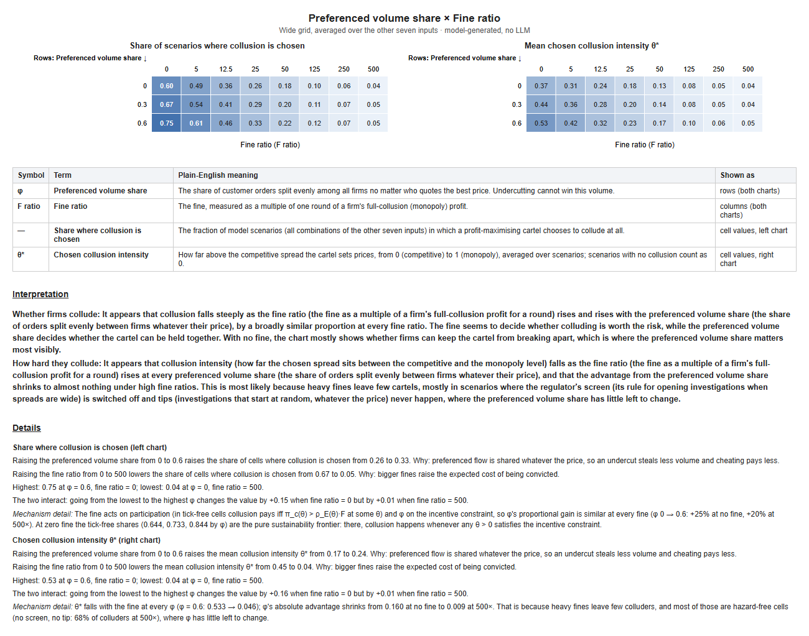

<u>**Interpretation**</u>

**Whether firms collude: It appears that collusion falls steeply as the fine ratio (the fine as a multiple of a firm's full-collusion profit for a round) rises and rises with the preferenced volume share (the share of orders split evenly between firms whatever their price), by a broadly similar proportion at every fine ratio. The fine seems to decide whether colluding is worth the risk, while the preferenced volume share decides whether the cartel can be held together. With no fine, the chart mostly shows whether firms can keep the cartel from breaking apart, which is where the preferenced volume share matters most visibly.**

**How hard they collude: It appears that collusion intensity (how far the chosen spread sits between the competitive and the monopoly level) falls as the fine ratio (the fine as a multiple of a firm's full-collusion profit for a round) rises at every preferenced volume share (the share of orders split evenly between firms whatever their price), and that the advantage from the preferenced volume share shrinks to almost nothing under high fine ratios. This is most likely because heavy fines leave few cartels, mostly in scenarios where the regulator's screen (its rule for opening investigations when spreads are wide) is switched off and tips (investigations that start at random, whatever the price) never happen, where the preferenced volume share has little left to change.**

## Preferenced volume share × Reservation spread ratio

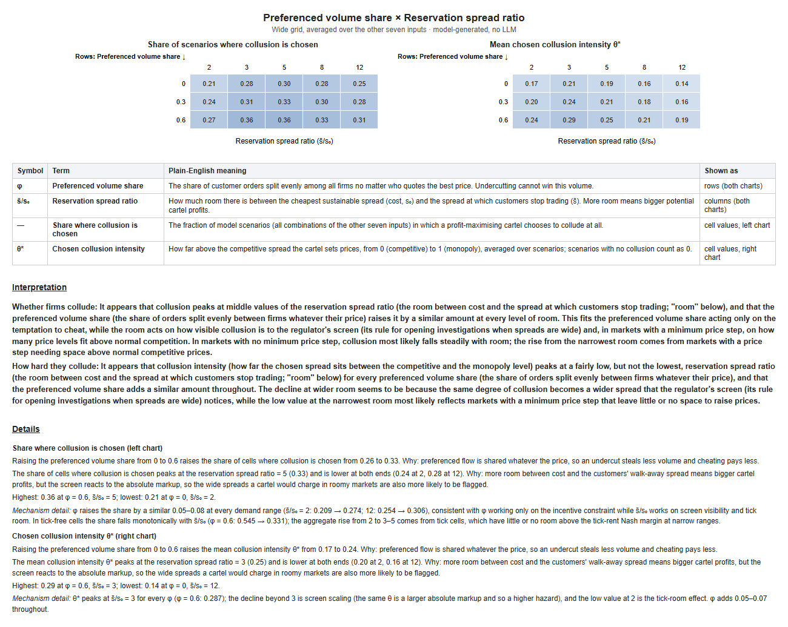

<u>**Interpretation**</u>

**Whether firms collude: It appears that collusion peaks at middle values of the reservation spread ratio (the room between cost and the spread at which customers stop trading; "room" below), and that the preferenced volume share (the share of orders split evenly between firms whatever their price) raises it by a similar amount at every level of room. This fits the preferenced volume share acting only on the temptation to cheat, while the room acts on how visible collusion is to the regulator's screen (its rule for opening investigations when spreads are wide) and, in markets with a minimum price step, on how many price levels fit above normal competition. In markets with no minimum price step, collusion most likely falls steadily with room; the rise from the narrowest room comes from markets with a price step needing space above normal competitive prices.**

**How hard they collude: It appears that collusion intensity (how far the chosen spread sits between the competitive and the monopoly level) peaks at a fairly low, but not the lowest, reservation spread ratio (the room between cost and the spread at which customers stop trading; "room" below) for every preferenced volume share (the share of orders split evenly between firms whatever their price), and that the preferenced volume share adds a similar amount throughout. The decline at wider room seems to be because the same degree of collusion becomes a wider spread that the regulator's screen (its rule for opening investigations when spreads are wide) notices, while the low value at the narrowest room most likely reflects markets with a minimum price step that leave little or no space to raise prices.**

## Tick size × Regulator screen slope

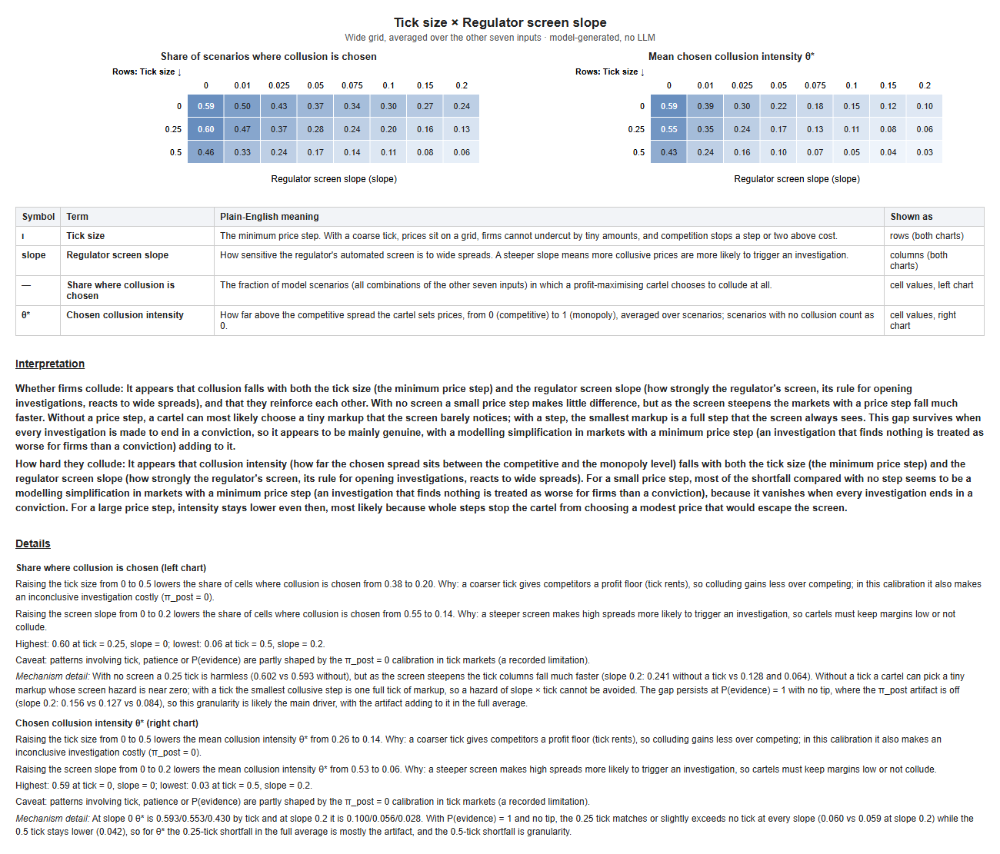

<u>**Interpretation**</u>

**Whether firms collude: It appears that collusion falls with both the tick size (the minimum price step) and the regulator screen slope (how strongly the regulator's screen, its rule for opening investigations, reacts to wide spreads), and that they reinforce each other. With no screen a small price step makes little difference, but as the screen steepens the markets with a price step fall much faster. Without a price step, a cartel can most likely choose a tiny markup that the screen barely notices; with a step, the smallest markup is a full step that the screen always sees. This gap survives when every investigation is made to end in a conviction, so it appears to be mainly genuine, with a modelling simplification in markets with a minimum price step (an investigation that finds nothing is treated as worse for firms than a conviction) adding to it.**

**How hard they collude: It appears that collusion intensity (how far the chosen spread sits between the competitive and the monopoly level) falls with both the tick size (the minimum price step) and the regulator screen slope (how strongly the regulator's screen, its rule for opening investigations, reacts to wide spreads). For a small price step, most of the shortfall compared with no step seems to be a modelling simplification in markets with a minimum price step (an investigation that finds nothing is treated as worse for firms than a conviction), because it vanishes when every investigation ends in a conviction. For a large price step, intensity stays lower even then, most likely because whole steps stop the cartel from choosing a modest price that would escape the screen.**

## Tick size × Tip probability

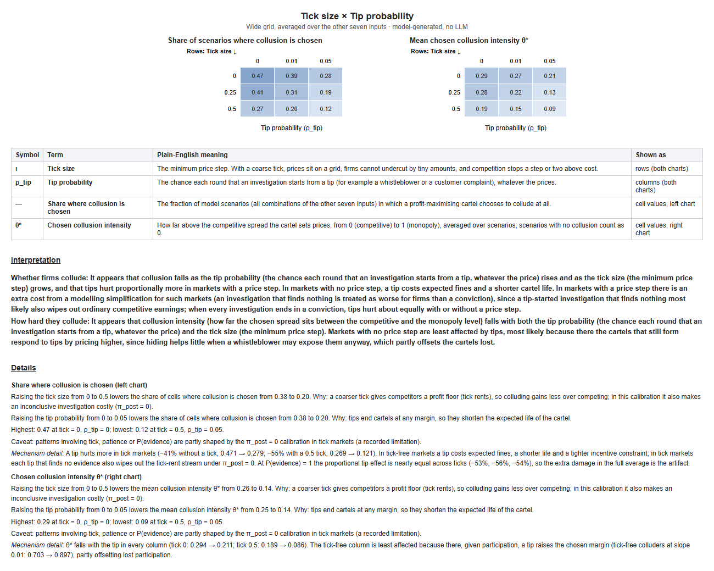

<u>**Interpretation**</u>

**Whether firms collude: It appears that collusion falls as the tip probability (the chance each round that an investigation starts from a tip, whatever the price) rises and as the tick size (the minimum price step) grows, and that tips hurt proportionally more in markets with a price step. In markets with no price step, a tip costs expected fines and a shorter cartel life. In markets with a price step there is an extra cost from a modelling simplification for such markets (an investigation that finds nothing is treated as worse for firms than a conviction), since a tip-started investigation that finds nothing most likely also wipes out ordinary competitive earnings; when every investigation ends in a conviction, tips hurt about equally with or without a price step.**

**How hard they collude: It appears that collusion intensity (how far the chosen spread sits between the competitive and the monopoly level) falls with both the tip probability (the chance each round that an investigation starts from a tip, whatever the price) and the tick size (the minimum price step). Markets with no price step are least affected by tips, most likely because there the cartels that still form respond to tips by pricing higher, since hiding helps little when a whistleblower may expose them anyway, which partly offsets the cartels lost.**

## Tick size × P(evidence | investigation)

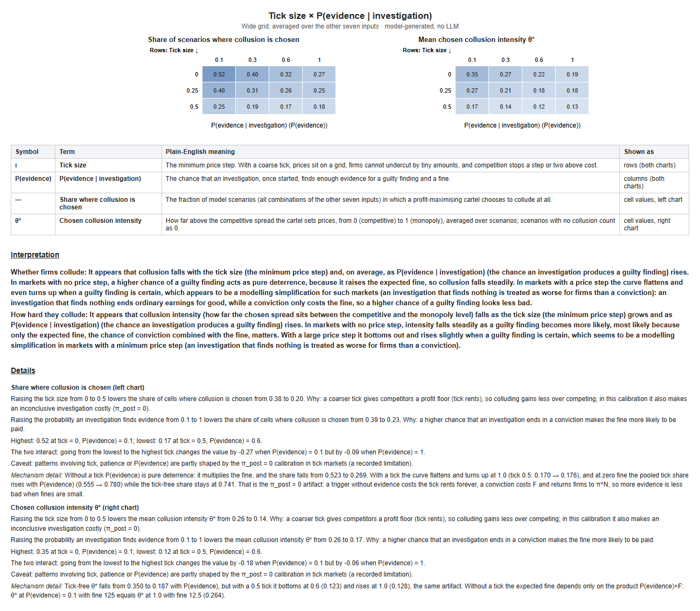

<u>**Interpretation**</u>

**Whether firms collude: It appears that collusion falls with the tick size (the minimum price step) and, on average, as P(evidence | investigation) (the chance an investigation produces a guilty finding) rises. In markets with no price step, a higher chance of a guilty finding acts as pure deterrence, because it raises the expected fine, so collusion falls steadily. In markets with a price step the curve flattens and even turns up when a guilty finding is certain, which appears to be a modelling simplification for such markets (an investigation that finds nothing is treated as worse for firms than a conviction): an investigation that finds nothing ends ordinary earnings for good, while a conviction only costs the fine, so a higher chance of a guilty finding looks less bad.**

**How hard they collude: It appears that collusion intensity (how far the chosen spread sits between the competitive and the monopoly level) falls as the tick size (the minimum price step) grows and as P(evidence | investigation) (the chance an investigation produces a guilty finding) rises. In markets with no price step, intensity falls steadily as a guilty finding becomes more likely, most likely because only the expected fine, the chance of conviction combined with the fine, matters. With a large price step it bottoms out and rises slightly when a guilty finding is certain, which seems to be a modelling simplification in markets with a minimum price step (an investigation that finds nothing is treated as worse for firms than a conviction).**

## Tick size × Fine ratio

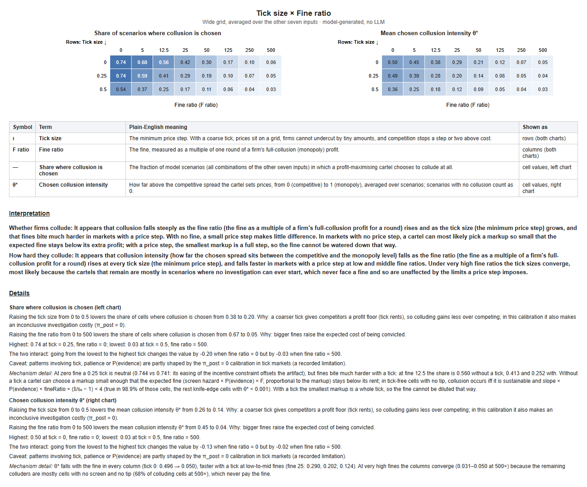

<u>**Interpretation**</u>

**Whether firms collude: It appears that collusion falls steeply as the fine ratio (the fine as a multiple of a firm's full-collusion profit for a round) rises and as the tick size (the minimum price step) grows, and that fines bite much harder in markets with a price step. With no fine, a small price step makes little difference. In markets with no price step, a cartel can most likely pick a markup so small that the expected fine stays below its extra profit; with a price step, the smallest markup is a full step, so the fine cannot be watered down that way.**

**How hard they collude: It appears that collusion intensity (how far the chosen spread sits between the competitive and the monopoly level) falls as the fine ratio (the fine as a multiple of a firm's full-collusion profit for a round) rises at every tick size (the minimum price step), and falls faster in markets with a price step at low and middle fine ratios. Under very high fine ratios the tick sizes converge, most likely because the cartels that remain are mostly in scenarios where no investigation can ever start, which never face a fine and so are unaffected by the limits a price step imposes.**

## Tick size × Reservation spread ratio

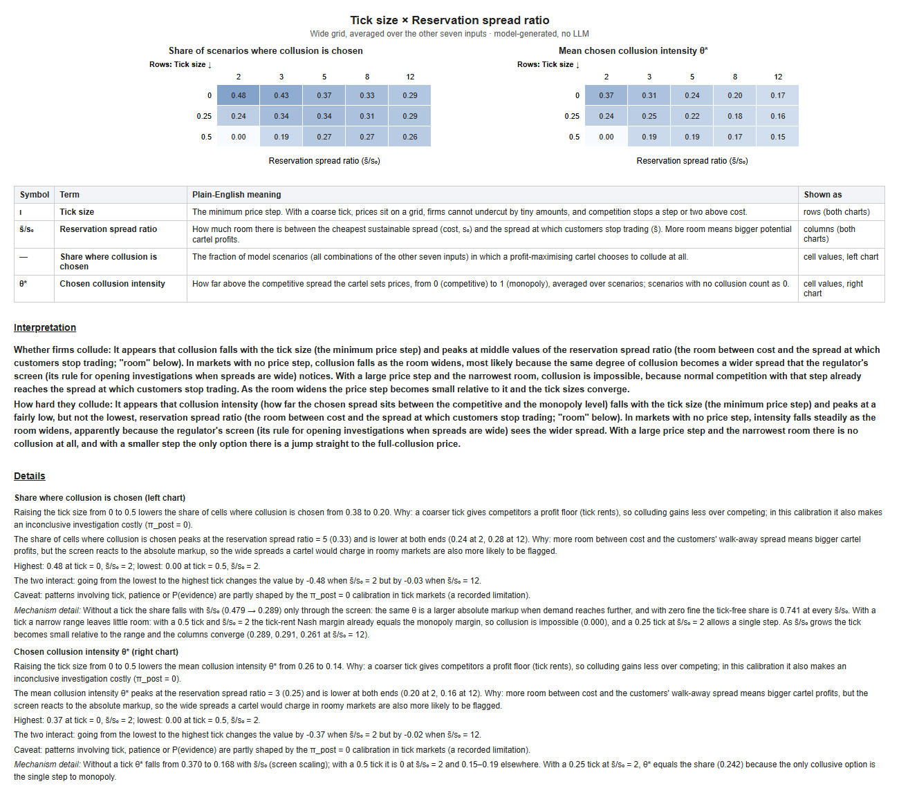

<u>**Interpretation**</u>

**Whether firms collude: It appears that collusion falls with the tick size (the minimum price step) and peaks at middle values of the reservation spread ratio (the room between cost and the spread at which customers stop trading; "room" below). In markets with no price step, collusion falls as the room widens, most likely because the same degree of collusion becomes a wider spread that the regulator's screen (its rule for opening investigations when spreads are wide) notices. With a large price step and the narrowest room, collusion is impossible, because normal competition with that step already reaches the spread at which customers stop trading. As the room widens the price step becomes small relative to it and the tick sizes converge.**

**How hard they collude: It appears that collusion intensity (how far the chosen spread sits between the competitive and the monopoly level) falls with the tick size (the minimum price step) and peaks at a fairly low, but not the lowest, reservation spread ratio (the room between cost and the spread at which customers stop trading; "room" below). In markets with no price step, intensity falls steadily as the room widens, apparently because the regulator's screen (its rule for opening investigations when spreads are wide) sees the wider spread. With a large price step and the narrowest room there is no collusion at all, and with a smaller step the only option there is a jump straight to the full-collusion price.**

## Regulator screen slope × Tip probability

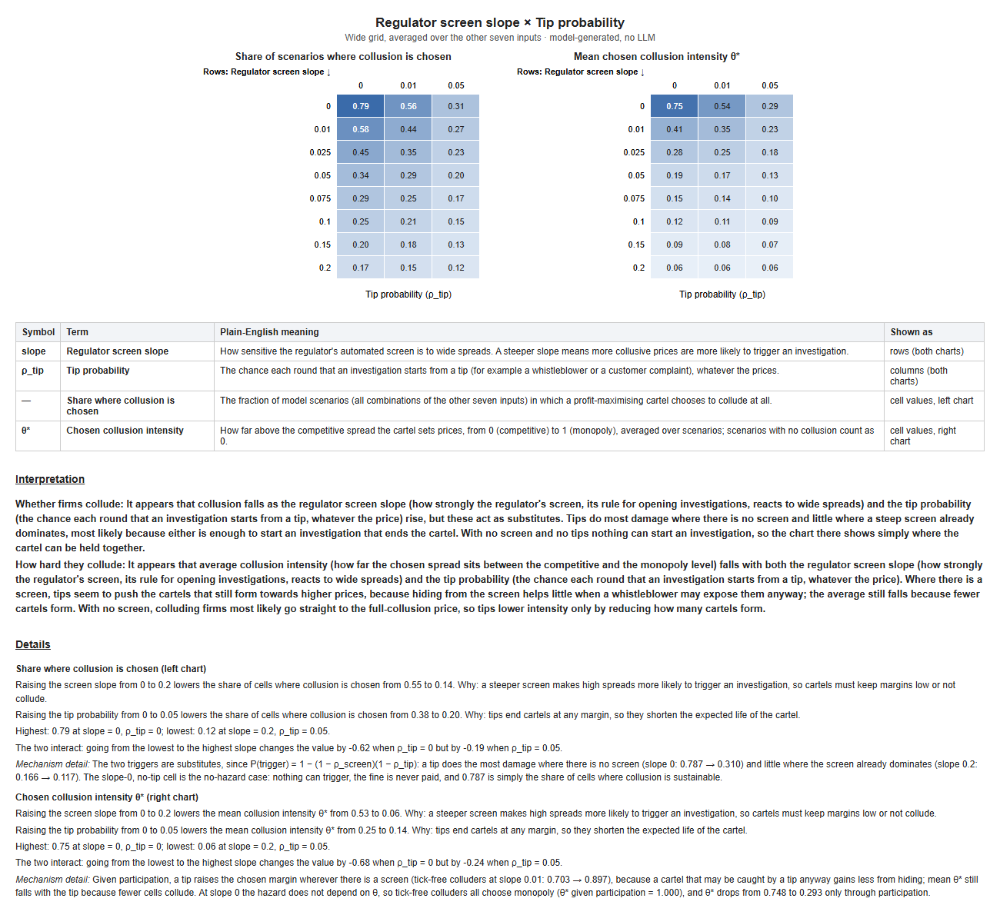

<u>**Interpretation**</u>

**Whether firms collude: It appears that collusion falls as the regulator screen slope (how strongly the regulator's screen, its rule for opening investigations, reacts to wide spreads) and the tip probability (the chance each round that an investigation starts from a tip, whatever the price) rise, but these act as substitutes. Tips do most damage where there is no screen and little where a steep screen already dominates, most likely because either is enough to start an investigation that ends the cartel. With no screen and no tips nothing can start an investigation, so the chart there shows simply where the cartel can be held together.**

**How hard they collude: It appears that average collusion intensity (how far the chosen spread sits between the competitive and the monopoly level) falls with both the regulator screen slope (how strongly the regulator's screen, its rule for opening investigations, reacts to wide spreads) and the tip probability (the chance each round that an investigation starts from a tip, whatever the price). Where there is a screen, tips seem to push the cartels that still form towards higher prices, because hiding from the screen helps little when a whistleblower may expose them anyway; the average still falls because fewer cartels form. With no screen, colluding firms most likely go straight to the full-collusion price, so tips lower intensity only by reducing how many cartels form.**

## Regulator screen slope × P(evidence | investigation)

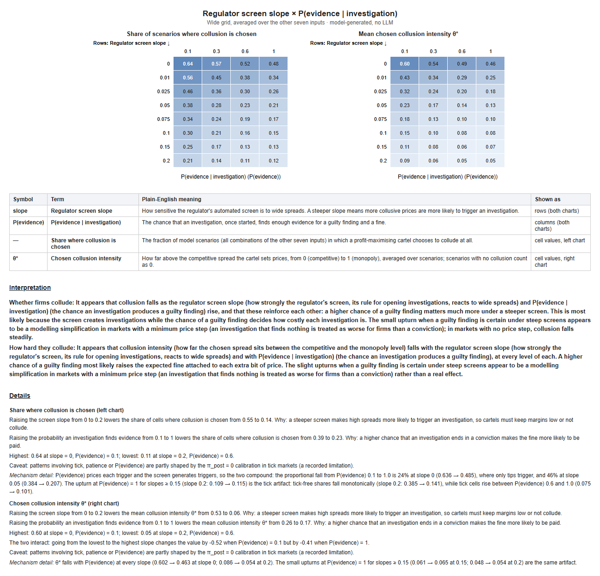

<u>**Interpretation**</u>

**Whether firms collude: It appears that collusion falls as the regulator screen slope (how strongly the regulator's screen, its rule for opening investigations, reacts to wide spreads) and P(evidence | investigation) (the chance an investigation produces a guilty finding) rise, and that these reinforce each other: a higher chance of a guilty finding matters much more under a steeper screen. This is most likely because the screen creates investigations while the chance of a guilty finding decides how costly each investigation is. The small upturn when a guilty finding is certain under steep screens appears to be a modelling simplification in markets with a minimum price step (an investigation that finds nothing is treated as worse for firms than a conviction); in markets with no price step, collusion falls steadily.**

**How hard they collude: It appears that collusion intensity (how far the chosen spread sits between the competitive and the monopoly level) falls with the regulator screen slope (how strongly the regulator's screen, its rule for opening investigations, reacts to wide spreads) and with P(evidence | investigation) (the chance an investigation produces a guilty finding), at every level of each. A higher chance of a guilty finding most likely raises the expected fine attached to each extra bit of price. The slight upturns when a guilty finding is certain under steep screens appear to be a modelling simplification in markets with a minimum price step (an investigation that finds nothing is treated as worse for firms than a conviction) rather than a real effect.**

## Regulator screen slope × Fine ratio

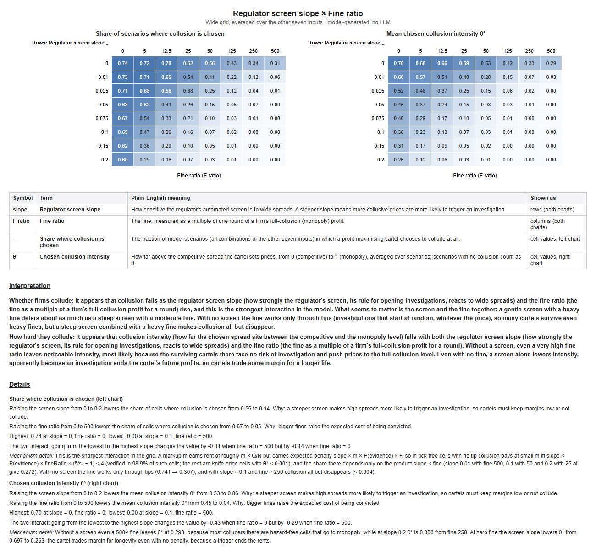

<u>**Interpretation**</u>

**Whether firms collude: It appears that collusion falls as the regulator screen slope (how strongly the regulator's screen, its rule for opening investigations, reacts to wide spreads) and the fine ratio (the fine as a multiple of a firm's full-collusion profit for a round) rise, and this is the strongest interaction in the model. What seems to matter is the screen and the fine together: a gentle screen with a heavy fine deters about as much as a steep screen with a moderate fine. With no screen the fine works only through tips (investigations that start at random, whatever the price), so many cartels survive even heavy fines, but a steep screen combined with a heavy fine makes collusion all but disappear.**

**How hard they collude: It appears that collusion intensity (how far the chosen spread sits between the competitive and the monopoly level) falls with both the regulator screen slope (how strongly the regulator's screen, its rule for opening investigations, reacts to wide spreads) and the fine ratio (the fine as a multiple of a firm's full-collusion profit for a round). Without a screen, even a very high fine ratio leaves noticeable intensity, most likely because the surviving cartels there face no risk of investigation and push prices to the full-collusion level. Even with no fine, a screen alone lowers intensity, apparently because an investigation ends the cartel's future profits, so cartels trade some margin for a longer life.**

## Regulator screen slope × Reservation spread ratio

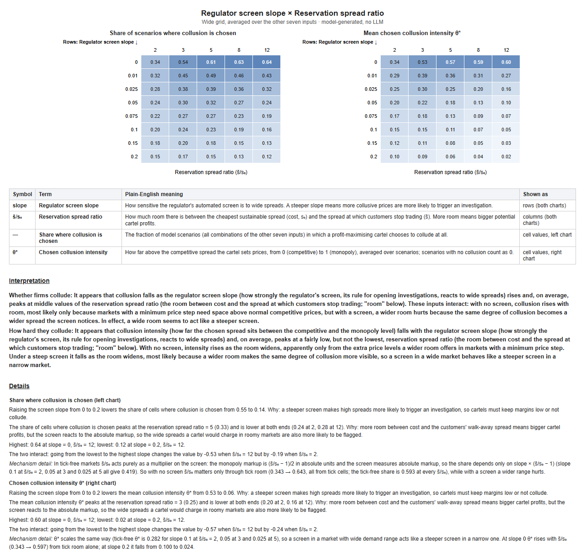

<u>**Interpretation**</u>

**Whether firms collude: It appears that collusion falls as the regulator screen slope (how strongly the regulator's screen, its rule for opening investigations, reacts to wide spreads) rises and, on average, peaks at middle values of the reservation spread ratio (the room between cost and the spread at which customers stop trading; "room" below). These inputs interact: with no screen, collusion rises with room, most likely only because markets with a minimum price step need space above normal competitive prices, but with a screen, a wider room hurts because the same degree of collusion becomes a wider spread the screen notices. In effect, a wide room seems to act like a steeper screen.**

**How hard they collude: It appears that collusion intensity (how far the chosen spread sits between the competitive and the monopoly level) falls with the regulator screen slope (how strongly the regulator's screen, its rule for opening investigations, reacts to wide spreads) and, on average, peaks at a fairly low, but not the lowest, reservation spread ratio (the room between cost and the spread at which customers stop trading; "room" below). With no screen, intensity rises as the room widens, apparently only from the extra price levels a wider room offers in markets with a minimum price step. Under a steep screen it falls as the room widens, most likely because a wider room makes the same degree of collusion more visible, so a screen in a wide market behaves like a steeper screen in a narrow market.**

## Tip probability × P(evidence | investigation)

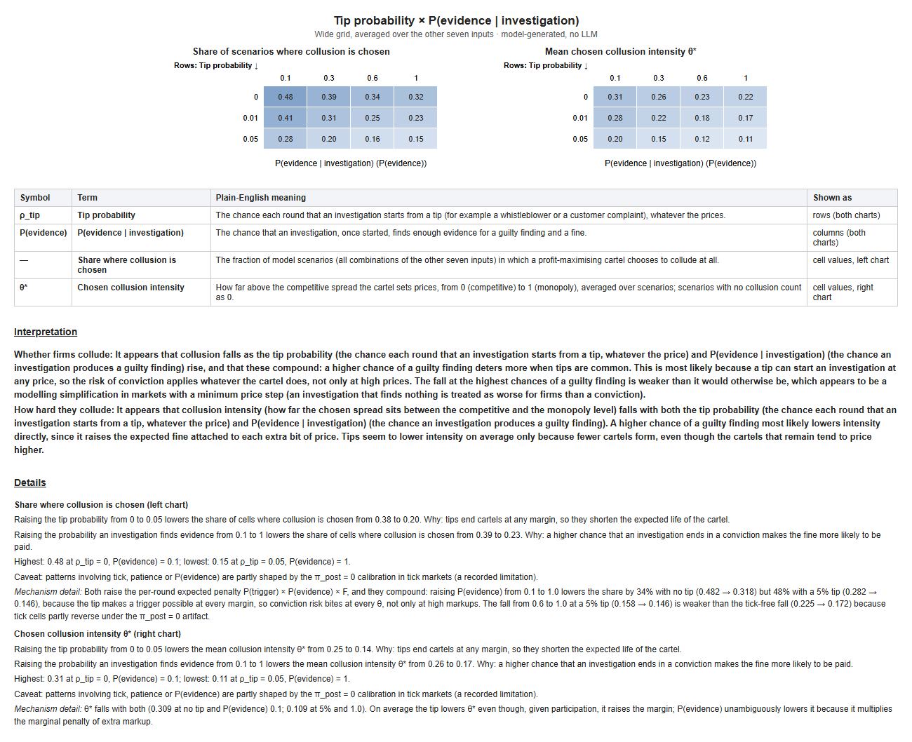

<u>**Interpretation**</u>

**Whether firms collude: It appears that collusion falls as the tip probability (the chance each round that an investigation starts from a tip, whatever the price) and P(evidence | investigation) (the chance an investigation produces a guilty finding) rise, and that these compound: a higher chance of a guilty finding deters more when tips are common. This is most likely because a tip can start an investigation at any price, so the risk of conviction applies whatever the cartel does, not only at high prices. The fall at the highest chances of a guilty finding is weaker than it would otherwise be, which appears to be a modelling simplification in markets with a minimum price step (an investigation that finds nothing is treated as worse for firms than a conviction).**

**How hard they collude: It appears that collusion intensity (how far the chosen spread sits between the competitive and the monopoly level) falls with both the tip probability (the chance each round that an investigation starts from a tip, whatever the price) and P(evidence | investigation) (the chance an investigation produces a guilty finding). A higher chance of a guilty finding most likely lowers intensity directly, since it raises the expected fine attached to each extra bit of price. Tips seem to lower intensity on average only because fewer cartels form, even though the cartels that remain tend to price higher.**

## Tip probability × Fine ratio

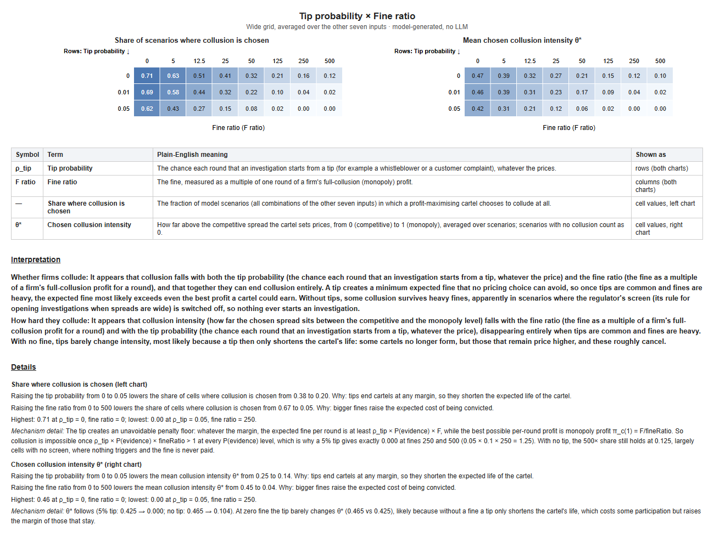

<u>**Interpretation**</u>

**Whether firms collude: It appears that collusion falls with both the tip probability (the chance each round that an investigation starts from a tip, whatever the price) and the fine ratio (the fine as a multiple of a firm's full-collusion profit for a round), and that together they can end collusion entirely. A tip creates a minimum expected fine that no pricing choice can avoid, so once tips are common and fines are heavy, the expected fine most likely exceeds even the best profit a cartel could earn. Without tips, some collusion survives heavy fines, apparently in scenarios where the regulator's screen (its rule for opening investigations when spreads are wide) is switched off, so nothing ever starts an investigation.**

**How hard they collude: It appears that collusion intensity (how far the chosen spread sits between the competitive and the monopoly level) falls with the fine ratio (the fine as a multiple of a firm's full-collusion profit for a round) and with the tip probability (the chance each round that an investigation starts from a tip, whatever the price), disappearing entirely when tips are common and fines are heavy. With no fine, tips barely change intensity, most likely because a tip then only shortens the cartel's life: some cartels no longer form, but those that remain price higher, and these roughly cancel.**

## Tip probability × Reservation spread ratio

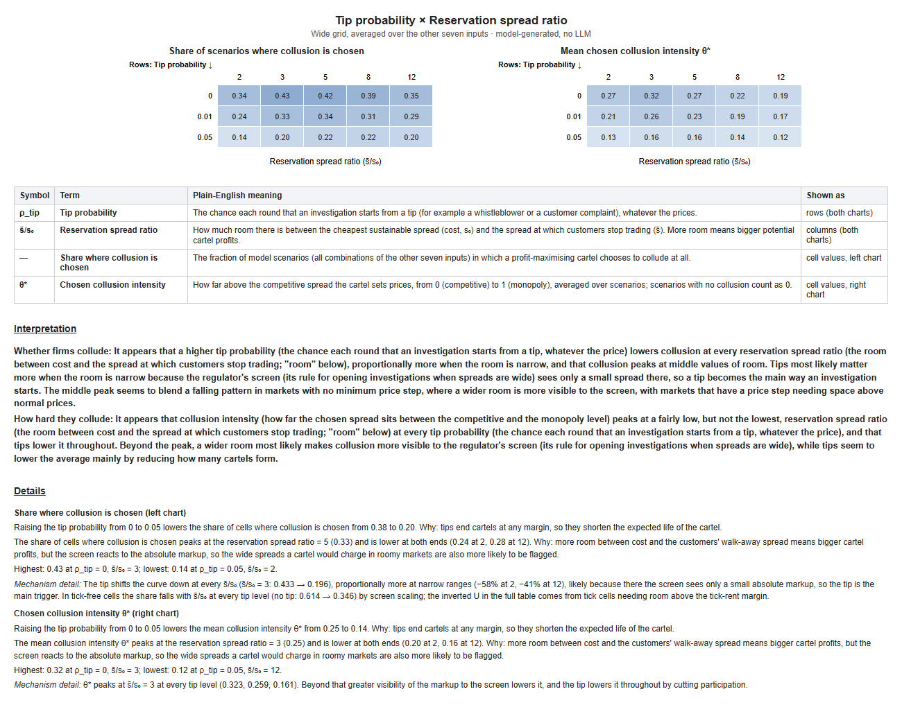

<u>**Interpretation**</u>

**Whether firms collude: It appears that a higher tip probability (the chance each round that an investigation starts from a tip, whatever the price) lowers collusion at every reservation spread ratio (the room between cost and the spread at which customers stop trading; "room" below), proportionally more when the room is narrow, and that collusion peaks at middle values of room. Tips most likely matter more when the room is narrow because the regulator's screen (its rule for opening investigations when spreads are wide) sees only a small spread there, so a tip becomes the main way an investigation starts. The middle peak seems to blend a falling pattern in markets with no minimum price step, where a wider room is more visible to the screen, with markets that have a price step needing space above normal prices.**

**How hard they collude: It appears that collusion intensity (how far the chosen spread sits between the competitive and the monopoly level) peaks at a fairly low, but not the lowest, reservation spread ratio (the room between cost and the spread at which customers stop trading; "room" below) at every tip probability (the chance each round that an investigation starts from a tip, whatever the price), and that tips lower it throughout. Beyond the peak, a wider room most likely makes collusion more visible to the regulator's screen (its rule for opening investigations when spreads are wide), while tips seem to lower the average mainly by reducing how many cartels form.**

## P(evidence | investigation) × Fine ratio

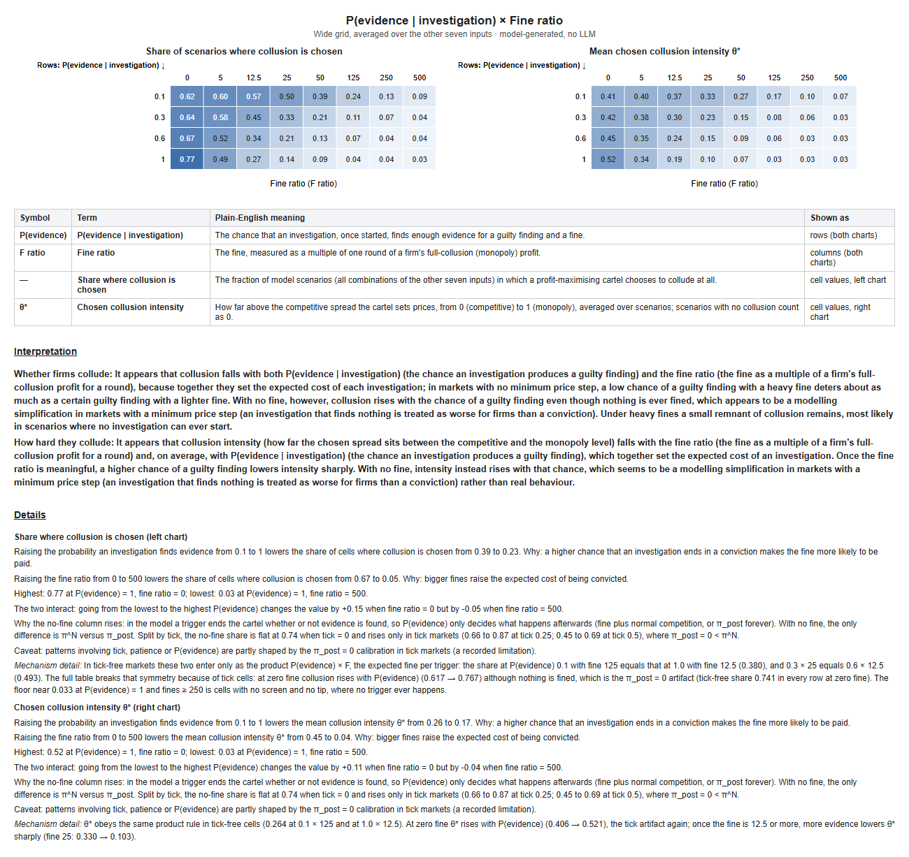

<u>**Interpretation**</u>

**Whether firms collude: It appears that collusion falls with both P(evidence | investigation) (the chance an investigation produces a guilty finding) and the fine ratio (the fine as a multiple of a firm's full-collusion profit for a round), because together they set the expected cost of each investigation; in markets with no minimum price step, a low chance of a guilty finding with a heavy fine deters about as much as a certain guilty finding with a lighter fine. With no fine, however, collusion rises with the chance of a guilty finding even though nothing is ever fined, which appears to be a modelling simplification in markets with a minimum price step (an investigation that finds nothing is treated as worse for firms than a conviction). Under heavy fines a small remnant of collusion remains, most likely in scenarios where no investigation can ever start.**

**How hard they collude: It appears that collusion intensity (how far the chosen spread sits between the competitive and the monopoly level) falls with the fine ratio (the fine as a multiple of a firm's full-collusion profit for a round) and, on average, with P(evidence | investigation) (the chance an investigation produces a guilty finding), which together set the expected cost of an investigation. Once the fine ratio is meaningful, a higher chance of a guilty finding lowers intensity sharply. With no fine, intensity instead rises with that chance, which seems to be a modelling simplification in markets with a minimum price step (an investigation that finds nothing is treated as worse for firms than a conviction) rather than real behaviour.**

## P(evidence | investigation) × Reservation spread ratio

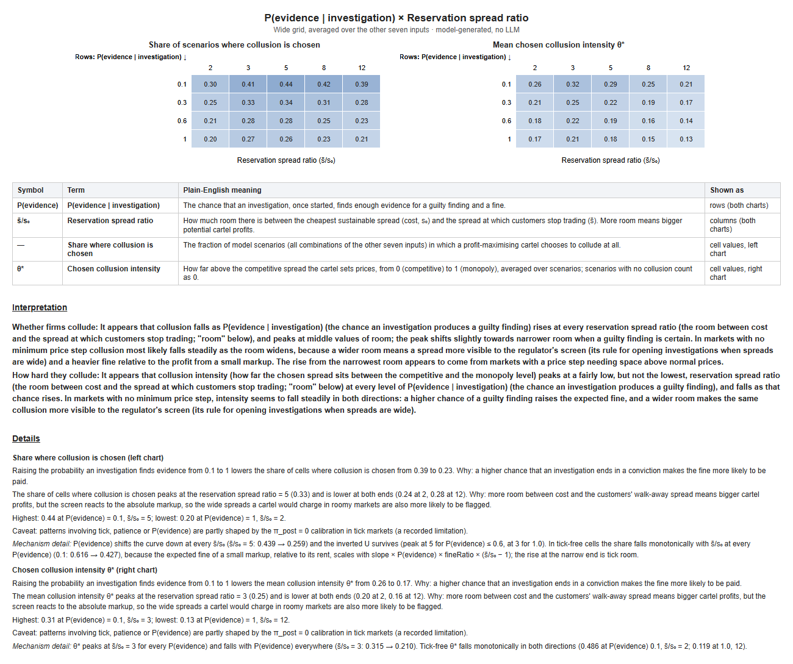

<u>**Interpretation**</u>

**Whether firms collude: It appears that collusion falls as P(evidence | investigation) (the chance an investigation produces a guilty finding) rises at every reservation spread ratio (the room between cost and the spread at which customers stop trading; "room" below), and peaks at middle values of room; the peak shifts slightly towards narrower room when a guilty finding is certain. In markets with no minimum price step collusion most likely falls steadily as the room widens, because a wider room means a spread more visible to the regulator's screen (its rule for opening investigations when spreads are wide) and a heavier fine relative to the profit from a small markup. The rise from the narrowest room appears to come from markets with a price step needing space above normal prices.**

**How hard they collude: It appears that collusion intensity (how far the chosen spread sits between the competitive and the monopoly level) peaks at a fairly low, but not the lowest, reservation spread ratio (the room between cost and the spread at which customers stop trading; "room" below) at every level of P(evidence | investigation) (the chance an investigation produces a guilty finding), and falls as that chance rises. In markets with no minimum price step, intensity seems to fall steadily in both directions: a higher chance of a guilty finding raises the expected fine, and a wider room makes the same collusion more visible to the regulator's screen (its rule for opening investigations when spreads are wide).**

## Fine ratio × Reservation spread ratio

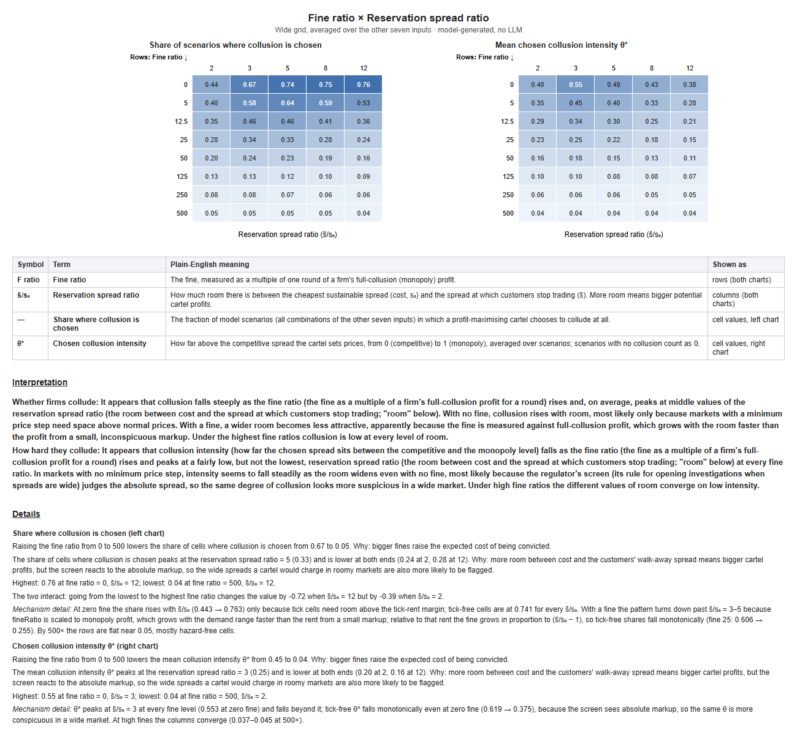

<u>**Interpretation**</u>

**Whether firms collude: It appears that collusion falls steeply as the fine ratio (the fine as a multiple of a firm's full-collusion profit for a round) rises and, on average, peaks at middle values of the reservation spread ratio (the room between cost and the spread at which customers stop trading; "room" below). With no fine, collusion rises with room, most likely only because markets with a minimum price step need space above normal prices. With a fine, a wider room becomes less attractive, apparently because the fine is measured against full-collusion profit, which grows with the room faster than the profit from a small, inconspicuous markup. Under the highest fine ratios collusion is low at every level of room.**

**How hard they collude: It appears that collusion intensity (how far the chosen spread sits between the competitive and the monopoly level) falls as the fine ratio (the fine as a multiple of a firm's full-collusion profit for a round) rises and peaks at a fairly low, but not the lowest, reservation spread ratio (the room between cost and the spread at which customers stop trading; "room" below) at every fine ratio. In markets with no minimum price step, intensity seems to fall steadily as the room widens even with no fine, most likely because the regulator's screen (its rule for opening investigations when spreads are wide) judges the absolute spread, so the same degree of collusion looks more suspicious in a wide market. Under high fine ratios the different values of room converge on low intensity.**
